## La regla de esta sesión

::: {.diagrama}
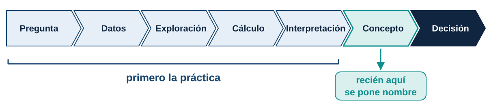{fig-alt="Cadena de siete pasos: pregunta, datos, exploración, cálculo, interpretación, concepto y decisión. El concepto aparece después de la práctica."}
:::

. . .

::: {.remate}
Primero la práctica. El nombre del concepto llega cuando ya lo necesitamos.
:::

## El caso: una plataforma de domicilios

::: {.diagrama}
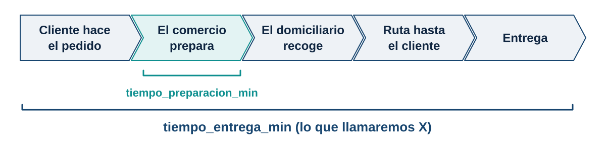{fig-alt="Cinco etapas de un pedido: el cliente lo hace, el comercio lo prepara, el domiciliario lo recoge, recorre la ruta y entrega. El tiempo de entrega abarca todas las etapas."}
:::

. . .

La plataforma registró **600 pedidos** durante varias semanas, en distintas zonas, horarios y condiciones de clima.

. . .

::: {.aviso}
La gerencia quiere publicar: **"Entregamos su pedido en máximo 45 minutos."**
:::

## Las diez preguntas de la gerencia

::: {.pasos .incremental}
1. ¿Cuánto tarda normalmente un pedido?
2. ¿Podemos saber exactamente cuánto tardará el próximo?
3. ¿Qué valores puede tomar el tiempo de entrega?
4. ¿Qué tan probable es que llegue en 30 minutos o menos?
5. ¿Y que tarde entre 30 y 45 minutos?
6. ¿Qué porcentaje se entrega en máximo 45 minutos?
7. ¿Cuánto tiempo cubre el 80, el 90 o el 95 % de los pedidos?
8. ¿La lluvia cambia la distribución de los tiempos?
9. ¿Cambia según la franja horaria?
10. ¿Es razonable prometer 45 minutos?
:::

## Ruta de la sesión

::: {.diagrama}
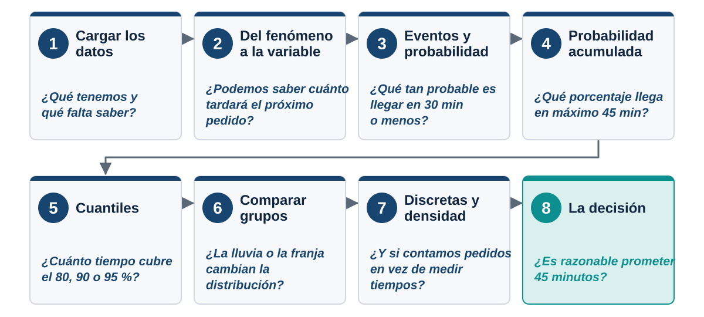{fig-alt="Ocho estaciones en dos filas: cargar los datos, del fenómeno a la variable, eventos y probabilidad, probabilidad acumulada, cuantiles, comparar grupos, discretas y densidad, y la decisión."}
:::

# Cargar los datos {.acto background-color="#0f2540"}

::: {.acto-numero}
Acto 1
:::

::: {.acto-pregunta}
¿Qué tenemos y qué nos falta saber?
:::

## Preparar el entorno {.fase-practica .compacto}

Tres bibliotecas: **pandas** para la tabla, **numpy** para el cálculo y **matplotlib** para dibujar.

. . .

```{.python #c01}
import pandas as pd
import numpy as np
import matplotlib.pyplot as plt

pd.set_option("display.width", 100)
```

. . .

Un estilo común para todas las gráficas de la sesión:

. . .

```{.python #c02}
plt.rcParams.update({
    "figure.figsize": (10, 4.6),
    "axes.spines.top": False,
    "axes.spines.right": False,
    "axes.grid": True,
    "grid.alpha": 0.25,
    "axes.titlesize": 15,
    "axes.titleweight": "bold",
    "axes.labelsize": 13,
    "font.size": 12,
    "axes.prop_cycle": plt.cycler(
        color=["#2f7bb8", "#0e8f8f", "#b7791f", "#a32d22"]
    ),
})
```

## Antes de ejecutar {.fase-pregunta}

::: {.par}
::: {.caja-pregunta .fragment}
¿Qué creen que representa cada fila?
:::
::: {.caja-respuesta .fragment}
Un pedido observado.
:::
:::

::: {.par}
::: {.caja-pregunta .fragment}
¿Qué columna usaríamos para evaluar la promesa de entrega?
:::
::: {.caja-respuesta .fragment}
`tiempo_entrega_min`, o `retrasado_45min`.
:::
:::

::: {.par}
::: {.caja-pregunta .fragment}
¿Qué columnas podrían explicar las diferencias en el tiempo?
:::
::: {.caja-respuesta .fragment}
Distancia, lluvia, preparación, franja, zona, tipo de pedido.
:::
:::

::: {.par}
::: {.caja-pregunta .fragment}
¿Qué columna guarda la incertidumbre de un pedido futuro?
:::
::: {.caja-respuesta .fragment}
`tiempo_entrega_min`: es lo que aún no sabemos.
:::
:::

## Leer el archivo {.fase-practica}

El archivo `pedidos_estadistica_analitica.csv` se descarga desde la página de la unidad y se guarda junto al cuaderno.

. . .

```{.python #c03}
df = pd.read_csv("pedidos_estadistica_analitica.csv")
```

. . .

```{.python #c04}
df.head()
```

. . .

```{=html}
<!--salida:c04-->
<table class="dataframe tabla-df">
  <thead>
    <tr style="text-align: right;">
      <th></th>
      <th>pedido_<wbr>id</th>
      <th>fecha</th>
      <th>dia_<wbr>semana</th>
      <th>hora_<wbr>pedido</th>
      <th>franja</th>
      <th>zona</th>
      <th>tipo_<wbr>pedido</th>
      <th>distancia_<wbr>km</th>
      <th>lluvia</th>
      <th>tiempo_<wbr>preparacion_<wbr>min</th>
      <th>tiempo_<wbr>entrega_<wbr>min</th>
      <th>retrasado_<wbr>45min</th>
      <th>incidencia</th>
      <th>satisfaccion</th>
    </tr>
  </thead>
  <tbody>
    <tr>
      <th>0</th>
      <td>P0001</td>
      <td>2026-08-25</td>
      <td>Martes</td>
      <td>09:30</td>
      <td>Manana</td>
      <td>Occidente</td>
      <td>Comida</td>
      <td>5.87</td>
      <td>Si</td>
      <td>14.4</td>
      <td>51.0</td>
      <td>Si</td>
      <td>Ninguna</td>
      <td>4</td>
    </tr>
    <tr>
      <th>1</th>
      <td>P0002</td>
      <td>2026-08-21</td>
      <td>Viernes</td>
      <td>17:30</td>
      <td>Tarde</td>
      <td>Occidente</td>
      <td>Comida</td>
      <td>8.43</td>
      <td>No</td>
      <td>15.5</td>
      <td>47.9</td>
      <td>Si</td>
      <td>Ninguna</td>
      <td>4</td>
    </tr>
    <tr>
      <th>2</th>
      <td>P0003</td>
      <td>2026-09-09</td>
      <td>Miercoles</td>
      <td>14:45</td>
      <td>Almuerzo</td>
      <td>Sur</td>
      <td>Comida</td>
      <td>6.32</td>
      <td>No</td>
      <td>23.8</td>
      <td>46.4</td>
      <td>Si</td>
      <td>Ninguna</td>
      <td>4</td>
    </tr>
    <tr>
      <th>3</th>
      <td>P0004</td>
      <td>2026-08-05</td>
      <td>Miercoles</td>
      <td>12:55</td>
      <td>Almuerzo</td>
      <td>Norte</td>
      <td>Mercado</td>
      <td>5.26</td>
      <td>No</td>
      <td>23.2</td>
      <td>44.9</td>
      <td>No</td>
      <td>Ninguna</td>
      <td>4</td>
    </tr>
    <tr>
      <th>4</th>
      <td>P0005</td>
      <td>2026-08-17</td>
      <td>Lunes</td>
      <td>11:40</td>
      <td>Manana</td>
      <td>Centro</td>
      <td>Comida</td>
      <td>2.51</td>
      <td>Si</td>
      <td>18.0</td>
      <td>49.2</td>
      <td>Si</td>
      <td>Ninguna</td>
      <td>4</td>
    </tr>
  </tbody>
</table>
```

. . .

::: {.remate}
Contrasten con lo que respondieron: ¿coincide con lo que ven en la tabla?
:::

## Filas y columnas {.fase-practica}

```{.python #c05}
df.shape
```

. . .

```{.salida for="c05"}
(600, 14)
```

. . .

::: {.caja-pregunta}
¿Qué significa que la tabla tenga filas y columnas?
:::

. . .

::: {.caja-respuesta}
**600** filas: 600 pedidos observados. **14** columnas: 14 características de cada pedido.
:::

## Diccionario de datos

::: {.diagrama}
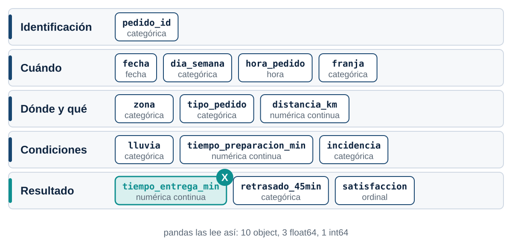{fig-alt="Las catorce columnas del archivo agrupadas en identificación, cuándo, dónde y qué, condiciones y resultado. El tiempo de entrega, en verde azulado, será la variable X."}
:::

## ¿Qué tipo de dato trae cada columna? {.fase-practica .minimo}

```{.python #c06}
df.info()
```

. . .

```{.salida for="c06"}
<class 'pandas.core.frame.DataFrame'>
RangeIndex: 600 entries, 0 to 599
Data columns (total 14 columns):
 #   Column                  Non-Null Count  Dtype  
---  ------                  --------------  -----  
 0   pedido_id               600 non-null    object 
 1   fecha                   600 non-null    object 
 2   dia_semana              600 non-null    object 
 3   hora_pedido             600 non-null    object 
 4   franja                  600 non-null    object 
 5   zona                    600 non-null    object 
 6   tipo_pedido             600 non-null    object 
 7   distancia_km            600 non-null    float64
 8   lluvia                  600 non-null    object 
 9   tiempo_preparacion_min  600 non-null    float64
 10  tiempo_entrega_min      600 non-null    float64
 11  retrasado_45min         600 non-null    object 
 12  incidencia              600 non-null    object 
 13  satisfaccion            600 non-null    int64  
dtypes: float64(3), int64(1), object(10)
memory usage: 65.8+ KB
```

## La variable de interés {.fase-practica .compacto}

Le damos un nombre corto a la columna que vamos a estudiar:

. . .

```{.python #c07}
tiempo = df["tiempo_entrega_min"]
tiempo.head(15)
```

. . .

```{.salida for="c07"}
0     51.0
1     47.9
2     46.4
3     44.9
4     49.2
5     57.5
6     34.1
7     32.5
8     63.7
9     71.9
10    34.9
11    52.7
12    33.8
13    67.4
14    47.1
Name: tiempo_entrega_min, dtype: float64
```

## Resumen numérico {.fase-practica .compacto}

```{.python #c08}
tiempo.describe()
```

. . .

```{.salida for="c08"}
count    600.000000
mean      44.223333
std       11.594048
min       12.000000
25%       36.300000
50%       43.600000
75%       51.250000
max       88.400000
Name: tiempo_entrega_min, dtype: float64
```

. . .

::: {.caja-pregunta}
¿Qué dicen juntas la media y la mediana?
:::

. . .

::: {.caja-respuesta}
Están muy cerca (44.2 y 43.6): la distribución es casi simétrica, con una cola hacia tiempos altos (máximo 88.4).
:::

# Del fenómeno a la variable aleatoria {.acto background-color="#0f2540"}

::: {.acto-numero}
Acto 2
:::

::: {.acto-pregunta}
¿Podemos saber cuánto tardará el próximo pedido?
:::

## Llega un pedido nuevo {.fase-pregunta}

::: {.caja-pregunta}
Si entra un pedido en este momento, ¿sabemos exactamente cuánto va a tardar?
:::

. . .

::: {.diagrama}
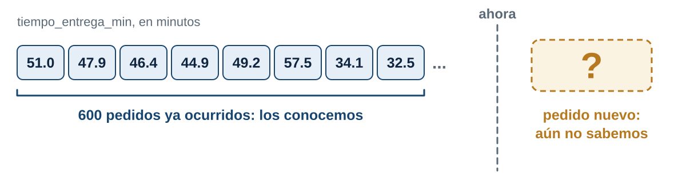{fig-alt="Seiscientos pedidos ya ocurridos con sus tiempos conocidos, una línea que marca el ahora y un pedido nuevo con tiempo desconocido."}
:::

. . .

::: {.caja-respuesta}
**No.** Conocemos la historia, pero no el resultado individual del próximo pedido.
:::

## ¿Qué hace incierto el resultado? {.fase-practica}

::: {.par}
::: {.caja-pregunta .fragment}
¿El tiempo está determinado antes de que ocurra?
:::
::: {.caja-respuesta .fragment}
No: depende de muchos factores que aún no se han dado.
:::
:::

::: {.par}
::: {.caja-pregunta .fragment}
¿Podemos repetir el proceso?
:::
::: {.caja-respuesta .fragment}
Sí: cada pedido nuevo repite el mismo proceso en condiciones parecidas.
:::
:::

::: {.par}
::: {.caja-pregunta .fragment}
¿Todos los pedidos tardan lo mismo?
:::
::: {.caja-respuesta .fragment}
No: los tiempos van de 12.0 a 88.4 minutos.
:::
:::

::: {.par}
::: {.caja-pregunta .fragment}
¿Qué produce esa variabilidad?
:::
::: {.caja-respuesta .fragment}
Distancia, lluvia, preparación, franja, tráfico, incidencias.
:::
:::

## Experimento aleatorio {.fase-concepto .imagen-baja}

::: {.concepto}
[Definición]{.rotulo}

Proceso que puede repetirse en condiciones similares, pero cuyo **resultado específico no se conoce antes de observarlo**.
:::

. . .

::: {.diagrama}
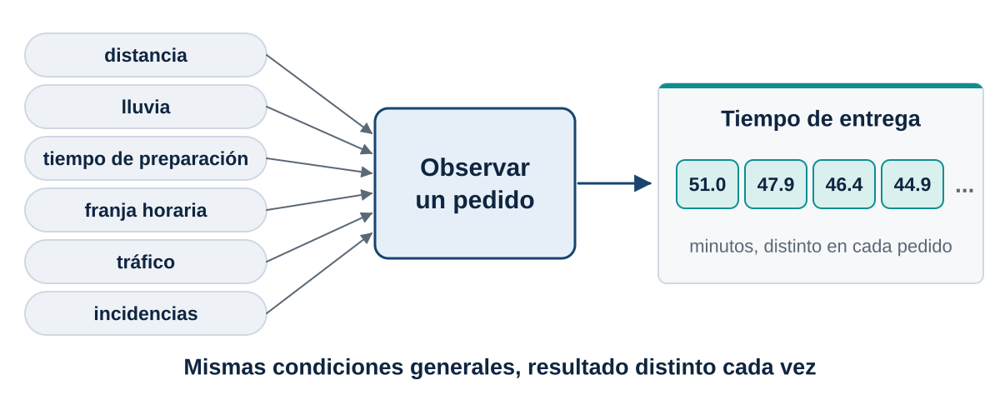{fig-alt="Seis factores (distancia, lluvia, preparación, franja, tráfico e incidencias) entran al experimento observar un pedido, que produce un tiempo de entrega distinto cada vez."}
:::

. . .

::: {.remate}
En nuestro caso: observar un pedido y registrar su tiempo total de entrega.
:::

## ¿Qué resultados puede tener? {.fase-pregunta}

::: {.caja-pregunta}
Antes de medir algo, ¿qué es lo que puede pasar?
:::

. . .

::: {.columns}
::: {.column width="45%"}
::: {.caja-pregunta}
Un dado
:::
$\Omega=\{1,2,3,4,5,6\}$
:::

::: {.column width="55%"}
::: {.caja-pregunta}
Un pedido
:::
El resultado completo es toda la fila: zona, distancia, lluvia, preparación, tráfico, incidencias y tiempo final.
:::
:::

. . .

::: {.concepto}
[Espacio muestral]{.rotulo}

Conjunto $\Omega$ de **todos los resultados posibles** del experimento.
:::

## De un pedido a un número {.fase-pregunta}

::: {.caja-pregunta}
¿Cómo convertimos cada pedido en un valor numérico que podamos analizar?
:::

. . .

No siempre necesitamos el resultado completo. Elegimos **una característica numérica**:

. . .

::: {.grande}
$X$ = tiempo total de entrega de un pedido
:::

## Variable aleatoria {.fase-concepto .imagen-baja}

::: {.concepto}
[Definición]{.rotulo}

Función que asigna un número real a cada resultado del espacio muestral:

$$X:\Omega\rightarrow\mathbb{R}$$
:::

. . .

::: {.diagrama}
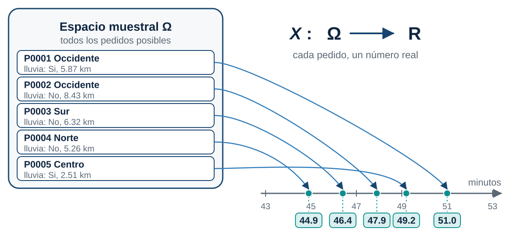{fig-alt="Cinco pedidos del espacio muestral, cada uno con una flecha hacia su valor de tiempo sobre una recta numérica en minutos."}
:::

. . .

::: {.remate}
Es aleatoria porque su valor depende de un resultado incierto.
:::

## Realizaciones de X {.fase-practica}

```{.python #c09}
tiempo.head()
```

. . .

```{.salida for="c09"}
0    51.0
1    47.9
2    46.4
3    44.9
4    49.2
Name: tiempo_entrega_min, dtype: float64
```

. . .

::: {.concepto}
[Notación]{.rotulo}

$X$ es la variable. Los valores $x_1=51.0,\; x_2=47.9,\; x_3=46.4,\dots$ son **realizaciones observadas**.
:::

::: {.par}
::: {.caja-pregunta .fragment}
¿`tiempo` es la variable aleatoria?
:::
::: {.caja-respuesta .fragment}
No. Son 600 realizaciones de $X$: los datos que ya ocurrieron.
:::
:::

## ¿Discreta o continua? {.fase-practica}

```{.python #c10}
print("Valores distintos de tiempo:", tiempo.nunique())
print("Valores distintos de satisfacción:", df["satisfaccion"].nunique())
print(sorted(df["satisfaccion"].unique().tolist()))
```

. . .

```{.salida for="c10"}
Valores distintos de tiempo: 324
Valores distintos de satisfacción: 4
[2, 3, 4, 5]
```

::: {.par}
::: {.caja-pregunta .fragment}
¿Podría el tiempo de entrega valer 20.263 minutos?
:::
::: {.caja-respuesta .fragment}
Sí. Depende de la precisión con que se mida.
:::
:::

## Discreta y continua {.fase-concepto .imagen-baja}

::: {.concepto}
[Definición]{.rotulo}

**Discreta:** toma valores separados, se cuenta.  
**Continua:** toma cualquier valor de un intervalo, se mide.
:::

. . .

::: {.diagrama}
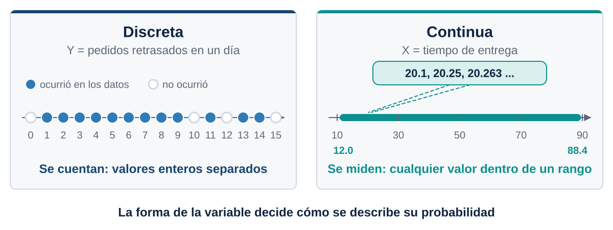{fig-alt="A la izquierda, una variable discreta con puntos aislados sobre los enteros. A la derecha, una variable continua con un segmento sin huecos."}
:::

. . .

::: {.remate}
$X$ (tiempo de entrega) es continua. $Y$ (pedidos retrasados en un día) es discreta.
:::

## Visualizar la variabilidad {.fase-practica}

```{.python #c11 fig="histograma-tiempos"}
plt.figure(figsize=(8, 5.2))
plt.hist(tiempo, bins=20, edgecolor="white")
plt.xlabel("Tiempo de entrega (min)")
plt.ylabel("Frecuencia")
plt.title("Tiempos de entrega observados")
plt.show()
```

## Leer el histograma {.fase-practica .grafico}

::: {.columns}
::: {.column width="54%"}
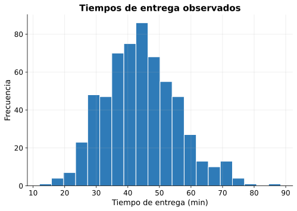{fig-alt="Histograma de los tiempos de entrega, con la mayoría de pedidos entre 35 y 55 minutos y una cola hacia la derecha."}
:::
::: {.column width="46%"}
::: {.par .apilado}
::: {.caja-pregunta .fragment}
¿Todos los tiempos son igualmente frecuentes?
:::
::: {.caja-respuesta .fragment}
No: unos valores aparecen mucho más que otros.
:::
:::

::: {.par .apilado}
::: {.caja-pregunta .fragment}
¿Dónde se concentra la mayoría?
:::
::: {.caja-respuesta .fragment}
Entre 35 y 55 minutos.
:::
:::

::: {.par .apilado}
::: {.caja-pregunta .fragment}
¿Hay pedidos muy lentos?
:::
::: {.caja-respuesta .fragment}
Sí: una cola hacia la derecha.
:::
:::

::: {.par .apilado}
::: {.caja-pregunta .fragment}
¿Una frecuencia es una probabilidad?
:::
::: {.caja-respuesta .fragment}
Todavía no. Falta dividir entre el total.
:::
:::
:::
:::

## Distribución {.fase-concepto}

::: {.concepto}
[Idea]{.rotulo}

Los valores de una variable **no aparecen todos con la misma frecuencia**. La forma en que se reparten es su **distribución**.
:::

. . .

::: {.remate}
El histograma es una foto de la distribución de $X$ en nuestros 600 pedidos.
:::

# Eventos y probabilidad {.acto background-color="#0f2540"}

::: {.acto-numero}
Acto 3
:::

::: {.acto-pregunta}
¿Qué tan probable es que un pedido llegue en 30 minutos o menos?
:::

## ¿Cuántos pedidos llegaron en 30 minutos o menos? {.fase-pregunta .compacto}

La empresa considera satisfactoria una entrega en máximo 30 minutos. Python responde `True` o `False` para cada pedido. Después miramos los que sí cumplen:

. . .

```{.python #c12}
A = tiempo <= 30
print(A.head(10).tolist())
print(tiempo[A].head(5).tolist())
```

. . .

```{.salida for="c12"}
[False, False, False, False, False, False, False, False, False, False]
[23.9, 27.8, 22.1, 25.8, 28.0]
```

## Contar los casos favorables {.fase-practica}

```{.python #c13}
print(A.sum())
print(len(A))
print(A.mean())
```

. . .

```{.salida for="c13"}
66
600
0.11
```

. . .

::: {.caja-pregunta}
¿Por qué la media de una serie de `True` y `False` es una proporción?
:::

. . .

::: {.caja-respuesta}
Python cuenta `True` como 1 y `False` como 0: promediar es dividir los casos favorables entre el total.
:::

## Evento {.fase-concepto}

::: {.concepto}
[Definición]{.rotulo}

Conjunto de resultados del espacio muestral que **cumplen una condición**.

$$A=\{X\le 30\}$$
:::

. . .

Cada `True` de la serie `A` es un pedido que pertenece al evento.

. . .

::: {.remate}
La condición se escribe en Python con un operador de comparación.
:::

## De la frecuencia a la probabilidad {.fase-practica}

```{.python #c14}
p_30 = (tiempo <= 30).mean()
print(f"P(X <= 30) = {p_30:.3f}")
```

. . .

```{.salida for="c14"}
P(X <= 30) = 0.110
```

. . .

::: {.diagrama}
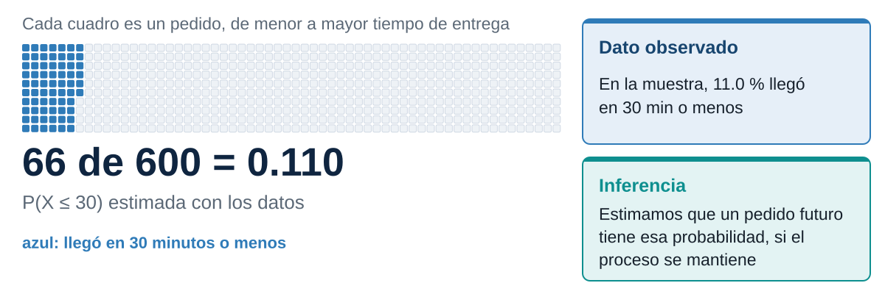{fig-alt="Una cuadrícula de 600 cuadros, uno por pedido, con 66 resaltados que cumplen el evento. La proporción es 0.110. A la derecha, la diferencia entre dato observado e inferencia."}
:::

## Probabilidad empírica {.fase-concepto}

::: {.concepto}
[Definición]{.rotulo}

$$\hat P(A)=\frac{\text{casos favorables}}{\text{casos totales}}$$
:::

. . .

**Dato observado:** en la muestra, el 11.0 % de los pedidos llegó en 30 minutos o menos.

. . .

**Inferencia:** si estos pedidos representan el proceso, esa proporción **estima** la probabilidad de que un pedido futuro tarde máximo 30 minutos.

## Otros eventos {.fase-practica .compacto}

Tres preguntas, tres eventos:

. . .

```{.python #c15}
p_le_45 = (tiempo <= 45).mean()
p_gt_60 = (tiempo > 60).mean()
p_30_45 = ((tiempo > 30) & (tiempo <= 45)).mean()

print(f"P(X <= 45)      = {p_le_45:.3f}")
print(f"P(X > 60)       = {p_gt_60:.3f}")
print(f"P(30 < X <= 45) = {p_30_45:.3f}")
```

. . .

```{.salida for="c15"}
P(X <= 45)      = 0.548
P(X > 60)       = 0.088
P(30 < X <= 45) = 0.438
```

## Preguntas sobre el operador & {.fase-pregunta}

::: {.par}
::: {.caja-pregunta .fragment}
¿Qué significa `&` en la tercera línea?
:::
::: {.caja-respuesta .fragment}
Que se cumplan las dos condiciones a la vez.
:::
:::

::: {.par}
::: {.caja-pregunta .fragment}
¿Por qué necesitamos dos condiciones?
:::
::: {.caja-respuesta .fragment}
Porque el evento es un intervalo: tiene un límite inferior y uno superior.
:::
:::

::: {.par}
::: {.caja-pregunta .fragment}
¿Importa la diferencia entre $30<X<45$ y $30\le X\le 45$?
:::
::: {.caja-respuesta .fragment}
En una variable continua, casi nada: los valores exactos en un punto tienen probabilidad cero.
:::
:::

## Cuatro eventos que no se traslapan {.fase-practica}

::: {.diagrama}
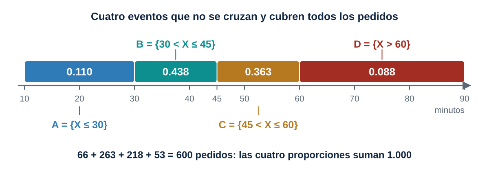{fig-alt="Eje de tiempo con cuatro eventos disjuntos: hasta 30 minutos, entre 30 y 45, entre 45 y 60, y más de 60, con sus proporciones. Suman uno."}
:::

## Complemento {.fase-practica .compacto}

```{.python #c16}
p_le_45 = (tiempo <= 45).mean()
p_gt_45 = (tiempo > 45).mean()

print(f"{p_le_45:.3f} + {p_gt_45:.3f} = {p_le_45 + p_gt_45:.3f}")
```

. . .

```{.salida for="c16"}
0.548 + 0.452 = 1.000
```

. . .

::: {.concepto}
[Regla]{.rotulo}

$A^c=\{X>45\}$ es el **complemento** de $A=\{X\le 45\}$:

$$P(A^c)=1-P(A)$$
:::

## Complemento en un dibujo

::: {.diagrama}
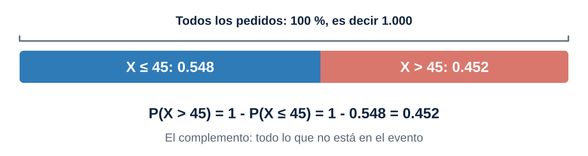{fig-alt="Una barra al cien por ciento dividida entre los pedidos de hasta 45 minutos, con 0.548, y los de más de 45 minutos, con 0.452."}
:::

## Calcula tú {.fase-actividad}

Con lo que ya sabemos, calcula:

. . .

1. $P(X\le 35)$  
2. $P(X>55)$

. . .

```{.python #c17}
p_35 = (tiempo <= 35).mean()
p_55 = (tiempo > 55).mean()

print(f"P(X <= 35) = {p_35:.3f}")
print(f"P(X > 55)  = {p_55:.3f}")
```

. . .

```{.salida for="c17"}
P(X <= 35) = 0.218
P(X > 55)  = 0.167
```

# Probabilidad acumulada {.acto background-color="#0f2540"}

::: {.acto-numero}
Acto 4
:::

::: {.acto-pregunta}
¿Qué porcentaje de pedidos llega en máximo 45 minutos... o en cualquier otro límite?
:::

## ¿Y si cambiamos el límite? {.fase-pregunta .compacto}

::: {.caja-pregunta}
¿Qué probabilidad hay de que el pedido llegue antes de distintos límites de tiempo?
:::

. . .

```{.python #c20}
limites = [20, 25, 30, 35, 40, 45, 50, 55, 60, 70]

for t in limites:
    p = (tiempo <= t).mean()
    print(f"P(X <= {t}) = {p:.3f}")
```

. . .

```{.salida for="c20"}
P(X <= 20) = 0.008
P(X <= 25) = 0.028
P(X <= 30) = 0.110
P(X <= 35) = 0.218
P(X <= 40) = 0.368
P(X <= 45) = 0.548
P(X <= 50) = 0.710
P(X <= 55) = 0.833
P(X <= 60) = 0.912
P(X <= 70) = 0.970
```

## La tabla acumulada {.fase-practica .compacto}

```{.python #c21}
tabla_acumulada = pd.DataFrame({
    "x": limites,
    "P(X<=x)": [(tiempo <= t).mean() for t in limites],
})
tabla_acumulada.round(3)
```

. . .

```{.salida for="c21"}
    x  P(X<=x)
0  20    0.008
1  25    0.028
2  30    0.110
3  35    0.218
4  40    0.368
5  45    0.548
6  50    0.710
7  55    0.833
8  60    0.912
9  70    0.970
```

## Lo que muestra la tabla {.fase-pregunta}

::: {.par}
::: {.caja-pregunta .fragment}
¿Por qué las probabilidades nunca bajan al aumentar $x$?
:::
::: {.caja-respuesta .fragment}
Cada evento $\{X\le x\}$ contiene al anterior.
:::
:::

::: {.par}
::: {.caja-pregunta .fragment}
¿Qué pasa con $x$ extremadamente pequeño?
:::
::: {.caja-respuesta .fragment}
La probabilidad se acerca a 0.
:::
:::

::: {.par}
::: {.caja-pregunta .fragment}
¿Y con $x$ extremadamente grande?
:::
::: {.caja-respuesta .fragment}
Se acerca a 1.
:::
:::

::: {.par}
::: {.caja-pregunta .fragment}
¿Qué tiene $\{X\le 40\}$ que no tenga $\{X\le 30\}$?
:::
::: {.caja-respuesta .fragment}
Los pedidos entre 30 y 40 minutos.
:::
:::

::: {.par}
::: {.caja-pregunta .fragment}
¿Qué estamos acumulando?
:::
::: {.caja-respuesta .fragment}
La probabilidad de todos los valores hasta $x$.
:::
:::

## Acumular es sumar de izquierda a derecha

::: {.diagrama}
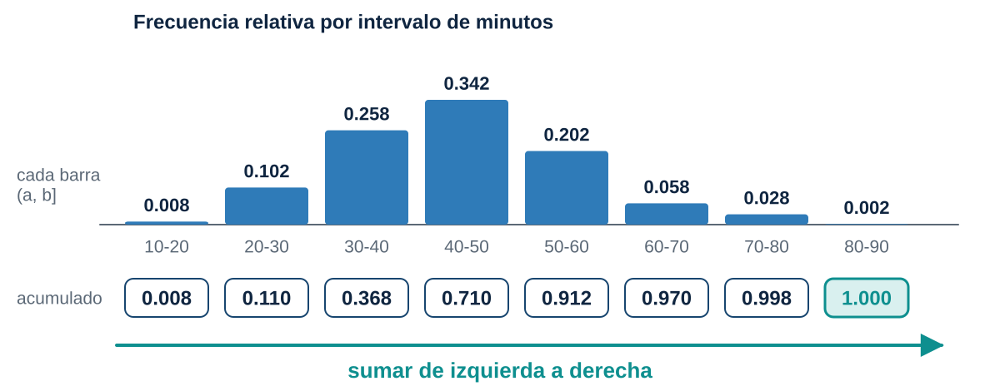{fig-alt="Histograma en intervalos de diez minutos con la proporción de cada barra y debajo la suma acumulada, que termina en uno."}
:::

## Función de distribución acumulada {.fase-concepto}

::: {.concepto}
[Definición]{.rotulo}

$$\boxed{F_X(x)=P(X\le x)}$$
:::

. . .

A cada valor $x$ le asigna la **probabilidad acumulada** hasta ese punto.

. . .

En los datos: $F_X(40)\approx 0.368$. El 36.8 % de los pedidos tarda 40 minutos o menos.

. . .

::: {.remate}
Sigla en inglés: **CDF**, cumulative distribution function.
:::

## Construir la CDF empírica {.fase-practica .compacto}

Ordenamos los tiempos y a cada uno le asignamos su lugar dividido entre $n$:

. . .

```{.python #c22}
x = np.sort(tiempo.to_numpy())
F = np.arange(1, len(x) + 1) / len(x)
```

. . .

```{.python #c23}
pd.DataFrame({"x": x[:10], "F(x)": F[:10]})
```

. . .

```{.salida for="c23"}
      x      F(x)
0  12.0  0.001667
1  16.4  0.003333
2  16.8  0.005000
3  17.3  0.006667
4  18.1  0.008333
5  21.3  0.010000
6  22.0  0.011667
7  22.0  0.013333
8  22.1  0.015000
9  22.1  0.016667
```

## Cómo se construye, paso a paso

::: {.diagrama}
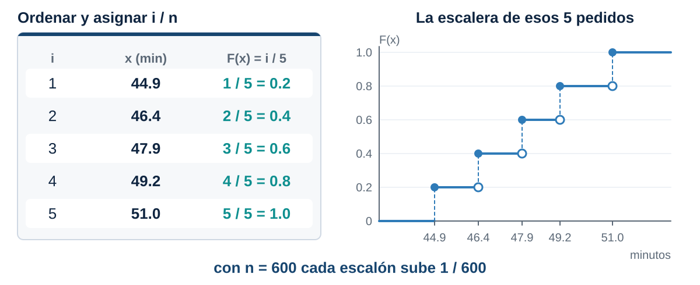{fig-alt="Cinco valores ordenados reciben los acumulados 0.2, 0.4, 0.6, 0.8 y 1.0 y forman una escalera. Con seiscientos pedidos cada escalón sube 1/600."}
:::

## Graficar la CDF empírica {.fase-practica}

```{.python #c24 fig="cdf-empirica"}
plt.figure(figsize=(8, 5.2))
plt.step(x, F, where="post")
plt.xlabel("Tiempo de entrega (min)")
plt.ylabel("F(x) = P(X <= x)")
plt.title("CDF empírica del tiempo de entrega")
plt.ylim(0, 1.02)
plt.show()
```

## Leer la CDF {.fase-practica .grafico}

::: {.columns}
::: {.column width="54%"}
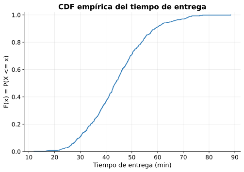{fig-alt="Función de distribución acumulada empírica: una escalera que sube de 0 a 1 entre 12 y 88 minutos, con mayor pendiente cerca de 45 minutos."}
:::
::: {.column width="46%"}
::: {.par .apilado}
::: {.caja-pregunta .fragment}
¿Dónde crece más rápido la curva?
:::
::: {.caja-respuesta .fragment}
Entre 35 y 55 minutos: ahí se concentran los pedidos.
:::
:::

::: {.par .apilado}
::: {.caja-pregunta .fragment}
¿Qué indica una zona casi horizontal?
:::
::: {.caja-respuesta .fragment}
Casi no hay pedidos con esos tiempos.
:::
:::

::: {.par .apilado}
::: {.caja-pregunta .fragment}
¿Por qué nunca baja?
:::
::: {.caja-respuesta .fragment}
Solo acumula: nunca resta probabilidad.
:::
:::

::: {.par .apilado}
::: {.caja-pregunta .fragment}
¿Por qué termina cerca de 1?
:::
::: {.caja-respuesta .fragment}
Al final ya están todos los pedidos.
:::
:::
:::
:::

## Propiedades de toda CDF {.fase-concepto}

::: {.diagrama}
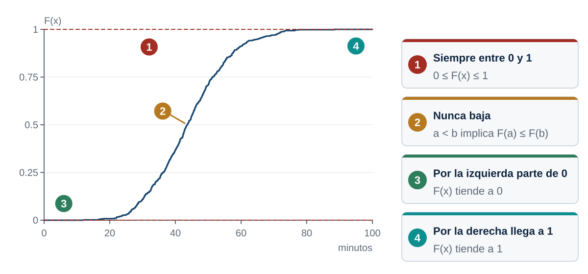{fig-alt="Curva de la CDF empírica con cuatro propiedades numeradas: siempre entre 0 y 1, nunca baja, por la izquierda parte de 0 y por la derecha llega a 1."}
:::

## Usar la CDF para calcular intervalos {.fase-practica .compacto}

::: {.caja-pregunta}
¿Cómo obtenemos $P(30<X\le 45)$ solo con la CDF?
:::

. . .

```{.python #c25}
F45 = (tiempo <= 45).mean()
F30 = (tiempo <= 30).mean()
directa = ((tiempo > 30) & (tiempo <= 45)).mean()

print(f"Directa:       {directa:.3f}")
print(f"F(45) - F(30): {F45 - F30:.3f}")
```

. . .

```{.salida for="c25"}
Directa:       0.438
F(45) - F(30): 0.438
```

. . .

::: {.concepto}
[Regla]{.rotulo}

$$P(a<X\le b)=F(b)-F(a)$$
:::

## El intervalo en la curva

::: {.diagrama}
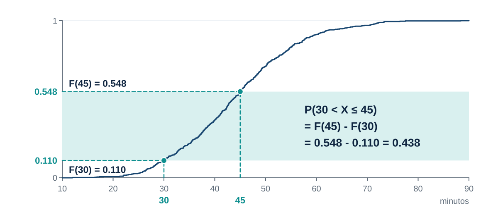{fig-alt="La CDF empírica con guías en 30 y 45 minutos que muestran F(30) igual a 0.110 y F(45) igual a 0.548. La distancia vertical entre ambas es la probabilidad del intervalo, 0.438."}
:::

## Calcula tú {.fase-actividad}

Con la CDF, calcula:

. . .

$P(35<X\le 50)$

. . .

```{.python #c26}
F50 = (tiempo <= 50).mean()
F35 = (tiempo <= 35).mean()

print(f"P(35 < X <= 50) = {F50 - F35:.3f}")
```

. . .

```{.salida for="c26"}
P(35 < X <= 50) = 0.492
```

## De la idea al código reutilizable {.fase-practica .compacto}

Lo que hicimos varias veces se convierte en dos funciones:

. . .

```{.python #c27}
def ecdf(datos):
    x = np.sort(np.asarray(datos))
    y = np.arange(1, len(x) + 1) / len(x)
    return x, y


def F_empirica(datos, x):
    return np.mean(np.asarray(datos) <= x)
```

. . .

```{.python #c28}
x, F = ecdf(tiempo)
print(f"F(45) = {F_empirica(tiempo, 45):.3f}")
```

. . .

```{.salida for="c28"}
F(45) = 0.548
```

## Preguntas sobre las funciones {.fase-pregunta}

::: {.par}
::: {.caja-pregunta .fragment}
¿Por qué ordenamos los datos en `ecdf`?
:::
::: {.caja-respuesta .fragment}
Para que el lugar de cada valor sea su porcentaje acumulado.
:::
:::

::: {.par}
::: {.caja-pregunta .fragment}
¿Por qué dividimos entre `len(x)`?
:::
::: {.caja-respuesta .fragment}
Para que el acumulado sea una proporción entre 0 y 1.
:::
:::

::: {.par}
::: {.caja-pregunta .fragment}
¿Por qué el último valor de `F` es 1?
:::
::: {.caja-respuesta .fragment}
Porque el último dato ya tiene a todos los demás por debajo.
:::
:::

## La CDF empírica como promedio {.fase-concepto}

::: {.concepto}
[Fórmula]{.rotulo}

$$\hat F_n(x)=\frac{1}{n}\sum_{i=1}^{n} I(X_i\le x)$$
:::

. . .

Para cada observación se pregunta $X_i\le x$: si sí vale 1, si no vale 0. Después se promedia.

. . .

Es exactamente lo que hace, en una línea:

. . .

```python
(tiempo <= 45).mean()
```

# Cuantiles {.acto background-color="#0f2540"}

::: {.acto-numero}
Acto 5
:::

::: {.acto-pregunta}
¿Cuánto tiempo necesito para cubrir el 80, el 90 o el 95 % de los pedidos?
:::

## Invertir la pregunta {.fase-pregunta}

::: {.columns}
::: {.column width="50%"}
::: {.caja-respuesta}
**Hasta ahora**
Si tengo 40 minutos, ¿qué porcentaje ya llegó?
:::
:::

::: {.column width="50%"}
::: {.caja-pregunta}
**Ahora**
Si quiero cubrir el 90 %, ¿cuántos minutos necesito?
:::
:::
:::

. . .

Conocemos la probabilidad y buscamos el valor de $x$.

## Cuánto tiempo cubre cada porcentaje {.fase-practica .compacto}

```{.python #c30}
for p in [0.50, 0.80, 0.90, 0.95]:
    minutos = tiempo.quantile(p)
    print(f"Cubrir el {p:.0%} de los pedidos: {minutos:.1f} min")
```

. . .

```{.salida for="c30"}
Cubrir el 50% de los pedidos: 43.6 min
Cubrir el 80% de los pedidos: 53.8 min
Cubrir el 90% de los pedidos: 58.9 min
Cubrir el 95% de los pedidos: 65.2 min
```

. . .

::: {.caja-pregunta}
¿Cómo se lee el resultado del 90 %?
:::

. . .

::: {.caja-respuesta}
Aproximadamente el 90 % de los pedidos observados tarda **58.9 minutos o menos**.
:::

## Cuantil {.fase-concepto .imagen-baja}

::: {.concepto}
[Definición]{.rotulo}

El **cuantil** $q_p$ es el valor que deja una proporción $p$ de las observaciones por debajo:

$$F(q_p)\approx p$$
:::

. . .

El percentil 90 es el cuantil $q_{0.90}$. La mediana es $q_{0.50}$.

. . .

::: {.diagrama}
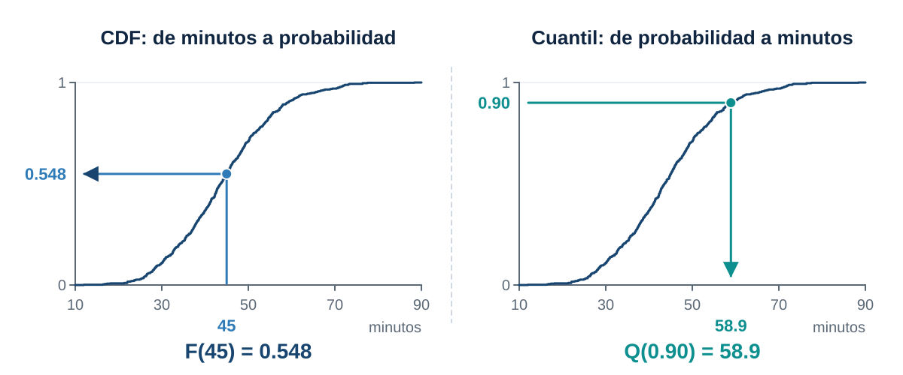{fig-alt="Dos paneles con la misma CDF. A la izquierda se va de 45 minutos a la probabilidad 0.548. A la derecha se va de la probabilidad 0.90 a 58.9 minutos."}
:::

## Dos direcciones sobre la misma curva {.fase-concepto}

::: {.columns}
::: {.column width="50%"}
::: {.concepto}
[CDF]{.rotulo}

$x\rightarrow F(x)$

De minutos a probabilidad.
:::
:::

::: {.column width="50%"}
::: {.concepto}
[Cuantil]{.rotulo}

$p\rightarrow Q(p)$

De probabilidad a minutos.
:::
:::
:::

. . .

$$Q(p)\approx F^{-1}(p)$$

. . .

::: {.remate}
Esta conexión es fundamental en analítica: la promesa de un servicio es un cuantil.
:::

## Calcula tú {.fase-actividad}

Encuentra el percentil 75 y el percentil 90 del tiempo de entrega.

. . .

```{.python #c31}
tiempo.quantile([0.75, 0.90])
```

. . .

```{.salida for="c31"}
0.75    51.25
0.90    58.92
Name: tiempo_entrega_min, dtype: float64
```

# Comparar grupos {.acto background-color="#0f2540"}

::: {.acto-numero}
Acto 6
:::

::: {.acto-pregunta}
¿La lluvia o la franja horaria cambian la distribución del tiempo?
:::

## Con lluvia y sin lluvia {.fase-practica .compacto}

```{.python #c40}
df.groupby("lluvia")["tiempo_entrega_min"].describe().round(1)
```

. . .

```{.salida for="c40"}
        count  mean   std   min   25%   50%   75%   max
lluvia                                                 
No      430.0  41.9  11.1  12.0  34.0  41.2  48.7  76.4
Si      170.0  50.0  10.8  22.0  43.2  49.0  56.6  88.4
```

. . .

::: {.caja-pregunta}
¿Qué diferencia salta a la vista?
:::

. . .

::: {.caja-respuesta}
Con lluvia la media y la mediana suben alrededor de 8 minutos.
:::

## El cumplimiento de 45 minutos en cada grupo {.fase-practica .compacto}

```{.python #c41}
cumple_lluvia = (tiempo <= 45).groupby(df["lluvia"]).mean()
cumple_lluvia.round(3)
```

. . .

```{.salida for="c41"}
lluvia
No    0.628
Si    0.347
Name: tiempo_entrega_min, dtype: float64
```

. . .

::: {.concepto}
[Adelanto]{.rotulo}

Calcular $P(X\le 45)$ **dentro de un grupo** es una probabilidad condicional: $P(X\le 45\mid \text{lluvia})$. En el Tema 2 la formalizamos.
:::

## Una CDF por grupo {.fase-practica .compacto}

```{.python #c42 fig="cdf-lluvia"}
plt.figure(figsize=(8, 5.2))

for condicion, grupo in df.groupby("lluvia"):
    x_g, F_g = ecdf(grupo["tiempo_entrega_min"])
    plt.step(x_g, F_g, where="post", label=condicion)

plt.xlabel("Tiempo de entrega (min)")
plt.ylabel("Probabilidad acumulada")
plt.title("CDF empírica según lluvia")
plt.legend(title="Lluvia")
plt.show()
```

## Leer dos curvas {.fase-practica .grafico}

::: {.columns}
::: {.column width="54%"}
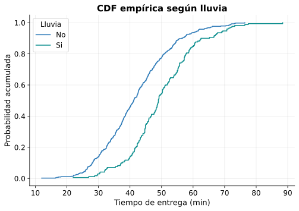{fig-alt="Dos CDF empíricas: la de los pedidos con lluvia queda desplazada a la derecha de la de los pedidos sin lluvia."}
:::
::: {.column width="46%"}
::: {.par .apilado}
::: {.caja-pregunta .fragment}
¿Coinciden las curvas?
:::
::: {.caja-respuesta .fragment}
No: la de lluvia está más a la derecha.
:::
:::

::: {.par .apilado}
::: {.caja-pregunta .fragment}
En 45 minutos, ¿qué grupo lleva más probabilidad acumulada?
:::
::: {.caja-respuesta .fragment}
Sin lluvia: 0.628 contra 0.347.
:::
:::

::: {.par .apilado}
::: {.caja-pregunta .fragment}
Si una curva está desplazada a la derecha, ¿qué significa?
:::
::: {.caja-respuesta .fragment}
Sus tiempos son mayores para la misma probabilidad.
:::
:::
:::
:::

## ¿La lluvia es la causa? {.fase-pregunta}

::: {.caja-pregunta}
¿Podemos afirmar que la lluvia produce los retrasos?
:::

. . .

::: {.diagrama}
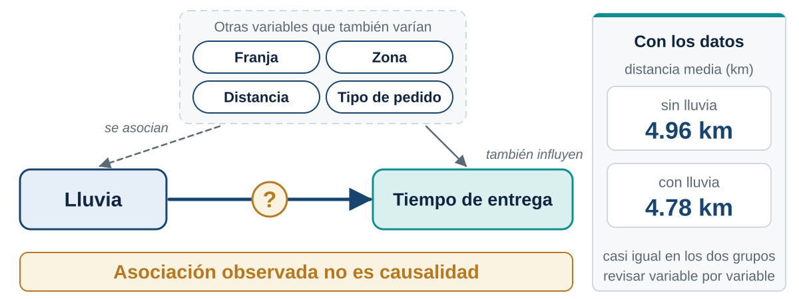{fig-alt="Lluvia y tiempo de entrega unidos por una flecha con signo de interrogación, y otros factores como franja, zona, distancia y tipo de pedido que también apuntan al tiempo."}
:::

. . .

::: {.caja-respuesta}
No solo con esta gráfica. Vemos una **asociación**; la causalidad exige revisar otros factores.
:::

## Revisar un posible factor de confusión {.fase-practica .compacto}

```{.python #c43}
df.groupby("lluvia")[["distancia_km", "tiempo_preparacion_min"]].mean().round(2)
```

. . .

```{.salida for="c43"}
        distancia_km  tiempo_preparacion_min
lluvia                                      
No              4.96                   14.59
Si              4.78                   14.41
```

. . .

::: {.caja-pregunta}
¿La lluvia trae pedidos más lejanos o con más preparación?
:::

. . .

::: {.caja-respuesta}
No: las medias son casi iguales. Esa parte de la diferencia no viene de la distancia ni de la preparación.
:::

## Por franja horaria {.fase-practica .compacto}

```{.python #c44}
df.groupby("franja")["tiempo_entrega_min"].describe().round(1)
```

. . .

```{.salida for="c44"}
          count  mean   std   min   25%   50%   75%   max
franja                                                   
Almuerzo  192.0  44.9  11.7  18.1  36.7  44.2  52.5  88.4
Manana    121.0  40.0  12.5  12.0  30.2  38.0  48.9  76.4
Noche     173.0  46.5  10.3  23.6  39.5  46.0  53.9  72.2
Tarde     114.0  44.1  11.2  16.8  36.9  42.8  50.3  73.2
```

## Una CDF por franja {.fase-practica .compacto}

```{.python #c45 fig="cdf-franja"}
plt.figure(figsize=(8, 5.2))

for franja in ["Manana", "Almuerzo", "Tarde", "Noche"]:
    grupo = df[df["franja"] == franja]
    x_g, F_g = ecdf(grupo["tiempo_entrega_min"])
    plt.step(x_g, F_g, where="post", label=franja)

plt.xlabel("Tiempo de entrega (min)")
plt.ylabel("Probabilidad acumulada")
plt.title("CDF empírica por franja horaria")
plt.legend()
plt.show()
```

## Leer cuatro curvas {.fase-practica .grafico}

::: {.columns}
::: {.column width="54%"}
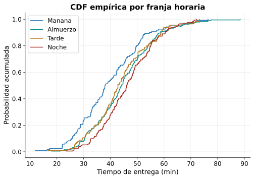{fig-alt="Cuatro CDF empíricas por franja horaria. La de la mañana queda más a la izquierda y la de la noche más a la derecha."}
:::
::: {.column width="46%"}
::: {.par .apilado}
::: {.caja-pregunta .fragment}
¿Qué franja tiene las entregas más rápidas?
:::
::: {.caja-respuesta .fragment}
La mañana.
:::
:::

::: {.par .apilado}
::: {.caja-pregunta .fragment}
¿Qué franja tiene las más lentas?
:::
::: {.caja-respuesta .fragment}
La noche.
:::
:::

::: {.par .apilado}
::: {.caja-pregunta .fragment}
¿Debería aplicarse una sola promesa a todas?
:::
::: {.caja-respuesta .fragment}
Depende de cuánto cambien sus percentiles.
:::
:::
:::
:::

## Cumplimiento y percentil 90 por franja {.fase-practica .compacto}

```{.python #c46}
por_franja = pd.DataFrame({
    "P(X<=45)": (tiempo <= 45).groupby(df["franja"]).mean(),
    "percentil 90": tiempo.groupby(df["franja"]).quantile(0.9),
})
por_franja.round(3)
```

. . .

```{.salida for="c46"}
          P(X<=45)  percentil 90
franja                          
Almuerzo     0.552         58.63
Manana       0.661         54.50
Noche        0.451         60.48
Tarde        0.570         58.87
```

. . .

::: {.caja-pregunta}
¿Qué información adicional necesitaríamos antes de decidir?
:::

. . .

::: {.caja-respuesta}
Cuántos pedidos hay en cada franja, si el clima se reparte parejo entre ellas y cuánto cuesta cada mejora.
:::

# Discretas y densidad {.acto background-color="#0f2540"}

::: {.acto-numero}
Acto 7
:::

::: {.acto-pregunta}
¿Y si en vez de medir tiempos contamos pedidos?
:::

## Una variable discreta en el mismo problema {.fase-practica .compacto}

Definimos retraso como $X>45$ y contamos cuántos hubo cada día:

. . .

```{.python #c50}
retrasos_dia = (
    df.assign(retraso=(tiempo > 45).astype(int))
    .groupby("fecha")["retraso"]
    .sum()
    .reset_index()
)
retrasos_dia.head()
```

. . .

```{.salida for="c50"}
        fecha  retraso
0  2026-08-03        6
1  2026-08-04       13
2  2026-08-05        5
3  2026-08-06        5
4  2026-08-07        8
```

. . .

::: {.grande}
$Y$ = número de pedidos retrasados en un día
:::

## Distribución de una variable discreta {.fase-practica .compacto}

```{.python #c51}
pmf = retrasos_dia["retraso"].value_counts(normalize=True).sort_index()
pmf.round(3)
```

. . .

```{.salida for="c51"}
retraso
1     0.041
2     0.041
3     0.122
4     0.163
5     0.245
6     0.061
7     0.122
8     0.122
9     0.020
11    0.020
13    0.020
14    0.020
Name: proportion, dtype: float64
```

. . .

```{.python #c52}
print(pmf.sum())
```

. . .

```{.salida for="c52"}
1.0
```

## Función de masa de probabilidad {.fase-concepto}

::: {.concepto}
[Definición]{.rotulo}

Para una variable discreta:

$$p_X(x)=P(X=x)$$

con $p_X(x)\ge 0$ y $\sum_x p_X(x)=1$.
:::

. . .

La altura de cada barra **sí** es una probabilidad.

. . .

::: {.remate}
Sigla en inglés: **PMF**, probability mass function.
:::

## Dibujar la PMF {.fase-practica}

```{.python #c53 fig="pmf-retrasos"}
plt.figure(figsize=(8, 5.2))
plt.bar(pmf.index, pmf.values)
plt.xlabel("Número de retrasos en un día")
plt.ylabel("Probabilidad estimada")
plt.title("PMF empírica de los retrasos diarios")
plt.show()
```

## Leer la PMF {.fase-practica .grafico}

::: {.columns}
::: {.column width="54%"}
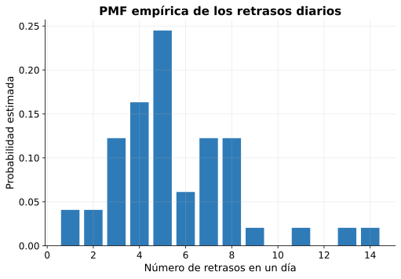{fig-alt="Gráfico de barras con la probabilidad estimada de cada número de retrasos por día, con el máximo en cinco retrasos."}
:::
::: {.column width="46%"}
::: {.par .apilado}
::: {.caja-pregunta .fragment}
¿Cuál es el número de retrasos más frecuente?
:::
::: {.caja-respuesta .fragment}
Cinco, con cerca del 24 % de los días.
:::
:::

::: {.par .apilado}
::: {.caja-pregunta .fragment}
¿Qué probabilidad hay de exactamente 3 retrasos?
:::
::: {.caja-respuesta .fragment}
Cerca del 12 %.
:::
:::

::: {.par .apilado}
::: {.caja-pregunta .fragment}
¿Qué diferencia hay entre $P(Y=3)$ y $P(Y\le 3)$?
:::
::: {.caja-respuesta .fragment}
La primera es un solo valor; la segunda acumula los valores hasta 3.
:::
:::
:::
:::

## La CDF de una variable discreta {.fase-practica .compacto}

```{.python #c54}
cdf_discreta = pmf.cumsum()
cdf_discreta.round(3)
```

. . .

```{.salida for="c54"}
retraso
1     0.041
2     0.082
3     0.204
4     0.367
5     0.612
6     0.673
7     0.796
8     0.918
9     0.939
11    0.959
13    0.980
14    1.000
Name: proportion, dtype: float64
```

. . .

::: {.concepto}
[Idea]{.rotulo}

$F_Y(3)=P(Y=0)+P(Y=1)+P(Y=2)+P(Y=3)$. Aquí se ve por qué se llama **acumulada**.
:::

## Dibujar la CDF discreta {.fase-practica}

```{.python #c55 fig="cdf-retrasos"}
plt.figure(figsize=(8, 5.2))
plt.step(cdf_discreta.index, cdf_discreta.values, where="post")
plt.xlabel("Número de retrasos en un día")
plt.ylabel("F(y) = P(Y <= y)")
plt.title("CDF empírica de los retrasos diarios")
plt.ylim(0, 1.05)
plt.show()
```

## Vista de la CDF discreta {.fase-practica .grafico}

::: {.columns}
::: {.column width="54%"}
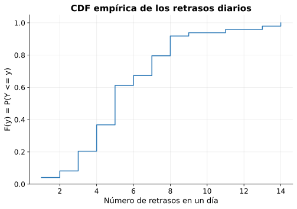{fig-alt="Escalera que sube de 0 a 1 con un salto en cada número de retrasos observado."}
:::
::: {.column width="46%"}
::: {.par .apilado}
::: {.caja-pregunta .fragment}
¿De qué tamaño es cada salto?
:::
::: {.caja-respuesta .fragment}
Igual a la probabilidad de ese valor en la PMF.
:::
:::

::: {.par .apilado}
::: {.caja-pregunta .fragment}
¿Dónde está la mediana?
:::
::: {.caja-respuesta .fragment}
En el primer valor donde la curva llega o pasa 0.5.
:::
:::
:::
:::

## Y para el tiempo de entrega, que es continuo {.fase-pregunta .compacto}

::: {.caja-pregunta}
Si no podemos contar valores aislados, ¿dónde queda la probabilidad?
:::

. . .

```{.python #c56 fig="densidad-tiempo"}
plt.figure(figsize=(8, 5.2))
tiempo.plot(kind="hist", bins=25, density=True, alpha=0.5)
tiempo.plot(kind="kde")
plt.xlabel("Tiempo de entrega (min)")
plt.title("Distribución del tiempo de entrega")
plt.show()
```

## Frecuencia y densidad {.fase-practica .grafico}

::: {.columns}
::: {.column width="54%"}
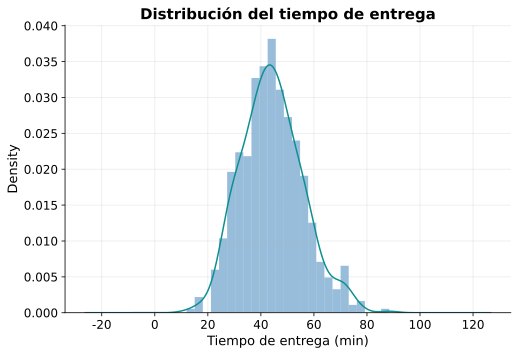{fig-alt="Histograma en escala de densidad con una curva suave que lo recorre, concentrada entre 35 y 55 minutos."}
:::
::: {.column width="46%"}
::: {.par .apilado}
::: {.caja-pregunta .fragment}
¿Dónde hay mayor densidad?
:::
::: {.caja-respuesta .fragment}
Alrededor de 40 a 50 minutos.
:::
:::

::: {.par .apilado}
::: {.caja-pregunta .fragment}
¿La altura de la curva es una probabilidad?
:::
::: {.caja-respuesta .fragment}
No.
:::
:::

::: {.par .apilado}
::: {.caja-pregunta .fragment}
¿Dónde está la probabilidad?
:::
::: {.caja-respuesta .fragment}
En el área bajo la curva sobre un intervalo.
:::
:::
:::
:::

## El área es la probabilidad {.fase-practica .compacto}

```{.python #c57}
from scipy.stats import gaussian_kde

kde = gaussian_kde(tiempo)
area = kde.integrate_box_1d(30, 40)
observada = ((tiempo > 30) & (tiempo <= 40)).mean()

print(f"Área bajo la curva entre 30 y 40:   {area:.3f}")
print(f"Proporción observada entre 30 y 40: {observada:.3f}")
```

. . .

```{.salida for="c57"}
Área bajo la curva entre 30 y 40:   0.257
Proporción observada entre 30 y 40: 0.258
```

. . .

::: {.remate}
Las dos cifras casi coinciden.
:::

## Dibujar el área {.fase-practica .compacto}

```{.python #c58 fig="area-30-40"}
malla = np.linspace(tiempo.min(), tiempo.max(), 300)
densidad = kde(malla)

plt.figure(figsize=(8, 5.2))
plt.plot(malla, densidad)
plt.fill_between(malla, densidad, where=(malla >= 30) & (malla <= 40), alpha=0.4)
plt.xlabel("Tiempo de entrega (min)")
plt.ylabel("Densidad")
plt.title("P(30 < X <= 40) como área")
plt.show()
```

## Vista del área {.fase-concepto .grafico}

::: {.columns}
::: {.column width="54%"}
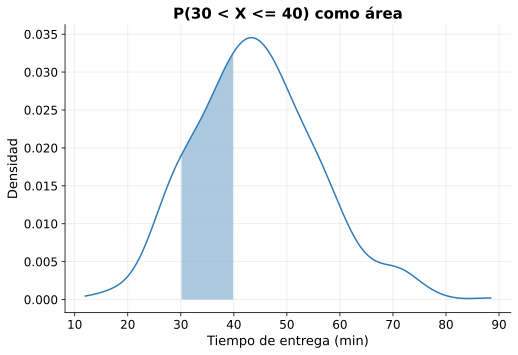{fig-alt="Curva de densidad del tiempo de entrega con el área entre 30 y 40 minutos sombreada."}
:::
::: {.column width="46%"}
::: {.concepto}
[Densidad]{.rotulo}

Para una variable continua:

$$P(a<X<b)=\int_a^b f(x)\,dx$$

Además $P(X=x)=0$ para cualquier valor puntual.
:::

::: {.fragment}
**Sigla en inglés: PDF**, probability density function.
:::
:::
:::

## PMF, PDF y CDF {.fase-concepto}

::: {.diagrama}
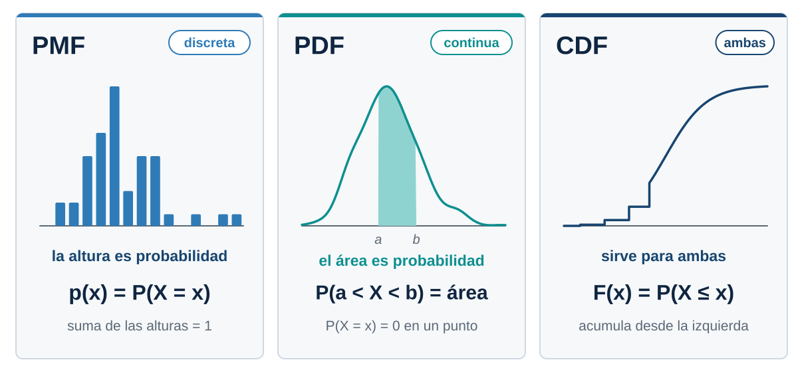{fig-alt="Tres columnas. PMF: barras cuya altura es probabilidad, para variables discretas. PDF: curva cuyo área es probabilidad, para variables continuas. CDF: sirve para ambas."}
:::

# La decisión {.acto background-color="#0f2540"}

::: {.acto-numero}
Acto 8
:::

::: {.acto-pregunta}
¿Es razonable prometer entrega en máximo 45 minutos?
:::

## Lo que dicen los datos {.fase-practica .compacto}

```{.python #c60}
print(f"Cumplimiento global: {(tiempo <= 45).mean():.3f}")
```

. . .

```{.salida for="c60"}
Cumplimiento global: 0.548
```

. . .

```{.python #c61}
cumple = (tiempo <= 45).groupby([df["lluvia"], df["franja"]]).mean()
cumple.unstack().round(3)
```

. . .

```{.salida for="c61"}
franja  Almuerzo  Manana  Noche  Tarde
lluvia                                
No         0.607   0.763  0.525  0.653
Si         0.404   0.250  0.291  0.410
```

## ¿Qué promesa cubre a la mayoría? {.fase-practica .compacto}

```{.python #c62}
for promesa in [45, 50, 55, 60, 65]:
    cobertura = (tiempo <= promesa).mean()
    print(f"Promesa de {promesa} min: cumple {cobertura:.1%}")
```

. . .

```{.salida for="c62"}
Promesa de 45 min: cumple 54.8%
Promesa de 50 min: cumple 71.0%
Promesa de 55 min: cumple 83.3%
Promesa de 60 min: cumple 91.2%
Promesa de 65 min: cumple 94.8%
```

. . .

::: {.caja-pregunta}
¿Qué promesa se acerca al 90 %?
:::

. . .

::: {.caja-respuesta}
60 minutos cubre el 91.2 %. El cuantil lo confirma: $q_{0.90}=58.9$.
:::

## Preguntas de decisión {.fase-decision}

::: {.par}
::: {.caja-pregunta .fragment}
¿El 54.8 % es suficiente para convertirlo en una promesa?
:::
::: {.caja-respuesta .fragment}
Casi la mitad de los clientes recibiría un pedido tardío.
:::
:::

::: {.par}
::: {.caja-pregunta .fragment}
¿La conclusión cambia con lluvia?
:::
::: {.caja-respuesta .fragment}
Sí: 34.7 % con lluvia contra 62.8 % sin lluvia.
:::
:::

::: {.par}
::: {.caja-pregunta .fragment}
¿Cambia según la franja?
:::
::: {.caja-respuesta .fragment}
Sí: de 45.1 % por la noche a 66.1 % por la mañana.
:::
:::

::: {.par}
::: {.caja-pregunta .fragment}
¿Estamos describiendo datos históricos o garantizando resultados futuros?
:::
::: {.caja-respuesta .fragment}
Describimos el pasado. Una probabilidad estimada no es una certeza.
:::
:::

## Una lectura posible {.fase-decision}

::: {.incremental}
- **No prometer 45 minutos a todos:** solo se cumple el 54.8 % de las veces.
- **Una promesa de 60 minutos** cubriría el 91.2 % de los pedidos.
- **Ajustar por contexto:** con lluvia o de noche el cuantil 90 es más alto.
- **Costo:** garantizar el percentil 95 (65.2 min) significa más capacidad operativa.
:::

. . .

::: {.aviso}
Límites del análisis: 600 pedidos, siete semanas y comparaciones descriptivas. No demuestran causalidad.
:::

## Reto por equipos {.fase-actividad}

::: {.diagrama}
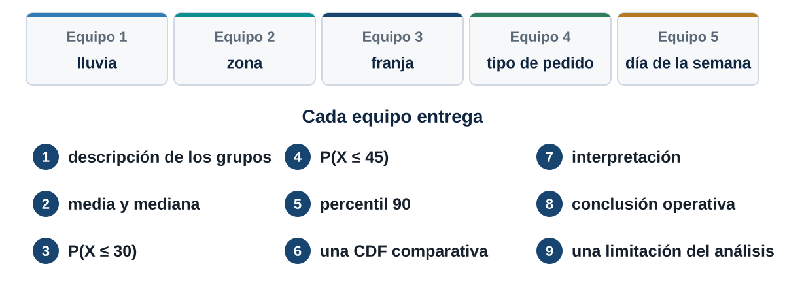{fig-alt="Cinco equipos, uno por dimensión: lluvia, zona, franja, tipo de pedido y día de la semana. Cada uno entrega nueve elementos, de la descripción de los grupos a una limitación del análisis."}
:::

## Punto de partida para el reto {.fase-actividad .compacto}

```{.python #c63}
resumen = (
    df.groupby("zona")["tiempo_entrega_min"]
    .agg(["count", "mean", "median"])
)
resumen.round(1)
```

. . .

```{.salida for="c63"}
           count  mean  median
zona                          
Centro       128  37.9    37.4
Norte        100  46.8    44.8
Occidente    118  42.8    42.6
Oriente      115  45.3    45.5
Sur          139  48.6    48.6
```

. . .

::: {.remate}
Cambien `zona` por la dimensión de su equipo y sigan las nueve entregas.
:::

## Errores conceptuales frecuentes {.fase-pregunta}

::: {.par}
::: {.caja-pregunta .fragment}
"La variable aleatoria son los datos."
:::
::: {.caja-respuesta .fragment}
Los datos son realizaciones observadas de la variable.
:::
:::

::: {.par}
::: {.caja-pregunta .fragment}
"Probabilidad y frecuencia son lo mismo."
:::
::: {.caja-respuesta .fragment}
La frecuencia observada estima la probabilidad bajo ciertos supuestos.
:::
:::

::: {.par}
::: {.caja-pregunta .fragment}
"La CDF da la probabilidad de exactamente $x$."
:::
::: {.caja-respuesta .fragment}
Es acumulada: $F(x)=P(X\le x)$.
:::
:::

::: {.par}
::: {.caja-pregunta .fragment}
"La altura de una PDF es la probabilidad."
:::
::: {.caja-respuesta .fragment}
La probabilidad es el área bajo la curva.
:::
:::

::: {.par}
::: {.caja-pregunta .fragment}
"Llueve y tarda más, así que la lluvia es la causa."
:::
::: {.caja-respuesta .fragment}
Es una asociación. La causalidad pide un análisis más riguroso.
:::
:::

## El hilo completo, con nuestro caso {.fase-sintesis .solo-mapa}

```{=html}
<svg class="mapa" viewBox="0 0 1180 420" font-family="Segoe UI, Arial, sans-serif" role="img" aria-label="Cadena de diez pasos, del fenómeno real a la decisión, con el valor que tomó cada uno en el caso de los domicilios."><defs><marker id="pta" viewBox="0 0 10 10" refX="9" refY="5" markerWidth="7" markerHeight="7" orient="auto"><path d="M 0 0 L 10 5 L 0 10 z" fill="#5b6876"/></marker></defs>
<g class="fragment">
<rect x="10" y="20" width="200" height="150" rx="12" fill="#eef2f6" stroke="#17456f" stroke-width="2"/>
<rect x="10" y="20" width="200" height="10" rx="5" fill="#17456f"/>
<text x="110.0" y="76" text-anchor="middle" font-size="22" font-weight="700" fill="#0f2540">Fenómeno real</text>
<text x="110.0" y="112" text-anchor="middle" font-size="19" fill="#16202b">Un pedido</text><text x="110.0" y="138" text-anchor="middle" font-size="19" fill="#16202b">a domicilio</text>
</g>
<line class="fragment" x1="214" y1="95" x2="246" y2="95" stroke="#5b6876" stroke-width="3" marker-end="url(#pta)"/>
<g class="fragment">
<rect x="250" y="20" width="200" height="150" rx="12" fill="#eef2f6" stroke="#17456f" stroke-width="2"/>
<rect x="250" y="20" width="200" height="10" rx="5" fill="#17456f"/>
<text x="350.0" y="76" text-anchor="middle" font-size="22" font-weight="700" fill="#0f2540">Experimento</text>
<text x="350.0" y="112" text-anchor="middle" font-size="19" fill="#16202b">Observar</text><text x="350.0" y="138" text-anchor="middle" font-size="19" fill="#16202b">un pedido</text>
</g>
<line class="fragment" x1="454" y1="95" x2="486" y2="95" stroke="#5b6876" stroke-width="3" marker-end="url(#pta)"/>
<g class="fragment">
<rect x="490" y="20" width="200" height="150" rx="12" fill="#eef2f6" stroke="#17456f" stroke-width="2"/>
<rect x="490" y="20" width="200" height="10" rx="5" fill="#17456f"/>
<text x="590.0" y="76" text-anchor="middle" font-size="22" font-weight="700" fill="#0f2540">Espacio muestral</text>
<text x="590.0" y="112" text-anchor="middle" font-size="19" fill="#16202b">&#937;: todos los</text><text x="590.0" y="138" text-anchor="middle" font-size="19" fill="#16202b">pedidos posibles</text>
</g>
<line class="fragment" x1="694" y1="95" x2="726" y2="95" stroke="#5b6876" stroke-width="3" marker-end="url(#pta)"/>
<g class="fragment">
<rect x="730" y="20" width="200" height="150" rx="12" fill="#eef2f6" stroke="#17456f" stroke-width="2"/>
<rect x="730" y="20" width="200" height="10" rx="5" fill="#17456f"/>
<text x="830.0" y="76" text-anchor="middle" font-size="22" font-weight="700" fill="#0f2540">Variable aleatoria</text>
<text x="830.0" y="112" text-anchor="middle" font-size="19" fill="#16202b">X: tiempo</text><text x="830.0" y="138" text-anchor="middle" font-size="19" fill="#16202b">de entrega</text>
</g>
<line class="fragment" x1="934" y1="95" x2="966" y2="95" stroke="#5b6876" stroke-width="3" marker-end="url(#pta)"/>
<g class="fragment">
<rect x="970" y="20" width="200" height="150" rx="12" fill="#eef2f6" stroke="#17456f" stroke-width="2"/>
<rect x="970" y="20" width="200" height="10" rx="5" fill="#17456f"/>
<text x="1070.0" y="76" text-anchor="middle" font-size="22" font-weight="700" fill="#0f2540">Realizaciones</text>
<text x="1070.0" y="112" text-anchor="middle" font-size="19" fill="#16202b">600 tiempos</text><text x="1070.0" y="138" text-anchor="middle" font-size="19" fill="#16202b">observados</text>
</g>
<path class="fragment" d="M 1070 176 L 1070 205 L 110 205 L 110 234" fill="none" stroke="#5b6876" stroke-width="3" marker-end="url(#pta)"/>
<g class="fragment">
<rect x="10" y="240" width="200" height="150" rx="12" fill="#eef2f6" stroke="#17456f" stroke-width="2"/>
<rect x="10" y="240" width="200" height="10" rx="5" fill="#17456f"/>
<text x="110.0" y="296" text-anchor="middle" font-size="22" font-weight="700" fill="#0f2540">Evento</text>
<text x="110.0" y="332" text-anchor="middle" font-size="19" fill="#16202b">A = {X &#8804; 45}</text>
</g>
<line class="fragment" x1="214" y1="315" x2="246" y2="315" stroke="#5b6876" stroke-width="3" marker-end="url(#pta)"/>
<g class="fragment">
<rect x="250" y="240" width="200" height="150" rx="12" fill="#eef2f6" stroke="#17456f" stroke-width="2"/>
<rect x="250" y="240" width="200" height="10" rx="5" fill="#17456f"/>
<text x="350.0" y="296" text-anchor="middle" font-size="22" font-weight="700" fill="#0f2540">Probabilidad</text>
<text x="350.0" y="332" text-anchor="middle" font-size="19" fill="#16202b">P(A) = 0.548</text>
</g>
<line class="fragment" x1="454" y1="315" x2="486" y2="315" stroke="#5b6876" stroke-width="3" marker-end="url(#pta)"/>
<g class="fragment">
<rect x="490" y="240" width="200" height="150" rx="12" fill="#effaf9" stroke="#0e8f8f" stroke-width="2"/>
<rect x="490" y="240" width="200" height="10" rx="5" fill="#0e8f8f"/>
<text x="590.0" y="296" text-anchor="middle" font-size="22" font-weight="700" fill="#0f2540">Distribución</text>
<text x="590.0" y="332" text-anchor="middle" font-size="19" fill="#16202b">F(x) = P(X &#8804; x)</text>
</g>
<line class="fragment" x1="694" y1="315" x2="726" y2="315" stroke="#5b6876" stroke-width="3" marker-end="url(#pta)"/>
<g class="fragment">
<rect x="730" y="240" width="200" height="150" rx="12" fill="#effaf9" stroke="#0e8f8f" stroke-width="2"/>
<rect x="730" y="240" width="200" height="10" rx="5" fill="#0e8f8f"/>
<text x="830.0" y="296" text-anchor="middle" font-size="22" font-weight="700" fill="#0f2540">Cuantil</text>
<text x="830.0" y="332" text-anchor="middle" font-size="19" fill="#16202b">Q(0.90) = 58.9 min</text>
</g>
<line class="fragment" x1="934" y1="315" x2="966" y2="315" stroke="#5b6876" stroke-width="3" marker-end="url(#pta)"/>
<g class="fragment">
<rect x="970" y="240" width="200" height="150" rx="12" fill="#dbe9f5" stroke="#0f2540" stroke-width="2"/>
<rect x="970" y="240" width="200" height="10" rx="5" fill="#0f2540"/>
<text x="1070.0" y="296" text-anchor="middle" font-size="22" font-weight="700" fill="#0f2540">Decisión</text>
<text x="1070.0" y="332" text-anchor="middle" font-size="19" fill="#16202b">Definir la promesa</text>
</g>
</svg>
```

## Lo que ya sabemos responder {.fase-sintesis}

::: {.caja-pregunta}
"¿Qué probabilidad hay de que esta variable **no supere** cierto valor?"
:::

. . .

::: {.caja-respuesta}
Es una **probabilidad acumulada**: se estudia con la CDF, $F(x)=P(X\le x)$.
:::

. . .

::: {.caja-pregunta}
"¿Qué valor necesitamos para **cubrir al 90 %** de los casos?"
:::

. . .

::: {.caja-respuesta}
Es un **cuantil** de la misma distribución.
:::

## Lo que viene

::: {.incremental}
- Hoy comparamos $P(X\le 45)$ dentro de cada grupo sin ponerle nombre.
- **Tema 2:** probabilidad condicional, independencia y teorema de Bayes.
- **Tema 3:** valor esperado y varianza: resumir una variable en dos números.
:::
