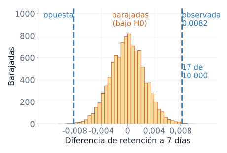
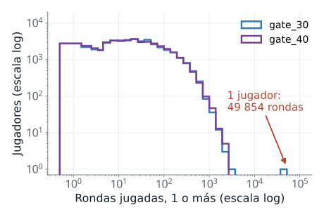
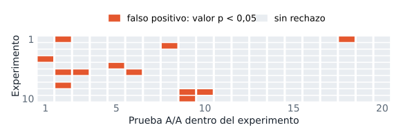
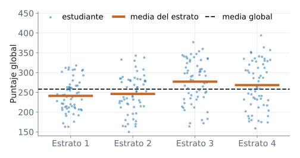
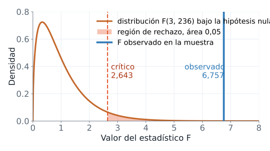
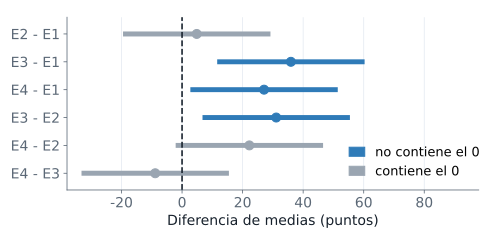

::: {.ficha}
|            |                                                          |
|------------|----------------------------------------------------------|
| Módulo     | Estadística para Analítica                               |
| Programa   | Especialización en Big Data                              |
| Unidad     | Unidad 3. Inferencia estadística                         |
| Saber      | Comparación de dos poblaciones y de varios tratamientos con ANOVA de una vía |
:::

## La pregunta de la sesión

Una empresa lanza dos versiones de un producto, asigna cada usuario al azar a una de ellas y mide el mismo resultado en los dos grupos. Las dos cifras casi nunca coinciden. La pregunta de la sesión es si esa diferencia señala una diferencia real entre las versiones o cabe dentro de lo que produce el azar del muestreo, y qué cambia cuando en lugar de dos versiones hay cuatro o veinte.

Al terminar la guía puedes:

- Plantear la comparación de dos grupos como una diferencia de parámetros y contrastar su hipótesis nula con una prueba de permutación, la t de Welch o la z de dos proporciones.
- Construir e interpretar el intervalo de confianza de una diferencia.
- Distinguir muestras independientes de muestras pareadas y elegir la prueba que corresponde a cada una.
- Calcular cuántos falsos positivos produce una colección de pruebas hechas sobre los mismos datos.
- Armar un ANOVA de una vía a mano (sumas de cuadrados, cuadrados medios, estadístico F) y con `scipy`.
- Verificar los supuestos del ANOVA, comparar los grupos por pares con Tukey y medir el tamaño del efecto con $\eta^2$.

La guía sigue el orden reto, fundamentos (dos grupos y varios grupos), solución del reto, práctica y resumen. No cubre ANOVA de dos vías, regresión ni pruebas no paramétricas, y supone muestras aleatorias; en el ANOVA, una muestra aleatoria por grupo.

## Notación y datos

Los símbolos son los mismos en toda la unidad. La columna de código indica cómo aparece cada cantidad en los ejemplos; cuando ningún bloque le da un nombre propio, la columna dice cómo se obtiene. Cada fundamento vuelve a definir los símbolos que usa en el momento en que aparecen.

| Símbolo | En el código | Significado |
|---|---|---|
| $n_1,\ n_2$ | `n1`, `n2` | tamaños de muestra del grupo 1 y del grupo 2 |
| $\mu_1,\ \mu_2$ | no se calculan | medias de las poblaciones de las que vienen los dos grupos (parámetros) |
| $\bar{x}_1,\ \bar{x}_2$ | `.mean()` | medias muestrales: la media de los datos de cada grupo |
| $s_1,\ s_2$ | `.std()`, `.var()` | desviaciones estándar muestrales; $s^2$ es la varianza muestral |
| $p_1,\ p_2$ | no se calculan | proporciones poblacionales: fracción de cada población que cumple una condición |
| $\hat{p}_1,\ \hat{p}_2$ | `p_gorro` | proporciones muestrales: fracción de cada muestra que cumple la condición |
| $\theta$ | `dif` | diferencia poblacional, $\mu_1-\mu_2$ o $p_1-p_2$ |
| $\mathrm{EE}$ | `ee` | error estándar: desviación estándar de un estadístico entre muestras repetidas |
| $H_0,\ H_1$ | | hipótesis nula y alternativa |
| $\alpha$ | se escribe `0.05` | nivel de significancia, el umbral del valor p para rechazar $H_0$ |
| $t,\ z,\ F$ | `z`, `f_valor` | estadísticos de prueba: cuánto se aleja el resultado de lo que afirma $H_0$ |
| valor p | `valor_p`, `.pvalue` | probabilidad de un resultado tan extremo como el observado si $H_0$ fuera cierta |
| $k$ | `k` | número de grupos en un ANOVA |

Las dos fuentes de datos son archivos CSV que se guardan en la misma carpeta que tu cuaderno: [cookie_cats.csv](recursos/cookie_cats.csv){download="cookie_cats.csv"} y [saber11_20224.zip](recursos/saber11_20224.zip){download="saber11_20224.zip"}, que se descomprime en `saber11_20224.csv`.

**Cookie Cats** es un experimento A/B de un juego móvil, con 90&nbsp;189 jugadores nuevos. Cada fila es un jugador: `userid` lo identifica, `version` indica la versión que recibió (`gate_30` o `gate_40`, el nivel en el que aparece la primera pausa obligatoria), `sum_gamerounds` cuenta las rondas jugadas en los primeros 14 días, y `retention_1` y `retention_7` valen verdadero si el jugador volvió a jugar al día 1 y al día 7 después de instalar el juego.

```python
import pandas as pd

jugadores = pd.read_csv("cookie_cats.csv")
print(jugadores.head(3))
print(jugadores.shape)
```

```text
   userid  version  sum_gamerounds  retention_1  retention_7
0     116  gate_30               3        False        False
1     337  gate_30              38         True        False
2     377  gate_40             165         True        False
(90189, 5)
```

**Saber 11** reúne los resultados del periodo 2022-2 de todos los estudiantes que presentaron la prueba: 1&nbsp;065&nbsp;888 registros. Esta sesión usa cinco columnas: `punt_global` (puntaje global, de 0 a 500), `punt_matematicas` y `punt_lectura_critica` (puntajes de 0 a 100), `fami_estratovivienda` (estrato de la vivienda, con 71&nbsp;842 valores faltantes) y `cole_naturaleza` (colegio `OFICIAL` o `NO OFICIAL`). El archivo pesa 45 MB, por eso se lee siempre con `usecols`, que carga solo las columnas indicadas.

```python
import pandas as pd

columnas = ["punt_global", "punt_matematicas", "punt_lectura_critica",
            "fami_estratovivienda", "cole_naturaleza"]
saber = pd.read_csv("saber11_20224.csv", usecols=columnas)
print(saber.shape)
print(saber["cole_naturaleza"].value_counts())
```

```text
(1065888, 5)
cole_naturaleza
OFICIAL       824930
NO OFICIAL    240956
Name: count, dtype: int64
```

Datos: experimento A/B Cookie Cats (DataCamp, Kaggle). Datos: ICFES, Saber 11 2022-2 (datos.gov.co, CC BY-SA 4.0).

## El reto

El reto se plantea antes de explicar cualquier método. Intenta resolverlo con lo que ya sabes, aunque el resultado quede incompleto: en la solución vas a comparar tu procedimiento con el que desarrolla la guía.

**Contexto.** En Cookie Cats, un jugador nuevo ve su primera pausa obligatoria en el nivel 30 (`gate_30`, 44&nbsp;700 jugadores) o en el nivel 40 (`gate_40`, 45&nbsp;489 jugadores). El experimento asignó cada jugador a una versión al azar. La variable de interés es la **retención a 7 días**: si el jugador vuelve a jugar siete días después de instalar el juego. Su promedio por versión es la proporción de jugadores retenidos.

```python
import pandas as pd

columnas = ["version", "retention_7"]
datos = pd.read_csv("cookie_cats.csv", usecols=columnas)
grupos = datos.groupby("version")["retention_7"]
resumen = grupos.agg(["count", "mean"])
resumen.columns = ["jugadores", "retencion_7"]
print(resumen.round(4))
```

```text
         jugadores  retencion_7
version                        
gate_30      44700       0.1902
gate_40      45489       0.1820
```

`groupby("version")` separa los jugadores por versión, `agg(["count", "mean"])` cuenta los jugadores de cada grupo y calcula su media, y como `retention_7` solo tiene valores verdadero o falso, la media es la proporción de verdaderos.

**Tarea 1.** La retención es 0,1902 en `gate_30` y 0,1820 en `gate_40`, una diferencia de 0,0082. Aporta evidencia cuantitativa para decidir si esa diferencia es real o es una variación esperable por azar.

**Tarea 2.** Si se probaran 20 versiones idénticas entre sí, ¿cuántas parecerían distintas solo por azar? Decidir qué diferencia se considera llamativa forma parte de la tarea.

**Restricción.** Trabaja con Python y sin fórmulas previas. Debes poder explicar cada paso de tu procedimiento.

Una solución completa cumple tres criterios:

1. Usa solo los datos del experimento y lo que se calcula o se simula a partir de ellos. Ningún valor se supone sin comprobarlo.
2. Cuantifica la incertidumbre. La respuesta no se limita a sí o no: indica cuánto puede variar la diferencia por azar.
3. Es reproducible. Con el mismo archivo y la misma semilla, otra persona obtiene los mismos números.

Al terminar, deberías tener anotados cinco resultados: la diferencia observada entre `gate_30` y `gate_40` con su signo, la medida de incertidumbre que elegiste y su valor, tu conclusión sobre las dos versiones en una frase, la respuesta para las 20 versiones idénticas con el modo en que la obtuviste, y el código con la semilla que reproduce todos tus números.

Datos: experimento A/B Cookie Cats (DataCamp, Kaggle).

Dedica un rato a intentarlo antes de seguir. Las dos secciones siguientes dan las herramientas para resolverlo.

## Comparar dos grupos

Esta sección y la siguiente desarrollan los fundamentos en el orden en que se necesitan. Esta cubre la comparación de dos grupos: qué parámetro se estima, cómo se decide con una prueba de permutación, con el error estándar y con la t de Welch, qué pasa con un dato extremo, cómo se construye un intervalo, cómo se comparan dos proporciones y qué cambia con muestras pareadas.

### Dos muestras independientes: qué se compara

**La pregunta.** ¿Qué número resume la diferencia entre dos versiones de un producto?

**Desde el ejemplo.** El experimento de Cookie Cats tiene 90&nbsp;189 jugadores. La siguiente tabla resume, para cada versión, cuántos jugadores recibió, el promedio de rondas jugadas y la proporción de jugadores que volvió al día 1 y al día 7.

```python
import pandas as pd

jugadores = pd.read_csv("cookie_cats.csv")
resumen = jugadores.groupby("version").agg(
    jugadores=("userid", "count"),
    rondas_media=("sum_gamerounds", "mean"),
    retencion_1=("retention_1", "mean"),
    retencion_7=("retention_7", "mean"))
print(resumen.round(4))
```

```text
         jugadores  rondas_media  retencion_1  retencion_7
version                                                   
gate_30      44700       52.4563       0.4482       0.1902
gate_40      45489       51.2988       0.4423       0.1820
```

`gate_30` supera a `gate_40` en las tres medidas: 52,46 frente a 51,30 rondas, 0,4482 frente a 0,4423 de retención al día 1 y 0,1902 frente a 0,1820 al día 7. Cada cifra sale de una muestra de jugadores, y otra muestra habría dado cifras distintas. Falta decidir si las diferencias superan lo que el azar produce por sí solo.

**Definición formal.** Una **población** es el conjunto completo de unidades sobre el que se quiere concluir, aquí todos los jugadores que podrían recibir cada versión. Un **parámetro** es un número que describe la población y casi nunca se conoce. Un **estadístico** es el mismo número calculado con una muestra, y cambia de una muestra a otra.

Dos grupos son **muestras independientes** cuando cada unidad pertenece a un solo grupo y lo que ocurre en un grupo no altera lo que ocurre en el otro. La asignación al azar de Cookie Cats produce muestras independientes. Para el grupo $j$, con $j=1$ para `gate_30` y $j=2$ para `gate_40`, se definen:

- $\mu_j$: promedio de rondas jugadas por todos los jugadores de la población del grupo $j$. $p_j$: proporción de esa población que vuelve a jugar a los 7 días. Ambos son parámetros.
- $\bar{x}_j$: media de las rondas jugadas por los $n_j$ jugadores observados en el grupo $j$, es decir, su suma dividida entre $n_j$. $\hat{p}_j$: fracción de esos $n_j$ jugadores que volvió a jugar a los 7 días. Ambos son estadísticos.

El parámetro de interés es la diferencia poblacional $\theta$ y su estimador es la misma diferencia calculada con las muestras:

$$\theta=\mu_1-\mu_2\qquad\text{o}\qquad\theta=p_1-p_2$$

$$\hat{\theta}=\bar{x}_1-\bar{x}_2\qquad\text{o}\qquad\hat{\theta}=\hat{p}_1-\hat{p}_2$$

**Qué significa y qué no.** La diferencia observada $\hat{\theta}$ estima $\theta$ y cambia de un experimento a otro. Si el experimento se repitiera, $\hat{\theta}$ tomaría otro valor aunque $\theta$ siguiera igual. Por eso una diferencia distinta de cero en la muestra no prueba que $\theta$ sea distinto de cero. La asignación al azar sí sustenta que una diferencia sistemática se deba a la versión y no a otra característica de los jugadores.

**En resumen.** Comparar dos grupos independientes es estimar $\theta$ y medir cuánto puede variar $\hat{\theta}$ por azar.

### La hipótesis nula y el valor p

**La pregunta.** Si la versión no influyera en la retención, ¿qué diferencias produciría el azar?

**Desde el ejemplo.** Un caso con 10 jugadores permite ver todas las posibilidades. Son datos de juguete, inventados para este ejemplo. Cinco jugadores recibieron la versión A: 3 volvieron a jugar a los 7 días, es decir, 0,6. Cinco recibieron la versión B: 1 volvió, es decir, 0,2. La diferencia observada es $0{,}6-0{,}2=0{,}4$.

Si la versión no influyera, cada jugador habría vuelto o no de todos modos, con cualquier etiqueta. Las etiquetas A y B serían intercambiables. Entonces se pueden repartir las dos etiquetas de todas las formas posibles entre los 10 jugadores, manteniendo cinco jugadores por versión, y calcular la diferencia en cada reparto. Son $\binom{10}{5}=252$ repartos.

```python
from itertools import combinations

# Datos de juguete, inventados: 1 = volvió a los 7 días
volvio = [1, 1, 1, 0, 0, 1, 0, 0, 0, 0]   # jugadores 0 a 4: versión A; 5 a 9: versión B
total = sum(volvio)
obs = sum(volvio[:5]) - sum(volvio[5:])    # retenidos de A menos retenidos de B
difs = [2 * sum(volvio[i] for i in grupo_a) - total
        for grupo_a in combinations(range(10), 5)]
extremas = sum(abs(d) >= abs(obs) for d in difs)
print(f"diferencia observada: {obs / 5:.1f}")
print(f"asignaciones posibles: {len(difs)}")
print(f"asignaciones con diferencia tan extrema: {extremas}")
print(f"valor p: {extremas / len(difs):.3f}")
```

```text
diferencia observada: 0.4
asignaciones posibles: 252
asignaciones con diferencia tan extrema: 132
valor p: 0.524
```

`combinations(range(10), 5)` genera cada forma de elegir qué 5 jugadores reciben la versión A. Con `total` retenidos en los 10 jugadores y `a` retenidos en el grupo A, la diferencia de retenidos entre A y B es `a - (total - a)`, que es `2 * a - total`. De los 252 repartos, 132 producen una diferencia de retención de 0,4 o más en valor absoluto. Con 10 jugadores el azar produce una diferencia tan grande más de la mitad de las veces.

**Definición formal.** Un contraste de hipótesis enfrenta dos afirmaciones sobre el parámetro. La **hipótesis nula** $H_0$ afirma que no hay diferencia, y es la que se somete a prueba. La **hipótesis alternativa** $H_1$ afirma que sí la hay, en cualquier sentido:

$$H_0:\ \theta=0\qquad H_1:\ \theta\neq 0$$

El **estadístico de prueba** es un número calculado con la muestra que mide cuánto se aleja el resultado de lo que afirma $H_0$. En este ejemplo es la diferencia $\hat{p}_1-\hat{p}_2$. El **valor p** es la probabilidad, calculada suponiendo cierta $H_0$, de obtener un estadístico al menos tan extremo como el observado:

$$\text{valor p}=P\big(\lvert\text{estadístico}\rvert\ge\lvert\text{valor observado}\rvert\ \mid\ H_0\ \text{cierta}\big)$$

El **nivel de significancia** $\alpha$ es un umbral que se fija antes de mirar los datos, casi siempre $0{,}05$. La regla de decisión es: si el valor p es menor o igual que $\alpha$, se rechaza $H_0$; en caso contrario, no se rechaza. El nivel $\alpha$ es la probabilidad de rechazar $H_0$ cuando es cierta, el llamado **error tipo I** o **falso positivo**.

**Qué significa y qué no.** Un valor p pequeño indica que los datos son difíciles de explicar con el azar bajo $H_0$. El valor p no es la probabilidad de que $H_0$ sea cierta, ni mide el tamaño de la diferencia. No rechazar $H_0$ tampoco prueba que sea cierta: con 10 jugadores, un valor p de 0,524 solo dice que los datos no bastan para contradecirla.

**En resumen.** El valor p mide cuánto sorprende el resultado si la versión no importara.

### Prueba de permutación con Cookie Cats

**La pregunta.** ¿Qué tan extrema es la diferencia de 0,0082 entre las diferencias que produce el azar de la asignación?

**Desde el ejemplo.** Con 90&nbsp;189 jugadores ya no se pueden listar todos los repartos de etiquetas, pero se pueden generar 10&nbsp;000 al azar. Cada **barajada** reparte las etiquetas `gate_30` y `gate_40` al azar entre los jugadores, conserva el tamaño de cada grupo y recalcula la diferencia de retención. Este procedimiento es una **prueba de permutación**. El ciclo repite 10&nbsp;000 veces un cálculo sobre todas las filas, de modo que tarda un rato.

```python
import numpy as np
import pandas as pd

datos = pd.read_csv("cookie_cats.csv")
ret = datos["retention_7"].to_numpy()  # True: volvió a los 7 días
es_a = (datos["version"] == "gate_30").to_numpy()  # etiqueta
dif_obs = ret[es_a].mean() - ret[~es_a].mean()
rng = np.random.default_rng(2026)
difs = np.empty(10_000)
for i in range(10_000):
    barajada = rng.permutation(es_a)  # mismos tamaños de grupo
    difs[i] = ret[barajada].mean() - ret[~barajada].mean()
print(f"diferencia observada: {dif_obs:.4f}")
print(f"valor p: {np.mean(np.abs(difs) >= abs(dif_obs)):.4f}")
```

```text
diferencia observada: 0.0082
valor p: 0.0017
```

`ret[es_a]` selecciona los jugadores de `gate_30`; la media de una columna de verdadero y falso es la proporción de verdaderos. `rng.permutation(es_a)` devuelve las etiquetas en orden aleatorio. `np.mean(np.abs(difs) >= abs(dif_obs))` es la fracción de barajadas cuya diferencia, en valor absoluto, alcanza o supera la observada. La semilla `2026` fija la secuencia aleatoria y hace reproducible el resultado.

::: {.diagrama}
{fig-alt="Histograma de 10 000 diferencias de retención a 7 días obtenidas al barajar las versiones, con forma de campana centrada en cero y valores entre aproximadamente menos 0,01 y 0,01; dos líneas verticales marcan la diferencia observada 0,0082 y su opuesta, y solo 17 barajadas quedan más allá de ellas"}
:::

**Definición formal.** Con $B$ barajadas, el valor p de la prueba de permutación es la fracción de barajadas cuya diferencia es tan extrema como la observada:

$$\text{valor p}=\frac{\#\{\,b:\ \lvert d_b^{*}\rvert\ge\lvert d_{\mathrm{obs}}\rvert\,\}}{B}$$

Aquí $d_{\mathrm{obs}}$ es la diferencia observada, $\hat{p}_1-\hat{p}_2$; $d_b^{*}$ es la diferencia calculada con las etiquetas de la barajada $b$; $B$ es el número de barajadas, 10&nbsp;000; y $\#$ cuenta cuántas barajadas cumplen la condición.

La diferencia observada es 0,0082 y el valor p es 0,0017: solo 17 de las 10&nbsp;000 barajadas llegan tan lejos de cero. Con $\alpha=0{,}05$ se rechaza $H_0$. La diferencia de retención a 7 días no se explica por el reparto al azar de los jugadores entre las dos versiones.

**Qué significa y qué no.** La distribución de las diferencias barajadas describe lo que produciría el azar de la asignación si la versión no influyera. No supone normalidad. Supone que, bajo $H_0$, las etiquetas son intercambiables, algo que aquí garantiza la asignación al azar del experimento. Con $B$ barajadas, el valor p tiene una resolución de $1/B$ y cambia un poco si se cambia la semilla. El valor p de 0,0017 no dice que `gate_30` sea mucho mejor: dice que la diferencia es improbable bajo $H_0$. Su magnitud sigue siendo 0,0082.

**En resumen.** La permutación obtiene la distribución de la diferencia bajo $H_0$ a partir de los propios datos.

### Error estándar de la diferencia

**La pregunta.** ¿Cuánto varía la diferencia entre dos medias muestrales independientes?

**Desde el ejemplo.** Para medir cuánto varía una diferencia hay que repetir el muestreo muchas veces, y eso se puede hacer exactamente con una población conocida (simulación). **Simulación:** dos poblaciones normales con la misma media $\mu_1=\mu_2=50$ y desviación estándar $\sigma=10$, de las que se extraen 10&nbsp;000 pares de muestras de $n=25$. La verdad se conoce por construcción.

```python
import numpy as np
rng = np.random.default_rng(2026)
n, sigma = 25, 10             # Simulación: dos poblaciones N(50, 10)
medias_a = rng.normal(50, sigma, size=(10_000, n)).mean(axis=1)
medias_b = rng.normal(50, sigma, size=(10_000, n)).mean(axis=1)
dif = medias_a - medias_b     # 10 000 diferencias de medias
print(f"EE de cada media: {medias_a.std(ddof=1):.3f}"
      f" y {medias_b.std(ddof=1):.3f}")
print(f"EE de la diferencia: {dif.std(ddof=1):.3f}")
print(f"fórmula: {np.sqrt(sigma**2 / n + sigma**2 / n):.3f}")
```

```text
EE de cada media: 1.991 y 1.993
EE de la diferencia: 2.809
fórmula: 2.828
```

`rng.normal(50, sigma, size=(10_000, n))` produce una matriz de 10&nbsp;000 filas, una por muestra, con $n$ datos cada una, y `.mean(axis=1)` promedia cada fila. `dif` guarda las 10&nbsp;000 diferencias de medias, y `std(ddof=1)` calcula su desviación estándar entre muestras.

**Definición formal.** El **error estándar** (EE) de un estadístico es su desviación estándar entre muestras repetidas: mide cuánto varía la estimación de una muestra a otra. Con la simulación, cada media tiene un error estándar cercano a 2 y la diferencia, 2,809. Restar no cancela la incertidumbre: con muestras independientes, las varianzas se suman. Si $\bar{X}_1$ y $\bar{X}_2$ son las medias muestrales vistas como cantidades que cambian de muestra en muestra, y $\bar{x}_1$ y $\bar{x}_2$ el valor que tomaron en una muestra concreta:

$$\mathrm{Var}(\bar{X}_1-\bar{X}_2)=\frac{\sigma_1^{2}}{n_1}+\frac{\sigma_2^{2}}{n_2}$$

Aquí $\sigma_1^2$ y $\sigma_2^2$ son las varianzas poblacionales (la varianza es el promedio de las distancias al cuadrado respecto de la media) y $n_1$, $n_2$ los tamaños de muestra. Con $\sigma=10$ y $n=25$, el error estándar vale $\sqrt{100/25+100/25}=2{,}828$, el valor que reproduce la simulación.

En la práctica $\sigma_1$ y $\sigma_2$ se desconocen y se sustituyen por las desviaciones estándar muestrales $s_1$ y $s_2$:

$$\mathrm{EE}(\bar{x}_1-\bar{x}_2)=\sqrt{\frac{s_1^{2}}{n_1}+\frac{s_2^{2}}{n_2}}$$

Para dos proporciones, cada observación tiene varianza $\hat{p}(1-\hat{p})$ y el error estándar de $\hat{p}_1-\hat{p}_2$ suma los dos términos:

$$\mathrm{EE}(\hat{p}_1-\hat{p}_2)=\sqrt{\frac{\hat{p}_1(1-\hat{p}_1)}{n_1}+\frac{\hat{p}_2(1-\hat{p}_2)}{n_2}}$$

**Qué significa y qué no.** El error estándar describe la variación de la estimación, no la variación de los datos. Una desviación estándar de 10 puntos entre jugadores convive con un error estándar de 2 puntos para la media de 25 jugadores. Aumentar $n_1$ o $n_2$ reduce el error estándar; aumentar la dispersión de los datos lo agranda.

**En resumen.** El error estándar de la diferencia es la raíz de la suma de los dos términos $s^2/n$.

### La t de Welch

**La pregunta.** ¿Por qué no suponer que los dos grupos tienen la misma varianza?

**Desde el ejemplo.** **Simulación** con $H_0$ cierta: $\mu_1=\mu_2=0$. El grupo 1 es pequeño y disperso ($n_1=10$, $\sigma_1=4$) y el grupo 2 es grande y concentrado ($n_2=40$, $\sigma_2=1$). Se aplican dos pruebas a 10&nbsp;000 pares de muestras y se cuenta cuántas veces cada una rechaza $H_0$ con $\alpha=0{,}05$. Como $H_0$ es cierta, una prueba correcta rechaza cerca del 5 % de las veces.

```python
import numpy as np
from scipy import stats
rng = np.random.default_rng(2026)   # Simulación: H0 cierta, mu = 0
rechazos_t, rechazos_welch = 0, 0
for _ in range(10_000):
    grupo_a = rng.normal(0, 4, size=10)   # sigma = 4, n = 10
    grupo_b = rng.normal(0, 1, size=40)   # sigma = 1, n = 40
    rechazos_t += stats.ttest_ind(grupo_a, grupo_b).pvalue < 0.05
    rechazos_welch += stats.ttest_ind(grupo_a, grupo_b,
                                      equal_var=False).pvalue < 0.05
print(f"rechaza H0, t clásica: {rechazos_t / 10_000:.3f}")
print(f"rechaza H0, t de Welch: {rechazos_welch / 10_000:.3f}")
```

```text
rechaza H0, t clásica: 0.298
rechaza H0, t de Welch: 0.051
```

`stats.ttest_ind(a, b)` hace la prueba t para dos muestras independientes y devuelve el estadístico y el valor p. Sin argumentos adicionales, `scipy` aplica la t clásica, que supone varianzas iguales. Con `equal_var=False` aplica la t de Welch. La t clásica rechaza una $H_0$ cierta en el 29,8 % de los casos; la de Welch, en el 5,1 %.

**Definición formal.** La t clásica combina las dos varianzas muestrales en una sola, $s_p^2$, y solo es válida si $\sigma_1=\sigma_2$. Cuando el grupo pequeño es el más disperso, esa combinación subestima el error estándar y la prueba rechaza de más. La **t de Welch** estima la varianza de cada grupo por separado y divide la diferencia de medias entre su error estándar:

$$t=\frac{\bar{x}_1-\bar{x}_2}{\sqrt{s_1^{2}/n_1+s_2^{2}/n_2}}$$

El estadístico $t$ cuenta cuántos errores estándar separan la diferencia observada de 0, su valor bajo $H_0$. Bajo $H_0$, $t$ sigue aproximadamente una distribución t de Student con $\nu$ grados de libertad:

$$\nu=\frac{\left(s_1^{2}/n_1+s_2^{2}/n_2\right)^{2}}{\dfrac{(s_1^{2}/n_1)^{2}}{n_1-1}+\dfrac{(s_2^{2}/n_2)^{2}}{n_2-1}}$$

La **distribución t de Student** es una curva en forma de campana centrada en 0, con colas algo más pesadas que las de la normal. Su forma la fija el número de **grados de libertad** $\nu$, y con $\nu$ grande se confunde con la normal estándar. El valor p bilateral es la probabilidad de que una t de Student con $\nu$ grados de libertad supere $\lvert t\rvert$ en cualquiera de las dos colas. `stats.ttest_ind(a, b, equal_var=False)` devuelve `.statistic` ($t$), `.pvalue` y `.df` ($\nu$).

**Qué significa y qué no.** La t de Welch no exige varianzas iguales ni tamaños de muestra iguales. Sigue exigiendo muestras independientes y que la media no dependa de unos pocos datos extremos, como se ve en el tema siguiente. Cuando las varianzas sí son iguales, Welch pierde muy poco frente a la t clásica, de modo que conviene usarla siempre y escribir `equal_var=False` de forma explícita.

**En resumen.** La t de Welch estima cada varianza por separado y no pide que sean iguales.

### Rondas jugadas: un valor extremo

**La pregunta.** ¿Qué ocurre con la prueba t cuando un dato es extremo?

**Desde el ejemplo.** La variable `sum_gamerounds` cuenta las rondas jugadas en los primeros 14 días. `grupo_a` reúne los jugadores de `gate_30` y `grupo_b` los de `gate_40`. El bloque aplica Welch dos veces: con todos los datos y sin el máximo de `gate_30`.

```python
import pandas as pd
from scipy import stats
datos = pd.read_csv("cookie_cats.csv")
grupo_a = datos.query("version == 'gate_30'")["sum_gamerounds"]
grupo_b = datos.query("version == 'gate_40'")["sum_gamerounds"]
print(f"n: {len(grupo_a)} y {len(grupo_b)}; máximo de A: {grupo_a.max()}")
for a in [grupo_a, grupo_a[grupo_a < grupo_a.max()]]:  # con y sin máximo
    res = stats.ttest_ind(a, grupo_b, equal_var=False)
    print(f"medias {a.mean():.2f} y {grupo_b.mean():.2f}; "
          f"desv. {a.std():.2f} y {grupo_b.std():.2f}; "
          f"t = {res.statistic:.3f}; p = {res.pvalue:.3f}")
```

```text
n: 44700 y 45489; máximo de A: 49854
medias 52.46 y 51.30; desv. 256.72 y 103.29; t = 0.885; p = 0.376
medias 51.34 y 51.30; desv. 102.06 y 103.29; t = 0.063; p = 0.949
```

`datos.query("version == 'gate_30'")` filtra las filas de una versión. `grupo_a[grupo_a < grupo_a.max()]` conserva todos los jugadores de `gate_30` menos el que tiene el máximo.

::: {.diagrama}
{fig-alt="Histograma de rondas jugadas con escala logarítmica en los dos ejes para gate_30 y gate_40: ambas distribuciones se superponen, caen desde unos miles de jugadores con pocas rondas hasta uno o dos jugadores con unas miles de rondas, y un único jugador de gate_30 queda aislado en 49 854 rondas"}
:::

**Definición formal.** La distribución de las rondas tiene **cola pesada**: la mayoría de los jugadores juega pocas rondas, unos pocos juegan miles y un jugador de `gate_30` registra 49&nbsp;854. En ese caso unos pocos datos dominan la media y la varianza. Con todos los datos, la desviación estándar de `gate_30` es 256,72 y la de `gate_40` es 103,29, con $t=0{,}885$ y valor p de 0,376. Sin ese jugador, la desviación de `gate_30` baja a 102,06, la media a 51,34 y el valor p sube a 0,949.

**Qué significa y qué no.** Un solo jugador entre 44&nbsp;700 multiplica la desviación estándar de su grupo por 2,5 y desplaza el valor p de 0,376 a 0,949. La conclusión es la misma en ambos casos, no rechazar $H_0$, pero la cifra depende de un dato. Quitar el máximo en este ejemplo sirve para mostrar la sensibilidad de la prueba; en un análisis real, eliminar un dato exige una razón del contexto, como un error de registro, y no el efecto que produce en el resultado. Antes de comparar medias conviene examinar la distribución de la variable.

**En resumen.** Con cola pesada, la media y la t dependen de pocos valores.

### Intervalo de confianza para la diferencia

**La pregunta.** ¿Qué valores de la diferencia son compatibles con los datos?

**Desde el ejemplo.** Para las rondas jugadas, el bloque calcula la diferencia de medias, su error estándar y el intervalo, con todos los datos y sin el máximo de `gate_30`.

```python
import numpy as np
import pandas as pd
from scipy import stats
datos = pd.read_csv("cookie_cats.csv")
grupo_a = datos.query("version == 'gate_30'")["sum_gamerounds"]
grupo_b = datos.query("version == 'gate_40'")["sum_gamerounds"]
for a in [grupo_a, grupo_a[grupo_a < grupo_a.max()]]:  # con y sin máximo
    dif = a.mean() - grupo_b.mean()
    ee = np.sqrt(a.var() / len(a) + grupo_b.var() / len(grupo_b))
    gl = stats.ttest_ind(a, grupo_b, equal_var=False).df  # Welch
    t_crit = stats.t.ppf(0.975, gl)
    print(f"dif = {dif:.2f}, EE = {ee:.3f}, t_crit = {t_crit:.3f}, "
          f"IC 95 %: [{dif - t_crit * ee:.2f}, {dif + t_crit * ee:.2f}]")
```

```text
dif = 1.16, EE = 1.307, t_crit = 1.960, IC 95 %: [-1.40, 3.72]
dif = 0.04, EE = 0.684, t_crit = 1.960, IC 95 %: [-1.30, 1.38]
```

`stats.t.ppf(0.975, gl)` devuelve el **cuantil** 0,975 de la t de Student con `gl` grados de libertad: el valor que deja una probabilidad de 0,975 a su izquierda y 0,025 a su derecha.

**Definición formal.** Un **intervalo de confianza** es un rango de valores plausibles para un parámetro: la estimación más o menos un margen de error. Para la diferencia de medias con el error estándar de Welch:

$$(\bar{x}_1-\bar{x}_2)\ \pm\ t_{\nu,\,1-\alpha/2}\cdot\mathrm{EE}$$

Aquí $1-\alpha$ es el nivel de confianza, 0,95; $t_{\nu,\,1-\alpha/2}$ es el cuantil de la t de Student con los $\nu$ grados de libertad de Welch, y $\mathrm{EE}$ es el error estándar de la diferencia. Con tantos grados de libertad, $t_{\nu,\,0{,}975}=1{,}960$, igual que el de la normal.

Con todos los datos, la diferencia es de 1,16 rondas y el intervalo va de $-1{,}40$ a $3{,}72$. Sin el máximo, va de $-1{,}30$ a $1{,}38$, y el error estándar baja de 1,307 a 0,684. Un solo jugador casi duplica el ancho del intervalo.

**Qué significa y qué no.** Los dos intervalos contienen el 0. Un intervalo de 95 % que contiene el 0 equivale a no rechazar $H_0$ con $\alpha=0{,}05$ en la prueba bilateral. El nivel de 95 % describe el procedimiento: si se repitiera el experimento muchas veces, el 95 % de los intervalos construidos así capturaría el valor real de la diferencia. No significa que este intervalo en particular tenga 95 % de probabilidad de contenerlo. Además de decidir, el intervalo muestra la magnitud: la diferencia de rondas está entre una pérdida de 1,4 y una ganancia de 3,7 sobre promedios cercanos a 52, una diferencia pequeña en ambas direcciones.

**En resumen.** El intervalo acota cuánto vale la diferencia y a la vez contrasta $H_0$.

### Dos proporciones

**La pregunta.** ¿Difiere la retención entre las versiones a 1 día y a 7 días?

**Desde el ejemplo.** Para cada columna de retención, el bloque calcula las proporciones de cada versión, el estadístico $z$, su valor p y el intervalo de confianza para $p_1-p_2$.

```python
import numpy as np
import pandas as pd
from scipy import stats
datos = pd.read_csv("cookie_cats.csv")
n = datos["version"].value_counts().sort_index()    # n1 y n2
for col in ["retention_1", "retention_7"]:
    p_gorro = datos.groupby("version")[col].mean()   # p1 y p2 estimadas
    dif, p_comb = p_gorro.iloc[0] - p_gorro.iloc[1], datos[col].mean()
    z = dif / np.sqrt(p_comb * (1 - p_comb) * (1 / n).sum())
    ee = np.sqrt((p_gorro * (1 - p_gorro) / n).sum())  # sin suponer H0
    print(f"{col}: z = {z:.3f}, p = {2 * stats.norm.sf(abs(z)):.4f}, "
          f"IC: [{dif - 1.96 * ee:.4f}, {dif + 1.96 * ee:.4f}]")
```

```text
retention_1: z = 1.784, p = 0.0744, IC: [-0.0006, 0.0124]
retention_7: z = 3.164, p = 0.0016, IC: [0.0031, 0.0133]
```

`p_gorro` contiene $\hat{p}_1$ y $\hat{p}_2$, las proporciones de cada versión; `p_comb` es la proporción combinada $\hat{p}$, la de los dos grupos juntos; `(1 / n).sum()` es $1/n_1+1/n_2$; y `stats.norm.sf(abs(z))` es la cola derecha de la normal estándar.

**Definición formal.** Si $H_0:\ p_1=p_2$ es cierta, ambas muestras estiman la misma proporción, que se estima combinando los dos grupos: retenidos de ambos entre $n_1+n_2$. El estadístico $z$ divide la diferencia entre su error estándar bajo $H_0$:

$$z=\frac{\hat{p}_1-\hat{p}_2}{\sqrt{\hat{p}\,(1-\hat{p})\,(1/n_1+1/n_2)}}$$

Aquí $\hat{p}$ es la proporción combinada. Con muestras grandes, $z$ sigue aproximadamente una **distribución normal estándar**, la campana con media 0 y desviación estándar 1. Como regla práctica, cada grupo debe tener al menos unos 10 éxitos y 10 fracasos. El valor p es el doble de la cola de $\lvert z\rvert$, `2 * stats.norm.sf(abs(z))`. El intervalo usa el error estándar sin combinar, porque no supone $H_0$:

$$(\hat{p}_1-\hat{p}_2)\ \pm\ z_{1-\alpha/2}\cdot\mathrm{EE}(\hat{p}_1-\hat{p}_2)$$

El valor $z_{1-\alpha/2}$ es el cuantil de la normal estándar, 1,96 para 95 % de confianza.

A 1 día, $z=1{,}784$ y el valor p es 0,0744: el intervalo, de $-0{,}0006$ a $0{,}0124$, contiene el 0. A 7 días, $z=3{,}164$ y el valor p es 0,0016: el intervalo, de 0,0031 a 0,0133, excluye el 0. Con $\alpha=0{,}05$ hay evidencia de diferencia solo a 7 días, y favorece a `gate_30`. El valor p de la permutación, 0,0017, es casi igual al de la prueba $z$.

**Qué significa y qué no.** El resultado a 1 día no prueba que las versiones retengan igual: el intervalo llega hasta 0,0124, así que una diferencia de más de un punto porcentual sigue siendo compatible con los datos. Y el resultado a 7 días no mide cuánto importa la diferencia: el intervalo la ubica entre 0,3 y 1,3 puntos porcentuales.

**En resumen.** Para dos proporciones se usa $z$ con la proporción combinada para contrastar y el error estándar sin combinar para el intervalo.

### Muestras pareadas

**La pregunta.** ¿Cómo se comparan dos mediciones tomadas a las mismas unidades?

**Desde el ejemplo.** En las muestras independientes, cada unidad aporta un solo valor, como un jugador de `gate_30`. En las **muestras pareadas**, cada unidad aporta dos mediciones: antes y después, o dos pruebas del mismo estudiante. Con una muestra de 200 estudiantes de Saber 11 se comparan su puntaje de matemáticas y su puntaje de lectura crítica, ambos de 0 a 100. `d` es la diferencia por estudiante y `200 ** 0.5` es la raíz cuadrada de 200.

```python
import pandas as pd
from scipy import stats
cols = ["punt_matematicas", "punt_lectura_critica"]
datos = pd.read_csv("saber11_20224.csv", usecols=cols)
muestra = datos.sample(n=200, random_state=2026)  # 200 estudiantes
mat, lec = muestra[cols[0]], muestra[cols[1]]  # mismo estudiante
d = mat - lec  # diferencia por estudiante
print(f"media de d = {d.mean():.3f}; correlación {mat.corr(lec):.3f}")
print(f"EE pareado = {d.std() / 200 ** 0.5:.3f}, EE independiente = "
      f"{((mat.var() + lec.var()) / 200) ** 0.5:.3f}")
print(f"p pareado = {stats.ttest_rel(mat, lec).pvalue:.1e}, p Welch = "
      f"{stats.ttest_ind(mat, lec, equal_var=False).pvalue:.4f}")
```

```text
media de d = -2.720; correlación 0.788
EE pareado = 0.520, EE independiente = 1.119
p pareado = 4.3e-07, p Welch = 0.0155
```

`datos.sample(n=200, random_state=2026)` extrae 200 filas al azar sin reemplazo; `random_state` es la semilla. `mat.corr(lec)` calcula la correlación entre las dos columnas, un número entre $-1$ y $1$ que mide cuánto acompañan los valores altos de una a los de la otra. `stats.ttest_rel(mat, lec)` hace la prueba pareada.

**Definición formal.** La prueba pareada es una prueba t de una muestra sobre las diferencias $d_i$ de cada unidad. Con $\mu_d$ la media poblacional de las diferencias, la hipótesis nula es $H_0:\ \mu_d=0$:

$$d_i=x_{i,\mathrm{mat}}-x_{i,\mathrm{lec}}\qquad t=\frac{\bar{d}}{s_d/\sqrt{n}}$$

Aquí $d_i$ es la diferencia del estudiante $i$; $\bar{d}$ y $s_d$ son la media y la desviación estándar de las $d_i$; y $n$ es el número de pares, 200. El estadístico $t$ tiene $n-1$ grados de libertad.

La media de $d$ es $-2{,}720$ puntos: en la muestra, lectura crítica supera a matemáticas. La correlación entre las dos pruebas es 0,788, de modo que quien puntúa alto en una suele puntuar alto en la otra. Al restar, esa variación entre estudiantes se cancela en buena parte, porque la varianza de una diferencia es:

$$\mathrm{Var}(X-Y)=\mathrm{Var}(X)+\mathrm{Var}(Y)-2\,\mathrm{Cov}(X,Y)$$

con $\mathrm{Cov}(X,Y)$ la covarianza, que mide cuánto varían juntas las dos variables y es grande y positiva cuando la correlación es alta. El error estándar pareado es 0,520, frente a 1,119 si se trataran las dos columnas como grupos independientes. El valor p es 4,3e-07 con la prueba pareada y 0,0155 con Welch.

**Qué significa y qué no.** El emparejamiento debe existir en el diseño: cada puntaje de matemáticas tiene su pareja de lectura en el mismo estudiante. Aplicar Welch a datos pareados ignora la correlación y pierde precisión; aplicar la prueba pareada a grupos distintos, como `gate_30` y `gate_40`, no tiene sentido, porque no hay pares. Un valor p de 4,3e-07 no indica que la diferencia sea grande: en promedio son 2,7 puntos sobre 100.

**En resumen.** Con datos pareados se analizan las diferencias por unidad con una prueba t de una muestra.

## Comparar varios grupos

Con tres o más grupos aparecen dos preguntas nuevas: cómo evitar que las pruebas repetidas acumulen falsos positivos y cómo comparar varias medias a la vez. Esta sección recorre el problema de repetir pruebas, el ANOVA, el estadístico F, los supuestos, las comparaciones por pares y el tamaño del efecto.

### El problema de las comparaciones múltiples

**La pregunta.** ¿Por qué no basta con repetir pruebas t entre todos los pares de grupos?

**Desde el ejemplo.** Un falso positivo es rechazar $H_0$ cuando es cierta. Con $\alpha=0{,}05$ ocurre en el 5 % de las pruebas. **Simulación:** cada experimento hace 20 **pruebas A/A**, cada una con dos grupos de $n=30$ extraídos de la misma población $N(100,\,20)$. Una prueba A/A compara dos grupos que reciben exactamente lo mismo, de modo que cualquier diferencia significativa es un falso positivo por construcción. Se simulan 10&nbsp;000 experimentos. Llamamos $m$ al número de pruebas: en la simulación $m=20$, y la última línea de la salida usa además $m=6$, el número de comparaciones por pares entre 4 grupos.

```python
import numpy as np
from scipy import stats
rng = np.random.default_rng(2026)
experimentos, pruebas, n = 10000, 20, 30
# Simulación: cada prueba compara dos grupos de la misma N(100, 20)
grupo_a = rng.normal(100, 20, size=(experimentos, pruebas, n))
grupo_b = rng.normal(100, 20, size=(experimentos, pruebas, n))
valor_p = stats.ttest_ind(grupo_a, grupo_b, axis=2).pvalue
falsos = valor_p < 0.05
print(f"Media de falsos positivos: {falsos.sum(axis=1).mean():.3f}")
print(f"Al menos un falso positivo: {falsos.any(axis=1).mean():.3f}")
print(f"Teórico: m = 20, {1 - 0.95**20:.4f}; m = 6, {1 - 0.95**6:.4f}")
```

```text
Media de falsos positivos: 1.007
Al menos un falso positivo: 0.646
Teórico: m = 20, 0.6415; m = 6, 0.2649
```

`size=(experimentos, pruebas, n)` crea un arreglo de tres dimensiones. Con `axis=2`, `stats.ttest_ind` hace una prueba t por cada par de grupos, y `falsos.any(axis=1)` indica, para cada experimento, si al menos una de sus 20 pruebas dio falso positivo.

::: {.diagrama}
{fig-alt="Cuadrícula de 10 filas, una por experimento, y 20 columnas, una por prueba A/A; casi todas las celdas son grises, sin rechazo, y unas pocas están en rojo como falsos positivos con valor p menor que 0,05, aunque ninguna diferencia es real"}
:::

En los 10&nbsp;000 experimentos hubo, en promedio, 1,007 falsos positivos por experimento, y al menos uno en una fracción 0,646 de ellos: casi dos de cada tres, aunque ninguna diferencia era real.

**Definición formal.** La probabilidad de cometer al menos un error tipo I en un conjunto de $m$ pruebas independientes, cada una con nivel $\alpha$, es la **tasa de error por familia**:

$$P(\text{al menos un falso positivo})=1-(1-\alpha)^{m}$$

Con $m=20$ y $\alpha=0{,}05$, vale $1-0{,}95^{20}=0{,}6415$, cerca de lo simulado. Con $k$ grupos hay $k(k-1)/2$ pares por comparar. Con $k=4$ son 6 pares y la tasa es $1-0{,}95^{6}=0{,}2649$.

**Qué significa y qué no.** La fórmula supone pruebas independientes. Cuando las comparaciones comparten datos, como varias versiones frente a un mismo control, las pruebas se correlacionan y la fórmula es una aproximación. Lo que no cambia es la dirección del problema: con cada prueba adicional crece la probabilidad de encontrar algo significativo por azar. Repetir pruebas t entre pares no controla ese error. La salida que adopta el resto de la guía es una sola prueba global, el ANOVA, seguida de comparaciones por pares que sí lo controlan.

**En resumen.** Cada prueba adicional sobre los mismos datos acumula riesgo de falso positivo.

### ANOVA de una vía: variación entre y dentro de los grupos

**La pregunta.** ¿Cómo se comparan varias medias con una sola prueba?

**Desde el ejemplo.** Se compara el puntaje global de Saber 11 entre los estratos 1 a 4. Se descartan los registros sin estrato y se eligen al azar 60 estudiantes de cada estrato, una muestra aleatoria estratificada de 240 estudiantes. Los bloques siguientes repiten estas líneas de preparación para poder ejecutarse por separado.

```python
import pandas as pd

columnas = ["punt_global", "fami_estratovivienda"]
datos = pd.read_csv("saber11_20224.csv", usecols=columnas).dropna()
datos.columns = ["puntaje", "estrato"]
niveles = ["Estrato 1", "Estrato 2", "Estrato 3", "Estrato 4"]
datos = datos[datos["estrato"].isin(niveles)]
muestra = datos.groupby("estrato").sample(n=60, random_state=2026)
resumen = muestra.groupby("estrato")["puntaje"].agg(["count", "mean", "std"])
print(resumen.round(1))
print(f"media global: {muestra['puntaje'].mean():.1f}")
```

```text
           count   mean   std
estrato                      
Estrato 1     60  241.2  41.2
Estrato 2     60  246.1  47.9
Estrato 3     60  277.2  54.7
Estrato 4     60  268.3  60.3
media global: 258.2
```

`dropna()` elimina las filas con algún valor faltante, `isin(niveles)` conserva solo las filas de los estratos 1 a 4, y `groupby("estrato").sample(n=60, ...)` extrae 60 filas de cada grupo.

::: {.diagrama}
{fig-alt="Gráfico de puntos con el puntaje global de 60 estudiantes en cada uno de los estratos 1 a 4; cada estrato muestra una nube de puntos con una línea gruesa en su media, y una línea horizontal discontinua marca la media global; las medias de los estratos 3 y 4 quedan por encima de las de los estratos 1 y 2"}
:::

**Definición formal.** El **ANOVA** (análisis de varianza) de una vía compara las medias de $k$ grupos, o **tratamientos**, definidos por un solo **factor**, una variable categórica. Aquí el factor es el estrato y $k=4$. Cada tratamiento es una condición que se compara: una versión de un producto, un estrato, una dosis. Sea $\mu_j$ la media poblacional del grupo $j$, con $j=1,\dots,k$. Las hipótesis son:

$$H_0:\ \mu_1=\mu_2=\dots=\mu_k$$

$$H_1:\ \text{al menos una } \mu_j \text{ es distinta}$$

La idea del ANOVA es comparar dos tipos de variación. La **variación entre grupos** es la distancia de la media de cada grupo a la **media global**, la media de todas las observaciones juntas, que se denota $\bar{x}$. La **variación dentro de los grupos** es la distancia de cada observación a la media de su grupo; es la variación del error, la que no se explica por el grupo.

::: {.diagrama}
{fig-alt="Dos paneles con tres grupos de seis puntos cada uno. Ambos paneles tienen las mismas medias de grupo y la misma media global, dibujada como una línea discontinua. En el caso A los puntos quedan junto a la media de su grupo y los segmentos rojos que miden la variación dentro son cortos; en el caso B los puntos están más dispersos y los segmentos rojos son largos. Las flechas ámbar que miden la variación entre grupos tienen la misma longitud en los dos paneles"}
:::

En el caso A, los grupos son compactos: la variación entre grupos supera con claridad a la variación dentro. En el caso B, las medias son las mismas pero los datos están más dispersos: la variación entre grupos no cambia y la variación dentro crece mucho. El ANOVA resume la comparación en un cociente, entre sobre dentro. Es grande cuando las medias se separan más de lo que varían los datos dentro de cada grupo.

**Qué significa y qué no.** El nombre "análisis de varianza" viene de que la prueba descompone la variabilidad total en dos partes, aunque lo que contrasta son medias. Que dos medias de grupo se vean lejanas en un gráfico no basta: el caso B muestra las mismas medias, con una separación que ya no sobresale del ruido. En los datos de Saber 11 las medias muestrales van de 241,2 a 277,2 puntos; el estadístico de la sección siguiente decide si esa separación supera lo esperable por azar.

**En resumen.** El ANOVA compara la separación entre las medias con la dispersión de los datos dentro de cada grupo.

### El estadístico F paso a paso

**La pregunta.** ¿Cómo se convierte la comparación de variaciones en un número?

**Desde el ejemplo.** El bloque calcula, con la muestra de Saber 11 por estrato, cada pieza del estadístico: las sumas de cuadrados, los cuadrados medios y el cociente $F$.

```python
import pandas as pd

columnas = ["punt_global", "fami_estratovivienda"]
datos = pd.read_csv("saber11_20224.csv", usecols=columnas).dropna()
datos.columns = ["puntaje", "estrato"]
niveles = ["Estrato 1", "Estrato 2", "Estrato 3", "Estrato 4"]
datos = datos[datos["estrato"].isin(niveles)]
muestra = datos.groupby("estrato").sample(n=60, random_state=2026)
media_grupo = muestra.groupby("estrato")["puntaje"].transform("mean")
sc_entre = ((media_grupo - muestra["puntaje"].mean()) ** 2).sum()
sc_dentro = ((muestra["puntaje"] - media_grupo) ** 2).sum()
cm_entre, cm_dentro = sc_entre / (4 - 1), sc_dentro / (240 - 4)
print(f"SC entre = {sc_entre:.1f}   SC dentro = {sc_dentro:.1f}")
print(f"CM entre = {cm_entre:.1f}   CM dentro = {cm_dentro:.1f}")
print(f"F = {cm_entre / cm_dentro:.3f}")
```

```text
SC entre = 53843.7   SC dentro = 626827.3
CM entre = 17947.9   CM dentro = 2656.0
F = 6.757
```

`transform("mean")` asigna a cada estudiante la media de su estrato, $\bar{x}_j$. Con ella, `sc_entre` suma las distancias al cuadrado de esa media a la media global, una por estudiante, y `sc_dentro` suma las distancias al cuadrado de cada puntaje a la media de su estrato.

**Definición formal.** La notación es la siguiente: $k$ grupos; el grupo $j$ tiene $n_j$ observaciones $x_{ij}$, con $i=1,\dots,n_j$, y media $\bar{x}_j$; $n=n_1+\dots+n_k$ es el total de observaciones; y $\bar{x}$ es la media global. La **suma de cuadrados** (SC) es una suma de distancias al cuadrado respecto de una media. No se divide entre el número de datos:

$$\mathrm{SC}_{\text{entre}}=\sum_{j=1}^{k} n_j\,(\bar{x}_j-\bar{x})^{2}$$

$$\mathrm{SC}_{\text{dentro}}=\sum_{j=1}^{k}\sum_{i=1}^{n_j}(x_{ij}-\bar{x}_j)^{2}$$

$\mathrm{SC}_{\text{entre}}$ suma, por grupo, $n_j$ veces la distancia al cuadrado de su media a la media global. $\mathrm{SC}_{\text{dentro}}$ acumula la distancia al cuadrado de cada observación a la media de su grupo. Juntas forman la variación total, $\mathrm{SC}_{\text{total}}=\mathrm{SC}_{\text{entre}}+\mathrm{SC}_{\text{dentro}}$, que es la suma de las distancias al cuadrado de cada observación a la media global.

Cada suma se divide entre sus **grados de libertad** y el resultado es un **cuadrado medio** (CM), una varianza estimada. Entre grupos hay $k-1$ grados de libertad: las $k$ medias de grupo varían alrededor de la media global, que ya queda fijada por ellas. Dentro de los grupos hay $n-k$: los $n$ datos, menos las $k$ medias de grupo que se estimaron.

$$\mathrm{CM}_{\text{entre}}=\frac{\mathrm{SC}_{\text{entre}}}{k-1},\qquad \mathrm{CM}_{\text{dentro}}=\frac{\mathrm{SC}_{\text{dentro}}}{n-k}$$

El estadístico $F$ es el cociente de los dos cuadrados medios:

$$F=\frac{\mathrm{CM}_{\text{entre}}}{\mathrm{CM}_{\text{dentro}}}$$

Con $k=4$ y $n=240$, los grados de libertad son $k-1=3$ y $n-k=236$. Los resultados son $\mathrm{SC}_{\text{entre}}=53\,843{,}7$, $\mathrm{SC}_{\text{dentro}}=626\,827{,}3$, $\mathrm{CM}_{\text{entre}}=17\,947{,}9$, $\mathrm{CM}_{\text{dentro}}=2\,656{,}0$ y $F=6{,}757$.

Si $H_0$ es cierta, y los datos cumplen los supuestos que se revisan más adelante, ambos cuadrados medios estiman la misma varianza y $F$ ronda 1. En ese caso $F$ sigue una **distribución F** con $k-1$ y $n-k$ grados de libertad, la distribución del cociente de dos varianzas estimadas independientes. Solo toma valores positivos, y solo su cola derecha contradice a $H_0$: valores grandes de $F$ indican medias separadas.

**Qué significa y qué no.** Un $F$ de 6,757 dice que, por grado de libertad, la variación entre estratos es 6,757 veces la variación dentro. No dice entre cuáles estratos hay diferencia, ni cuánto importa. Un $F$ cercano a 1 indica que la separación de las medias es del tamaño del ruido.

**En resumen.** $F$ divide la variación entre grupos por grado de libertad entre la variación dentro por grado de libertad.

### La tabla ANOVA y `f_oneway`

**La pregunta.** ¿Cómo se resume y se decide el contraste del ANOVA?

**Desde el ejemplo.** El bloque arma la tabla ANOVA de la muestra de Saber 11, verifica el resultado con `stats.f_oneway` y calcula el valor crítico de $F$.

```python
import pandas as pd
from scipy import stats

columnas = ["punt_global", "fami_estratovivienda"]
datos = pd.read_csv("saber11_20224.csv", usecols=columnas).dropna()
datos.columns = ["puntaje", "estrato"]
niveles = ["Estrato 1", "Estrato 2", "Estrato 3", "Estrato 4"]
datos = datos[datos["estrato"].isin(niveles)]
muestra = datos.groupby("estrato").sample(n=60, random_state=2026)
grupos = [g for _, g in muestra.groupby("estrato")["puntaje"]]
k, n = len(grupos), len(muestra)
sc_entre = sum(len(g) * (g.mean() - muestra["puntaje"].mean()) ** 2 for g in grupos)
sc_dentro = sum(((g - g.mean()) ** 2).sum() for g in grupos)
tabla = pd.DataFrame({"SC": [sc_entre, sc_dentro], "gl": [k - 1, n - k],
                      "CM": [sc_entre / (k - 1), sc_dentro / (n - k)]},
                     index=["entre", "dentro"])
f_valor, valor_p = stats.f_oneway(*grupos)
print(tabla.round(1))
print("Medias:", *[f"{g.mean():.1f}" for g in grupos])
print(f"F = {f_valor:.3f}   valor p = {valor_p:.5f}")
print(f"F crítico con alfa = 0.05: {stats.f.ppf(0.95, k - 1, n - k):.3f}")
```

```text
              SC   gl       CM
entre    53843.7    3  17947.9
dentro  626827.3  236   2656.0
Medias: 241.2 246.1 277.2 268.3
F = 6.757   valor p = 0.00022
F crítico con alfa = 0.05: 2.643
```

`grupos` es una lista con cuatro series: los puntajes de cada estrato. `stats.f_oneway(*grupos)` hace el ANOVA de una vía en una llamada y devuelve $F$ y el valor p; el asterisco entrega cada serie de la lista como un argumento separado. `stats.f.ppf(0.95, k - 1, n - k)` es el cuantil 0,95 de la distribución F: el **valor crítico** que deja un área de 0,05 a su derecha.

**Definición formal.** La **tabla ANOVA** reúne, para cada fuente de variación, la suma de cuadrados, los grados de libertad, el cuadrado medio y, en la fila de los grupos, el estadístico $F$ y su valor p. El valor p del ANOVA es la probabilidad, si $H_0$ es cierta, de obtener un $F$ igual o mayor que el observado. La regla de decisión tiene dos formas equivalentes: se rechaza $H_0$ si $F$ supera el valor crítico, o si el valor p es menor que $\alpha$.

Las medias muestrales son 241,2, 246,1, 277,2 y 268,3 puntos. El $F$ de `f_oneway` es 6,757, igual al cálculo manual; el valor p es 0,00022 y el valor crítico, 2,643. Como $6{,}757>2{,}643$, se rechaza $H_0$: las cuatro medias poblacionales no son todas iguales.

**Qué significa y qué no.** Rechazar $H_0$ en un ANOVA afirma que al menos una media difiere de las demás. No identifica cuál, y un valor p de 0,00022 no indica por sí solo que la diferencia sea grande. Las dos secciones que siguen verifican si el resultado es confiable y qué más se puede concluir.

**En resumen.** La tabla ANOVA concentra la descomposición de la variación y la decisión.

### Supuestos del ANOVA y su verificación

**La pregunta.** ¿Qué condiciones requiere el ANOVA y cómo se verifican?

**Desde el ejemplo.** El bloque aplica a la muestra de Saber 11 una prueba de normalidad por estrato, una de igualdad de varianzas y la variante del ANOVA que no supone varianzas iguales.

```python
import pandas as pd
from scipy import stats
columnas = ["punt_global", "fami_estratovivienda"]
datos = pd.read_csv("saber11_20224.csv", usecols=columnas).dropna()
datos.columns = ["puntaje", "estrato"]
niveles = ["Estrato 1", "Estrato 2", "Estrato 3", "Estrato 4"]
datos = datos[datos["estrato"].isin(niveles)]
muestra = datos.groupby("estrato").sample(n=60, random_state=2026)
grupos = [g for _, g in muestra.groupby("estrato")["puntaje"]]
print("Shapiro, p:", *[f"{stats.shapiro(g).pvalue:.3f}" for g in grupos])
print(f"Levene, p = {stats.levene(*grupos).pvalue:.4f}")
print(f"Welch, p = {stats.f_oneway(*grupos, equal_var=False).pvalue:.5f}")
```

```text
Shapiro, p: 0.063 0.310 0.083 0.040
Levene, p = 0.0019
Welch, p = 0.00019
```

**Definición formal.** El ANOVA descansa en un modelo: cada observación es la media de su grupo, $\mu_j$, más un error aleatorio $\varepsilon_{ij}$ con media 0 y varianza común $\sigma^{2}$:

$$x_{ij}=\mu_j+\varepsilon_{ij}$$

De ese modelo salen tres supuestos.

- **Independencia.** Una observación no influye en otra. La garantiza el diseño, aquí el muestreo aleatorio, y no se comprueba con los datos.
- **Normalidad.** Los errores de cada grupo siguen una distribución normal. La **prueba de Shapiro-Wilk**, `stats.shapiro`, contrasta en cada grupo la hipótesis nula de que los datos vienen de una normal.
- **Igualdad de varianzas**, u **homocedasticidad**: $\sigma_1^2=\dots=\sigma_k^2=\sigma^2$, la varianza común del modelo. La **prueba de Levene**, `stats.levene`, contrasta esa igualdad como hipótesis nula. Su ausencia se llama heterocedasticidad, y el ANOVA de Welch cubre el caso de varianzas distintas.

Los valores p de Shapiro van de 0,040 a 0,310: el estrato 4 rechaza normalidad con $\alpha=0{,}05$. Con 60 datos por grupo, el **teorema del límite central** protege la comparación: afirma que la media de muchos datos se distribuye de forma aproximadamente normal aunque los datos no lo sean. Levene da un valor p de 0,0019, así que las varianzas difieren. El **ANOVA de Welch**, `stats.f_oneway(*grupos, equal_var=False)`, no supone varianzas iguales: ajusta el estadístico y sus grados de libertad. También rechaza $H_0$, con valor p de 0,00019, de modo que la conclusión se mantiene.

**Qué significa y qué no.** Una prueba de supuestos que no rechaza no demuestra que el supuesto se cumpla: con pocos datos tiene poca capacidad para detectar desvíos. Y con muchos datos, rechaza por desvíos mínimos. Por eso cuenta más que dos procedimientos distintos coincidan, como aquí el ANOVA clásico y el de Welch, que mirar un solo valor p. Con grupos del mismo tamaño, el ANOVA clásico es poco sensible a diferencias moderadas de varianza, y Welch tampoco cuesta más.

**En resumen.** Los supuestos se verifican con el diseño y con Shapiro y Levene, y se refuerza la conclusión con Welch.

### Qué indica un ANOVA significativo

**La pregunta.** ¿Qué permite concluir un ANOVA significativo y qué no?

**Desde el ejemplo.** La figura muestra la distribución F con 3 y 236 grados de libertad: los valores de $F$ que produce el azar cuando $H_0$ es cierta. El valor crítico, 2,643, deja un área de 0,05 a su derecha. El $F$ observado, 6,757, cae dentro de esa región de rechazo.

```python
from scipy import stats

f_valor, gl_entre, gl_dentro = 6.757, 3, 236   # resultado del ANOVA anterior
print(f"F crítico, alfa = 0.05: {stats.f.ppf(0.95, gl_entre, gl_dentro):.3f}")
print(f"valor p = P(F >= {f_valor}): {stats.f.sf(f_valor, gl_entre, gl_dentro):.5f}")
```

```text
F crítico, alfa = 0.05: 2.643
valor p = P(F >= 6.757): 0.00022
```

`stats.f.sf(f_valor, gl_entre, gl_dentro)` calcula el área a la derecha del $F$ observado, que es el valor p.

::: {.diagrama}
{fig-alt="Curva de densidad de la distribución F con 3 y 236 grados de libertad, con un máximo cerca de 0,7 para valores de F menores que 1 y una cola derecha que se acerca a cero hacia F igual a 5; el área a la derecha del valor crítico 2,643 está sombreada como región de rechazo, con área 0,05, y una línea vertical marca el F observado de 6,757, dentro de esa región"}
:::

**Definición formal.** Un ANOVA significativo indica que **al menos una media poblacional difiere de las demás**. Eso es todo lo que afirma $H_1$.

**Qué significa y qué no.**

- No indica cuáles medias difieren. Para eso están las comparaciones por pares, que vienen a continuación.
- No mide la magnitud. Un valor p pequeño puede acompañar a una diferencia pequeña. La magnitud la mide el tamaño del efecto.
- No prueba causalidad. El estrato de una vivienda no se asigna al azar, de modo que el estudio es **observacional**: los grupos ya existían y se observan, y un ANOVA muestra una asociación. En una prueba A/B, la asignación aleatoria sí sustenta que la diferencia se deba al tratamiento.

**En resumen.** Un ANOVA significativo señala que hay alguna diferencia y deja abiertas dónde está, cuánto vale y por qué ocurre.

### Comparaciones por pares con Tukey

**La pregunta.** ¿Cuáles pares de grupos difieren después de un ANOVA significativo?

**Desde el ejemplo.** Con cuatro estratos hay seis pares. El bloque aplica Tukey a la muestra de Saber 11 y recorre los seis.

```python
import pandas as pd
from scipy import stats
columnas = ["punt_global", "fami_estratovivienda"]
datos = pd.read_csv("saber11_20224.csv", usecols=columnas).dropna()
datos.columns = ["puntaje", "estrato"]
niveles = ["Estrato 1", "Estrato 2", "Estrato 3", "Estrato 4"]
datos = datos[datos["estrato"].isin(niveles)]
muestra = datos.groupby("estrato").sample(n=60, random_state=2026)
grupos = [g for _, g in muestra.groupby("estrato")["puntaje"]]
tukey = stats.tukey_hsd(*grupos)
for i, j in [(1, 0), (2, 0), (3, 0), (2, 1), (3, 1), (3, 2)]:
    dif, p = tukey.statistic[i, j], tukey.pvalue[i, j]
    print(f"{niveles[i]} - {niveles[j]}: dif = {dif:5.1f}, p = {p:.3f}")
```

```text
Estrato 2 - Estrato 1: dif =   4.9, p = 0.955
Estrato 3 - Estrato 1: dif =  36.0, p = 0.001
Estrato 4 - Estrato 1: dif =  27.1, p = 0.023
Estrato 3 - Estrato 2: dif =  31.1, p = 0.006
Estrato 4 - Estrato 2: dif =  22.2, p = 0.087
Estrato 4 - Estrato 3: dif =  -8.9, p = 0.782
```

`tukey.statistic[i, j]` es la diferencia $\bar{x}_i-\bar{x}_j$ entre los grupos $i$ y $j$, contando desde 0, y `tukey.pvalue[i, j]` es su valor p ajustado.

**Definición formal.** Las **comparaciones por pares** contrastan cada par de grupos después de un ANOVA significativo. El **método de Tukey** (diferencia honestamente significativa, HSD) compara todos los pares y mantiene la tasa de error por familia en $\alpha$, es decir, la probabilidad de algún falso positivo entre los $k(k-1)/2$ pares no supera $\alpha$. Para el par $i$ y $j$ usa el estadístico:

$$q_{ij}=\frac{\bar{x}_i-\bar{x}_j}{\sqrt{\dfrac{\mathrm{CM}_{\text{dentro}}}{2}\left(\dfrac{1}{n_i}+\dfrac{1}{n_j}\right)}}$$

y lo compara con la distribución del rango studentizado, que describe la mayor diferencia entre las $k$ medias muestrales, estandarizada. El resultado es un **valor p ajustado**, corregido por el número de comparaciones. Los **intervalos simultáneos** de 95 % para las diferencias contienen todos a la vez sus parámetros con esa confianza. Si un intervalo no contiene el 0, la diferencia es significativa.

Tres pares difieren: los estratos 3 y 1 (valor p 0,001), 4 y 1 (0,023) y 3 y 2 (0,006). Los otros tres no llegan a $\alpha=0{,}05$.

::: {.diagrama}
{fig-alt="Gráfico con seis intervalos horizontales, uno por par de estratos, para la diferencia de medias en puntos, con una línea vertical discontinua en cero; los intervalos de E3 menos E1, E4 menos E1 y E3 menos E2 están en azul y no contienen el cero, los de E2 menos E1, E4 menos E2 y E4 menos E3 están en gris y sí lo contienen"}
:::

**Qué significa y qué no.** El par de los estratos 4 y 2 tiene una diferencia de 22,2 puntos con valor p de 0,087. No rechazar no prueba igualdad: con 60 estudiantes por estrato, la precisión es limitada. Los resultados pueden parecer incoherentes: el estrato 3 difiere del 2, el 4 no difiere del 3 y el 4 tampoco del 2. No hay contradicción, porque "no rechazar" no equivale a "son iguales". Los valores p ajustados solo valen para el conjunto de comparaciones; repetir pruebas t por separado volvería al problema del error por familia. Tukey usa un cuadrado medio dentro común a todos los grupos; con varianzas desiguales, como aquí (Levene, valor p 0,0019), sus valores p son aproximados y se prefiere el método de Games-Howell. Con grupos del mismo tamaño la aproximación es tolerable.

**En resumen.** Tukey señala los pares que difieren sin dejar que el riesgo de falsos positivos crezca con el número de pares.

### Tamaño del efecto: eta cuadrado

**La pregunta.** ¿Cuánto de la variación del puntaje explican los grupos?

**Desde el ejemplo.** El valor p indica si hay evidencia de diferencias. El **tamaño del efecto** mide cuán grandes son, en una escala que no depende del tamaño de la muestra. El bloque define `eta_cuadrado` y la calcula con la muestra de 240 estudiantes y con la población completa de los estratos 1 a 4, que no tiene error de muestreo porque se observa entera.

```python
import pandas as pd
columnas = ["punt_global", "fami_estratovivienda"]
datos = pd.read_csv("saber11_20224.csv", usecols=columnas).dropna()
datos.columns = ["puntaje", "estrato"]
niveles = ["Estrato 1", "Estrato 2", "Estrato 3", "Estrato 4"]
datos = datos[datos["estrato"].isin(niveles)]
muestra = datos.groupby("estrato").sample(n=60, random_state=2026)
def eta_cuadrado(tabla):
    media_grupo = tabla.groupby("estrato")["puntaje"].transform("mean")
    sc_entre = ((media_grupo - tabla["puntaje"].mean()) ** 2).sum()
    sc_total = ((tabla["puntaje"] - tabla["puntaje"].mean()) ** 2).sum()
    return sc_entre / sc_total
print(f"Muestra, n = {len(muestra)}: eta^2 = {eta_cuadrado(muestra):.3f}")
print(f"Población, n = {len(datos)}: eta^2 = {eta_cuadrado(datos):.3f}")
```

```text
Muestra, n = 240: eta^2 = 0.079
Población, n = 929830: eta^2 = 0.029
```

**Definición formal.** **Eta cuadrado**, $\eta^2$, es la fracción de la variación total que explican los grupos:

$$\eta^{2}=\frac{\mathrm{SC}_{\text{entre}}}{\mathrm{SC}_{\text{total}}}$$

Aquí $\mathrm{SC}_{\text{total}}=\mathrm{SC}_{\text{entre}}+\mathrm{SC}_{\text{dentro}}$ y $\eta^2$ toma valores entre 0 y 1. Las referencias de Cohen para interpretarlo son 0,01 pequeño, 0,06 mediano y 0,14 grande.

En la muestra de 240 estudiantes, $\eta^2=0{,}079$. En la población de 929&nbsp;830 estudiantes de los estratos 1 a 4, $\eta^2=0{,}029$. Las medias de los estratos sí difieren en la población, pero el estrato explica solo una fracción 0,029 de la variación del puntaje global. El resto, más del 97 %, ocurre entre estudiantes del mismo estrato.

**Qué significa y qué no.** El valor del tamaño del efecto no lo determina el valor p: un ANOVA puede ser muy significativo con un $\eta^2$ pequeño, y un $\eta^2$ moderado puede no ser significativo con pocos datos. Con muestras pequeñas, $\eta^2$ varía mucho y tiene un sesgo positivo: tiende a sobrestimar el efecto de la población. Para dos grupos, el tamaño del efecto es la propia diferencia con su intervalo de confianza, en las unidades de la variable.

**Corrección del sesgo.** Bajo $H_0$, el valor esperado de $\eta^2$ en una muestra no es 0: ronda $(k-1)/(n-1)$, con $k$ grupos y $n$ datos. **Omega cuadrado**, $\omega^2$, corrige ese sesgo:

$$\omega^{2}=\frac{\mathrm{SC}_{\text{entre}}-(k-1)\,\mathrm{CM}_{\text{dentro}}}{\mathrm{SC}_{\text{total}}+\mathrm{CM}_{\text{dentro}}}$$

El bloque calcula el sesgo esperado y $\omega^2$ en la muestra, y compara las medias de los estratos en la muestra con las de la población.

```python
import pandas as pd
columnas = ["punt_global", "fami_estratovivienda"]
datos = pd.read_csv("saber11_20224.csv", usecols=columnas).dropna()
datos.columns = ["puntaje", "estrato"]
niveles = ["Estrato 1", "Estrato 2", "Estrato 3", "Estrato 4"]
datos = datos[datos["estrato"].isin(niveles)]
muestra = datos.groupby("estrato").sample(n=60, random_state=2026)
k, n = 4, len(muestra)
media_grupo = muestra.groupby("estrato")["puntaje"].transform("mean")
sc_entre = ((media_grupo - muestra["puntaje"].mean()) ** 2).sum()
sc_dentro = ((muestra["puntaje"] - media_grupo) ** 2).sum()
cm_dentro = sc_dentro / (n - k)
omega = (sc_entre - (k - 1) * cm_dentro) / (sc_entre + sc_dentro + cm_dentro)
print(f"sesgo esperado de eta^2 bajo H0: {(k - 1) / (n - 1):.3f}")
print(f"omega^2 en la muestra: {omega:.3f}")
print("Medias de la muestra:  ", *[f"{m:.1f}" for m in muestra.groupby("estrato")["puntaje"].mean()])
print("Medias de la población:", *[f"{m:.1f}" for m in datos.groupby("estrato")["puntaje"].mean()])
```

```text
sesgo esperado de eta^2 bajo H0: 0.013
omega^2 en la muestra: 0.067
Medias de la muestra:   241.2 246.1 277.2 268.3
Medias de la población: 242.0 253.7 263.2 267.4
```

El sesgo esperado de $\eta^2$ bajo $H_0$ es 0,013, y $\omega^2$ en la muestra es 0,067. La corrección explica una parte de la brecha entre el 0,079 de la muestra y el 0,029 de la población, pero no la mayor parte: queda una diferencia de 0,067 frente a 0,029. Esa diferencia viene sobre todo de la variación muestral con 60 estudiantes por estrato. Las medias de la muestra (241,2; 246,1; 277,2; 268,3) se separan más que las de la población (242,0; 253,7; 263,2; 267,4), y una muestra distinta daría otro valor de $\eta^2$.

**En resumen.** El valor p dice si hay diferencia y $\eta^2$ dice cuánta variación explica.

## Solución del reto, paso a paso

El reto planteó dos tareas sobre Cookie Cats: decidir si la diferencia de retención a 7 días entre `gate_30` y `gate_40` es real y estimar cuántas de 20 versiones idénticas parecerían distintas por azar. Ahora se resuelven con las herramientas de los fundamentos.

**Paso 1. Plantear el contraste.** El parámetro es $\theta=p_1-p_2$, la diferencia entre las proporciones poblacionales de retención a 7 días de `gate_30` y `gate_40`. Las hipótesis son $H_0:\ p_1-p_2=0$ y $H_1:\ p_1-p_2\neq 0$, con $\alpha=0{,}05$ fijado antes de calcular. Las dos muestras son independientes por la asignación al azar.

**Paso 2. Estimar, contrastar y acotar.** El bloque calcula la diferencia observada, el estadístico $z$ con la proporción combinada, su valor p y el intervalo de 95 % con el error estándar sin combinar, y además la diferencia relativa.

```python
import numpy as np
import pandas as pd
from scipy import stats

datos = pd.read_csv("cookie_cats.csv", usecols=["version", "retention_7"])
a = datos.loc[datos["version"] == "gate_30", "retention_7"]
b = datos.loc[datos["version"] == "gate_40", "retention_7"]
n1, n2 = len(a), len(b)
p1, p2 = a.mean(), b.mean()
p_comb = datos["retention_7"].mean()
ee = np.sqrt(p_comb * (1 - p_comb) * (1 / n1 + 1 / n2))
z = (p1 - p2) / ee
ee_ic = np.sqrt(p1 * (1 - p1) / n1 + p2 * (1 - p2) / n2)
print(f"diferencia = {p1 - p2:.4f}, z = {z:.3f}, valor p = {2 * stats.norm.sf(abs(z)):.4f}")
print(f"IC 95 %: [{p1 - p2 - 1.96 * ee_ic:.4f}, {p1 - p2 + 1.96 * ee_ic:.4f}]")
print(f"diferencia relativa: {(p1 - p2) / p2:.1%}")
```

```text
diferencia = 0.0082, z = 3.164, valor p = 0.0016
IC 95 %: [0.0031, 0.0133]
diferencia relativa: 4.5%
```

La diferencia observada es 0,0082, con $z=3{,}164$ y valor p de 0,0016. El valor p queda muy cerca del 0,0017 de la prueba de permutación. El intervalo de 95 % va de 0,0031 a 0,0133, de modo que excluye el 0. La retención de `gate_30` supera a la de `gate_40` por entre 0,3 y 1,3 puntos porcentuales, una diferencia relativa de 4,5 % respecto de la retención de `gate_40`.

**Paso 3. Decidir y leer.** El valor p, 0,0016, es menor que $\alpha=0{,}05$: se rechaza $H_0$. La diferencia de retención a 7 días no se explica por el azar de la asignación, y como el experimento asignó las versiones al azar, la diferencia se atribuye a la versión: `gate_30` retiene más. Que la diferencia sea real no la vuelve grande. Con unos 45&nbsp;000 jugadores por versión, una diferencia mínima resulta significativa. El intervalo y la diferencia relativa de 4,5 % ayudan a juzgar si importa; esa decisión depende del negocio, y la prueba no la toma.

**Paso 4. Las 20 versiones idénticas.** Si se prueban 20 versiones iguales entre sí, cada comparación tiene un 5 % de probabilidad de parecer distinta por azar. El número esperado de comparaciones llamativas es $20\times 0{,}05=1$, y la probabilidad de que al menos una lo parezca es $1-0{,}95^{20}=0{,}6415$. La simulación de falsos positivos de la sección Comparar varios grupos dio 1,007 por experimento y 0,646 para al menos uno.

El bloque siguiente comprueba esas cifras con los jugadores reales de Cookie Cats. **Simulación:** mezcla al azar la retención de los 90&nbsp;189 jugadores, de modo que ninguna versión puede influir; luego la divide 20 veces en dos grupos con el tamaño de `gate_30` y `gate_40` y cuenta cuántas pruebas $z$ dan un valor p menor que 0,05. El resultado corresponde a una sola repetición del procedimiento. La última línea calcula el riesgo de mirar tres métricas, como si fueran independientes.

```python
import numpy as np
import pandas as pd
from scipy import stats

datos = pd.read_csv("cookie_cats.csv", usecols=["version", "retention_7"])
rng = np.random.default_rng(2026)
retenido = datos["retention_7"].to_numpy()
n1 = 44_700
falsos = 0
for _ in range(20):
    mezcla = rng.permutation(retenido)       # se rompe toda relación con la versión
    p1, p2 = mezcla[:n1].mean(), mezcla[n1:].mean()
    pc = mezcla.mean()
    z = (p1 - p2) / np.sqrt(pc * (1 - pc) * (1 / n1 + 1 / (len(mezcla) - n1)))
    falsos += 2 * stats.norm.sf(abs(z)) < 0.05
print(f"pruebas A/A con valor p < 0.05: {falsos} de 20")
print(f"riesgo de algún falso positivo con 3 pruebas: {1 - 0.95 ** 3:.4f}")
```

```text
pruebas A/A con valor p < 0.05: 1 de 20
riesgo de algún falso positivo con 3 pruebas: 0.1426
```

**Lectura final.**

*Tarea 1.* La diferencia de 0,0082 en la retención a 7 días es significativa: valor p de 0,0016 con la prueba $z$ y de 0,0017 por permutación. Su incertidumbre se resume con el intervalo, de 0,0031 a 0,0133. La relevancia práctica exige un criterio adicional, porque una diferencia relativa de 4,5 % puede importar o no según el negocio. En la retención a 1 día (valor p 0,0744) y en las rondas jugadas (valor p 0,376) no hubo diferencia significativa. Si el equipo hubiera mirado las tres métricas sin elegir una de antemano, la probabilidad de encontrar alguna significativa por azar habría subido a cerca de 14 %. Esa cifra es una aproximación: vale solo si las tres $H_0$ fueran ciertas, y con métricas correlacionadas positivamente, como la retención a 1 y a 7 días, el riesgo real es algo menor. Aun con la corrección de Bonferroni, que multiplica cada valor p por el número de pruebas, 0,0016 por 3 es 0,0048, que sigue por debajo de 0,05: el resultado de la retención a 7 días resiste la corrección.

*Tarea 2.* Con 20 versiones idénticas, esperas una comparación que parezca distinta por azar, y la probabilidad de que aparezca al menos una es 0,6415. En la repetición de arriba, 1 de las 20 pruebas dio un valor p menor que 0,05, coherente con el valor esperado de 1; otra semilla puede dar 0 o 2. Una diferencia llamativa entre dos versiones, tomada de entre muchas comparaciones, no basta por sí sola. Con varias versiones conviene una prueba global (ANOVA para medias, chi cuadrado para proporciones) y después comparaciones por pares con corrección por multiplicidad.

Datos: experimento A/B Cookie Cats (DataCamp, Kaggle).

## Práctica

La práctica compara grupos de Saber 11 con muestras aleatorias. Resuelve las tareas antes de leer la solución de referencia.

**Datos.** Resultados de Saber 11, periodo 2022-2: 1&nbsp;065&nbsp;888 estudiantes. Las variables son `punt_matematicas` (puntaje de matemáticas, de 0 a 100), `punt_lectura_critica` (puntaje de lectura crítica, de 0 a 100), `fami_estratovivienda` (estrato de la vivienda, con 71&nbsp;842 valores faltantes) y `cole_naturaleza` (colegio oficial o no oficial).

**Parte A.** Matemáticas en colegios oficiales ($\mu_1$) y no oficiales ($\mu_2$), con muestras de $n=200$ estudiantes por grupo.

- **A1.** Contrastar $H_0:\ \mu_1=\mu_2$ frente a $H_1:\ \mu_1\neq\mu_2$ con la t de Welch.
- **A2.** Construir el intervalo de confianza de 95 % para $\mu_2-\mu_1$ y comprobar si contiene el 0.
- **A3.** Calcular la diferencia entre las medias de las poblaciones completas y compararla con el intervalo.

**Parte B.** Lectura crítica en los estratos 1 a 4, con $n=60$ estudiantes por estrato y sin valores faltantes.

- **B1.** Contrastar $H_0:\ \mu_1=\mu_2=\mu_3=\mu_4$ con un ANOVA de una vía.
- **B2.** Verificar los supuestos: normalidad en cada grupo e igualdad de varianzas entre grupos.
- **B3.** Si el ANOVA es significativo, identificar con Tukey qué pares de estratos difieren.

**Código de arranque.** Lee las cuatro columnas con `usecols`, toma de cada tipo de colegio 200 estudiantes sin reemplazo con `rng.choice` y muestra el tamaño y la media de cada muestra. `grupo_a` estima $\mu_1$ y `grupo_b` estima $\mu_2$. `get_group` devuelve los datos de un grupo creado con `groupby`.

```python
import numpy as np
import pandas as pd
rng = np.random.default_rng(2026)
columnas = ["punt_matematicas", "punt_lectura_critica",
            "fami_estratovivienda", "cole_naturaleza"]
saber = pd.read_csv("saber11_20224.csv", usecols=columnas)
mate = saber.groupby("cole_naturaleza")["punt_matematicas"]
grupo_a = rng.choice(mate.get_group("OFICIAL"), size=200, replace=False)
grupo_b = rng.choice(mate.get_group("NO OFICIAL"), size=200, replace=False)
print(f"grupo_a: n = {len(grupo_a)}, media = {grupo_a.mean():.2f}")
print(f"grupo_b: n = {len(grupo_b)}, media = {grupo_b.mean():.2f}")
```

```text
grupo_a: n = 200, media = 50.97
grupo_b: n = 200, media = 54.12
```

Datos: ICFES, Saber 11 2022-2 (datos.gov.co, CC BY-SA 4.0).

### Solución de referencia, parte A: dos poblaciones

Las primeras nueve líneas repiten el arranque: misma semilla y mismas muestras de 200 estudiantes. `equal_var=False` activa la t de Welch y `confidence_interval(0.95)` devuelve los extremos `low` y `high` del intervalo de 95 %. `mate.mean()` calcula la media poblacional de cada grupo.

```python
import numpy as np
import pandas as pd
from scipy import stats
rng = np.random.default_rng(2026)
columnas = ["punt_matematicas", "cole_naturaleza"]
saber = pd.read_csv("saber11_20224.csv", usecols=columnas)
mate = saber.groupby("cole_naturaleza")["punt_matematicas"]
grupo_a = rng.choice(mate.get_group("OFICIAL"), size=200, replace=False)
grupo_b = rng.choice(mate.get_group("NO OFICIAL"), size=200, replace=False)
prueba = stats.ttest_ind(grupo_b, grupo_a, equal_var=False)
ic = prueba.confidence_interval(0.95)
real = mate.mean()
print(f"t de Welch = {prueba.statistic:.2f}, valor p = {prueba.pvalue:.4f}")
print(f"diferencia muestral = {grupo_b.mean() - grupo_a.mean():.2f}")
print(f"intervalo de 95 %: ({ic.low:.2f}, {ic.high:.2f})")
print(f"diferencia poblacional = {real['NO OFICIAL'] - real['OFICIAL']:.2f}")
```

```text
t de Welch = 2.53, valor p = 0.0119
diferencia muestral = 3.15
intervalo de 95 %: (0.70, 5.60)
diferencia poblacional = 5.55
```

- **A1.** El estadístico es $t=2{,}53$ y el valor p, 0,0119. Es menor que $\alpha=0{,}05$, así que se rechaza $H_0:\ \mu_1=\mu_2$ para matemáticas.
- **A2.** La diferencia muestral es 3,15 puntos y el intervalo de 95 % va de 0,70 a 5,60 puntos. Excluye el 0, de acuerdo con el contraste. Acota la magnitud de la diferencia, aunque con un rango amplio.
- **A3.** La diferencia entre las medias de las poblaciones completas es 5,55 puntos. Cae dentro del intervalo, cerca de su extremo superior; la muestra dio 3,15. Con una muestra de 200 por grupo, la estimación puede quedar lejos del valor real, y para eso sirve el intervalo. Un intervalo de 95 % deja fuera el valor real en 5 de cada 100 muestras.

::: {.diagrama}
{fig-alt="Dos gráficos apilados. Arriba, histogramas superpuestos de los puntajes de matemáticas de colegios oficiales, con media 50,97, y no oficiales, con media 54,12, en muestras de 200 estudiantes. Abajo, un eje con la diferencia de medias entre 0 y 8 puntos: una línea discontinua en cero marca la diferencia nula, un segmento con punto en 3,15 muestra el intervalo de 0,70 a 5,60 y una línea vertical gruesa en 5,55 marca la diferencia poblacional, dentro del intervalo"}
:::

### Solución de referencia, parte B: varios grupos

`rng.choice` extrae 60 estudiantes sin reemplazo de cada estrato y `stats.f_oneway(*grupos)` calcula $F$. `stats.tukey_hsd(*grupos)` compara los seis pares y su atributo `pvalue` es la matriz de valores p ajustados entre pares de grupos.

```python
import numpy as np
import pandas as pd
from scipy import stats
rng = np.random.default_rng(2026)
columnas = ["punt_lectura_critica", "fami_estratovivienda"]
saber = pd.read_csv("saber11_20224.csv", usecols=columnas).dropna()
lectura = saber.groupby("fami_estratovivienda")["punt_lectura_critica"]
grupos = [rng.choice(lectura.get_group(f"Estrato {k}"), size=60,
                     replace=False) for k in range(1, 5)]
anova = stats.f_oneway(*grupos)
tukey = stats.tukey_hsd(*grupos)
print(f"F = {anova.statistic:.2f}, valor p = {anova.pvalue:.4f}")
print("Shapiro:", np.round([stats.shapiro(g).pvalue for g in grupos], 3))
print("Levene:", np.round(stats.levene(*grupos).pvalue, 3))
print(np.round(tukey.pvalue, 3))
```

```text
F = 4.23, valor p = 0.0062
Shapiro: [0.212 0.647 0.609 0.004]
Levene: 0.99
[[1.    0.499 0.073 0.004]
 [0.499 1.    0.729 0.195]
 [0.073 0.729 1.    0.775]
 [0.004 0.195 0.775 1.   ]]
```

- **B1.** El ANOVA da $F=4{,}23$ y valor p de 0,0062: se rechaza que las medias de lectura crítica de los cuatro estratos sean iguales.
- **B2.** Levene da 0,99 y no rechaza varianzas iguales. Shapiro da 0,212, 0,647, 0,609 y 0,004: rechaza normalidad en el estrato 4. Con 60 datos por grupo el ANOVA tolera esa desviación, pero es una limitación que debe señalarse.
- **B3.** En la matriz de Tukey, la fila $i$ y la columna $j$ guardan el valor p ajustado entre los estratos $i$ y $j$. Solo el par de los estratos 1 y 4 tiene un valor p menor que 0,05, igual a 0,004. Un ANOVA significativo no implica que todos los pares difieran.

Colegio oficial frente a no oficial y estrato son características que los estudiantes ya traen: el estudio es observacional y las diferencias muestran asociaciones, no causas.

Datos: ICFES, Saber 11 2022-2 (datos.gov.co, CC BY-SA 4.0).

### Lectura del reto

La práctica reconecta con el planteamiento inicial en dos puntos.

**Significancia y relevancia.** En el reto, la retención a 7 días era 0,1902 frente a 0,1820, con una diferencia de 0,0082 y un valor p de 0,0016. Con unos 45&nbsp;000 jugadores por versión, una diferencia mínima resulta significativa. El valor p indica si hay diferencia, no si importa. La relevancia se juzga con la magnitud y su intervalo, como en la parte A: allí, una diferencia de 3,15 puntos sobre una escala de 0 a 100 tiene un intervalo de 0,70 a 5,60, y la población completa confirmó 5,55. Para la retención, el equivalente es el intervalo de 0,0031 a 0,0133.

**Comparación con la población completa.** En la parte A, la población entera de Saber 11 permite ver qué tan bien estimó la muestra: la diferencia real de 5,55 puntos cayó dentro del intervalo de 95 %, pero 2,4 puntos por encima de la estimación puntual. En Cookie Cats pasa algo análogo: la diferencia de 0,0082 es la de los 90&nbsp;189 jugadores del experimento, y el intervalo describe cuánto podría diferir de la que habría con todos los jugadores futuros.

**Varios grupos.** Con 20 versiones idénticas, la probabilidad de que alguna parezca distinta por azar es $1-0{,}95^{20}=0{,}6415$. Cada prueba por pares acumula riesgo de falso positivo. Una prueba global contrasta una sola hipótesis (ANOVA para medias, chi cuadrado para proporciones), y las comparaciones por pares con corrección por multiplicidad controlan el error en los pares, como Tukey en la parte B.

## Resumen de la sesión

### El mapa de procedimientos

La siguiente tabla ordena las comparaciones de la sesión. Cada fila indica qué se compara, qué prueba corresponde, el estadístico, los supuestos, cómo se decide y qué se concluye.

| Qué se compara | Prueba | Estadístico | Supuestos | Decisión | Qué se concluye |
|---|---|---|---|---|---|
| Dos medias, grupos independientes | t de Welch (o permutación) | $t=\dfrac{\bar{x}_1-\bar{x}_2}{\sqrt{s_1^2/n_1+s_2^2/n_2}}$, con $\nu$ grados de libertad | independencia; sin datos extremos que dominen la media | valor p $\le\alpha$, o intervalo sin el 0 | si $\mu_1$ y $\mu_2$ difieren, y entre qué valores está la diferencia |
| Dos medias, mediciones pareadas | t pareada | $t=\bar{d}/(s_d/\sqrt{n})$, con $n-1$ grados de libertad | pares independientes entre sí; diferencias sin datos extremos | valor p $\le\alpha$, o intervalo sin el 0 | si la media de las diferencias es distinta de 0 |
| Dos proporciones | z de dos proporciones (o permutación) | $z=\dfrac{\hat{p}_1-\hat{p}_2}{\sqrt{\hat{p}(1-\hat{p})(1/n_1+1/n_2)}}$ | independencia; al menos unos 10 éxitos y 10 fracasos por grupo | valor p $\le\alpha$, o intervalo sin el 0 | si $p_1$ y $p_2$ difieren, y entre qué valores está la diferencia |
| Tres o más medias | ANOVA de una vía (Welch si las varianzas difieren) | $F=\mathrm{CM}_{\text{entre}}/\mathrm{CM}_{\text{dentro}}$, con $k-1$ y $n-k$ grados de libertad | independencia, normalidad, varianzas iguales | $F$ mayor que el valor crítico, o valor p $\le\alpha$ | al menos una media difiere, sin decir cuál |
| Pares después de un ANOVA significativo | Tukey | $q_{ij}$ y valor p ajustado | los del ANOVA | valor p ajustado $\le\alpha$, o intervalo simultáneo sin el 0 | qué pares difieren, con el error del conjunto controlado |
| Magnitud | intervalo de la diferencia; $\eta^2$ | $\eta^2=\mathrm{SC}_{\text{entre}}/\mathrm{SC}_{\text{total}}$ | | se interpreta, no se contrasta | cuán grande es la diferencia, aparte de si existe |

### Qué procedimiento usar según la pregunta

El procedimiento depende de dos criterios: si el parámetro de interés es una media o una proporción, y cuántos grupos se comparan.

| | Un grupo | Dos grupos | Tres o más grupos |
|---|---|---|---|
| **Media** (variable cuantitativa) | t de Student | t de Welch, o t pareada si las mediciones van en pares | ANOVA de una vía y, si resulta significativo, Tukey |
| **Proporción** (variable de dos categorías) | z o binomial exacta | z de la diferencia | chi cuadrado, que esta guía no cubre |

Los procedimientos de un solo grupo se estudian en la [guía de pruebas de hipótesis](pruebas-hipotesis.qmd). Cada procedimiento tiene dos formas: el intervalo estima cuánto vale el parámetro, y el contraste decide si los datos contradicen $H_0$.

$$\text{estimación}\ \pm\ \text{valor crítico}\times\mathrm{EE}\qquad\qquad \text{valor p}\le\alpha\ \Rightarrow\ \text{se rechaza } H_0$$

En todos los casos se verifican los supuestos y se reporta el tamaño del efecto junto al valor p.

### Errores frecuentes

- Concluir "no hay diferencia" cuando no se rechaza $H_0$. No rechazar significa que los datos no bastan, y el intervalo de confianza muestra qué diferencias siguen siendo compatibles.
- Usar la t clásica con varianzas distintas. Usa Welch con `equal_var=False`.
- Mezclar los diseños. Welch sirve para grupos independientes y la prueba pareada para mediciones sobre las mismas unidades.
- Repetir pruebas t entre todos los pares en vez de un ANOVA. Con $k$ grupos hay $k(k-1)/2$ pares y el riesgo de algún falso positivo crece rápido.
- Leer un ANOVA significativo como "todas las medias difieren". Solo indica que al menos una difiere; Tukey identifica los pares.
- Tomar un valor p pequeño por una diferencia grande. Con muestras grandes, una diferencia mínima resulta significativa: reporta la magnitud y su intervalo, y $\eta^2$ en un ANOVA.
- Interpretar el intervalo de 95 % como "el parámetro está aquí con 95 % de probabilidad". El 95 % describe el procedimiento a lo largo de muestras repetidas.
- Quitar un dato extremo porque cambia el resultado. Se elimina solo con una razón del contexto, y se reporta el análisis con y sin él.
- Atribuir causalidad a datos observacionales. La asignación al azar de un experimento A/B sustenta una causa; el estrato o el tipo de colegio no.

[Abrir la presentación de la sesión](presentacion-inferencia-dos-poblaciones-anova.html){.btn .btn-primary role="button"}

La presentación es un apoyo visual para seguir los mismos pasos en clase. La guía se basta sola: cada concepto, cada fórmula y cada resultado que muestra la presentación aparece explicado en esta página.

Datos: ICFES, Saber 11 2022-2 (datos.gov.co, CC BY-SA 4.0). Datos: experimento A/B Cookie Cats (DataCamp, Kaggle).
