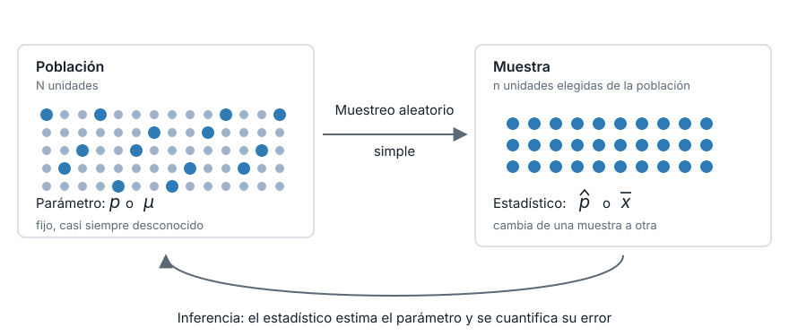
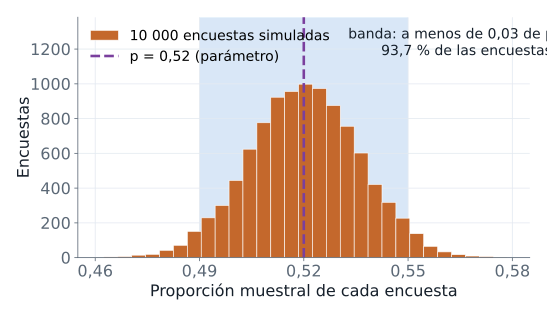
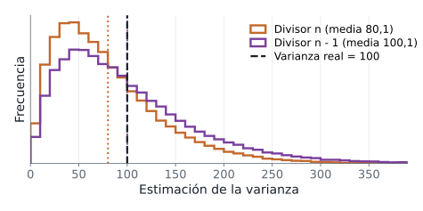
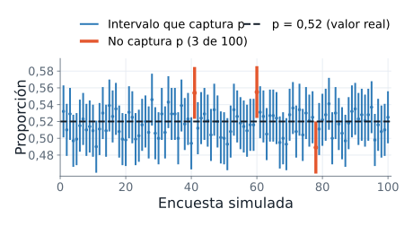
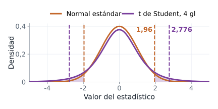
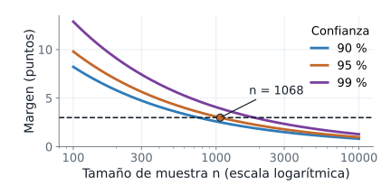
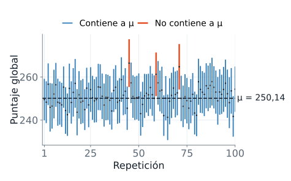

::: {.ficha}
|            |                                                          |
|------------|----------------------------------------------------------|
| Módulo     | Estadística para Analítica                               |
| Programa   | Especialización en Big Data                              |
| Unidad     | Unidad 3. Inferencia estadística                         |
| Saber      | Muestreo, distribución muestral, teorema del límite central e intervalos de confianza |
:::

Esta guía acompaña la presentación de la sesión: [abrir la presentación](presentacion-inferencia-muestreo-intervalos.html).

## La pregunta de la sesión

Una encuesta de opinión entrevista a 1&nbsp;000 personas, reporta que el 52 % apoya al candidato A y declara un margen de error de 3 puntos. El país tiene millones de votantes. La pregunta de la sesión es esta: ¿cuánto se equivoca una muestra al estimar un parámetro de la población?

La guía responde en cuatro pasos. Primero se estudia cómo se elige una muestra y qué la vuelve confiable o sesgada. Después se mide cuánto cambia un resultado de una muestra a otra, y se describe ese cambio con la distribución muestral y el error estándar. Luego el teorema del límite central explica la forma que tiene esa variación. Al final, el intervalo de confianza resume todo en una estimación acompañada de su margen de error.

Al terminar la guía, usted puede hacer lo siguiente:

- Distinguir población, muestra, parámetro y estadístico en un caso concreto, y reconocer cuándo una muestra tiene sesgo de selección.
- Simular encuestas repetidas en Python y describir la distribución muestral de una proporción y de una media.
- Calcular el error estándar de una proporción y de una media, y explicar por qué cuadruplicar el tamaño de muestra lo reduce a la mitad.
- Enunciar el teorema del límite central, decir qué afirma y qué no afirma, y reconocer cuándo converge despacio.
- Evaluar un estimador por su sesgo y por su variabilidad.
- Construir un intervalo de confianza para una proporción y para una media, con la normal o con la t de Student, e interpretarlo sin errores.
- Calcular el tamaño de muestra que garantiza un margen de error dado.

La guía se basta sola. Cada bloque de código es autónomo: importa lo que usa, fija su propia semilla y se puede copiar y ejecutar por separado, siempre que los archivos de datos estén en la carpeta desde donde se ejecuta. La salida que aparece debajo de cada bloque es la que produce ese bloque exacto.

## Notación y datos de la sesión

### Símbolos y nombres en el código

Cada símbolo se define de nuevo en la sección donde aparece por primera vez. Esta tabla es la referencia rápida: junto al símbolo está el nombre que lleva en el código.

| Concepto | Símbolo | Nombre en el código |
|---|---|---|
| Tamaño de la población y de la muestra | $N$ y $n$ | `N` y `n` |
| Media, desviación estándar y proporción de la población (parámetros) | $\mu$, $\sigma$ y $p$ | `mu`, `sigma` y `p` |
| Media, desviación estándar y proporción de la muestra (estadísticos) | $\bar{x}$, $s$ y $\hat{p}$ | `media_muestral`, `desv_muestral` y `p_gorro` |
| Las $\hat{p}$ de muchas encuestas simuladas | $\hat{p}_1, \hat{p}_2, \ldots$ | `p_gorros` |
| Error estándar | $\mathrm{EE}$ | `ee` |
| Nivel de confianza y nivel de significancia | $1-\alpha$ y $\alpha$ | `alfa` (con $\alpha = 0{,}05$) |
| Cuantil de la normal estándar y de la t de Student | $z_{1-\alpha/2}$ y $t_{n-1,\,1-\alpha/2}$ | `z_crit` y `t_crit` |
| Generador de números aleatorios | | `rng` |

Dos convenciones de lectura. En el texto, los decimales van con coma (0,52); en las salidas de Python, con punto (0.52), porque así los imprime el lenguaje. Y todo bloque que simula una población cuya verdad se conoce por construcción lleva el comentario `# Simulación` y declara sus parámetros: un dato simulado nunca se presenta como real.

### Los datos

La sesión usa dos conjuntos de datos reales, además de poblaciones simuladas.

**Saber 11, periodo 2022-2.** Resultados de todos los estudiantes que presentaron la prueba: 1&nbsp;065&nbsp;888 filas. Se usan dos columnas: `punt_global`, el puntaje global, y `cole_naturaleza`, que vale `OFICIAL` o `NO OFICIAL`. El archivo pesa 45 MB, así que siempre se lee con `usecols`, que carga solo las columnas pedidas.

**Cookie Cats.** Experimento A/B de un juego móvil con 90&nbsp;189 jugadores. Se usa la columna `sum_gamerounds`, las rondas que cada jugador jugó en sus primeros 14 días.

Los dos archivos se descargan desde la página de la unidad y se guardan en la carpeta desde la cual se ejecuta el código. Los bloques usan el nombre `saber11_20224.csv`; si no descomprimió el archivo `.zip`, reemplace ese nombre por `saber11_20224.zip` y pandas lo lee sin descomprimir.

```python
import pandas as pd

jugadores = pd.read_csv("cookie_cats.csv")
saber = pd.read_csv("saber11_20224.csv", usecols=["punt_global", "cole_naturaleza"])
print(jugadores.shape, saber.shape)
```

```text
(90189, 5) (1065888, 2)
```

Datos: ICFES, Saber 11 2022-2 (datos.gov.co, CC BY-SA 4.0). Datos: experimento A/B Cookie Cats (DataCamp, Kaggle).

## El reto

Este es el problema que organiza la sesión. Se plantea antes de ver la teoría y se resuelve en la sección 8, con las herramientas de las secciones 4 a 7.

::: {.callout-note}
## Enunciado

Una encuesta de opinión reporta una intención de voto del 52 % por el candidato A. Se entrevistó una muestra aleatoria de $n = 1\,000$ personas, y el margen de error reportado es de $\pm 3$ puntos porcentuales. Un analista sostiene que 1&nbsp;000 personas no permiten conocer la opinión de millones de votantes.

**Tarea.** (a) Aportar evidencia cuantitativa, calculada con Python, a favor o en contra de la afirmación del analista. (b) Comprobar cuánto varía el resultado de una encuesta a otra, repitiendo la encuesta muchas veces en una simulación.

**Restricción.** No se entrega la fórmula del margen de error. La solución se construye solo con Python y simulación.
:::

El enunciado usa cuatro palabras que conviene fijar. El **margen de error** es la cantidad que se suma y se resta a un resultado calculado con una muestra, para indicar cuánto podría diferir del valor de toda la población. La **incertidumbre** es la falta de certeza sobre un valor que se calculó con una muestra y no con toda la población. Una **simulación** usa el computador para repetir muchas veces un experimento aleatorio. Una **semilla** es el número que fija el punto de partida del generador de números aleatorios: con la misma semilla se obtienen siempre los mismos números, y por eso la solución es **reproducible**, es decir, otra persona que repita el procedimiento con los mismos datos obtiene exactamente las mismas cifras.

Una buena solución tiene tres rasgos. Parte de lo observado: 1&nbsp;000 personas y 52 %, con la proporción real de la población desconocida. Cuantifica la incertidumbre, porque un solo número no dice cuánto podría cambiar el resultado. Y es reproducible. Conviene anotar cuatro elementos para contrastar el trabajo con la solución de la sección 8: el método de simulación en una línea, cuántas encuestas simuló, cuánto varía el porcentaje a favor (valor menor, valor mayor y el intervalo que propone) y su conclusión sobre la afirmación del analista, respaldada con una cifra de la simulación.

Antes de seguir, intente el reto. Abra un cuaderno de Python, simule la encuesta con lo que ya sabe y anote qué cifras le permiten sostener una conclusión. Lo más probable es que se quede sin herramientas para algo concreto, por ejemplo para explicar por qué el margen tiene el tamaño que tiene. Esas carencias son lo que organiza las secciones siguientes. La solución completa está en la sección 8.

## Muestreo y distribución muestral

### Población, muestra, parámetro y estadístico

#### Desde el ejemplo

¿Qué se mide exactamente en una encuesta, y qué se quiere conocer? Para poder comparar lo medido con lo verdadero hace falta un mundo donde la verdad se conozca. Lo construimos por simulación: un país de 1&nbsp;000&nbsp;000 de votantes, de los cuales 520&nbsp;000 votan por A. Cada votante se representa con un 1 (vota por A) o un 0 (no vota por A). Después sacamos una muestra de 1&nbsp;000 votantes y la comparamos con el país completo.

```python
import numpy as np

rng = np.random.default_rng(2026)
# Simulación: 1 = vota por A, 0 = no vota por A
poblacion = np.repeat([1, 0], [520_000, 480_000])
N, p = len(poblacion), poblacion.mean()
print(f"Población: N = {N}, p = {p:.3f}")
n = 1_000
muestra = rng.choice(poblacion, n, replace=False)
p_gorro = muestra.mean()
print(f"Muestra: n = {n}, votos por A = {muestra.sum()}")
print(f"p_gorro = {p_gorro:.3f}, error = {p_gorro - p:+.3f}")
```

```text
Población: N = 1000000, p = 0.520
Muestra: n = 1000, votos por A = 532
p_gorro = 0.532, error = +0.012
```

Las llamadas del bloque, en orden. `np.random.default_rng(2026)` crea el generador de números aleatorios con la semilla 2026. `np.repeat([1, 0], [520_000, 480_000])` construye un arreglo con 520&nbsp;000 unos seguidos de 480&nbsp;000 ceros. `.mean()` promedia el arreglo: como solo hay ceros y unos, el promedio es la proporción de unos. `rng.choice(poblacion, n, replace=False)` extrae `n` elementos al azar sin devolverlos, de modo que ningún votante aparece dos veces. `muestra.sum()` cuenta los unos de la muestra, es decir, los votos por A. El formato `:+.3f` imprime tres decimales y siempre muestra el signo.

#### Definición formal

La **población** es el conjunto completo de unidades que interesa estudiar. Su tamaño se escribe $N$. Aquí son los 1&nbsp;000&nbsp;000 de votantes simulados.

Un **parámetro** es una cantidad fija que describe la población. La proporción de votantes por A es el parámetro $p$; la media y la desviación estándar de una variable numérica son los parámetros $\mu$ y $\sigma$. En la práctica los parámetros se desconocen: por eso se estima. En la simulación sí conocemos $p = 0{,}52$.

La **muestra** es el subconjunto de la población que se observa. Su tamaño se escribe $n$. Aquí son $n = 1\,000$ votantes elegidos por **muestreo aleatorio simple**: cada votante tiene la misma probabilidad de entrar en la muestra, y la elección se hace sin reemplazo, es decir, sin devolver a la población a quien ya salió.

Un **estadístico** es una cantidad calculada con los datos de la muestra. La proporción muestral es

$$\hat{p} = \frac{\text{número de votos por A en la muestra}}{n}$$

donde $\hat{p}$ se lee "p gorro". En el código es `p_gorro`. En la muestra del bloque hay 532 votos por A, así que $\hat{p} = 532/1\,000 = 0{,}532$. La diferencia $\hat{p} - p = +0{,}012$ se llama **error de muestreo**: la distancia entre el estadístico y el parámetro, causada solo por el azar de la selección.

::: {.diagrama}
{fig-alt="Esquema de dos recuadros. A la izquierda, la población con N unidades y el parámetro p o mu, fijo y casi siempre desconocido. A la derecha, la muestra de n unidades con el estadístico p gorro o x barra, que cambia de una muestra a otra. Una flecha de muestreo aleatorio simple va de la población a la muestra y una flecha curva de inferencia regresa de la muestra a la población."}
:::

#### Qué significa y qué no significa

El parámetro $p$ es un número fijo; el estadístico $\hat{p}$ depende de qué votantes entraron en la muestra. El primero describe a la población, el segundo describe a la muestra, y la inferencia consiste en usar el segundo para decir algo sobre el primero.

- El error de muestreo aparece aunque la muestra se elija sin ningún defecto, porque cada muestra posible trae sus propias unidades. Ninguna falla del encuestador lo causa.
- En un problema real el error de muestreo no se observa: exigiría conocer $p$. Lo que sí se puede hacer es estudiar cuánto suele valer, y de eso trata el resto de la guía.

::: {.callout-note}
## En una línea

El parámetro es fijo y desconocido; el estadístico se calcula con la muestra y la diferencia entre ambos es el error de muestreo.
:::

### Cómo se elige la muestra: aleatoria simple y sesgo de selección

#### Desde el ejemplo

¿Basta con reunir muchas respuestas? En 1936, la revista *Literary Digest* intentó predecir la elección presidencial de Estados Unidos con un listado formado por suscriptores, directorios telefónicos y registros de automóviles. Envió unos 10 millones de cuestionarios y recibió cerca de 2,4 millones de respuestas. Predijo 57 % para Landon; Roosevelt ganó con 60,8 % (Squire, 1988). Una muestra de millones se equivocó por un margen enorme.

El fallo está en cómo se eligió la muestra. El listado cubría sobre todo hogares de mayores ingresos, y entre quienes recibieron el cuestionario respondieron más los opositores de Roosevelt. Para ver el mecanismo sin depender de los datos históricos, lo simulamos. De 1&nbsp;000&nbsp;000 de votantes, 300&nbsp;000 están en el listado y votan por A con probabilidad 0,40; los otros 700&nbsp;000 votan por A con probabilidad 0,5714. Eso deja el parámetro en $p = 0{,}520$.

```python
import numpy as np

rng = np.random.default_rng(2026)
# Simulación: 300 000 votantes en el marco
en_marco = np.repeat([True, False], [300_000, 700_000])
prob_a = np.where(en_marco, 0.40, 0.5714)
voto = rng.random(1_000_000) < prob_a
print(f"Parámetro p:                {voto.mean():.3f}")
aleatoria = rng.choice(voto, 1_000, replace=False)
print(f"Aleatoria simple, n = 1000: {aleatoria.mean():.3f}")
del_marco = rng.choice(voto[en_marco], 100_000, replace=False)
print(f"Solo marco, n = 100000:     {del_marco.mean():.3f}")
```

```text
Parámetro p:                0.520
Aleatoria simple, n = 1000: 0.491
Solo marco, n = 100000:     0.401
```

`np.where(en_marco, 0.40, 0.5714)` asigna a cada votante la probabilidad 0,40 si está en el listado y 0,5714 si no. `rng.random(1_000_000) < prob_a` sortea un número entre 0 y 1 para cada votante y declara que vota por A cuando ese número queda por debajo de su probabilidad: así cada votante vota por A con la probabilidad que le tocó. `voto[en_marco]` selecciona solo los votantes del listado.

#### Definición formal

El **marco muestral** es el listado de unidades del que se extrae la muestra. Si el marco deja por fuera a una parte de la población, la muestra no puede representarla.

El **sesgo de selección** es un error sistemático que aparece cuando la forma de elegir la muestra favorece a ciertas unidades. El **sesgo de no respuesta** es un error sistemático de otro origen: quienes responden difieren, en lo que se mide, de quienes no responden. Los dos empujan el estadístico hacia el mismo lado en cada muestra. Eso los distingue del error de muestreo, que cambia de signo y de tamaño de una muestra a otra.

#### Qué significa y qué no significa

La muestra aleatoria simple de 1&nbsp;000 votantes dio 0,491, a 2,9 puntos por debajo de $p = 0{,}520$, una distancia dentro del azar que se espera con $n = 1\,000$. La muestra tomada solo del marco, con 100&nbsp;000 votantes, cien veces más grande, dio 0,401, muy lejos.

- Aumentar $n$ reduce el error de muestreo y no toca el sesgo de selección. Cien mil votantes del marco estiman con precisión el comportamiento del marco, que es otro.
- La representatividad depende del mecanismo de selección; el tamaño de la muestra no la garantiza.
- Las conclusiones de las secciones siguientes suponen muestreo aleatorio simple. Si la muestra tiene sesgo de selección, el margen de error calculado con esas fórmulas es demasiado optimista.

Fuentes del caso *Literary Digest*: P. Squire (1988), "Why the 1936 Literary Digest Poll Failed", *Public Opinion Quarterly* 52(1), 125-133; D. Freedman, R. Pisani y R. Purves, *Statistics*, 4.a ed.

::: {.callout-note}
## En una línea

El sesgo de selección no baja al aumentar $n$; solo el muestreo aleatorio simple permite medir el error que queda.
:::

### Una encuesta da un resultado y otra da otro

#### Desde el ejemplo

Con una muestra bien elegida, ¿cuánto cambia el resultado si se repite la encuesta? Volvemos al país simulado con $p = 0{,}52$ y repetimos cinco veces una encuesta de $n = 1\,000$, cada vez con una muestra nueva.

```python
import numpy as np

rng = np.random.default_rng(2026)
poblacion = np.repeat([1, 0], [520_000, 480_000])  # Simulación
p, n = 0.52, 1_000
for i in range(1, 6):
    muestra = rng.choice(poblacion, n, replace=False)
    p_gorro = muestra.mean()
    error = p_gorro - p
    print(f"Encuesta {i}: p_gorro {p_gorro:.3f}, error {error:+.3f}")
```

```text
Encuesta 1: p_gorro 0.532, error +0.012
Encuesta 2: p_gorro 0.514, error -0.006
Encuesta 3: p_gorro 0.517, error -0.003
Encuesta 4: p_gorro 0.536, error +0.016
Encuesta 5: p_gorro 0.486, error -0.034
```

Cada vuelta del ciclo `for` extrae una muestra nueva y calcula su $\hat{p}$ y su error $\hat{p} - p$. La encuesta 1 repite la muestra de la sección 4.1 (0,532) porque el generador parte de la misma semilla, 2026, y hace la misma primera extracción. Las otras cuatro dan 0,514, 0,517, 0,536 y 0,486. Ninguna coincide con $p = 0{,}52$, y la quinta se aleja 0,034.

#### Definición formal

Una **variable aleatoria** es una cantidad cuyo valor depende del azar. Antes de extraer la muestra, no se sabe qué valor tendrá $\hat{p}$: depende de qué votantes entren. Por eso el estadístico $\hat{p}$ es una variable aleatoria, y cada encuesta es una observación de ella.

#### Qué significa y qué no significa

El resultado de una encuesta es una de muchas posibles. Una sola cifra, 0,532 o 0,486, no dice cuánto podría haber cambiado.

- Las cinco encuestas usan la misma población y el mismo método; la diferencia entre ellas es solo azar de muestreo.
- Cinco encuestas no bastan para decir cuánto varía el resultado. Para describir esa variación con precisión hay que repetir la encuesta muchas veces, que es lo que sigue.

::: {.callout-note}
## En una línea

El estadístico cambia de una muestra a otra: es una variable aleatoria, y su variación es lo que hay que medir.
:::

### La distribución muestral

#### Desde el ejemplo

¿Cómo se ven los resultados de todas las encuestas posibles? Repetimos la encuesta de $n = 1\,000$ diez mil veces sobre la población con $p = 0{,}52$ y guardamos cada $\hat{p}$ en `p_gorros`. Después resumimos esos 10&nbsp;000 valores.

```python
import numpy as np

rng = np.random.default_rng(2026)
poblacion = np.repeat([1, 0], [520_000, 480_000])  # Simulación
p, n = 0.52, 1_000
p_gorros = np.empty(10_000)
for i in range(10_000):
    p_gorros[i] = rng.choice(poblacion, n, replace=False).mean()
cerca = np.abs(p_gorros - p) <= 0.03
print(f"Media de los p_gorro: {p_gorros.mean():.3f}")
print(f"Desviación de los p_gorro: {np.std(p_gorros):.4f}")
print(f"A menos de 0.03 de p: {cerca.mean():.3f}")
```

```text
Media de los p_gorro: 0.520
Desviación de los p_gorro: 0.0158
A menos de 0.03 de p: 0.937
```

`np.empty(10_000)` reserva un arreglo de 10&nbsp;000 posiciones que el ciclo llena una por repetición. `np.abs(p_gorros - p) <= 0.03` calcula, para cada encuesta, si su resultado queda a 0,03 o menos de $p$; el promedio de esa condición es la fracción de encuestas que cumple. `np.std` calcula la desviación estándar con divisor $n$, la adecuada cuando se tiene el conjunto completo de valores que se quiere describir.

::: {.diagrama}
{fig-alt="Histograma de las proporciones muestrales de 10 mil encuestas simuladas. Tiene forma de campana simétrica centrada en 0,52, marcado con una línea punteada. Una banda sombreada de 0,49 a 0,55 contiene el 93,7 por ciento de las encuestas."}
:::

#### Definición formal

La **distribución muestral** de un estadístico es la distribución de los valores que toma en todas las muestras posibles del mismo tamaño. Casi nunca se puede listar completa, así que se aproxima repitiendo el muestreo muchas veces, como en el bloque. El histograma de arriba es esa aproximación para $\hat{p}$.

Tres rasgos resumen una distribución muestral. El centro: la media de los 10&nbsp;000 valores es 0,520, igual a $p$. La dispersión: su desviación estándar es 0,0158. La forma: simétrica y acampanada alrededor de $p$. La banda sombreada contiene casi todo el histograma: el 93,7 % de las encuestas cae a menos de 0,03 de $p$. Por qué aparece esa forma es la pregunta de la sección 5.

#### Qué significa y qué no significa

- La distribución muestral es una distribución de **estadísticos**, uno por muestra. Los datos de una sola muestra tienen otra distribución, la de las respuestas individuales de esos 1&nbsp;000 votantes.
- En un estudio real se observa una sola muestra, no 10&nbsp;000. La distribución muestral no se ve; se estudia por simulación o con fórmulas, y eso es lo que permite decir cuánto se puede equivocar la muestra que sí se tiene.
- Que el centro coincida con $p$ dice que $\hat{p}$ no se inclina hacia un lado: en promedio sobre todas las encuestas acierta. No dice que cada encuesta acierte.

::: {.callout-note}
## En una línea

La distribución muestral muestra dónde caen los resultados de todas las muestras posibles: centrada en el parámetro, con una dispersión medible.
:::

### El error estándar

#### Desde el ejemplo

¿Existe una fórmula para la dispersión de la distribución muestral, sin repetir 10&nbsp;000 encuestas? Sí. Para una proporción, el error estándar es $\mathrm{EE} = \sqrt{p(1-p)/n}$, donde $p$ es la proporción de la población y $n$ el tamaño de la muestra; la definición precisa viene después del código. Antes de evaluar la fórmula, hay que saber cuánto dispersan los ceros y unos de la población.

```python
import numpy as np

poblacion = np.repeat([1, 0], [520_000, 480_000])  # Simulación
p = 0.52
print(f"Desviación de los ceros y unos: {poblacion.std():.4f}")
print(f"Raíz de p(1 - p): {np.sqrt(p * (1 - p)):.4f}")
for n in [100, 400, 1_000, 10_000]:
    print(f"p_gorro, n = {n:>5}: EE = {np.sqrt(p * (1 - p) / n):.4f}")
```

```text
Desviación de los ceros y unos: 0.4996
Raíz de p(1 - p): 0.4996
p_gorro, n =   100: EE = 0.0500
p_gorro, n =   400: EE = 0.0250
p_gorro, n =  1000: EE = 0.0158
p_gorro, n = 10000: EE = 0.0050
```

La desviación de una población de ceros y unos con proporción $p$ de unos vale $\sqrt{p(1-p)}$; el bloque lo comprueba con 0,4996 por los dos caminos. Con $n = 1\,000$ la fórmula da un error estándar de 0,0158, que coincide con la desviación de los 10&nbsp;000 resultados simulados en la sección anterior. Con $n = 100$ es 0,0500 y con $n = 400$ es 0,0250: cuadruplicar el tamaño de la muestra reduce el error a la mitad.

#### Definición formal

El **error estándar** (EE) de un estadístico es la desviación estándar de su distribución muestral: mide cuánto varía el estadístico de una muestra a otra. Para la media de una muestra aleatoria de tamaño $n$ de una población con desviación estándar $\sigma$,

$$\mathrm{EE}(\bar{x}) = \frac{\sigma}{\sqrt{n}}$$

donde $\bar{x}$ es la media muestral y $\sigma$ la desviación estándar de la población, es decir, la raíz del promedio de los cuadrados de las desviaciones de cada unidad a la media $\mu$. Una proporción es la media de una variable de ceros y unos, y esa variable tiene $\sigma = \sqrt{p(1-p)}$. Por eso,

$$\mathrm{EE}(\hat{p}) = \sqrt{\frac{p(1-p)}{n}}$$

Ambas fórmulas valen para muestreo aleatorio simple cuando $n$ es pequeño frente a $N$ (la sección 5.3 muestra por qué $N$ casi no importa). La raíz cuadrada en el denominador explica el efecto de $n$: para dividir el error estándar entre 2 hay que multiplicar $n$ por 4, y para dividirlo entre 10 hay que multiplicarlo por 100.

Con una media real lo comprobamos con los puntajes de Saber 11, tomando los 1&nbsp;065&nbsp;888 estudiantes como la población completa. Se calcula $\mu$ y $\sigma$ directamente, y se verifica la fórmula contra 10&nbsp;000 muestras de $n = 100$ estudiantes.

```python
import numpy as np
import pandas as pd

rng = np.random.default_rng(2026)
puntajes = pd.read_csv("saber11_20224.csv", usecols=["punt_global"])["punt_global"].to_numpy()
mu, sigma = puntajes.mean(), np.std(puntajes)
n = 100
ee = sigma / np.sqrt(n)
medias = rng.choice(puntajes, size=(10_000, n)).mean(axis=1)
print(f"Saber 11: mu = {mu:.2f}, sigma = {sigma:.2f}")
print(f"EE de la media con n = {n}: fórmula {ee:.2f}, simulación {medias.std():.2f}")
```

```text
Saber 11: mu = 250.14, sigma = 51.84
EE de la media con n = 100: fórmula 5.18, simulación 5.20
```

Datos: ICFES, Saber 11 2022-2 (datos.gov.co, CC BY-SA 4.0).

`pd.read_csv(..., usecols=["punt_global"])` lee solo esa columna, y `.to_numpy()` la convierte en un arreglo de NumPy. Se usa `np.std` y no `.std()` de pandas porque este último divide entre $n-1$ por defecto, y aquí los puntajes son la población completa, no una muestra. `rng.choice(puntajes, size=(10_000, n))` extrae 10&nbsp;000 muestras de $n = 100$ puntajes en una sola llamada, una por fila, con reemplazo (es la opción por defecto, y con 100 de más de un millón de estudiantes casi no cambia nada). `.mean(axis=1)` promedia cada fila y deja 10&nbsp;000 medias.

El puntaje global tiene media $\mu = 250{,}14$ y desviación $\sigma = 51{,}84$. La media de una muestra de 100 estudiantes tiene un error estándar de $51{,}84/\sqrt{100} = 5{,}18$ puntos por la fórmula, y de 5,20 por simulación.

#### Qué significa y qué no significa

- El error estándar describe la variabilidad del **estadístico**, no la de los datos. Los puntajes individuales varían alrededor de 51,84 puntos; las medias de muestras de 100 estudiantes varían alrededor de 5,18.
- Es la desviación de un estadístico de muestra a muestra. No es la desviación de los datos de una muestra, que se llama $s$.
- Mide solo el error de muestreo. Con sesgo de selección, el error estándar puede ser pequeño y el resultado seguir lejos del parámetro.

::: {.callout-note}
## En una línea

El error estándar es la desviación de la distribución muestral: $\sqrt{p(1-p)/n}$ para una proporción y $\sigma/\sqrt{n}$ para una media, y baja con la raíz de $n$.
:::

## El teorema del límite central

### Qué afirma el teorema

#### Desde el ejemplo

El histograma de la sección 4.4 tiene forma de campana, aunque cada dato individual es un 0 o un 1. ¿Por qué? Una medida directa de esa forma consiste en estandarizar cada $\hat{p}$, es decir, restarle $p$ y dividir entre el error estándar. Si la distribución muestral es una campana normal, la variable resultante debe tener media 0, desviación 1 y dejar el 95 % de los valores entre $-1{,}96$ y $1{,}96$.

```python
import numpy as np

rng = np.random.default_rng(2026)
poblacion = np.repeat([1, 0], [520_000, 480_000])  # Simulación
p, n = 0.52, 1_000
ee = np.sqrt(p * (1 - p) / n)
p_gorros = np.empty(10_000)
for i in range(10_000):
    p_gorros[i] = rng.choice(poblacion, n, replace=False).mean()
z = (p_gorros - p) / ee
print(f"Media de z: {z.mean():.3f}, desviación de z: {z.std():.3f}")
print(f"Proporción con |z| <= 1.96: {(np.abs(z) <= 1.96).mean():.3f}")
```

```text
Media de z: 0.016, desviación de z: 1.002
Proporción con |z| <= 1.96: 0.946
```

La media de $z$ es 0,016 y su desviación 1,002, muy cerca de 0 y 1; la proporción de valores con $|z| \le 1{,}96$ es 0,946, muy cerca del 0,95 de una normal estándar. El teorema del límite central explica por qué ocurre esto con una población de ceros y unos, y por qué ocurriría con casi cualquier otra población.

#### Definición formal

Antes del enunciado, dos términos. Unas observaciones son **independientes** cuando el valor de una no informa sobre las demás, e **idénticamente distribuidas** cuando provienen todas de la misma distribución; el muestreo aleatorio simple las produce (de forma aproximada cuando $n$ es pequeño frente a $N$). Y la **normal estándar** es la campana simétrica con media 0 y desviación 1.

**Teorema del límite central.** Sean $X_1, X_2, \ldots, X_n$ observaciones independientes e idénticamente distribuidas, con media $\mu$ y desviación estándar $\sigma$ finita. Si $n$ es grande, la media muestral $\bar{X}$ tiene distribución aproximadamente normal:

$$\bar{X} \approx \text{Normal}\left(\mu,\ \frac{\sigma^2}{n}\right) \qquad Z = \frac{\bar{X} - \mu}{\sigma/\sqrt{n}} \approx \text{Normal}(0,\,1)$$

Aquí $\bar{X}$ (mayúscula) es la media muestral antes de extraer la muestra, una variable aleatoria; $\bar{x}$ (minúscula) es el valor que toma en una muestra concreta. La media de $\bar{X}$ es $\mu$, su varianza es $\sigma^2/n$ y su desviación estándar, $\sigma/\sqrt{n}$, es el error estándar. $Z$ es la media muestral estandarizada. El símbolo $\approx$ significa "se parece cada vez más a" cuando $n$ crece.

Una proporción es la media de una variable de ceros y unos. Por eso el teorema también cubre a $\hat{p}$, y por eso la distribución muestral de la sección 4.4 tiene forma de campana: el teorema asegura la forma, y el error estándar $\sqrt{p(1-p)/n}$ fija el ancho.

::: {.diagrama}
{fig-alt="Tres partes de izquierda a derecha. A la izquierda, una población con forma muy asimétrica, con cola larga a la derecha, que tiene media mu y desviación estándar sigma. En el centro, una flecha rotulada: muchas muestras independientes de tamaño n, de cada una se calcula la media muestral. A la derecha, la distribución de las medias muestrales con forma de campana, centrada en mu y con error estándar sigma sobre raíz de n."}
:::

#### Qué significa y qué no significa

- La forma de la población no importa. La media de $n$ observaciones tiende a una campana aunque cada observación sea asimétrica, discreta o de ceros y unos.
- El teorema es un resultado sobre **medias**, y por extensión sobre proporciones y sumas. No dice que los datos individuales se vuelvan normales: siguen teniendo su forma original.
- El teorema pide varianza finita: poblaciones con colas tan pesadas que la desviación estándar no existe quedan fuera.
- No fija un $n$ mínimo universal. "Grande" depende de qué tan asimétrica sea la población: la sección siguiente lo muestra con datos reales.

::: {.callout-note}
## En una línea

La media de $n$ observaciones independientes tiende a una campana normal, centrada en $\mu$ y con error estándar $\sigma/\sqrt{n}$, sin importar la forma de la población.
:::

### El teorema con una variable muy sesgada

#### Desde el ejemplo

¿Qué pasa cuando la población no se parece en nada a una campana? Usamos las rondas jugadas por los 90&nbsp;189 jugadores de Cookie Cats, y las tratamos como la población completa. Primero se mira cómo es esa variable.

```python
import pandas as pd

rondas = pd.read_csv("cookie_cats.csv")["sum_gamerounds"]
print(f"Jugadores: {len(rondas)}")
print(f"Media {rondas.mean():.2f}, mediana {rondas.median():.0f}, máximo {rondas.max()}")
print(f"Percentil 99: {rondas.quantile(0.99):.0f}")
```

```text
Jugadores: 90189
Media 51.87, mediana 16, máximo 49854
Percentil 99: 493
```

La mitad de los jugadores juega 16 rondas o menos, el 99 % juega 493 o menos, y un jugador llegó a 49&nbsp;854. La media (51,87) queda muy por encima de la mediana (16): la distribución tiene una cola derecha muy larga. Para cada tamaño de muestra $n$ en 1, 5, 30 y 200, extraemos 10&nbsp;000 muestras, calculamos la media de cada una y medimos la asimetría de esas 10&nbsp;000 medias: un número que vale 0 cuando la distribución es simétrica y crece cuando la cola derecha se alarga.

```python
import numpy as np
import pandas as pd
from scipy import stats

rng = np.random.default_rng(2026)
datos = pd.read_csv("cookie_cats.csv")
rondas = datos["sum_gamerounds"].to_numpy()
for n in [1, 5, 30, 200]:
    muestras = rng.choice(rondas, size=(10_000, n))
    asim = stats.skew(muestras.mean(axis=1))
    k = (muestras == rondas.max()).any(axis=1).sum()
    print(f"n = {n:>3}: asimetría {asim:6.2f}; con {rondas.max()}: {k}")
```

```text
n =   1: asimetría   5.58; con 49854: 0
n =   5: asimetría  74.34; con 49854: 1
n =  30: asimetría  29.29; con 49854: 7
n = 200: asimetría  12.77; con 49854: 27
```

Datos: experimento A/B Cookie Cats (DataCamp, Kaggle).

`stats.skew` calcula la asimetría de las 10&nbsp;000 medias. La condición `muestras == rondas.max()` marca los jugadores con 49&nbsp;854 rondas, `.any(axis=1)` detecta las muestras que contienen al menos uno y `.sum()` las cuenta; esa es la última columna de la salida.

Para separar el efecto del valor extremo, un segundo bloque repite los mismos sorteos (misma semilla y mismo orden de llamadas) y calcula la asimetría de la población completa, la que queda sin el máximo y la de las medias de las muestras que no contienen el extremo.

```python
import numpy as np
import pandas as pd
from scipy import stats

rng = np.random.default_rng(2026)
rondas = pd.read_csv("cookie_cats.csv")["sum_gamerounds"].to_numpy()
print(f"Población completa: asimetría {stats.skew(rondas):.2f}")
print(f"Sin el máximo {rondas.max()}: asimetría {stats.skew(rondas[rondas < rondas.max()]):.2f}")
for n in [1, 5, 30, 200]:
    muestras = rng.choice(rondas, size=(10_000, n))
    sin_extremo = ~(muestras == rondas.max()).any(axis=1)
    asim = stats.skew(muestras.mean(axis=1)[sin_extremo])
    print(f"n = {n:>3}: asimetría sin las muestras con el extremo {asim:5.2f}")
```

```text
Población completa: asimetría 185.43
Sin el máximo 49854: asimetría 5.95
n =   1: asimetría sin las muestras con el extremo  5.58
n =   5: asimetría sin las muestras con el extremo  3.00
n =  30: asimetría sin las muestras con el extremo  1.16
n = 200: asimetría sin las muestras con el extremo  0.48
```

`rondas[rondas < rondas.max()]` descarta al jugador de 49&nbsp;854 rondas, y `sin_extremo` es verdadero para las muestras que no lo incluyen; `muestras.mean(axis=1)[sin_extremo]` conserva solo las medias de esas muestras.

::: {.diagrama}
{fig-alt="Cuatro paneles con histogramas de las medias muestrales de rondas jugadas, uno por cada tamaño de muestra n igual a 1, 5, 30 y 200. Los paneles de n igual a 1 y 5 son asimétricos, con una cola derecha larga. El de n igual a 30 conserva una cola derecha visible y el de n igual a 200 se aproxima a una campana. Cada panel indica cuántas muestras con el valor extremo quedaron fuera del eje: ninguna, 1, 7 y 27."}
:::

#### Definición formal

La **asimetría** de una variable $X$ con media $\mu$ y desviación estándar $\sigma$ es el promedio de $\left(\frac{X-\mu}{\sigma}\right)^3$. Vale 0 en una distribución simétrica, como la normal, y es positiva cuando la cola derecha es más larga que la izquierda. Como el cubo agranda mucho las desviaciones grandes, un solo valor extremo basta para disparar la medida. Aquí se aplica a las 10&nbsp;000 medias de cada $n$, y el teorema predice que debe acercarse a 0 cuando $n$ crece.

#### Qué significa y qué no significa

La asimetría de la población completa, los 90&nbsp;189 jugadores, es 185,43, casi toda por el único jugador de 49&nbsp;854 rondas: sin él vale 5,95. Con $n = 1$ las 10&nbsp;000 "medias" son 10&nbsp;000 jugadores sorteados, ninguno de ellos el extremo, y su asimetría es 5,58, que corresponde a esos sorteos y no a la población completa. Al retirar las muestras que incluyen el extremo, la asimetría de las medias baja a 3,00 con $n = 5$, a 1,16 con $n = 30$ y a 0,48 con $n = 200$. Con $n = 200$ el histograma se aproxima a una campana; con $n = 30$ conserva una cola derecha visible, aunque cada dato venga de una población muy asimétrica. Los valores de la primera salida, que sí incluye las muestras con el extremo, no bajan de forma regular: 5,58, 74,34, 29,29 y 12,77. La causa es el valor extremo de 49&nbsp;854: con $n = 5$ una sola muestra lo incluyó y la asimetría saltó a 74,34 por esa muestra; con $n = 200$ lo incluyeron 27 muestras. Cada muestra con el valor extremo tiene una media muy alejada del resto, y esas pocas medias dominan la medida. En la figura, esas muestras se dibujan fuera del eje para que se vea la forma del resto.

- El teorema funciona con datos reales muy asimétricos: la forma de campana se aproxima al crecer $n$, y más despacio cuanto más pesada es la cola.
- Un valor extremo retrasa la convergencia. Con colas pesadas, $n = 30$ no es una garantía, y conviene mirar el histograma de las medias o revisar los valores extremos antes de confiar en las fórmulas.
- "Grande" no es un número fijo. Con una población simétrica suelen alcanzar unas pocas decenas de observaciones; con una cola muy pesada, como un valor 3&nbsp;000 veces mayor que la mediana, hacen falta bastantes más.

::: {.callout-note}
## En una línea

Con datos reales muy sesgados el teorema sigue valiendo, pero un valor extremo retrasa la convergencia: no hay un $n$ mágico.
:::

### Alcances del teorema y tamaño de la población

#### Desde el ejemplo

Se oye con frecuencia que, para opinar sobre un país, la muestra debe ser un porcentaje de la población. ¿Es cierto? Comparamos la misma encuesta, $n = 1\,000$ y $p = 0{,}52$, sobre dos poblaciones: una de $N = 100\,000$ y otra de $N = 1\,000\,000$, con 10&nbsp;000 repeticiones cada una.

```python
import numpy as np

rng = np.random.default_rng(2026)
p, n = 0.52, 1_000
for N in [100_000, 1_000_000]:
    unos = round(p * N)
    poblacion = np.repeat([1, 0], [unos, N - unos])
    p_gorros = np.empty(10_000)
    for i in range(10_000):
        muestra = rng.choice(poblacion, n, replace=False)
        p_gorros[i] = muestra.mean()
    print(f"N = {N}: desviación = {np.std(p_gorros):.4f}")
```

```text
N = 100000: desviación = 0.0157
N = 1000000: desviación = 0.0160
```

La desviación de $\hat{p}$ es 0,0157 con $N = 100\,000$ y 0,0160 con $N = 1\,000\,000$. La fórmula $\sqrt{p(1-p)/n}$, que no contiene $N$, da 0,0158. Pasar de cien mil a un millón de votantes no cambia la precisión de una encuesta de 1&nbsp;000.

#### Definición formal

Al muestrear sin reemplazo hay una corrección exacta del error estándar, el **factor de población finita**:

$$\sqrt{\frac{N-n}{N-1}}$$

donde $N$ es el tamaño de la población y $n$ el de la muestra. Multiplica al error estándar y vale casi 1 cuando $n$ es pequeño frente a $N$. Con $n = 1\,000$ y $N = 100\,000$ vale 0,995; con $N = 1\,000\,000$ vale 0,9995. Solo se nota cuando la muestra es una fracción apreciable de la población, por ejemplo más del 5 %.

#### Qué significa y qué no significa

Lo que el teorema del límite central afirma y lo que no afirma:

| Afirma | No afirma |
|---|---|
| La media muestral es aproximadamente normal, centrada en $\mu$ y con error estándar $\sigma/\sqrt{n}$, si la varianza poblacional es finita. | Que los datos individuales sean normales. |
| La forma de campana mejora cuando $n$ crece. | Un tamaño $n$ universal a partir del cual la aproximación sea buena. |
| Vale para observaciones independientes con la misma distribución. | Que corrija el sesgo de selección o la dependencia entre observaciones, como las respuestas de una misma familia. |

La precisión de una encuesta depende de $n$ y casi nada de $N$. Por eso 1&nbsp;000 personas pueden describir a un país de millones con el mismo margen que describen a una ciudad.

::: {.callout-note}
## En una línea

La precisión depende del tamaño de la muestra y casi nada del tamaño de la población, mientras la muestra sea pequeña frente a ella.
:::

## Estimación puntual

### Estimador, estimación y sesgo

#### Desde el ejemplo

Hasta aquí hemos calculado $\bar{x}$ y $\hat{p}$ sin preguntarnos si son buenas formas de aproximar un parámetro. ¿Cómo se juzga una regla de cálculo? Con el parámetro $\sigma^2$, la **varianza poblacional**. Hay dos fórmulas razonables para estimarla con una muestra, que difieren solo en el divisor: $n$ o $n - 1$. Las simulamos sobre una población normal con $\sigma = 10$, es decir $\sigma^2 = 100$, con 100&nbsp;000 muestras de $n = 5$.

```python
import numpy as np

rng = np.random.default_rng(2026)
sigma, n = 10, 5                  # Simulación: varianza real 100
muestras = rng.normal(0, sigma, size=(100_000, n))
var_n = np.var(muestras, axis=1, ddof=0)    # divisor n
var_n1 = np.var(muestras, axis=1, ddof=1)   # divisor n - 1
print(f"Varianza poblacional: {sigma**2:.1f}")
for nombre, v in [("n:", var_n), ("n - 1:", var_n1)]:
    media, desv = v.mean(), v.std(ddof=1)
    print(f"Divisor {nombre:6} media {media:.1f}, desv. {desv:.1f}")
```

```text
Varianza poblacional: 100.0
Divisor n:     media 80.1, desv. 56.6
Divisor n - 1: media 100.1, desv. 70.8
```

`rng.normal(0, sigma, size=(100_000, n))` simula 100&nbsp;000 muestras, una por fila, de una población normal con media 0 y desviación 10. `np.var(..., axis=1, ddof=0)` calcula una varianza por fila dividiendo entre $n$, y con `ddof=1` divide entre $n-1$. Cada regla produce 100&nbsp;000 estimaciones de $\sigma^2$.

Con divisor $n$, el promedio de las estimaciones es 80,1: queda por debajo de 100. Con divisor $n-1$ es 100,1. La figura reúne las 100&nbsp;000 estimaciones de cada regla.

::: {.diagrama}
{fig-alt="Dos histogramas superpuestos de las estimaciones de la varianza. El de divisor n tiene su media en 80,1 y el de divisor n menos 1 en 100,1. Una línea vertical punteada marca la varianza real, 100. El de divisor n menos 1 se centra en la línea y es más ancho."}
:::

#### Definición formal

Un **estimador** es una regla de cálculo que se aplica a cualquier muestra para aproximar un parámetro $\theta$ (la letra griega theta, que aquí representa un parámetro cualquiera). Se escribe $\hat{\theta}$. Antes de extraer la muestra, $\hat{\theta}$ es una variable aleatoria. Una **estimación** es el número que produce esa regla con una muestra concreta: $\hat{p} = 0{,}532$, el resultado de la muestra de la sección 4.1, es una estimación, y la regla "contar los votos por A y dividir entre $n$" es el estimador.

El **sesgo** de un estimador compara su promedio sobre todas las muestras posibles con el parámetro:

$$\text{sesgo}(\hat{\theta}) = E(\hat{\theta}) - \theta$$

donde $E(\hat{\theta})$ es el valor esperado de $\hat{\theta}$, es decir, el promedio de sus valores en todas las muestras posibles. Con sesgo cero, el estimador es **insesgado**. La **varianza del estimador**, $\mathrm{Var}(\hat{\theta})$, mide cuánto se dispersan sus estimaciones de una muestra a otra; su raíz es el error estándar.

Para la varianza hay dos candidatos. $S_n^2$ divide entre $n$ y $S^2$ divide entre $n-1$:

$$S_n^2 = \frac{1}{n}\sum_{i=1}^{n}(x_i - \bar{x})^2 \qquad S^2 = \frac{1}{n-1}\sum_{i=1}^{n}(x_i - \bar{x})^2$$

donde $x_i$ es la observación $i$ de la muestra. Con divisor $n$ el promedio de las estimaciones es $\frac{n-1}{n}\sigma^2$: con $n = 5$ ese factor vale 0,8 y explica el 80,1 de la salida. La causa es que las desviaciones se miden respecto de $\bar{x}$, que por construcción queda más cerca de los datos que $\mu$, y eso las encoge. Con divisor $n-1$ la corrección compensa y el promedio es 100,1.

#### Qué significa y qué no significa

- Que $S^2$ sea insesgado no lo hace mejor en todo: es más variable que $S_n^2$ (desviación 70,8 frente a 56,6). Entre sesgo y variabilidad hay un intercambio: el de divisor $n$ tiene menor error cuadrático medio, y aun así se prefiere el insesgado por convención, porque las fórmulas de inferencia que siguen se construyen sin corrección de sesgo.
- Por esa razón la desviación estándar muestral `desv_muestral` ($s$) se calcula con $n-1$, que es lo que hace `.std()` de pandas por defecto, y se usa $s = \sqrt{S^2}$ en las fórmulas de intervalos que siguen.
- La media muestral $\bar{x}$ y la proporción $\hat{p}$ son insesgadas: la media de los 10&nbsp;000 valores de la sección 4.4 fue 0,520, igual a $p$.

::: {.callout-note}
## En una línea

Un estimador se evalúa por su sesgo y por su variabilidad en todas las muestras posibles; dividir entre $n-1$ elimina el sesgo de la varianza muestral.
:::

## Intervalos de confianza

### La idea del intervalo

#### Desde el ejemplo

Una encuesta produce una sola estimación, $\hat{p} = 0{,}52$. ¿Cómo se informa cuánto puede alejarse del parámetro? Con lo que ya sabemos: las estimaciones posibles forman la distribución muestral, centrada en $p$, con forma de campana y desviación igual al error estándar $\mathrm{EE}$. En una normal, el 95 % de los valores cae a menos de 1,96 desviaciones del centro. El número 1,96 sale de la normal estándar:

```python
from scipy import stats

alfa = 0.05
z_crit = stats.norm.ppf(1 - alfa / 2)
dentro = stats.norm.cdf(z_crit) - stats.norm.cdf(-z_crit)
print(f"z_crit = {z_crit:.3f}")
print(f"Probabilidad entre -z_crit y z_crit: {dentro:.3f}")
```

```text
z_crit = 1.960
Probabilidad entre -z_crit y z_crit: 0.950
```

`stats.norm.ppf(q)` devuelve el **cuantil** de la normal estándar: el valor que deja por debajo la probabilidad `q`. Con `q = 0.975` deja 2,5 % en la cola derecha, y por simetría 2,5 % en la izquierda, así que entre $-1{,}96$ y $1{,}96$ queda el 95 %. `stats.norm.cdf(z)` es la operación inversa: la probabilidad acumulada hasta `z`, y la resta de las dos acumuladas confirma el 0,950.

Ahora el argumento central. Si una estimación $\hat{p}$ está a menos de 1,96 $\mathrm{EE}$ de $p$, entonces $p$ está a menos de 1,96 $\mathrm{EE}$ de $\hat{p}$, y un intervalo centrado en $\hat{p}$ con ese semiancho contiene a $p$. Eso ocurre en el 95 % de las muestras. En el 5 % restante la estimación cae fuera de la banda, y su intervalo no contiene a $p$.

::: {.diagrama}
{fig-alt="Una campana con una banda sombreada que cubre 1,96 errores estándar a cada lado de p, rotulada como 95 por ciento de las estimaciones. Debajo, tres segmentos horizontales de igual largo con un punto en el centro. Los de las encuestas A y B cruzan la línea vertical de p. El de la encuesta C, dibujado en rojo, queda a la derecha de la línea y no la contiene."}
:::

#### Definición formal

Un **intervalo de confianza** es un rango calculado con la muestra, con la estructura

$$\text{estimación} \pm \text{margen de error} \qquad \text{margen de error} = z_{1-\alpha/2} \times \mathrm{EE}$$

donde el **margen de error** es la mitad del ancho del intervalo: un cuantil multiplicado por el error estándar. El **nivel de confianza** es $1-\alpha$, la fracción de muestras posibles en que el procedimiento produce un intervalo que contiene al parámetro. Con $\alpha = 0{,}05$, el nivel de confianza es $0{,}95$ y el cuantil es $z_{1-\alpha/2} = z_{0{,}975} = 1{,}960$. Cuando se desconoce $\sigma$, la sección 7.4 reemplaza el cuantil $z$ por el de otra distribución, la t de Student. El nivel de confianza lo fija quien analiza; los más usados son 90 %, 95 % y 99 %.

#### Qué significa y qué no significa

- La confianza califica al **procedimiento**, no a un intervalo ya calculado. Antes de extraer la muestra, el procedimiento captura al parámetro con probabilidad 0,95.
- El intervalo se centra en la estimación $\hat{p}$, no en el parámetro $p$. Por eso se mueve de una muestra a otra, y $p$ se queda quieto.
- Un intervalo más ancho captura más veces y informa menos. El nivel de confianza se elige en equilibrio con el ancho.

::: {.callout-note}
## En una línea

Un intervalo de confianza es estimación más y menos un cuantil por el error estándar, y el nivel de confianza dice con qué frecuencia el procedimiento captura al parámetro.
:::

### Intervalo para una proporción

#### Desde el ejemplo

Aplicamos la estructura a la encuesta del reto: $\hat{p} = 0{,}52$ y $n = 1\,000$. Se calcula el cuantil, el error estándar, el margen y los extremos del intervalo.

```python
import numpy as np
from scipy import stats

alfa = 0.05
z_crit = stats.norm.ppf(1 - alfa / 2)
p_gorro, n = 0.52, 1000            # encuesta del reto
ee = np.sqrt(p_gorro * (1 - p_gorro) / n)
margen = z_crit * ee
print(f"z = {z_crit:.3f}, EE = {ee:.3f}, margen = {margen:.3f}")
print(f"IC 95 %: [{p_gorro - margen:.3f}, {p_gorro + margen:.3f}]")
margen_max = z_crit * np.sqrt(0.5 * 0.5 / 1068)   # p = 0.5
print(f"Margen máximo con n = 1068: {margen_max:.3f}")
```

```text
z = 1.960, EE = 0.016, margen = 0.031
IC 95 %: [0.489, 0.551]
Margen máximo con n = 1068: 0.030
```

El cuantil es $z = 1{,}960$, el error estándar es $0{,}016$ y el margen es $0{,}031$. El intervalo de 95 % para la proporción de votantes por A va de 0,489 a 0,551, es decir, de 48,9 % a 55,1 %.

#### Definición formal

El intervalo de confianza para una proporción es

$$\hat{p} \pm z_{1-\alpha/2}\sqrt{\frac{\hat{p}(1-\hat{p})}{n}}$$

donde $\hat{p}$ es la proporción muestral, $z_{1-\alpha/2}$ el cuantil de la normal estándar, $n$ el tamaño de la muestra y la raíz es el error estándar estimado: como $p$ se desconoce, se reemplaza por $\hat{p}$ dentro de la fórmula del error estándar. El teorema del límite central justifica el uso de la normal.

La fórmula funciona con la regla práctica de que $n\hat{p}$ y $n(1-\hat{p})$ valgan al menos 10: debe haber, en la muestra, 10 éxitos y 10 fracasos como mínimo.

Las encuestadoras publican el margen del peor caso. El producto $\hat{p}(1-\hat{p})$ es máximo cuando $\hat{p} = 0{,}5$, donde vale 0,25. Con $n = 1\,068$, el margen en ese punto es 0,030: los 3 puntos que reportan las encuestas con cerca de mil personas.

#### Qué significa y qué no significa

- Con el margen de 0,031, en el 95 % de las encuestas hechas así la estimación queda a menos de 0,031 del parámetro, siempre que el muestreo sea aleatorio simple.
- El intervalo 0,489 a 0,551 contiene valores por debajo de 0,50. Un 52 % con este margen no establece que A tenga mayoría.
- El margen cuantifica solo el error de muestreo. No corrige sesgo de selección, falta de respuesta ni preguntas mal formuladas.

::: {.callout-note}
## En una línea

Para una proporción, el margen es $z_{1-\alpha/2}\sqrt{\hat{p}(1-\hat{p})/n}$; con $n = 1\,068$ y $\hat{p} = 0{,}5$ vale 3 puntos.
:::

### Qué significa 95 %: la cobertura

#### Desde el ejemplo

¿Qué quiere decir que el intervalo tiene "95 % de confianza"? Lo comprobamos en un mundo donde $p$ es conocido. Simulamos 100 encuestas de $n = 1\,000$ con $p = 0{,}52$, construimos el intervalo de cada una y contamos cuántos contienen a $p$. Después repetimos con 10&nbsp;000 encuestas.

```python
import numpy as np
from scipy import stats

rng = np.random.default_rng(2026)
p, n = 0.52, 1000                  # Simulación: p conocido
z_crit = stats.norm.ppf(0.975)
for encuestas in [100, 10_000]:
    p_gorro = rng.binomial(n, p, size=encuestas) / n
    margen = z_crit * np.sqrt(p_gorro * (1 - p_gorro) / n)
    captura = (p_gorro - margen <= p) & (p <= p_gorro + margen)
    tasa = captura.mean()
    print(f"{encuestas}: {captura.sum()} aciertos, tasa {tasa:.3f}")
```

```text
100: 97 aciertos, tasa 0.970
10000: 9459 aciertos, tasa 0.946
```

`rng.binomial(n, p, size=encuestas)` simula, para cada encuesta, cuántos de los $n$ entrevistados responden a favor, cuando cada uno lo hace con probabilidad $p$; al dividir entre $n$ se obtiene $\hat{p}$. La variable `captura` vale verdadero cuando el intervalo contiene a $p$ (el extremo inferior queda por debajo y el superior por encima), y su promedio, `tasa`, es la fracción de intervalos que aciertan.

::: {.diagrama}
{fig-alt="Cien segmentos verticales, uno por encuesta simulada, que muestran el intervalo de confianza de cada una. Una línea horizontal punteada marca el valor real 0,52. Noventa y siete segmentos azules cruzan la línea. Tres segmentos rojos quedan por encima o por debajo de ella: son los intervalos que no capturan a p."}
:::

#### Definición formal

La **cobertura** de un procedimiento es la fracción de intervalos que contienen al parámetro cuando el procedimiento se repite con muchas muestras. Con 100 encuestas, 97 intervalos capturan a $p$ (cobertura 0,970) y 3 no lo hacen. Con 10&nbsp;000 encuestas la cobertura es 0,946. Ambas cifras están cerca del 0,95 declarado; la diferencia con 100 encuestas es variación de la simulación, porque 100 intervalos son pocos para fijar una fracción con precisión.

#### Qué significa y qué no significa

- El 95 % describe al procedimiento: de cada 100 intervalos construidos así, cerca de 95 contienen al parámetro.
- Cada intervalo ya calculado contiene a $p$ o no lo contiene. $p$ es fijo, no aleatorio, y no tiene sentido decir que "está dentro con probabilidad 0,95" una vez que el intervalo existe. La probabilidad 0,95 se refiere a las muestras, antes de extraerlas.
- No se sabe cuál de los 100 intervalos falló. En un estudio real se tiene un solo intervalo y no se puede saber si es de los acertados.

::: {.callout-note}
## En una línea

La cobertura es la fracción de intervalos que capturan al parámetro al repetir el muestreo: cerca de 0,95 con un procedimiento de 95 %.
:::

### Intervalo para una media: la t de Student

#### Desde el ejemplo

El intervalo de una media usa la misma estructura, con un cambio. Si se conoce la desviación poblacional $\sigma$, el cociente $(\bar{X}-\mu)/(\sigma/\sqrt{n})$ sigue la normal estándar cuando la población es normal, y de forma aproximada, por el teorema del límite central, cuando $n$ es grande. En la práctica $\sigma$ se desconoce y se reemplaza por la desviación de la muestra, $s$. Ese reemplazo agrega variabilidad, y con muestras pequeñas la normal deja de ser una buena aproximación. Lo comprobamos con una población normal con $\mu = 250$ y $\sigma = 50$, 10&nbsp;000 muestras de $n = 5$, y dos cuantiles: el de la normal ($z$) y el de la t de Student.

```python
import numpy as np
from scipy import stats

rng = np.random.default_rng(2026)
mu, sigma, n = 250, 50, 5          # Simulación: población normal
muestras = rng.normal(mu, sigma, size=(10_000, n))
media_muestral = muestras.mean(axis=1)
ee = muestras.std(axis=1, ddof=1) / np.sqrt(n)
z_crit = stats.norm.ppf(0.975)
t_crit = stats.t.ppf(0.975, df=n - 1)
for nombre, crit in [("z", z_crit), ("t", t_crit)]:
    cubre = np.abs(media_muestral - mu) <= crit * ee
    print(f"{nombre} = {crit:.3f}: cobertura {cubre.mean():.3f}")
print(f"t con n = 30: {stats.t.ppf(0.975, df=29):.3f}")
```

```text
z = 1.960: cobertura 0.880
t = 2.776: cobertura 0.949
t con n = 30: 2.045
```

Para cada muestra se calcula su media y su error estimado $s/\sqrt{n}$, con `ddof=1` para dividir entre $n-1$. `stats.t.ppf(0.975, df=n - 1)` devuelve el cuantil 0,975 de la t con $n - 1 = 4$ grados de libertad. Con $z$ el intervalo contiene a $\mu$ en el 88,0 % de las muestras, menos del 95 % declarado. Con $t$, en el 94,9 %: la t recupera el nivel de confianza. Con $n = 30$ el cuantil de la t es 2,045, ya cercano a 1,960.

::: {.diagrama}
{fig-alt="Dos curvas de densidad, la normal estándar y la t de Student con 4 grados de libertad, ambas simétricas alrededor de cero. La t es más baja en el centro y tiene colas más gruesas. Dos marcas señalan los cuantiles de 95 por ciento: 1,96 para la normal y 2,776 para la t."}
:::

#### Definición formal

Con $s$ en lugar de $\sigma$, el cociente

$$T = \frac{\bar{X} - \mu}{s/\sqrt{n}}$$

sigue una **distribución t de Student** con $n-1$ **grados de libertad**. La t es simétrica como la normal, pero con colas más pesadas: asigna más probabilidad a valores lejanos del centro. Los grados de libertad, $n-1$, son el parámetro que fija su forma: cuentan las desviaciones respecto de $\bar{x}$ que pueden variar libremente. Cuando $n$ crece, la t se acerca a la normal. El intervalo de confianza para una media es

$$\bar{x} \pm t_{n-1,\,1-\alpha/2}\,\frac{s}{\sqrt{n}}$$

donde $\bar{x}$ es la media muestral, $s$ la desviación estándar muestral, $n$ el tamaño de la muestra, $s/\sqrt{n}$ el error estándar estimado y $t_{n-1,\,1-\alpha/2}$ el cuantil de la t con $n-1$ grados de libertad. Los supuestos: muestra aleatoria y población normal, caso en que $T$ sigue exactamente la t; si la población no es normal, la t es una aproximación que mejora cuando $n$ es grande, siempre que no haya valores extremos.

Aplicamos la fórmula con datos reales. Tomamos 30 estudiantes de Saber 11 al azar y construimos un intervalo de 95 % para la media del puntaje global, que luego comparamos con la media de toda la población.

```python
import pandas as pd
from scipy import stats

saber = pd.read_csv("saber11_20224.csv", usecols=["punt_global"])
muestra = saber["punt_global"].sample(n=30, random_state=2026)
n = len(muestra)
media_muestral, desv_muestral = muestra.mean(), muestra.std()
ee = desv_muestral / n ** 0.5
t_crit = stats.t.ppf(0.975, df=n - 1)
margen = t_crit * ee
lim_inf, lim_sup = media_muestral - margen, media_muestral + margen
print(f"Media {media_muestral:.2f}, s {desv_muestral:.2f}, EE {ee:.2f}")
print(f"t {t_crit:.3f}, IC 95 %: [{lim_inf:.2f}, {lim_sup:.2f}]")
print(f"Media de la población: {saber['punt_global'].mean():.2f}")
```

```text
Media 237.57, s 51.93, EE 9.48
t 2.045, IC 95 %: [218.18, 256.96]
Media de la población: 250.14
```

Datos: ICFES, Saber 11 2022-2 (datos.gov.co, CC BY-SA 4.0).

`.sample(n=30, random_state=2026)` extrae 30 filas al azar sin reemplazo y fija la semilla con `random_state`. `n ** 0.5` es $\sqrt{n}$. La muestra da $\bar{x} = 237{,}57$, $s = 51{,}93$ y $\mathrm{EE} = 9{,}48$. Con $t = 2{,}045$, el intervalo de 95 % va de 218,18 a 256,96. La media de toda la población es 250,14 y queda dentro del intervalo. Con datos reales casi nunca se conoce ese valor; aquí se conoce para poder comprobarlo.

#### Qué significa y qué no significa

- La t corrige un efecto real: con $n = 5$, el intervalo con $z$ tiene una cobertura de 0,880 y el de la t, de 0,949.
- La media de esta muestra, 237,57, quedó a 12,57 puntos de la media real. La media real entra en el intervalo porque el margen, 19,39 puntos, supera esa distancia.
- El intervalo estima la media. No describe a los estudiantes individuales (sección 7.6).

::: {.callout-note}
## En una línea

Cuando $\sigma$ se desconoce, el intervalo de una media usa $s$ y el cuantil de la t con $n-1$ grados de libertad; con muestras pequeñas la diferencia con $z$ importa.
:::

### Qué controla el ancho del intervalo y cuántos datos hacen falta

#### Desde el ejemplo

El margen $z_{1-\alpha/2}\sqrt{\hat{p}(1-\hat{p})/n}$ depende de dos cosas que se pueden elegir: el nivel de confianza, que fija el cuantil, y el tamaño de muestra $n$. Evaluamos el margen con $\hat{p} = 0{,}5$, el caso más desfavorable, para tres tamaños.

```python
import numpy as np
from scipy import stats

z_crit = stats.norm.ppf(0.975)
for n in [250, 1_000, 4_000]:
    margen = z_crit * np.sqrt(0.5 * 0.5 / n)   # p = 0.5
    print(f"n = {n:>5}: margen {margen:.4f}")
```

```text
n =   250: margen 0.0620
n =  1000: margen 0.0310
n =  4000: margen 0.0155
```

De 250 a 1&nbsp;000 el margen baja de 0,0620 a 0,0310; de 1&nbsp;000 a 4&nbsp;000, de 0,0310 a 0,0155. Cada vez que $n$ se multiplica por 4, el margen se divide entre 2.

Ahora la pregunta inversa: ¿qué $n$ garantiza un margen $m$ fijado de antemano? Se despeja $n$ de la fórmula del margen. Para una proporción, con $m = z_{1-\alpha/2}\sqrt{p(1-p)/n}$,

$$n = \frac{z_{1-\alpha/2}^{\,2}\,p(1-p)}{m^2}$$

donde $m$ es el margen deseado. Si no se conoce $p$, se usa $p = 0{,}5$, que da el $n$ más alto y por eso garantiza el margen. El resultado se redondea hacia arriba. Calculamos el $n$ para $m = 0{,}03$ con tres niveles de confianza.

```python
import numpy as np
from scipy import stats

margen = 0.03                      # margen deseado
for confianza in [0.90, 0.95, 0.99]:
    z_crit = stats.norm.ppf(1 - (1 - confianza) / 2)
    n_nec = np.ceil(z_crit**2 * 0.25 / margen**2)   # p = 0.5
    print(f"{confianza:.2f}: z = {z_crit:.3f}, n = {n_nec:.0f}")
```

```text
0.90: z = 1.645, n = 752
0.95: z = 1.960, n = 1068
0.99: z = 2.576, n = 1844
```

`np.ceil` redondea hacia arriba, porque un $n$ fraccionario se sube al entero siguiente para no quedar por debajo del margen. Con margen 0,03, hacen falta 752 personas con 90 % de confianza, 1&nbsp;068 con 95 % y 1&nbsp;844 con 99 %. Más confianza exige más datos.

::: {.diagrama}
{fig-alt="Tres curvas decrecientes del margen de error, en puntos porcentuales, contra el tamaño de muestra n en escala logarítmica, una para cada nivel de confianza: 90, 95 y 99 por ciento. A mayor confianza la curva queda más arriba. Un punto señala n igual a 1068 con 95 por ciento, donde el margen es de 3 puntos."}
:::

#### Definición formal

Para una media el despeje es análogo: $n = (z_{1-\alpha/2}\,\sigma/m)^2$, que exige una estimación previa de $\sigma$. Se obtiene, por ejemplo, de un estudio piloto. En los dos casos, $n$ depende de $1/m^2$: reducir el margen a la mitad exige cuatro veces más datos.

#### Qué significa y qué no significa

- Más confianza, margen más ancho para el mismo $n$; margen más estrecho, más $n$ para la misma confianza. No existe un intervalo a la vez más angosto, más confiable y con la misma muestra.
- La fórmula del tamaño de muestra no incluye el tamaño de la población $N$, mientras $n$ sea pequeño frente a $N$ (sección 5.3).
- El resultado es un tamaño de muestra efectivo. Si se prevé que parte de las personas no responde, hay que contactar a más para obtener $n$ respuestas, y aun así el sesgo de no respuesta sigue ahí.

::: {.callout-note}
## En una línea

El margen baja con la raíz de $n$ y sube con el nivel de confianza; para un margen dado, $n = z^2 p(1-p)/m^2$, y con $p = 0{,}5$ el margen de 3 puntos pide 1&nbsp;068 personas.
:::

### Cómo interpretar un intervalo

#### Desde el ejemplo

Tomamos dos intervalos ya calculados: el de la encuesta del reto, $[0{,}489;\ 0{,}551]$, y el de los 30 estudiantes de Saber 11, $[218{,}18;\ 256{,}96]$. ¿Qué se puede afirmar de ellos, y qué no?

#### Definición formal

La interpretación correcta de un intervalo de confianza del 95 % es una afirmación sobre el procedimiento: en el 95 % de las muestras posibles, el intervalo construido así contiene al parámetro. Las lecturas frecuentes se clasifican así:

| Lectura | Veredicto | Razón |
|---|---|---|
| "El procedimiento produce intervalos que contienen a $p$ en el 95 % de las muestras." | Correcta | Es la definición de nivel de confianza. |
| "Hay 95 % de probabilidad de que $p$ esté entre 0,489 y 0,551." | Incorrecta | $p$ es fijo: este intervalo lo contiene o no. La probabilidad se refiere a las muestras, antes de extraerlas. |
| "El 95 % de las próximas encuestas dará entre 0,489 y 0,551." | Incorrecta | El intervalo se centra en $\hat{p}$ y no en $p$; las estimaciones futuras se dispersan alrededor de $p$, que puede estar en otro punto. |
| "El 95 % de los estudiantes tiene entre 218,18 y 256,96 puntos." | Incorrecta | Ese intervalo estima la media $\mu$, no los puntajes individuales, que con $s = 51{,}93$ se dispersan mucho más. |
| "La encuesta demuestra que A tiene mayoría." | Incorrecta | Parte del intervalo queda por debajo de 0,50. |
| "El margen de error cubre todos los errores de la encuesta." | Incorrecta | Cuantifica solo el azar del muestreo, no el sesgo de selección, la falta de respuesta ni las preguntas mal formuladas. |

#### Qué significa y qué no significa

Un intervalo estrecho calculado con una muestra sesgada es un resultado equivocado con aspecto de precisión. El teorema del límite central, el error estándar y el intervalo se construyen sobre el supuesto de muestreo aleatorio simple.

::: {.callout-note}
## En una línea

El nivel de confianza califica al procedimiento completo, el muestreo más la fórmula; el intervalo estima un parámetro, no describe a los individuos y no corrige el sesgo.
:::

## Solución del reto, paso a paso

Con las herramientas de las secciones 4 a 7, la solución del reto tiene cinco pasos. Recordemos el problema: una encuesta con $n = 1\,000$ reporta 52 % por A con margen de 3 puntos, y un analista sostiene que 1&nbsp;000 personas no permiten conocer la opinión de millones.

**Paso 1. Construir un mundo donde la verdad se conoce.** La proporción real se desconoce. Para estudiar cuánto varía una encuesta se toma el 0,52 observado como si fuera la verdad y se simula un país de 1&nbsp;000&nbsp;000 de votantes con esa proporción (sección 4.1). Es un supuesto de trabajo, y lo que se obtiene es el orden de magnitud de la variación.

**Paso 2. Repetir la encuesta muchas veces.** Extraemos 10&nbsp;000 muestras aleatorias de $n = 1\,000$ y guardamos el porcentaje a favor de cada una (sección 4.4).

**Paso 3. Resumir cuánto varía el resultado.** Se miran el valor menor, el mayor, el intervalo que contiene al 95 % central de las encuestas y la fracción de encuestas que mostraría a A por debajo del 50 %.

```python
import numpy as np

rng = np.random.default_rng(2026)
poblacion = np.repeat([1, 0], [520_000, 480_000])  # Simulación: p = 0.52
n, encuestas = 1_000, 10_000
p_gorros = np.empty(encuestas)
for i in range(encuestas):
    p_gorros[i] = rng.choice(poblacion, n, replace=False).mean()
inf, sup = np.percentile(p_gorros, [2.5, 97.5])
print(f"Encuestas simuladas: {encuestas}")
print(f"Menor {p_gorros.min():.3f}, mayor {p_gorros.max():.3f}")
print(f"Intervalo que contiene al 95 %: [{inf:.3f}, {sup:.3f}]")
print(f"Encuestas con p_gorro menor que 0.5: {(p_gorros < 0.5).mean():.3f}")
```

```text
Encuestas simuladas: 10000
Menor 0.460, mayor 0.578
Intervalo que contiene al 95 %: [0.489, 0.551]
Encuestas con p_gorro menor que 0.5: 0.094
```

`np.percentile(p_gorros, [2.5, 97.5])` devuelve los valores que dejan 2,5 % por debajo y 2,5 % por encima: entre ambos queda el 95 % central de las 10&nbsp;000 encuestas. Los resultados: la encuesta menor da 0,460 y la mayor 0,578; el 95 % central va de 0,489 a 0,551; y el 0,094 indica que cerca del 9 % de las encuestas mostraría a A por debajo del 50 %, aunque en el país simulado A tiene el 52 %.

**Paso 4. Contrastar con la fórmula.** Aplicamos el error estándar y el margen de las secciones 4.5 y 7.2 a la encuesta del reto. No se simula nada: el cálculo usa solo $\hat{p}$, $n$ y el cuantil de la normal.

```python
import numpy as np

n, p_gorro, z_crit = 1000, 0.52, 1.96
ee = np.sqrt(p_gorro * (1 - p_gorro) / n)
margen = z_crit * ee
print(f"ee = {ee:.4f}   margen = {margen:.3f}")
print(f"intervalo: [{p_gorro - margen:.3f}, {p_gorro + margen:.3f}]")
```

```text
ee = 0.0158   margen = 0.031
intervalo: [0.489, 0.551]
```

El error estándar es 0,0158, el margen 0,031 y el intervalo va de 0,489 a 0,551. La fórmula coincide con el 95 % central de la simulación (0,489 a 0,551) y con el margen de 3 puntos que reportó la encuesta.

**Paso 5. Responder.** La lectura final se separa en las dos tareas del reto.

- **Tarea (a), evidencia.** El analista afirma que 1&nbsp;000 personas no permiten conocer la opinión de millones. La evidencia dice que sí permiten estimarla con un margen de unos 3 puntos: el error estándar es 0,0158, el 93,7 % de las encuestas cae a menos de 0,03 de la proporción real (sección 4.4), el intervalo de 95 % tiene una cobertura de 0,946 con 10&nbsp;000 encuestas (sección 7.3), y esa precisión no cambia entre una población de cien mil y una de un millón (sección 5.3).
- **Tarea (b), variación.** Al repetir la encuesta 10&nbsp;000 veces, el porcentaje a favor osciló entre 46,0 % y 57,8 %, y el 95 % central de los resultados quedó entre 48,9 % y 55,1 %. La encuesta del reto, con 52 %, es una de esas posibles.
- **Conclusión.** El analista tiene razón en un punto y se equivoca en otro. Se equivoca en que el tamaño sea insuficiente: con 1&nbsp;000 personas se mide la proporción con un margen de 3 puntos, sin importar si el país tiene cien mil o millones de votantes. Tiene razón en que esa precisión tiene un límite: el intervalo de 48,9 % a 55,1 % contiene el 50 %, y en la simulación el 9,4 % de las encuestas habría mostrado a A por debajo de la mitad. Con este margen, un 52 % no demuestra mayoría.
- **Condición.** Todo lo anterior vale si la muestra es aleatoria simple. Con sesgo de selección o de no respuesta, el margen subestima el error real (sección 4.2).

## Práctica

La práctica repite el procedimiento con datos reales, y esta vez el parámetro se conoce porque se toma la población completa. Con el puntaje global de Saber 11 como población de 1&nbsp;065&nbsp;888 estudiantes (media 250,14), se construyen intervalos y se mira cuántos capturan el valor real.

::: {.callout-note}
## Enunciado

Use Saber 11, periodo 2022-2, como población completa.

1. Extraiga una muestra aleatoria simple de $n = 100$ estudiantes, sin reemplazo.
2. Construya el intervalo de confianza de 95 % para la media del puntaje global.
3. Repita el procedimiento 100 veces y cuente en cuántas repeticiones el intervalo contiene a la media real $\mu$.
4. Haga lo mismo con la proporción de estudiantes de colegios `OFICIAL`.

Compare cada cobertura con el 95 % declarado.
:::

El código de arranque lee los datos, calcula el parámetro $\mu$ y deja anotadas las cuatro tareas.

```python
import numpy as np
import pandas as pd
from scipy import stats

rng = np.random.default_rng(2026)
saber = pd.read_csv("saber11_20224.csv",
                    usecols=["punt_global", "cole_naturaleza"])
mu = saber["punt_global"].mean()
print(f"N = {len(saber)}   mu = {mu:.2f}")
# Tarea 1: muestra aleatoria simple de n = 100, sin reemplazo
# Tarea 2: intervalo de confianza de 95 % para la media
# Tarea 3: 100 repeticiones; contar los que contienen a mu
# Tarea 4: lo mismo con la proporción de colegios OFICIAL
```

```text
N = 1065888   mu = 250.14
```

Datos: ICFES, Saber 11 2022-2 (datos.gov.co, CC BY-SA 4.0).

### Solución de referencia: la media

La solución lee la población, calcula `mu` y repite 100 veces: en cada vuelta extrae una muestra de 100 puntajes sin reemplazo con `rng.choice`, calcula el error estándar `ee` con `std(ddof=1)` (la $s$ de la muestra dividida entre $\sqrt{n}$), el margen con `stats.t.ppf(0.975, df=n - 1)` y suma 1 a `cubre` cuando el intervalo contiene a $\mu$, es decir, cuando $\bar{x}$ dista de $\mu$ no más que el margen.

```python
import numpy as np
import pandas as pd
from scipy import stats

rng = np.random.default_rng(2026)
saber = pd.read_csv("saber11_20224.csv", usecols=["punt_global"])
mu = saber["punt_global"].mean()
n, cubre = 100, 0
for _ in range(100):
    muestra = rng.choice(saber["punt_global"], n, replace=False)
    ee = muestra.std(ddof=1) / np.sqrt(n)
    margen = stats.t.ppf(0.975, df=n - 1) * ee
    cubre += abs(muestra.mean() - mu) <= margen
print(f"muestra 100: {muestra.mean():.2f} +/- {margen:.2f}")
print(f"mu = {mu:.2f}   cobertura: {cubre} de 100")
```

```text
muestra 100: 254.36 +/- 10.54
mu = 250.14   cobertura: 97 de 100
```

La muestra 100 da $254{,}36 \pm 10{,}54$ y contiene a $\mu = 250{,}14$. La cobertura total es de 97 de 100.

::: {.diagrama}
{fig-alt="Cien segmentos verticales, uno por repetición, que muestran el intervalo de confianza de 95 por ciento para la media del puntaje global. Una línea horizontal marca la media real, 250,14. Noventa y siete segmentos azules la cruzan y tres segmentos rojos no."}
:::

### Solución de referencia: la proporción de colegios oficiales

La estructura es la misma. `oficial` vale verdadero para cada estudiante de colegio `OFICIAL`, y su media es la proporción real $p$. Cada muestra de 100 estudiantes da `p_gorro`, el error estándar es $\sqrt{\hat{p}(1-\hat{p})/n}$ calculado con los datos de cada muestra, y `z_crit` es 1,96. El criterio de cobertura no cambia.

```python
import numpy as np
import pandas as pd

rng = np.random.default_rng(2026)
saber = pd.read_csv("saber11_20224.csv", usecols=["cole_naturaleza"])
oficial = saber["cole_naturaleza"] == "OFICIAL"
p = oficial.mean()
n, z_crit, cubre = 100, 1.96, 0
for _ in range(100):
    p_gorro = rng.choice(oficial, n, replace=False).mean()
    ee = np.sqrt(p_gorro * (1 - p_gorro) / n)
    margen = z_crit * ee
    cubre += abs(p_gorro - p) <= margen
print(f"muestra 100: {p_gorro:.3f} +/- {margen:.3f}")
print(f"p = {p:.3f}   cobertura: {cubre} de 100")
```

```text
muestra 100: 0.850 +/- 0.070
p = 0.774   cobertura: 95 de 100
```

La proporción real de colegios oficiales es $p = 0{,}774$. La muestra 100 da $0{,}850 \pm 0{,}070$ y no contiene a $p$. La cobertura total es de 95 de 100.

::: {.diagrama}
{fig-alt="Cien segmentos verticales, uno por repetición, que muestran el intervalo de confianza de 95 por ciento para la proporción de estudiantes de colegios oficiales. Una línea horizontal marca la proporción real, 0,774. Noventa y cinco segmentos azules la cruzan y cinco segmentos rojos no."}
:::

Con 100 repeticiones, la cobertura observada varía de una ejecución a otra: la cuenta de intervalos que aciertan tiene una desviación de unos 2 intervalos alrededor de 95. Los resultados de 97 de 100 y de 95 de 100 son compatibles con el nivel declarado de 95 %.

### Lectura de la práctica

La práctica repite el procedimiento del reto con una población real cuyo parámetro se conoce, y permite comprobar lo que la solución de la sección 8 supone.

- **Qué se comprobó.** Con muestras de 100 de 1&nbsp;065&nbsp;888 estudiantes, 97 de 100 intervalos contuvieron a la media real y 95 de 100 a la proporción real. El procedimiento acierta casi con la frecuencia anunciada, aunque cada muestra es una fracción mínima de la población.
- **Qué se vio variar.** El centro y los extremos de cada intervalo cambian de una muestra a otra, y el margen indica cuánto. El tamaño del margen depende de $n$ y no de $N$.
- **Qué trasladar a la encuesta del reto.** Su intervalo va de 48,9 % a 55,1 % y contiene el 50 %. Ese margen supone una muestra aleatoria sin sesgo de selección.

## Resumen

### El mapa del tema

| Pregunta | Se estima | Estimador | Error estándar | Intervalo de confianza | Supuestos |
|---|---|---|---|---|---|
| ¿Qué fracción de la población tiene una característica? | Proporción $p$ | $\hat{p}$ (`p_gorro`) | $\sqrt{\hat{p}(1-\hat{p})/n}$ | $\hat{p} \pm z_{1-\alpha/2}\,\mathrm{EE}$ | Muestra aleatoria simple; $n\hat{p}$ y $n(1-\hat{p})$ al menos 10 |
| ¿Cuánto vale el promedio de una variable? | Media $\mu$ | $\bar{x}$ (`media_muestral`) | $s/\sqrt{n}$ | $\bar{x} \pm t_{n-1,\,1-\alpha/2}\,\mathrm{EE}$ | Muestra aleatoria simple; población aproximadamente normal o $n$ grande |

En la fórmula de la proporción el cuantil es $z_{1-\alpha/2}$ y vale 1,960 con 95 %. Para la media, $s$ es la desviación estándar de la muestra, con divisor $n-1$.

### Las ideas de la sesión

1. Una población tiene parámetros fijos; una muestra produce estadísticos que cambian de una muestra a otra.
2. La distribución muestral describe esa variación. Su desviación es el error estándar: $\sqrt{p(1-p)/n}$ para una proporción y $\sigma/\sqrt{n}$ para una media.
3. Cuadruplicar $n$ reduce el error estándar a la mitad. El tamaño de la población casi no influye.
4. El teorema del límite central asegura que, con $n$ suficiente, la media muestral y la proporción tienen distribución aproximadamente normal, sin importar la forma de la población. Un valor extremo retrasa la convergencia.
5. Un estimador se evalúa por su sesgo y por su variabilidad. La varianza muestral con divisor $n-1$ es insesgada.
6. Un intervalo de confianza es estimación más y menos un cuantil por el error estándar. El nivel de confianza se refiere al procedimiento: cerca de 95 de cada 100 intervalos capturan al parámetro.
7. Para un margen dado, $n = z^2 p(1-p)/m^2$; con $p = 0{,}5$, margen 0,03 y 95 % de confianza, $n = 1\,068$.

### Errores frecuentes

- Creer que una muestra grande es una muestra representativa. El tamaño reduce el error de muestreo, no el sesgo de selección.
- Pensar que el tamaño de la muestra debe ser un porcentaje de la población. La precisión depende de $n$, no de $N$.
- Leer el 95 % como la probabilidad de que el parámetro esté dentro de un intervalo concreto. Se refiere al procedimiento.
- Confundir el intervalo para la media con un rango donde caen los individuos.
- Usar $z$ en lugar de $t$ con muestras pequeñas, o dividir entre $n$ en lugar de $n-1$ al calcular la desviación de una muestra.
- Aplicar las fórmulas con datos con valores extremos o con una muestra no aleatoria sin revisar antes el histograma y el mecanismo de selección.
- Tomar el margen de error como el único error de la encuesta.

## Presentación de apoyo {.unnumbered}

La presentación de la sesión repite este recorrido con animaciones paso a paso. Es un apoyo visual: esta guía se basta sola, y lo que aparece en la presentación está explicado aquí.

[Abrir la presentación de la sesión](presentacion-inferencia-muestreo-intervalos.html){.btn .btn-primary role="button"}
