::: {.ficha}
|            |                                                          |
|------------|----------------------------------------------------------|
| Módulo     | Estadística para Analítica                               |
| Programa   | Especialización en Big Data                              |
| Unidad     | Unidad 3. Inferencia estadística                         |
| Saber      | Pruebas de hipótesis: valor p, inferencia sobre una proporción y una media |
:::

La pregunta de la sesión es esta: ¿los datos contradicen una afirmación sobre un parámetro? Un equipo de producto tiene una cifra histórica, rediseña algo, mide una muestra y obtiene un número distinto. Esa diferencia puede venir del cambio o del azar del muestreo, y una prueba de hipótesis es el procedimiento que separa las dos explicaciones con una regla fijada antes de mirar el resultado.

Al terminar esta guía sabrás hacer seis cosas:

- Formular una hipótesis nula y una alternativa a partir de una pregunta sobre un parámetro.
- Calcular el estadístico de prueba $z$ para una proporción y $t$ para una media.
- Obtener el valor p por simulación y con `scipy`, e interpretarlo sin atribuirle lo que no dice.
- Decidir con un nivel de significancia fijado de antemano y redactar la conclusión en el lenguaje del problema.
- Distinguir el error tipo I, el error tipo II y la potencia, y explicar qué cambia con el tamaño de la muestra.
- Separar la significancia estadística de la relevancia práctica.

La guía parte de un reto que conviene intentar antes de leer la teoría. Después construye una a una las piezas que ese reto necesita, lo resuelve paso a paso, y termina con una práctica sobre datos reales y un resumen. Las secciones se agrupan en cinco bloques:

- **Preparación** (secciones 1 y 2): notación, datos y el reto.
- **Fundamentos** (3 a 13): hipótesis, estadístico, valor p, decisión, error tipo I, etapas del contraste y lecturas erróneas del valor p.
- **Aplicación** (14 a 18): contraste para una proporción, contraste para una media, una o dos colas e intervalo de confianza.
- **Errores y potencia** (19 y 20): error tipo II, potencia y relevancia práctica.
- **Cierre** (21 a 23): solución del reto, práctica y resumen.

## Notación y datos

### Notación

Esta guía supone que conoces la distribución normal y la idea de distribución muestral: un estadístico calculado con una muestra cambia de una muestra a otra, y esa variación tiene una forma que se puede describir. Todo lo demás se define donde aparece. La tabla reúne los símbolos que ya se usan desde esta sección, con el nombre que reciben en el código.

| Concepto | Símbolo | Nombre en el código |
|---|---|---|
| Tamaño de la muestra | $n$ | `n` |
| Proporción de la población: un parámetro, valor fijo y desconocido | $p$ | `p` |
| Proporción de la muestra: un estadístico, valor calculado con los datos | $\hat{p}$ | `p_gorro` |
| Media de la población | $\mu$ | `mu` |
| Media de la muestra | $\bar{x}$ | `media_muestral` |
| Desviación estándar de la muestra | $s$ | `desv_muestral` |
| Error estándar: desviación estándar de un estadístico, es decir, cuánto varía de una muestra a otra | $\mathrm{EE}$ | `ee` |
| Generador de números aleatorios con semilla | | `rng` |

Los símbolos propios del contraste de hipótesis ($H_0$, $H_1$, $z$, $t$, $\alpha$, $\beta$) se definen en la sección donde nacen y se reúnen de nuevo en el resumen. En la prosa y en las fórmulas el decimal lleva coma. Las salidas de Python llevan punto, porque así las imprime el lenguaje.

### Los datos

La guía usa dos conjuntos. Cookie Cats es un experimento A/B de un juego móvil: cada fila es un jugador con la versión del juego que recibió (`version`, que vale `gate_30` o `gate_40`) y dos columnas que indican si volvió a jugar un día y siete días después de instalarlo (`retention_1` y `retention_7`). Saber 11 reúne los resultados de la prueba de Estado del periodo 2022-2, con una fila por estudiante. Usamos cinco de sus columnas: `punt_global`, `punt_matematicas`, `cole_naturaleza` (`OFICIAL` o `NO OFICIAL`), `estu_genero` (`F` o `M`) y `fami_estratovivienda` (`Estrato 1` a `Estrato 6`).

Los dos archivos se descargan desde la página de la unidad y se guardan en la carpeta desde la que ejecutas el código: `cookie_cats.csv` y `saber11_20224.csv` (si prefieres, `pandas` también lee el `.zip` sin descomprimirlo). Saber 11 tiene más de un millón de filas, así que se lee siempre con `usecols`, que carga solo las columnas indicadas.

```python
import pandas as pd

jugadores = pd.read_csv("cookie_cats.csv")
print(jugadores.groupby("version")["retention_7"].agg(["count", "mean"]).round(4))
columnas = ["punt_global", "punt_matematicas", "cole_naturaleza", "estu_genero", "fami_estratovivienda"]
saber = pd.read_csv("saber11_20224.csv", usecols=columnas)
print(saber.shape)
```

```text
         count    mean
version               
gate_30  44700  0.1902
gate_40  45489  0.1820
(1065888, 5)
```

La tabla muestra cuántos jugadores recibió cada versión y qué proporción volvió a los siete días: `mean` de una columna de verdadero y falso es la proporción de verdaderos. Saber 11 tiene 1 065 888 filas y las cinco columnas pedidas.

Datos: ICFES, Saber 11 2022-2 (datos.gov.co, CC BY-SA 4.0). Datos: experimento A/B Cookie Cats (DataCamp, Kaggle).

## El reto

Intenta resolver este problema antes de leer los fundamentos. La guía lo retoma al final, con todas las herramientas a mano.

**Contexto.** Un juego móvil prueba dos diseños según el nivel donde aparece la primera barrera de espera: el nivel 30 (`gate_30`, el diseño actual) y el nivel 40 (`gate_40`, el rediseño). Se mide la **retención a 7 días**: la proporción de jugadores que vuelven a jugar siete días después de instalar el juego. Es un número entre 0 y 1.

**Datos.**

| Dato | Valor |
|---|---|
| Línea base: retención a 7 días de todo `gate_30`, con 44&nbsp;700 jugadores. Es un valor de referencia histórico que se toma como fijo y conocido | 0,1902 |
| Muestra aleatoria de `gate_40`, con la semilla 2026 | n = 2000 |
| Jugadores de la muestra que volvieron a los 7 días | 372, es decir 0,1860 |

El código siguiente produce esos datos. No resuelve nada: solo construye la muestra y reporta los tres números.

```python
import numpy as np
import pandas as pd

datos = pd.read_csv("cookie_cats.csv")
gate_30 = datos[datos["version"] == "gate_30"]
gate_40 = datos[datos["version"] == "gate_40"]
linea_base = gate_30["retention_7"].mean()
rng = np.random.default_rng(2026)
muestra = rng.choice(gate_40["retention_7"], 2000, replace=False)
print(f"linea base: {linea_base:.4f}")
print(f"muestra: n = {len(muestra)}, retenidos = {muestra.sum()}")
print(f"retencion observada: {muestra.mean():.4f}")
```

```text
linea base: 0.1902
muestra: n = 2000, retenidos = 372
retencion observada: 0.1860
```

`rng.choice(..., 2000, replace=False)` extrae 2000 valores al azar sin repetir ninguno: una muestra aleatoria simple de `gate_40`.

**Pregunta.** La retención de la muestra, 0,1860, es menor que la línea base, 0,1902. ¿Esa diferencia es atribuible al rediseño o al azar del muestreo?

**Tarea y restricción.** Define qué tan extremo debe ser el resultado de la muestra para que te convenzas de que el rediseño cambió la retención. Trabaja con Python, solo con la muestra y sin fórmulas previas: la idea es que descubras qué necesitas calcular.

Una solución razonable cumple tres criterios:

1. **Usa solo la muestra.** Trabaja con los 2000 jugadores observados. La retención del resto del rediseño se desconoce.
2. **Cuantifica la incertidumbre.** Indica con un número cuánto varía el resultado de una muestra a otra, en lugar de apoyarse en una impresión.
3. **Es reproducible.** El código fija la semilla, de modo que otra persona que lo ejecute obtiene exactamente el mismo resultado.

Y deja por escrito tres cosas: el **criterio**, que es la regla de decisión escrita antes de calcular (qué tan extremo debe ser el resultado); la **evidencia**, que es el número que cuantifica la incertidumbre junto con el procedimiento que lo produjo; y la **conclusión**, que dice si la diferencia entre 0,1860 y 0,1902 se atribuye al rediseño o al azar, y con qué argumento.

Haz el intento ahora, aunque no llegues a una respuesta cerrada. Las secciones siguientes ponen nombre a lo que vas a tantear.

## Qué es una hipótesis estadística

### Desde el ejemplo

El reto menciona tres cantidades que conviene no confundir. La retención de la línea base, 0,1902, se midió sobre 44&nbsp;700 jugadores de `gate_30`: la tomamos como un valor conocido y la llamamos $p_0$ (se lee "p cero"). La retención del rediseño en toda la población de jugadores que lo reciban, que llamamos $p$, se desconoce: es el parámetro. Y la retención de la muestra, 0,1860, es el estadístico $\hat{p}$: ya se observó.

```python
import pandas as pd
import numpy as np

datos = pd.read_csv("cookie_cats.csv")
gate_30 = datos[datos["version"] == "gate_30"]
gate_40 = datos[datos["version"] == "gate_40"]
p0 = gate_30["retention_7"].mean()
rng = np.random.default_rng(2026)
muestra = rng.choice(gate_40["retention_7"], 2000, replace=False)
print(f"línea base: p0 = {p0:.4f}, con {len(gate_30)} jugadores")
print(f"muestra: n = {len(muestra)}, retenidos = {muestra.sum()}")
print(f"p_gorro = {muestra.mean():.4f}")
```

```text
línea base: p0 = 0.1902, con 44700 jugadores
muestra: n = 2000, retenidos = 372
p_gorro = 0.1860
```

En el código, `p0` es $p_0$ y `p_gorro` es $\hat{p}$. La pregunta del equipo trata de $p$: ¿la retención del rediseño difiere de 0,1902? Para responderla solo tenemos $\hat{p}$, y $\hat{p}$ cambiaría si extrajéramos otra muestra.

### Definición

Una **hipótesis estadística** es una afirmación sobre el valor de un parámetro de la población. Por ejemplo, "la retención del rediseño es 0,1902" se escribe $p = 0{,}1902$. Un **contraste de hipótesis** es el procedimiento que usa los datos de una muestra para decidir si una de esas afirmaciones es compatible con ellos.

### Qué significa y qué no significa

Las hipótesis hablan de parámetros, nunca de estadísticos. Decir "$\hat{p}$ es 0,1902" no tiene sentido como hipótesis, porque $\hat{p}$ ya se observó y vale 0,1860. Lo incierto es $p$, y los datos nos dan información parcial sobre él, con un margen de error que depende de la muestra.

**En una línea.** Una hipótesis afirma algo sobre $p$ o sobre $\mu$; la muestra aporta la evidencia.

## Hipótesis nula y alternativa

### Desde el ejemplo

Para decidir si el rediseño cambió la retención, ponemos frente a frente dos afirmaciones. La primera dice que no pasó nada: la retención del rediseño sigue siendo la histórica, $p = 0{,}1902$. La segunda dice que sí pasó algo. Los datos van a ayudarnos a decidir si la primera se sostiene.

### Definición

La **hipótesis nula**, $H_0$, fija el parámetro en el valor de referencia, por lo general el de "ningún cambio". Se presume verdadera mientras los datos no la contradigan. La **hipótesis alternativa**, $H_1$, expresa lo que queremos establecer: que el parámetro es menor, mayor o distinto del valor de referencia. En el caso del reto:

$$H_0:\ p = p_0 \qquad\text{frente a}\qquad H_1:\ p \neq p_0$$

El razonamiento se parece al de un juicio penal. La tabla pone las dos situaciones lado a lado.

| Juicio penal | Contraste de hipótesis |
|---|---|
| El acusado se presume inocente | $H_0$ se presume verdadera |
| Las pruebas del proceso | Los datos de la muestra |
| Se condena solo con pruebas más allá de toda duda razonable | Se rechaza $H_0$ solo si los datos serían muy improbables bajo $H_0$ |
| Absolver | No rechazar $H_0$ |

### Qué significa y qué no significa

$H_0$ lleva el signo de igualdad por una razón práctica: un valor exacto de $p$ nos permite calcular qué resultados produce el azar si ese valor es el verdadero. Sin ese cálculo no hay forma de medir cuán sorprendente es lo que observamos. La carga de la prueba recae en $H_1$: los datos tienen que contradecir a $H_0$ con claridad antes de que la abandonemos.

Absolver no declara inocente al acusado, solo reconoce que faltó evidencia. Del mismo modo, **no rechazar $H_0$ significa falta de evidencia contra ella, no que $H_0$ sea verdadera**. Esta distinción reaparece varias veces en la guía y la sección Solución del reto la cierra con un resultado concreto.

**En una línea.** $H_0$ es el punto de partida, $H_1$ es lo que hay que demostrar, y los datos son las pruebas.

## Cómo se formula un par de hipótesis

### Desde el ejemplo

Se parte de una pregunta del negocio, escrita antes de mirar los datos. Se identifica el parámetro que la responde, se fija el valor de referencia con el que se compara, y de ahí salen $H_0$ y $H_1$.

| Paso | Caso del reto (proporción) | Caso con una media |
|---|---|---|
| Pregunta | ¿El rediseño cambia la retención a 7 días? | ¿El puntaje global de los colegios no oficiales difiere del promedio nacional de Saber 11, 250,14? |
| Parámetro | $p$: la retención del rediseño en la población | $\mu$: la media del puntaje global en colegios no oficiales |
| Valor de referencia | $p_0 = 0{,}1902$ | $\mu_0 = 250{,}14$ |
| Hipótesis nula | $H_0:\ p = p_0$ | $H_0:\ \mu = \mu_0$ |
| Hipótesis alternativa | $H_1:\ p \neq p_0$ | $H_1:\ \mu \neq \mu_0$ |

### Definición: las tres formas de la alternativa

La alternativa toma la dirección de la pregunta, y hay tres formas posibles. Escritas para una proporción:

- $H_1:\ p \neq p_0$ admite diferencias en ambas direcciones. Es un **contraste bilateral**.
- $H_1:\ p < p_0$ admite solo que el parámetro sea menor. Es un **contraste unilateral** (a la izquierda).
- $H_1:\ p > p_0$ admite solo que sea mayor. Es un contraste unilateral a la derecha.

Tres reglas ordenan la formulación. $H_0$ siempre lleva la igualdad. $H_1$ sigue la pregunta del estudio. Y ambas se escriben antes de ver los datos, porque elegirlas después de mirar el resultado contamina la decisión.

El reto pregunta si la retención cambió, sin decir hacia dónde, de modo que su contraste es bilateral. Para ver cómo nace el valor p conviene empezar con una sola cola, así que las secciones que siguen usan primero $H_1:\ p < p_0$, que responde "¿el rediseño reduce la retención?", y pasan a la forma bilateral del reto en cuanto el mecanismo está claro.

### Qué significa y qué no significa

Una hipótesis no contiene a la muestra. Ni $H_0$ ni $H_1$ mencionan $\hat{p}$ ni $\bar{x}$: hablan del parámetro. Y la alternativa no se escoge porque los datos "apunten" hacia un lado: si 0,1860 está por debajo de 0,1902 pero la pregunta era bilateral, la alternativa sigue siendo $p \neq p_0$.

**En una línea.** Pregunta, parámetro, referencia, hipótesis: siempre en ese orden y antes de calcular.

## El estadístico de prueba

### Desde el ejemplo

Observamos 0,1860 y la referencia es 0,1902: la diferencia es $-0{,}0042$. ¿Es grande o pequeña? Depende de cuánto suele variar $\hat{p}$ de una muestra a otra. Una diferencia de 0,004 sería enorme si $\hat{p}$ casi no se moviera, y trivial si se moviera mucho. Hay que medir la diferencia en unidades de esa variación.

### Definición

El **estadístico de prueba** es un número calculado con la muestra que mide la discrepancia entre los datos y $H_0$, y cuya distribución se conoce cuando $H_0$ es verdadera. Para una proporción es

$$z = \frac{\hat{p} - p_0}{\sqrt{p_0\,(1 - p_0)\,/\,n}}$$

donde:

- $\hat{p}$ es la proporción observada en la muestra.
- $p_0$ es la proporción que afirma $H_0$.
- $n$ es el tamaño de la muestra.
- El denominador es el error estándar de $\hat{p}$ calculado suponiendo $H_0$ verdadera, por eso usa $p_0$ y no $\hat{p}$. Lo escribimos $\mathrm{EE}$.

El cociente expresa la diferencia en errores estándar: es un cambio de escala. Un $z$ de $-2$ significa que $\hat{p}$ quedó dos errores estándar por debajo de $p_0$.

```python
import numpy as np

p0, n, retenidos = 0.1902, 2000, 372
p_gorro = retenidos / n
ee = np.sqrt(p0 * (1 - p0) / n)
estadistico = (p_gorro - p0) / ee
print(f"diferencia = {p_gorro - p0:.4f}, ee bajo H0 = {ee:.5f}")
print(f"estadístico z = {estadistico:.3f}")
```

```text
diferencia = -0.0042, ee bajo H0 = 0.00878
estadístico z = -0.479
```

`np.sqrt` calcula la raíz cuadrada. En el código, `ee` es $\mathrm{EE}$ y `estadistico` es $z$. La salida dice que la diferencia es $-0{,}0042$, que el error estándar vale $0{,}00878$ y que por tanto $z = -0{,}479$: $\hat{p}$ está a 0,479 errores estándar por debajo de $p_0$.

### Qué significa y qué no significa

La distribución de $z$ bajo $H_0$ no depende de $n$ ni de $p_0$. Cuando $H_0$ es verdadera, el teorema del límite central (la proporción muestral se distribuye aproximadamente normal con $n$ grande) implica que $z$ sigue aproximadamente la **normal estándar**, $N(0,1)$: una normal con media 0 y desviación estándar 1. Por eso una sola tabla, o una sola función de `scipy`, sirve para cualquier proporción. El estadístico $z$ es una distancia medida en errores estándar y no una probabilidad: la probabilidad aparece más adelante, con el valor p.

**En una línea.** El estadístico convierte "qué tan lejos quedó la muestra de $H_0$" en un número comparable.

## El estadístico cuando H0 es cierta

### Desde el ejemplo

Antes de calcular nada con la muestra real, simulemos un mundo donde sabemos que $H_0$ es verdadera. Construimos un universo con $p = p_0 = 0{,}1902$ y extraemos 10&nbsp;000 muestras de $n = 2000$ jugadores. De cada una calculamos su $\hat{p}$ y su $z$. El histograma de esos 10&nbsp;000 valores muestra qué produce el azar cuando no hay ningún efecto.

Simulación. Aquí la verdad se conoce por construcción: $p = 0{,}1902$ y $n = 2000$.

```python
import numpy as np

p0, n = 0.1902, 2000
rng = np.random.default_rng(2026)
retenidos_sim = rng.binomial(n, p0, size=10_000)
p_gorro_sim = retenidos_sim / n
ee = np.sqrt(p0 * (1 - p0) / n)
estadistico_sim = (p_gorro_sim - p0) / ee
print(f"desviación de p_gorro_sim = {p_gorro_sim.std(ddof=1):.5f}")
print(f"media de z = {estadistico_sim.mean():.3f}")
print(f"desviación de z = {estadistico_sim.std(ddof=1):.3f}")
```

```text
desviación de p_gorro_sim = 0.00873
media de z = 0.015
desviación de z = 0.995
```

`rng.binomial(n, p0, size=10_000)` genera 10&nbsp;000 números, cada uno la cantidad de jugadores retenidos entre $n$ jugadores que vuelven con probabilidad $p_0$. Dividir entre $n$ da los 10&nbsp;000 valores de $\hat{p}$. El argumento `ddof=1` hace que `.std` divida entre $n - 1$, como lo hace el $s$ de las muestras.

::: {.diagrama}
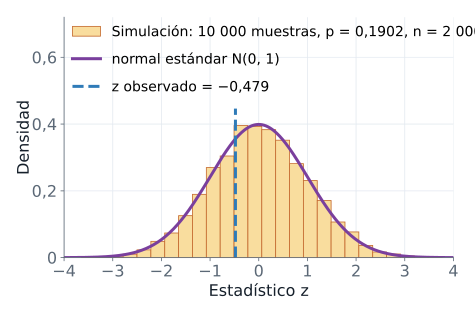{fig-alt="Histograma de 10 000 valores simulados de z con H0 verdadera, que sigue de cerca la curva de la normal estándar y se concentra entre menos tres y tres; una línea vertical marca el z observado de menos 0,479, en la zona central"}
:::

### Definición

La **distribución del estadístico bajo la hipótesis nula** (o distribución nula) es la distribución de los valores que toma el estadístico, de muestra en muestra, cuando $H_0$ es verdadera. Es la vara con la que medimos lo que observamos.

### Qué significa y qué no significa

Tres hechos salen de la simulación. La desviación de los $\hat{p}$ simulados, 0,00873, casi coincide con el error estándar teórico, 0,00878: el $\mathrm{EE}$ describe esa variación. La media de $z$ es 0,015 y su desviación 0,995, es decir, aproximadamente 0 y 1: $z$ sigue la normal estándar. Y el valor observado en el reto, $z = -0{,}479$, cae en la zona central del histograma: resultados así aparecen con frecuencia cuando no hay ningún efecto.

Esto último no prueba que $H_0$ sea cierta. Dice que el azar, por sí solo, produce con facilidad un $z$ como el nuestro. La sección siguiente mide esa frecuencia.

**En una línea.** Si $H_0$ es cierta, $z$ se comporta como una $N(0,1)$, y con ella sabemos qué es raro y qué es común.

## El valor p

### Desde el ejemplo

¿Qué tan sorprendente es $z = -0{,}479$ si $H_0$ es cierta? Una forma de medirlo es contar. De cada 100 muestras que produce el azar bajo $H_0$, ¿cuántas dan un $z$ igual de lejano a $H_0$ que el nuestro, o más? Esa fracción es el valor p. Empezamos con la alternativa $H_1: p < p_0$, donde "más lejano" significa "más pequeño", y miramos solo la cola izquierda.

### Definición

El **valor p** es la probabilidad, calculada suponiendo que $H_0$ es verdadera, de obtener un estadístico igual de extremo que el observado o más extremo, en la dirección de $H_1$. Para $H_1: p < p_0$:

$$\text{valor p} = P(Z \le z_{\text{obs}} \mid H_0)$$

donde:

- $Z$ es el estadístico antes de observar la muestra: una variable aleatoria que sigue $N(0,1)$ bajo $H_0$.
- $z_{\text{obs}}$ es el valor que calculamos con la muestra real, aquí $-0{,}479$.
- La barra vertical $\mid$ se lee "suponiendo que": la probabilidad se calcula en el mundo donde $H_0$ es verdadera.

Es el área bajo la curva a la izquierda de $z_{\text{obs}}$, la **cola** izquierda: el extremo de la curva más allá de ese valor.

::: {.diagrama}
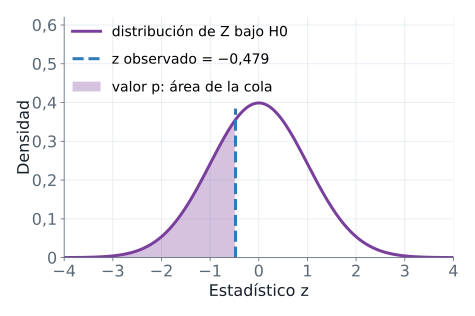{fig-alt="Curva de la normal estándar con una línea punteada en menos 0,479; el área a la izquierda de esa línea está sombreada y representa el valor p unilateral"}
:::

Cada forma de $H_1$ fija qué cola cuenta:

- Con $H_1: p < p_0$, cuenta la cola izquierda: $P(Z \le z_{\text{obs}} \mid H_0)$.
- Con $H_1: p > p_0$, cuenta la cola derecha: $P(Z \ge z_{\text{obs}} \mid H_0)$.
- Con $H_1: p \neq p_0$ cuentan las dos colas. Como la normal estándar es simétrica, el valor p bilateral es el doble de la cola que contiene a $z_{\text{obs}}$: $P(|Z| \ge |z_{\text{obs}}| \mid H_0) = 2\,P(Z \ge |z_{\text{obs}}|)$.

En esta sección y en la siguiente usamos una sola cola ($H_1: p < p_0$) solo para ver el mecanismo. El valor p del reto es bilateral, 0,632, y la sección Calcular el valor p lo obtiene al final.

### Qué significa y qué no significa

Un valor p grande indica que un resultado así es frecuente cuando $H_0$ es cierta: los datos no contradicen la afirmación. Un valor p pequeño indica que sería raro: los datos son difíciles de conciliar con $H_0$. El valor p mide la sorpresa de los datos bajo $H_0$. No mide la probabilidad de que $H_0$ sea verdadera, un error común que la sección "Lo que el valor p no dice" desarma con detalle.

**En una línea.** El valor p es el área de la cola, calculada en el mundo donde $H_0$ es verdadera.

## Calcular el valor p

### Desde el ejemplo

Tres caminos llevan al mismo número con $n = 2000$, 372 retenidos y $p_0 = 0{,}1902$. El primero es contar en la simulación: la fracción de muestras simuladas con 372 retenidos o menos. El segundo es la **prueba binomial exacta**: bajo $H_0$, el número de retenidos $X$ sigue una distribución binomial (el número de éxitos en $n$ ensayos independientes, cada uno con la misma probabilidad de éxito) con $n = 2000$ y probabilidad $p_0$, y el valor p es $P(X \le 372)$. El tercero es la aproximación normal: $P(Z \le z_{\text{obs}})$.

```python
import numpy as np
from scipy import stats

p0, n, retenidos = 0.1902, 2000, 372
rng = np.random.default_rng(2026)
retenidos_sim = rng.binomial(n, p0, size=10_000)
valor_p_sim = (retenidos_sim <= retenidos).mean()
prueba = stats.binomtest(retenidos, n, p0, alternative="less")
estadistico = (retenidos / n - p0) / np.sqrt(p0 * (1 - p0) / n)
print(f"valor p por simulación = {valor_p_sim:.4f}")
print(f"valor p exacto con binomtest = {prueba.pvalue:.4f}")
print(f"valor p con la normal = {stats.norm.cdf(estadistico):.4f}")
print(f"valor p bilateral con la normal = {2 * stats.norm.sf(abs(estadistico)):.4f}")
```

```text
valor p por simulación = 0.3230
valor p exacto con binomtest = 0.3280
valor p con la normal = 0.3161
valor p bilateral con la normal = 0.6322
```

Las funciones nuevas:

- `stats.binomtest(k, n, p, alternative="less")` hace la prueba binomial exacta; su atributo `.pvalue` es el valor p. Con `alternative="less"` cuenta la cola izquierda, $P(X \le k)$.
- `stats.norm.cdf(z)` es la acumulada de la normal estándar, $P(Z \le z)$: el área a la izquierda de $z$.
- `stats.norm.sf(z)` es la cola derecha, $P(Z > z)$. Aplicada a $|z|$ y multiplicada por 2 da el valor p bilateral.

::: {.diagrama}
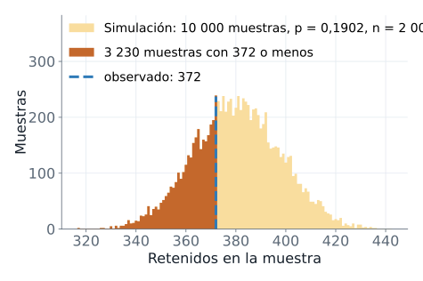{fig-alt="Histograma de los jugadores retenidos en 10 000 muestras simuladas con H0 verdadera; las barras con 372 retenidos o menos, que son 3230 muestras, están resaltadas y una línea punteada marca el valor observado de 372"}
:::

Con la simulación, 3230 de 10&nbsp;000 muestras tienen 372 retenidos o menos, lo que da 0,3230, el área oscura de la figura. La prueba exacta da 0,3280 y la normal, 0,3161. Los tres números casi coinciden, y la prueba exacta es la referencia porque no aproxima nada. Para el contraste bilateral del reto, el valor p con la normal es el doble de la cola, 0,6322.

### Definición

Calcular el valor p es ubicar el estadístico observado en la distribución nula y medir el área de la cola que $H_1$ señala. La simulación lo hace contando, la binomial lo hace con la distribución exacta del número de retenidos y la normal lo hace con la distribución aproximada de $z$.

### Qué significa y qué no significa

Un valor p de 0,3280 dice que, si el rediseño no cambiara la retención, una de cada tres muestras de 2000 jugadores mostraría una retención igual o más baja que 0,1860. Eso es lo habitual, no un resultado raro. Lo de la aproximación normal tiene un límite: funciona bien cuando $n\,p_0$ y $n\,(1 - p_0)$ son al menos 10, una condición que revisamos en la sección del procedimiento completo.

**En una línea.** Tres formas de calcular la misma cola; la simulación te la deja ver.

## La decisión y el nivel de significancia

### Desde el ejemplo

Tenemos un valor p. Falta decidir cuándo es lo bastante pequeño como para rechazar $H_0$, y esa regla tiene que existir antes de ver los datos. Si el umbral se escogiera después, siempre habría un umbral que justificara lo que ya queremos concluir.

### Definición

El **nivel de significancia**, $\alpha$ (alfa), es la probabilidad máxima de rechazar $H_0$ cuando es verdadera que el analista acepta correr. Se fija antes de ver los datos. El valor usual es $\alpha = 0{,}05$, una convención y no una ley. La regla de decisión es:

- Si el valor p es menor o igual que $\alpha$, se **rechaza** $H_0$.
- Si el valor p es mayor que $\alpha$, **no se rechaza** $H_0$.

Existe una forma equivalente. La **región de rechazo** reúne los valores del estadístico tan extremos que, bajo $H_0$, ocurrirían con probabilidad no mayor que $\alpha$. En el contraste bilateral con $z$ es $|z| \ge z_{1-\alpha/2}$, donde $z_{1-\alpha/2}$ es el **valor crítico**: el valor que deja una probabilidad $\alpha/2$ a su derecha en la normal estándar; por simetría, su opuesto deja $\alpha/2$ a su izquierda. Rechazar por valor p y rechazar por región de rechazo da siempre la misma decisión.

```python
import numpy as np
from scipy import stats

p0, n, retenidos, alfa = 0.1902, 2000, 372, 0.05
estadistico = (retenidos / n - p0) / np.sqrt(p0 * (1 - p0) / n)
valor_p = 2 * stats.norm.sf(abs(estadistico))
z_crit = stats.norm.ppf(1 - alfa / 2)
print(f"valor p = {valor_p:.3f}, alfa = {alfa}")
print(f"se rechaza H0 por el valor p: {valor_p <= alfa}")
print(f"valor crítico = {z_crit:.3f}, |z| = {abs(estadistico):.3f}")
print(f"se rechaza H0 por la región de rechazo: {abs(estadistico) >= z_crit}")
```

```text
valor p = 0.632, alfa = 0.05
se rechaza H0 por el valor p: False
valor crítico = 1.960, |z| = 0.479
se rechaza H0 por la región de rechazo: False
```

`stats.norm.ppf(q)` es la función inversa de la acumulada: devuelve el valor $z$ que deja una probabilidad $q$ a su izquierda. Con $q = 1 - \alpha/2 = 0{,}975$ da 1,960.

El valor p bilateral, 0,632, es mayor que $\alpha = 0{,}05$, y $|z| = 0{,}479$ es menor que 1,960: no se rechaza $H_0$. En el lenguaje del caso: con esta muestra, la diferencia entre 0,1860 y 0,1902 es compatible con el azar del muestreo. Con la alternativa unilateral de la sección anterior se llega a la misma decisión, porque 0,3280 también supera 0,05.

### Qué significa y qué no significa

El resultado se redacta siempre con uno de dos verbos: "se rechaza $H_0$" o "no se rechaza $H_0$". Nunca se "acepta" $H_0$, porque la decisión descansa en falta de evidencia, no en una demostración. Y $\alpha$ tiene una lectura de frecuencia: es el riesgo que asumimos de rechazar una $H_0$ verdadera, un error que tiene nombre.

El **error tipo I** es rechazar $H_0$ cuando es verdadera: un falso positivo. Su probabilidad es $\alpha$. La sección siguiente lo comprueba con una simulación.

**En una línea.** Se fija $\alpha$ antes, se compara el valor p con $\alpha$ y se redacta la conclusión en el lenguaje del caso.

## El error tipo I, comprobado por simulación

### Desde el ejemplo

Si $\alpha = 0{,}05$ es la frecuencia con que rechazamos una $H_0$ verdadera, una simulación debería mostrarlo. Construimos 1000 muestras de $n = 2000$ en un mundo donde $H_0$ es verdadera, $p = 0{,}1902$, y a cada una le aplicamos el mismo contraste. Como en la sección del valor p, usamos la alternativa unilateral $H_1: p < p_0$.

Simulación. Aquí la verdad se conoce por construcción: $p = 0{,}1902$, así que cada rechazo es un error.

```python
import numpy as np
from scipy import stats

p0, n, alfa = 0.1902, 2000, 0.05
rng = np.random.default_rng(2026)
retenidos_sim = rng.binomial(n, p0, size=1_000)
valores_p = [stats.binomtest(x, n, p0, alternative="less").pvalue
             for x in retenidos_sim]
rechazos = sum(v <= alfa for v in valores_p)
print(f"contrastes con H0 verdadera: {len(valores_p)}")
print(f"rechazos de H0: {rechazos}")
print(f"proporción de rechazos = {rechazos / len(valores_p):.3f}")
```

```text
contrastes con H0 verdadera: 1000
rechazos de H0: 50
proporción de rechazos = 0.050
```

La lista `valores_p` guarda el valor p de cada uno de los 1000 contrastes, y `rechazos` cuenta los que fueron menores o iguales que $\alpha$.

::: {.diagrama}
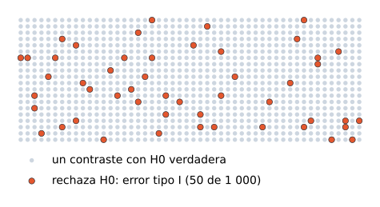{fig-alt="Rejilla de 1000 puntos pequeños, uno por cada contraste simulado con H0 verdadera; 50 puntos marcados en un color destacado representan los rechazos de H0, que son errores tipo I"}
:::

Rechazan 50 de 1000, una proporción de 0,050. Como $H_0$ es verdadera en todas, cada rechazo es un error tipo I.

### Qué significa y qué no significa

El nivel $\alpha$ es una frecuencia de largo plazo: con $\alpha = 0{,}05$, un contraste con $H_0$ verdadera rechaza cerca de 5 de cada 100 veces. En una sola muestra no sabemos si estamos en una de las cinco. El procedimiento garantiza el riesgo promedio; ninguna decisión individual trae esa garantía.

**En una línea.** $\alpha$ se puede ver: es la fracción de muestras que engañan cuando $H_0$ es cierta.

## Las seis etapas de un contraste

Con las piezas anteriores, el procedimiento completo se ordena en seis etapas. Es la misma secuencia para una proporción y para una media.

::: {.diagrama}
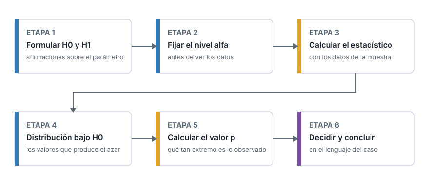{fig-alt="Seis cajas conectadas por flechas en dos filas: etapa 1 formular H0 y H1, etapa 2 fijar el nivel alfa, etapa 3 calcular el estadístico, etapa 4 distribución bajo H0, etapa 5 calcular el valor p, etapa 6 decidir y concluir"}
:::

1. **Formular $H_0$ y $H_1$** sobre el parámetro, a partir de la pregunta.
2. **Fijar $\alpha$**, antes de ver los datos.
3. **Calcular el estadístico** con la muestra: $z$ para una proporción, $t$ para una media.
4. **Obtener la distribución del estadístico bajo $H_0$**: los valores que produce el azar.
5. **Calcular el valor p**: qué tan extremo es el estadístico observado dentro de esa distribución.
6. **Decidir y concluir**: comparar el valor p con $\alpha$, decidir sobre $H_0$ y redactar la conclusión en el lenguaje del caso.

Las etapas 1 y 2 se completan antes de abrir los datos. Las etapas 3 a 6 son cálculo y lectura.

## Lo que el valor p no dice

El valor p es el número más citado y más malinterpretado de la estadística aplicada. Hay tres lecturas erróneas frecuentes.

**Primera lectura errónea: el valor p es la probabilidad de que $H_0$ sea verdadera.** El valor p se calcula suponiendo que $H_0$ es verdadera, así que no puede medir la probabilidad de $H_0$. Un valor p de 0,3280 (el unilateral de las secciones anteriores) no asigna esa probabilidad a $H_0$. Responde otra pregunta: si $H_0$ fuera cierta, ¿cuán frecuentes serían datos como estos?

**Segunda lectura errónea: un valor p mayor que $\alpha$ demuestra que $H_0$ es verdadera.** No rechazar $H_0$ equivale a absolver: faltó evidencia. A partir de aquí pasamos del valor p unilateral, 0,3280, al bilateral del reto, 0,632, que es el que corresponde a la pregunta. Ese valor p no prueba que el rediseño deje la retención intacta. La sección de errores tipo I y II muestra qué tan poco puede probar una muestra pequeña.

**Tercera lectura errónea: un valor p pequeño indica un efecto grande o importante.** Con una muestra muy grande, una diferencia mínima produce un valor p pequeño. El valor p informa si el azar explica mal la diferencia, no cuánto vale esa diferencia. La relevancia práctica se evalúa aparte, como veremos en la sección Significancia estadística y relevancia práctica.

Una cuarta fuente de error no está en la lectura sino en el procedimiento: elegir $\alpha$ o la cola de $H_1$ después de ver el resultado. Esa elección retroactiva infla el riesgo de falso positivo, como muestra la sección sobre una o dos colas.

## Contraste para una proporción: el procedimiento completo

### Desde el ejemplo

Ya tenemos todas las piezas para el contraste bilateral del reto, que queda así: $H_0: p = 0{,}1902$ frente a $H_1: p \neq 0{,}1902$, con $\alpha = 0{,}05$ fijado antes de calcular.

### Definición

El contraste $z$ para una proporción usa el estadístico de la sección anterior, $z = (\hat{p} - p_0)/\sqrt{p_0(1-p_0)/n}$, y el valor p bilateral $2\,P(Z \ge |z|)$. Exige tres condiciones:

- La muestra es aleatoria simple y las observaciones son independientes entre sí. Una muestra pequeña frente a la población, de menos del 10 %, cumple de sobra la independencia aproximada.
- $n\,p_0 \ge 10$: se esperan al menos 10 éxitos bajo $H_0$.
- $n\,(1 - p_0) \ge 10$: se esperan al menos 10 fracasos bajo $H_0$.

Las dos últimas garantizan que la aproximación normal es razonable. Si no se cumplen, se usa la prueba binomial exacta.

```python
import numpy as np
import pandas as pd
from scipy import stats

datos = pd.read_csv("cookie_cats.csv")
gate_30 = datos[datos["version"] == "gate_30"]
gate_40 = datos[datos["version"] == "gate_40"]
p0 = gate_30["retention_7"].mean()
rng = np.random.default_rng(2026)
muestra = rng.choice(gate_40["retention_7"], 2000, replace=False)
n, p_gorro = len(muestra), muestra.mean()
estadistico = (p_gorro - p0) / np.sqrt(p0 * (1 - p0) / n)
valor_p = 2 * stats.norm.sf(abs(estadistico))
print(f"p0 = {p0:.4f}   p_gorro = {p_gorro:.4f}")
print(f"n*p0 = {n * p0:.1f}   n*(1-p0) = {n * (1 - p0):.1f}")
print(f"z = {estadistico:.3f}   valor p = {valor_p:.3f}")
```

```text
p0 = 0.1902   p_gorro = 0.1860
n*p0 = 380.4   n*(1-p0) = 1619.6
z = -0.479   valor p = 0.632
```

Las dos condiciones se cumplen de sobra: se esperan 380,4 éxitos y 1619,6 fracasos. El estadístico es $z = -0{,}479$ y el valor p bilateral, 0,632. Como $0{,}632 > 0{,}05$, no se rechaza $H_0$: los datos no aportan evidencia de que el rediseño haya cambiado la retención. Esto no demuestra que $H_0$ sea cierta.

### Qué significa y qué no significa

El resultado responde la pregunta "¿es plausible que el azar produzca 0,1860 cuando la retención real es 0,1902?" con un sí claro. No responde "¿el rediseño cambió la retención?" con un no. Esa diferencia se aclara en la sección Errores tipo I y II, y potencia, donde medimos cuánta potencia tenía esta muestra.

**En una línea.** Estadístico $z$, valor p con las dos colas, decisión contra $\alpha$, y tres condiciones que revisar antes de confiar en la normal.

## Contraste para una media: el estadístico t

### Desde el ejemplo

Cambiamos de parámetro. Con Saber 11 como población, el puntaje global promedio de todo el país es 250,14. Un analista pregunta si la media del puntaje global de los estudiantes de colegios no oficiales difiere de ese valor. Dispone de una muestra aleatoria de 50 de ellos. Con $\mu$ la media poblacional de esos colegios, que se desconoce, formula $H_0: \mu = \mu_0 = 250{,}14$ frente a $H_1: \mu \neq \mu_0$.

### Definición

Si conociéramos la desviación estándar poblacional $\sigma$, el estadístico sería $z = (\bar{x} - \mu_0)/(\sigma/\sqrt{n})$. Como $\sigma$ se desconoce, se reemplaza por la desviación estándar de la muestra, $s$, y el estadístico se llama $t$:

$$t = \frac{\bar{x} - \mu_0}{s\,/\,\sqrt{n}}$$

donde:

- $\bar{x}$ es la media de la muestra y $s$ su desviación estándar (calculada con divisor $n - 1$).
- $\mu_0$ es la media que afirma $H_0$.
- $n$ es el tamaño de la muestra.
- $s/\sqrt{n}$ es el **error estándar estimado** de la media muestral: el error estándar de $\bar{x}$ con $s$ en lugar de $\sigma$.

Bajo $H_0$, $t$ sigue una **distribución t de Student** con $n - 1$ **grados de libertad**. La t de Student es simétrica alrededor de 0, como la normal, pero con colas más pesadas, porque usar $s$ añade incertidumbre. Los grados de libertad cuentan cuántas desviaciones independientes sirven para estimar la variabilidad: con $n$ datos y una media estimada con ellos, quedan $n - 1$. Cuando los grados de libertad crecen, la t se acerca a la normal. Aquí hay $n - 1 = 49$.

Los supuestos son dos: una muestra aleatoria simple con observaciones independientes; y una población aproximadamente normal, o un $n$ suficiente para que el teorema del límite central haga normal a $\bar{x}$. Con muestras muy pequeñas la normalidad pesa mucho más.

```python
import numpy as np
import pandas as pd
from scipy import stats

rng = np.random.default_rng(2026)
saber = pd.read_csv("saber11_20224.csv", usecols=["punt_global", "cole_naturaleza"])
no_oficial = saber[saber["cole_naturaleza"] == "NO OFICIAL"]["punt_global"]
muestra = no_oficial.sample(n=50, random_state=rng)
print(f"poblacion = {len(no_oficial)}   n = {len(muestra)}   fraccion = {len(muestra) / len(no_oficial):.5f}")
print(f"media poblacional (no oficial) = {no_oficial.mean():.2f}")
print(f"Shapiro-Wilk de la muestra: valor p = {stats.shapiro(muestra).pvalue:.3f}")
print(f"t_49(0.975) = {stats.t.ppf(0.975, df=49):.3f}   t_49(0.95) = {stats.t.ppf(0.95, df=49):.3f}")
print(f"z(0.975) = {stats.norm.ppf(0.975):.3f}")
```

```text
poblacion = 240956   n = 50   fraccion = 0.00021
media poblacional (no oficial) = 272.55
Shapiro-Wilk de la muestra: valor p = 0.397
t_49(0.975) = 2.010   t_49(0.95) = 1.677
z(0.975) = 1.960
```

Datos: ICFES, Saber 11 2022-2 (datos.gov.co, CC BY-SA 4.0).

`.sample(n=50, random_state=rng)` extrae 50 elementos al azar sin reemplazo. `stats.shapiro` aplica la prueba de Shapiro-Wilk, cuya $H_0$ afirma que la población es normal; con un valor p de 0,397 no hay evidencia contra la normalidad, aunque eso, como siempre, no la demuestra. `stats.t.ppf(q, df=gl)` es el valor de la t con `gl` grados de libertad que deja una probabilidad $q$ a su izquierda: con 49 grados de libertad y $q = 0{,}975$ es 2,010, un poco mayor que el 1,960 de la normal, que es el efecto de las colas pesadas. La muestra es el 0,021 % de los 240&nbsp;956 estudiantes de colegios no oficiales, así que la independencia no se compromete por extraer sin reemplazo.

### Qué significa y qué no significa

El estadístico $t$ mide, en errores estándar estimados, cuánto se aleja $\bar{x}$ de $\mu_0$. La t sustituye a la normal porque estimar $\sigma$ con $s$ añade incertidumbre, y las colas pesadas la reflejan. Con $n$ grande, la diferencia práctica entre usar $t$ y usar $z$ desaparece.

**En una línea.** Con una media, $s$ reemplaza a $\sigma$ y la normal cede su lugar a la t con $n - 1$ grados de libertad.

## El contraste de una media en código

Con la misma muestra de 50 estudiantes, `stats.ttest_1samp` calcula $t$ y el valor p bilateral en una llamada. Su argumento `popmean` es $\mu_0$. El método `.std()` de pandas divide entre $n - 1$, igual que el $s$ de la fórmula.

```python
import numpy as np
import pandas as pd
from scipy import stats

rng = np.random.default_rng(2026)
saber = pd.read_csv("saber11_20224.csv", usecols=["punt_global", "cole_naturaleza"])
no_oficial = saber[saber["cole_naturaleza"] == "NO OFICIAL"]
muestra = no_oficial["punt_global"].sample(n=50, random_state=rng)
media_muestral, desv_muestral = muestra.mean(), muestra.std()
estadistico, valor_p = stats.ttest_1samp(muestra, popmean=250.14)
t_a_mano = (media_muestral - 250.14) / (desv_muestral / np.sqrt(len(muestra)))
print(f"media = {media_muestral:.2f}   s = {desv_muestral:.2f}")
print(f"t = {estadistico:.3f}   valor p = {valor_p:.4f}")
print(f"t calculado a mano = {t_a_mano:.3f}")
```

```text
media = 267.62   s = 51.79
t = 2.386   valor p = 0.0209
t calculado a mano = 2.386
```

La media de la muestra es 267,62 y su desviación estándar 51,79. El estadístico es $t = 2{,}386$, y el cálculo a mano con la fórmula da el mismo número: la media muestral está a 2,386 errores estándar por encima de $\mu_0$. El valor p, 0,0209, es la probabilidad de que una t con 49 grados de libertad supere 2,386 en valor absoluto, es decir, el área de las dos colas.

Como $0{,}0209 < 0{,}05$, se rechaza $H_0$: la media del puntaje global de los colegios no oficiales difiere de 250,14 y, por el signo positivo de $t$, es mayor. La media real de esos colegios, 272,55, calculada con la población completa, confirma que rechazar fue la decisión correcta. Con $n = 50$ no siempre se acierta; aquí la diferencia real (unos 22 puntos) es grande y se detecta.

## Una o dos colas

El mismo $t = 2{,}386$ da valores p distintos según la alternativa. `stats.ttest_1samp` lo controla con el argumento `alternative`, que admite `"two-sided"` (bilateral, el valor por omisión), `"greater"` ($H_1: \mu > \mu_0$) y `"less"` ($H_1: \mu < \mu_0$).

```python
import numpy as np
import pandas as pd
from scipy import stats

rng = np.random.default_rng(2026)
saber = pd.read_csv("saber11_20224.csv",
                    usecols=["punt_global", "cole_naturaleza"])
no_oficial = saber[saber["cole_naturaleza"] == "NO OFICIAL"]
muestra = no_oficial["punt_global"].sample(n=50, random_state=rng)
for h1 in ["two-sided", "greater", "less"]:
    prueba = stats.ttest_1samp(muestra, 250.14, alternative=h1)
    print(f"{h1:>9}: valor p = {prueba.pvalue:.4f}")
```

```text
two-sided: valor p = 0.0209
  greater: valor p = 0.0105
     less: valor p = 0.9895
```

::: {.diagrama}
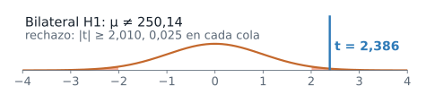{fig-alt="Curva de la distribución t con 49 grados de libertad; las dos colas de rechazo, cada una con probabilidad 0,025, empiezan en menos 2,010 y 2,010, y una línea vertical marca el valor observado de 2,386 en la cola derecha"}
:::

::: {.diagrama}
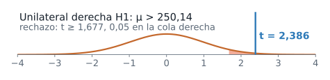{fig-alt="Curva de la distribución t con 49 grados de libertad; la cola derecha de rechazo, con probabilidad 0,05, empieza en 1,677, y una línea vertical marca el valor observado de 2,386 dentro de la región"}
:::

::: {.diagrama}
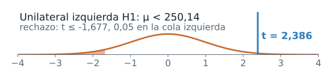{fig-alt="Curva de la distribución t con 49 grados de libertad; la cola izquierda de rechazo, con probabilidad 0,05, llega hasta menos 1,677, y la línea vertical del valor observado, 2,386, queda en el lado contrario"}
:::

Las tres filas dicen:

- **Bilateral**, $H_1: \mu \neq \mu_0$: el nivel $\alpha = 0{,}05$ se reparte, 0,025 en cada cola. Se rechaza si $|t| \ge 2{,}010$. Como $2{,}386$ supera ese valor crítico, se rechaza $H_0$; el valor p bilateral es 0,0209.
- **Unilateral a la derecha**, $H_1: \mu > \mu_0$: todo $\alpha$ va a una sola cola, el valor crítico baja a 1,677 y el valor p es 0,0105, la mitad del bilateral.
- **Unilateral a la izquierda**, $H_1: \mu < \mu_0$: con $t = 2{,}386$ el valor p es 0,9895, porque los datos apuntan al lado opuesto de lo que afirma $H_1$.

La dirección de $H_1$ se fija antes de ver los datos, según la pregunta del estudio. Si miras el signo de $t$ y escoges después la cola que lo favorece, rechazarás cuando $|t| \ge 1{,}677$, y bajo $H_0$ eso ocurre el 10 % de las veces en lugar del 5 %: el riesgo real de falso positivo se duplica sin que el análisis lo informe. Un contraste unilateral se justifica cuando una diferencia en el otro sentido no tendría ninguna consecuencia, y esa decisión se toma antes de abrir el archivo.

## El intervalo de confianza y el contraste

### Desde el ejemplo

Con la misma muestra podemos construir un intervalo de confianza para $\mu$ y repetir el contraste con tres valores de referencia: 250,14 y los dos extremos del intervalo.

### Definición

Un **intervalo de confianza** de nivel $1 - \alpha$ es un rango de valores plausibles para el parámetro, construido con un procedimiento que captura el valor real con probabilidad $1 - \alpha$. Para una media:

$$\bar{x} \pm t_{n-1,\,1-\alpha/2}\;\frac{s}{\sqrt{n}}$$

donde $t_{n-1,\,1-\alpha/2}$ es el valor crítico de la t con $n - 1$ grados de libertad que deja $\alpha/2$ en la cola derecha; con $n = 50$ y $\alpha = 0{,}05$ vale 2,010, como vimos arriba.

```python
import numpy as np
import pandas as pd
from scipy import stats

rng = np.random.default_rng(2026)
saber = pd.read_csv("saber11_20224.csv",
                    usecols=["punt_global", "cole_naturaleza"])
no_oficial = saber[saber["cole_naturaleza"] == "NO OFICIAL"]
muestra = no_oficial["punt_global"].sample(n=50, random_state=rng)
ic = stats.ttest_1samp(muestra, 250.14).confidence_interval(0.95)
for mu0 in [250.14, ic.low, ic.high]:
    valor_p = stats.ttest_1samp(muestra, mu0).pvalue
    print(f"mu0 = {mu0:.2f}   valor p = {valor_p:.3f}")
```

```text
mu0 = 250.14   valor p = 0.021
mu0 = 252.90   valor p = 0.050
mu0 = 282.34   valor p = 0.050
```

`.confidence_interval(0.95)` devuelve el intervalo de 95 % asociado a la prueba t, con sus extremos `low` y `high`: 252,90 y 282,34. El valor $\mu_0 = 250{,}14$ queda fuera y su valor p es 0,021. En los dos extremos el valor p es exactamente 0,050, el nivel $\alpha$.

::: {.diagrama}
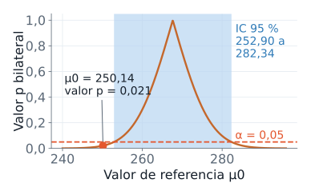{fig-alt="Gráfico del valor p bilateral para cada valor de referencia mu cero: una curva que vale 1 en la media muestral de 267,62 y baja hacia los lados; el intervalo de confianza de 95 por ciento, de 252,90 a 282,34, está sombreado y es la zona donde la curva queda por encima de alfa igual a 0,05; el punto 250,14 queda fuera con valor p de 0,021"}
:::

### Qué significa y qué no significa

La relación es exacta para la media con la t, y aproximada para una proporción (el intervalo usa $\hat{p}$ y el contraste usa $p_0$): **el contraste bilateral de nivel $\alpha$ rechaza $H_0: \mu = \mu_0$ si y solo si $\mu_0$ cae fuera del intervalo de confianza de nivel $1 - \alpha$.** El intervalo es, por tanto, la lista de todos los valores de referencia que el contraste no rechazaría. Eso lo hace más informativo que el contraste solo: además de decir si 250,14 se rechaza, indica entre qué valores se mueve $\mu$.

La media real de los colegios no oficiales, 272,55, está dentro del intervalo. El intervalo no garantiza capturarla en cada muestra, solo en 95 de cada 100.

**En una línea.** El intervalo contiene los valores de $\mu_0$ que no se rechazan; el contraste pregunta por uno solo.

## Errores tipo I y II, y potencia

### Desde el ejemplo

Hasta ahora controlamos un solo riesgo: rechazar una $H_0$ verdadera. La decisión se toma sin conocer la verdad, y $H_0$ puede ser verdadera o falsa. Con dos decisiones posibles, resultan cuatro combinaciones.

| | $H_0$ es verdadera | $H_0$ es falsa |
|---|---|---|
| **No se rechaza $H_0$** | Decisión correcta | Error tipo II, con probabilidad $\beta$ |
| **Se rechaza $H_0$** | Error tipo I, con probabilidad $\alpha$ | Decisión correcta, con probabilidad $1 - \beta$ |

El error tipo II es no rechazar $H_0$ cuando es falsa, con probabilidad $\beta$ (beta). La **potencia**, $1 - \beta$, es la probabilidad de rechazar $H_0$ cuando es falsa: la capacidad del contraste de detectar una diferencia que existe.

En el caso de Cookie Cats medimos la retención de todo `gate_40`, 45&nbsp;489 jugadores: 0,1820. Por convenio didáctico tomamos ese valor como el valor real de $p$ y la línea base, 0,1902, como un valor fijo; con ese convenio $H_0$ es falsa. Con esa verdad supuesta podemos preguntar cuánta potencia tiene un contraste con $n = 2000$, $n = 10\,000$ y $n = 20\,000$. El cálculo tiene dos pasos. Primero, la región de rechazo expresada en $\hat{p}$: se rechaza si $\hat{p}$ cae por debajo de `bajo` o por encima de `alto`, los valores que dejan $\alpha/2$ a cada lado bajo $H_0$. Segundo, la probabilidad de caer en esa región cuando $p$ es el valor real, 0,1820, que es la potencia. Una simulación con muestras reales de `gate_40` lo comprueba.

```python
import numpy as np
import pandas as pd
from scipy import stats

datos = pd.read_csv("cookie_cats.csv", usecols=["version", "retention_7"])
p0 = datos[datos["version"] == "gate_30"]["retention_7"].mean()
gate_40 = datos[datos["version"] == "gate_40"]["retention_7"].to_numpy()
p_real, z_crit = gate_40.mean(), stats.norm.ppf(0.975)
print(f"p0 = {p0:.4f}   p real de gate_40 = {p_real:.4f}   N = {len(gate_40)}")
for n in [2000, 10000, 20000]:
    ee0 = np.sqrt(p0 * (1 - p0) / n)
    ee1 = np.sqrt(p_real * (1 - p_real) / n)
    bajo, alto = p0 - z_crit * ee0, p0 + z_crit * ee0
    potencia = stats.norm.cdf((bajo - p_real) / ee1) + stats.norm.sf((alto - p_real) / ee1)
    print(f"n = {n}: rechaza H0 si p_gorro < {bajo:.4f} o > {alto:.4f}; potencia = {potencia:.3f}")
rng = np.random.default_rng(2026)
ee0 = np.sqrt(p0 * (1 - p0) / 2000)
z = [(rng.choice(gate_40, 2000, replace=False).mean() - p0) / ee0 for _ in range(1000)]
print(f"Simulación, 1000 muestras de n = 2000: proporción que rechaza H0 = {np.mean(np.abs(z) > z_crit):.3f}")
```

```text
p0 = 0.1902   p real de gate_40 = 0.1820   N = 45489
n = 2000: rechaza H0 si p_gorro < 0.1730 o > 0.2074; potencia = 0.150
n = 10000: rechaza H0 si p_gorro < 0.1825 o > 0.1979; potencia = 0.553
n = 20000: rechaza H0 si p_gorro < 0.1848 o > 0.1956; potencia = 0.844
Simulación, 1000 muestras de n = 2000: proporción que rechaza H0 = 0.158
```

Los tres primeros resultados vienen de la fórmula: `ee0` es el error estándar bajo $H_0$ y `ee1` el que corresponde al valor real, y `stats.norm.cdf` y `stats.norm.sf` suman las dos colas de la región de rechazo. La última línea es una simulación: 1000 muestras de $n = 2000$ de `gate_40` y la proporción de ellas que rechaza $H_0$.

::: {.diagrama}
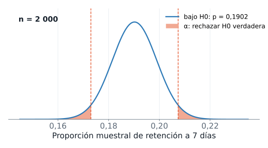{fig-alt="Curva azul de la distribución de la proporción muestral de retención a 7 días bajo H0, centrada en 0,1902, con n igual a 2000; dos líneas verticales punteadas en 0,1730 y 0,2074 delimitan las colas de rechazo, sombreadas, que suman alfa igual a 0,05"}
:::

::: {.diagrama}
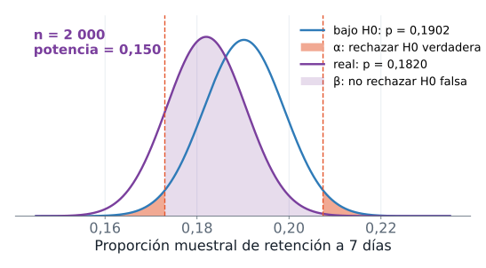{fig-alt="Dos curvas de la proporción muestral con n igual a 2000, una centrada en 0,1902 bajo H0 y otra en 0,1820, el valor real, que casi se superponen; casi toda el área de la curva real cae entre las líneas de rechazo y se pinta como beta, la probabilidad de no rechazar una H0 falsa; la potencia es 0,150"}
:::

::: {.diagrama}
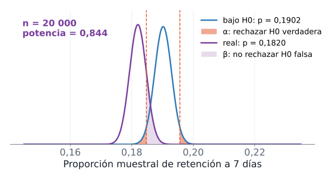{fig-alt="Las mismas dos curvas con n igual a 20 000, mucho más angostas y separadas, de modo que la mayor parte de la curva real queda fuera de la región de rechazo; la potencia es 0,844"}
:::

Con $n = 2000$, el contraste rechaza $H_0$ si $\hat{p}$ cae por debajo de 0,1730 o por encima de 0,2074. Pero el $\hat{p}$ de una muestra típica de `gate_40` queda cerca de 0,1820, dentro de esos límites, así que la potencia es 0,150: el contraste detecta la diferencia real solo una vez de cada siete, y $\beta$ vale alrededor de 0,850. La simulación confirma el cálculo: de 1000 muestras de 2000 jugadores, rechazan 0,158. Con $n = 10\,000$ la potencia sube a 0,553 y con $n = 20\,000$ llega a 0,844.

### Qué significa y qué no significa

La probabilidad $\alpha$ la fija el analista. La probabilidad $\beta$ no se fija: depende del tamaño de la muestra, del tamaño de la diferencia real y de $\alpha$. Disminuye al aumentar $n$ o la diferencia real, y aumenta si se reduce $\alpha$ sin subir $n$. Es el equilibrio entre dos errores: ningún contraste los elimina a la vez.

La consecuencia práctica es que "no se rechaza $H_0$" significa poco cuando la potencia es baja. El reto es el ejemplo: no rechazó $H_0$ y, sin embargo, con el convenio de esta sección la diferencia de 0,0082 existe. El contraste calculó bien; con 2000 jugadores no tenía poder para ver esa diferencia, y eso es un error tipo II.

**En una línea.** Dos errores posibles, $\alpha$ y $\beta$; la potencia $1 - \beta$ crece con $n$ y con el tamaño de la diferencia.

## Significancia estadística y relevancia práctica

### Desde el ejemplo

Hagamos una pregunta hipotética. La diferencia medida con todos los jugadores de `gate_40` frente a la línea base es 0,1820 menos 0,1902, es decir $-0{,}0082$: 82 jugadores retenidos menos por cada 10&nbsp;000. Supongamos que una muestra de cada tamaño $n$ hubiera dado exactamente ese $\hat{p}$, y tomemos la línea base como un valor fijo. ¿Qué valor p tendríamos?

```python
import numpy as np
import pandas as pd
from scipy import stats

datos = pd.read_csv("cookie_cats.csv")
linea_base = datos[datos["version"] == "gate_30"]["retention_7"].mean()
gate_40 = datos[datos["version"] == "gate_40"]["retention_7"]
p_gorro, n_total = gate_40.mean(), len(gate_40)
print(f"p0 = {linea_base:.4f}   p_gorro = {p_gorro:.4f}   diferencia = {p_gorro - linea_base:.4f} ({(p_gorro - linea_base) * 10000:.0f} por cada 10000)")
for n in [2000, 10000, n_total]:
    estadistico = (p_gorro - linea_base) / np.sqrt(linea_base * (1 - linea_base) / n)
    print(f"n = {n}: z = {estadistico:.2f}   valor p = {2 * stats.norm.sf(abs(estadistico)):.3f}")
ee = np.sqrt(p_gorro * (1 - p_gorro) / n_total)
print(f"IC 95 % para p: [{p_gorro - 1.96 * ee:.4f}, {p_gorro + 1.96 * ee:.4f}]   para p - p0: [{p_gorro - 1.96 * ee - linea_base:.4f}, {p_gorro + 1.96 * ee - linea_base:.4f}]")
print(f"n desde el que la misma diferencia da valor p < 0.05: {(1.96 / (p_gorro - linea_base)) ** 2 * linea_base * (1 - linea_base):.0f}")
```

```text
p0 = 0.1902   p_gorro = 0.1820   diferencia = -0.0082 (-82 por cada 10000)
n = 2000: z = -0.93   valor p = 0.350
n = 10000: z = -2.09   valor p = 0.037
n = 45489: z = -4.46   valor p = 0.000
IC 95 % para p: [0.1785, 0.1855]   para p - p0: [-0.0117, -0.0047]
n desde el que la misma diferencia da valor p < 0.05: 8797
```

::: {.diagrama}
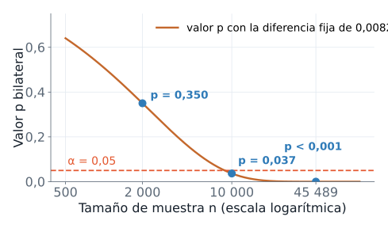{fig-alt="Curva decreciente del valor p bilateral contra el tamaño de muestra en escala logarítmica, con la diferencia fija de 0,0082: pasa por 0,350 con 2000 jugadores, 0,037 con 10 000 y menos de 0,001 con 45 489; una línea horizontal marca alfa igual a 0,05"}
:::

### Definición

Una diferencia tiene **significancia estadística** cuando su valor p es menor o igual que $\alpha$: difícilmente se explica por el azar del muestreo. Tiene **relevancia práctica** cuando su tamaño importa para la decisión: costos, beneficios y la diferencia mínima que justificaría actuar. Son dos preguntas distintas y la primera no contesta la segunda.

### Qué significa y qué no significa

La misma diferencia de 0,0082 produce un valor p de 0,350 con 2000 jugadores, de 0,037 con 10&nbsp;000 y menor que 0,001 con los 45&nbsp;489 (la salida imprime 0.000: el redondeo a tres decimales). El $z = -4{,}46$ de esa última fila toma $p_0$ como fijo; la sección Solución del reto lo recalcula reconociendo también la incertidumbre de la línea base. Desde $n = 8797$ esa diferencia ya resulta significativa al nivel de 5 %. El valor p de 0,350 de esta tabla y el 0,632 del reto no son comparables directamente: la muestra del reto quedó más cerca de la línea base ($\hat{p} = 0{,}1860$) que la diferencia medida con todos los jugadores (0,1820), y por eso no alcanzaba.

El tamaño de la muestra decide si una diferencia se vuelve significativa, y no cambia lo que la diferencia significa para el negocio. Por eso se informa la estimación con su intervalo: la retención de `gate_40` cae entre 0,47 y 1,17 puntos porcentuales respecto de la línea base, con 95 % de confianza si tratamos a los 45&nbsp;489 jugadores de `gate_40` como una muestra de un proceso que podría repetirse y la línea base como un valor fijo. Si los 82 jugadores perdidos por cada 10&nbsp;000 importan más o menos que el beneficio que traiga el rediseño es una decisión de negocio: el valor p solo complementa.

**En una línea.** Un valor p pequeño dice que el azar explica mal la diferencia; el tamaño y el contexto dicen si importa.

## Solución del reto

Con las herramientas completas, resolvemos el reto siguiendo las seis etapas.

1. **Formular.** El equipo pregunta si el rediseño cambió la retención a 7 días, sin señalar una dirección. $p$ es la retención del rediseño en la población y $p_0 = 0{,}1902$ la línea base: $H_0: p = p_0$ frente a $H_1: p \neq p_0$.
2. **Fijar $\alpha$.** El criterio del reto era una regla escrita antes de calcular: $\alpha = 0{,}05$, y se rechaza $H_0$ si el valor p es menor o igual que 0,05.
3. **Calcular el estadístico.** $z = (\hat{p} - p_0)/\sqrt{p_0(1-p_0)/n}$ con $\hat{p} = 0{,}1860$ y $n = 2000$.
4. **Distribución bajo $H_0$.** Normal estándar, con $n\,p_0 = 380{,}4$ y $n\,(1-p_0) = 1619{,}6$ por encima de 10.
5. **Valor p.** El área de las dos colas más allá de $|z|$.
6. **Decidir y concluir**, con el intervalo de confianza que da el tamaño plausible de $p$, y con la comparación final contra todos los jugadores de `gate_40`.

```python
import numpy as np
import pandas as pd
from scipy import stats

alfa = 0.05
datos = pd.read_csv("cookie_cats.csv", usecols=["version", "retention_7"])
gate_30 = datos[datos["version"] == "gate_30"]["retention_7"]
p0 = gate_30.mean()
gate_40 = datos[datos["version"] == "gate_40"]["retention_7"]
rng = np.random.default_rng(2026)
muestra = rng.choice(gate_40, size=2000, replace=False)
n, p_gorro = len(muestra), muestra.mean()
ee = np.sqrt(p0 * (1 - p0) / n)
estadistico = (p_gorro - p0) / ee
valor_p = 2 * stats.norm.sf(abs(estadistico))
print(f"p_gorro = {p_gorro:.4f}, linea base = {p0:.4f}")
print(f"z = {estadistico:.3f}, valor p = {valor_p:.3f}, se rechaza H0: {valor_p <= alfa}")
ee_gorro = np.sqrt(p_gorro * (1 - p_gorro) / n)
print(f"IC 95 % para p: [{p_gorro - 1.96 * ee_gorro:.4f}, {p_gorro + 1.96 * ee_gorro:.4f}]")
n_total = len(gate_40)
z_total = (gate_40.mean() - p0) / np.sqrt(p0 * (1 - p0) / n_total)
print(f"con los {n_total} jugadores de gate_40 y p0 fijo: p = {gate_40.mean():.4f}, z = {z_total:.2f}")
p_comun = (gate_30.sum() + gate_40.sum()) / (len(gate_30) + len(gate_40))
ee_dif = np.sqrt(p_comun * (1 - p_comun) * (1 / len(gate_30) + 1 / len(gate_40)))
z_dos = (gate_40.mean() - p0) / ee_dif
print(f"con la incertidumbre de la linea base: z = {z_dos:.2f}, valor p = {2 * stats.norm.sf(abs(z_dos)):.4f}")
```

```text
p_gorro = 0.1860, linea base = 0.1902
z = -0.479, valor p = 0.632, se rechaza H0: False
IC 95 % para p: [0.1689, 0.2031]
con los 45489 jugadores de gate_40 y p0 fijo: p = 0.1820, z = -4.46
con la incertidumbre de la linea base: z = -3.16, valor p = 0.0016
```

**Lectura.** El estadístico es $z = -0{,}479$ y el valor p bilateral, 0,632, mayor que $\alpha = 0{,}05$: no se rechaza $H_0$. La diferencia entre 0,1860 y 0,1902 es compatible con el azar del muestreo, y la muestra no aporta evidencia de que el rediseño haya cambiado la retención. El intervalo de confianza de 95 % para $p$, de 0,1689 a 0,2031, contiene tanto la línea base como la retención medida con todos los jugadores de `gate_40`, 0,1820: la muestra no distingue entre ellos.

Esa lectura admite una segunda parte que importa. Si leyéramos "no se rechaza $H_0$" como "el rediseño no cambió nada", nos equivocaríamos. Con todos los jugadores de `gate_40`, la retención es 0,1820 y, tomando $p_0$ como fijo, $z = -4{,}46$. Si también reconocemos la incertidumbre de la línea base, medida con 44&nbsp;700 jugadores, el estadístico de dos proporciones (que estima el error estándar con la proporción combinada de ambos grupos) da $z = -3{,}16$ y valor p de 0,0016, última línea de la salida: sigue siendo significativo. Con los jugadores completos la diferencia se distingue del azar, y por el convenio de la sección de errores y potencia la tomamos como la diferencia real. La muestra del reto tenía una potencia de 0,150 frente a esa diferencia, y su resultado es un error tipo II: no rechazar una $H_0$ falsa por falta de potencia. El reto no encuentra el cambio porque 2000 jugadores no alcanzan para verlo.

**Respuesta a la pregunta del reto.** Con esta muestra no hay evidencia de que el rediseño cambiara la retención, y tampoco hay evidencia de que no la cambiara. Para saber si la diferencia es atribuible al rediseño hace falta una muestra mayor: a partir de unos 8800 jugadores una diferencia como la medida con todos los jugadores, tomando la línea base como fija, ya sería significativa al 5 %, y con unos 20&nbsp;000 la potencia ronda 0,84.

Revisa los tres criterios del reto. El procedimiento usa solo la muestra. Cuantifica la incertidumbre con el error estándar, el valor p y el intervalo. Y es reproducible porque fija la semilla.

## Práctica

### Enunciado

Con Saber 11 como población (1&nbsp;065&nbsp;888 estudiantes) practicas dos contrastes. Cada uno usa solo una muestra; la población, que aquí sí conocemos, sirve después para comprobar la decisión. Trabaja con $\alpha = 0{,}05$.

**Contraste (a): proporción de mujeres.** $H_0$ afirma $p = 0{,}5$ y $H_1$ afirma $p \neq 0{,}5$, un contraste bilateral. Con una muestra aleatoria de 400 estudiantes:

1. Calcula la proporción muestral $\hat{p}$ y el estadístico $z$.
2. Calcula el valor p.
3. Decide y redacta la conclusión.
4. Compara con la proporción real de mujeres en la población.

**Contraste (b): matemáticas en Estrato 6.** $\mu_0$ es la media nacional del puntaje de matemáticas, la media de toda la población. $H_0$ afirma $\mu = \mu_0$ para los estudiantes de Estrato 6 y $H_1$ afirma $\mu \neq \mu_0$. Con una muestra aleatoria de 60 estudiantes de ese estrato:

1. Calcula el estadístico $t$ y su valor p.
2. Decide y redacta la conclusión.
3. Compara con la media real de Estrato 6, calculada con la población completa.

El código de arranque solo prepara los datos: no extrae muestras ni calcula contrastes.

```python
import numpy as np
import pandas as pd
from scipy import stats

rng = np.random.default_rng(2026)
cols = ["estu_genero", "fami_estratovivienda", "punt_matematicas"]
datos = pd.read_csv("saber11_20224.csv", usecols=cols)
mujeres = (datos["estu_genero"] == "F").to_numpy()
filtro = datos["fami_estratovivienda"] == "Estrato 6"
estrato_6 = datos.loc[filtro, "punt_matematicas"]
print(f"estudiantes en la poblacion: {len(datos)}")
print(f"estudiantes de Estrato 6: {len(estrato_6)}")
```

```text
estudiantes en la poblacion: 1065888
estudiantes de Estrato 6: 7758
```

`mujeres` vale verdadero para cada mujer, así que su media en una muestra es $\hat{p}$. `datos.loc[filtro, "punt_matematicas"]` selecciona las filas donde el filtro es verdadero y devuelve la columna indicada: aquí, los puntajes de matemáticas de Estrato 6.

Datos: ICFES, Saber 11 2022-2 (datos.gov.co, CC BY-SA 4.0).

Intenta las dos soluciones antes de seguir.

### Solución de referencia: contraste (a)

El estadístico es $z = (\hat{p} - 0{,}5)/\sqrt{0{,}5 \cdot 0{,}5 / 400}$ y el valor p es el área de las dos colas más allá de $|z|$. La condición de la normal se cumple: $n\,p_0 = 200$ y $n\,(1-p_0) = 200$.

```python
import numpy as np
import pandas as pd
from scipy import stats

rng = np.random.default_rng(2026)
datos = pd.read_csv("saber11_20224.csv", usecols=["estu_genero"])
mujeres = (datos["estu_genero"] == "F").to_numpy()
muestra = rng.choice(mujeres, size=400, replace=False)
p_gorro = muestra.mean()
estadistico = (p_gorro - 0.5) / np.sqrt(0.5 * 0.5 / 400)
valor_p = 2 * stats.norm.sf(abs(estadistico))
print(f"p_gorro = {p_gorro:.4f}, z = {estadistico:.3f}")
print(f"valor p = {valor_p:.4f}")
print(f"proporcion real = {mujeres.mean():.4f}")
```

```text
p_gorro = 0.5600, z = 2.400
valor p = 0.0164
proporcion real = 0.5430
```

::: {.diagrama}
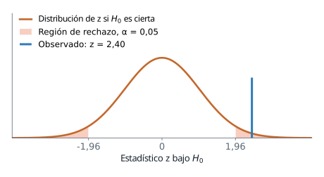{fig-alt="Curva de la normal estándar bajo H0 con las dos regiones de rechazo de alfa igual a 0,05, en menos 1,96 y 1,96; una línea vertical azul marca el valor observado de z igual a 2,40, que queda dentro de la región de rechazo de la derecha"}
:::

La proporción de mujeres en la muestra es 0,5600 y $z = 2{,}400$, es decir, 2,4 errores estándar por encima de 0,5. El valor p es 0,0164. Como $0{,}0164 < \alpha = 0{,}05$, se rechaza $H_0$: los datos no son compatibles con $p = 0{,}5$ a ese nivel de significancia. La proporción real es 0,5430: rechazar fue correcto, aunque $\hat{p}$ (0,5600) sobrestima el parámetro. El contraste decide si $p$ difiere de 0,5; no lo estima.

### Solución de referencia: contraste (b)

El estadístico es $t = (\bar{x} - \mu_0)/(s/\sqrt{n})$ con $n - 1 = 59$ grados de libertad, y `stats.ttest_1samp` lo calcula en una llamada.

```python
import numpy as np
import pandas as pd
from scipy import stats

rng = np.random.default_rng(2026)
cols = ["fami_estratovivienda", "punt_matematicas"]
datos = pd.read_csv("saber11_20224.csv", usecols=cols)
mu_0 = datos["punt_matematicas"].mean()
filtro = datos["fami_estratovivienda"] == "Estrato 6"
estrato_6 = datos.loc[filtro, "punt_matematicas"]
muestra = rng.choice(estrato_6, size=60, replace=False)
prueba = stats.ttest_1samp(muestra, popmean=mu_0)
print(f"mu_0 = {mu_0:.2f}, media_muestral = {muestra.mean():.2f}")
print(f"t = {prueba.statistic:.2f}, valor p = {prueba.pvalue:.3f}")
print(f"media real de Estrato 6 = {estrato_6.mean():.2f}")
```

```text
mu_0 = 50.59, media_muestral = 47.93
t = -1.40, valor p = 0.167
media real de Estrato 6 = 48.83
```

::: {.diagrama}
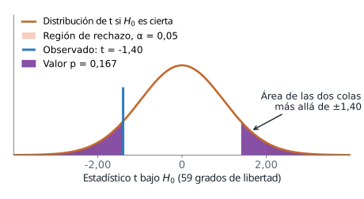{fig-alt="Curva de la distribución t con 59 grados de libertad bajo H0; las regiones de rechazo de alfa igual a 0,05 empiezan en menos 2,00 y 2,00; una línea vertical marca el valor observado de menos 1,40, que cae fuera de ellas, y el área de las dos colas más allá de 1,40 en valor absoluto, de 0,167, está sombreada en morado"}
:::

La media nacional es $\mu_0 = 50{,}59$ y la media de la muestra de Estrato 6 es 47,93. El estadístico es $t = -1{,}40$ y el valor p bilateral 0,167: cerca de una de cada seis muestras daría un $|t|$ al menos así de grande si $H_0$ fuera cierta. Como $0{,}167 > 0{,}05$, no se rechaza $H_0$. La media real de Estrato 6 es 48,83, a 1,76 puntos de $\mu_0$: existe una diferencia, pero con 60 estudiantes la prueba no la separa del azar. No rechazar $H_0$ no demuestra que $\mu = \mu_0$.

### Lectura de la práctica

Los dos contrastes dan decisiones distintas. En (a), el valor p, 0,0164, es menor que $\alpha$ y se rechaza $H_0$: la proporción real, 0,5430, es distinta de 0,5. En (b), el valor p, 0,167, supera a $\alpha$ y no se rechaza $H_0$, aunque la media real, 48,83, difiere de 50,59. Saber 11 describe a quienes presentaron la prueba; los contrastes cuantifican diferencias en esa población y no explican sus causas.

El reto planteaba una pregunta del mismo tipo: la retención de 2000 jugadores de `gate_40` frente a la línea base 0,1902. Rechazar $H_0$ habría indicado que el azar del muestreo explica mal la diferencia. El resultado fue 372 retenidos de 2000, $\hat{p} = 0{,}1860$, $z = -0{,}479$ y valor p de 0,632: no se rechaza $H_0$. Un valor p alto no demuestra que no haya diferencia. El contraste (b) lo muestra: una diferencia real de 1,76 puntos tampoco se detectó. En el reto ocurre lo mismo, y con $n = 2000$ una diferencia pequeña pasa inadvertida. Antes de concluir "no hay cambio" hay que preguntar si la muestra alcanza para verlo.

## Resumen de la sesión

### El mapa del contraste

| | Proporción | Media |
|---|---|---|
| Parámetro y referencia | $p$ y $p_0$ | $\mu$ y $\mu_0$ |
| Hipótesis | $H_0: p = p_0$ frente a $H_1: p \neq p_0$, $p < p_0$ o $p > p_0$ | $H_0: \mu = \mu_0$ frente a $H_1: \mu \neq \mu_0$, $\mu < \mu_0$ o $\mu > \mu_0$ |
| Estadístico | $z = \dfrac{\hat{p} - p_0}{\sqrt{p_0(1-p_0)/n}}$ | $t = \dfrac{\bar{x} - \mu_0}{s/\sqrt{n}}$ |
| Distribución bajo $H_0$ | Normal estándar $N(0,1)$ | t de Student con $n - 1$ grados de libertad |
| Supuestos | Muestra aleatoria simple; $n\,p_0 \ge 10$ y $n\,(1-p_0) \ge 10$ | Muestra aleatoria simple; población aproximadamente normal o $n$ suficiente |
| Función en `scipy` | `stats.norm.sf` o `stats.binomtest` | `stats.ttest_1samp` |
| Decisión | Rechazar $H_0$ si el valor p es menor o igual que $\alpha$ | Igual |
| Conclusión | En el lenguaje del caso: "hay (o no hay) evidencia de que..." | Igual |

### Los símbolos nuevos de la sesión

| Símbolo | Significado | Nombre en el código |
|---|---|---|
| $H_0$, $H_1$ | Hipótesis nula y alternativa | |
| $p_0$, $\mu_0$ | Valor de referencia que afirma $H_0$ | `p0`, `mu_0` |
| $z$, $t$ | Estadístico de prueba para una proporción y para una media | `estadistico` |
| valor p | Probabilidad, bajo $H_0$, de un estadístico al menos tan extremo como el observado | `valor_p` |
| $\alpha$ | Nivel de significancia: probabilidad aceptada de un error tipo I | `alfa` |
| $\beta$ | Probabilidad de un error tipo II | |
| $1 - \beta$ | Potencia | `potencia` |
| $z_{1-\alpha/2}$, $t_{n-1,\,1-\alpha/2}$ | Valores críticos del contraste bilateral | `z_crit` |

### Qué recordar

- Una hipótesis habla de un parámetro. $H_0$ lleva la igualdad y se presume cierta; $H_1$ sigue la pregunta y es lo que hay que demostrar. Ambas se escriben antes de ver los datos.
- El estadístico mide la distancia entre los datos y $H_0$ en errores estándar. Su distribución bajo $H_0$ es conocida y es la vara de medir.
- El valor p es la probabilidad, suponiendo $H_0$, de un resultado al menos tan extremo como el observado. Se decide comparándolo con $\alpha$, fijado antes.
- Un intervalo de confianza de nivel $1 - \alpha$ contiene exactamente los valores de referencia que el contraste bilateral de nivel $\alpha$ no rechaza (exacto para la media; aproximado para la proporción).
- Hay dos errores: rechazar una $H_0$ verdadera (tipo I, probabilidad $\alpha$) y no rechazar una falsa (tipo II, probabilidad $\beta$). La potencia $1 - \beta$ crece con $n$.
- Cualquier diferencia distinta de cero termina siendo significativa si $n$ crece lo suficiente. Se informa la estimación, su intervalo y el valor p, y la relevancia se juzga en el contexto.

### Errores frecuentes

1. Leer el valor p como la probabilidad de que $H_0$ sea cierta.
2. Concluir que $H_0$ es verdadera porque el valor p superó a $\alpha$. Solo falta evidencia, y con poca potencia falta casi siempre.
3. Tomar un valor p pequeño por un efecto grande o importante.
4. Elegir $\alpha$, la dirección de $H_1$ o la prueba después de ver los datos.
5. Calcular el error estándar de $z$ con $\hat{p}$ en lugar de $p_0$. Bajo $H_0$ corresponde $p_0$.
6. Usar la normal para una proporción sin revisar que $n\,p_0$ y $n\,(1-p_0)$ sean al menos 10.
7. Usar $z$ para una media con $\sigma$ desconocida. Corresponde la t de Student.
8. Reportar solo "significativo" o "no significativo", sin la estimación ni su intervalo.

## Lista de verificación {.unnumbered}

::: {.checklist}
- [ ] Formulas $H_0$ y $H_1$ a partir de una pregunta, identificando el parámetro, el valor de referencia y la dirección de $H_1$.
- [ ] Calculas $z$ para una proporción y $t$ para una media, y explicas qué mide cada uno y qué distribución sigue bajo $H_0$.
- [ ] Defines el valor p, lo obtienes por simulación y con `scipy`, y explicas por qué no es la probabilidad de $H_0$.
- [ ] Fijas $\alpha$ antes de calcular, aplicas la regla de decisión y redactas la conclusión sin decir que "aceptas" $H_0$.
- [ ] Distingues un contraste bilateral de uno unilateral y no eliges la cola después de ver los datos.
- [ ] Relacionas el intervalo de confianza con el contraste bilateral.
- [ ] Explicas el error tipo I, el error tipo II y la potencia, y cómo cambia la potencia con $n$.
- [ ] Separas la significancia estadística de la relevancia práctica y reportas la estimación con su intervalo.
:::

## Referencias {.unnumbered}

- Documentación de `scipy.stats`, con `binomtest`, `ttest_1samp`, `norm` y `t`: <https://docs.scipy.org/doc/scipy/reference/stats.html>.

[Abrir la presentación de la sesión](presentacion-inferencia-pruebas-hipotesis.html){.btn .btn-primary role="button"}

La presentación es un apoyo visual: recorre la misma secuencia con las mismas figuras y el mismo código, paso a paso. La guía se basta sola.
