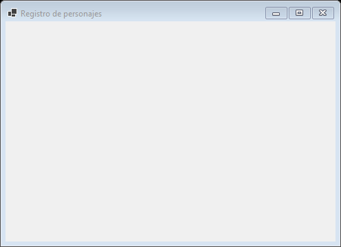
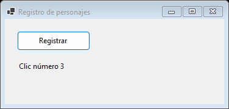
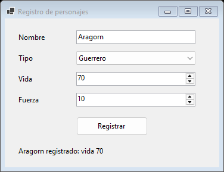
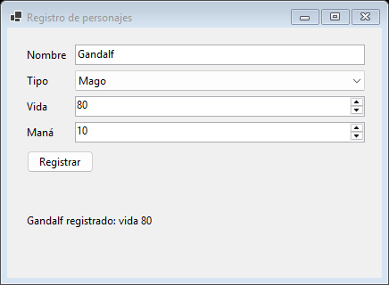
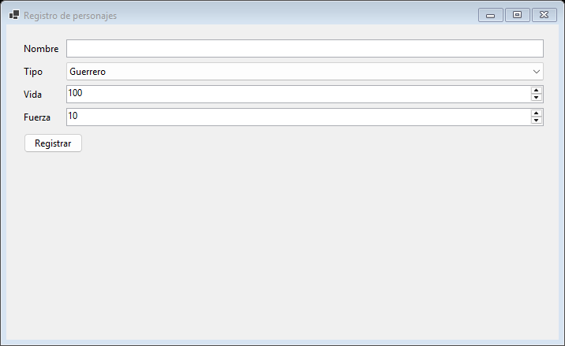
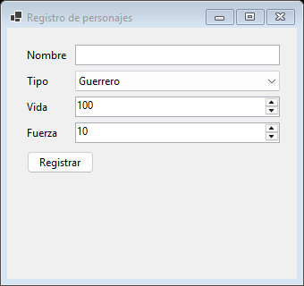
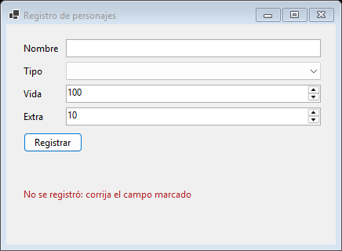
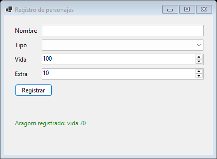

```{=html}
<style>
  /* En esta guía hay fragmentos de código largos dentro de listas y tablas: en teléfono se parten en vez de ensanchar la página */
  p code, li code, td code { white-space: normal; overflow-wrap: anywhere; }
</style>
```

::: {.ficha}
|            |                                                          |
|------------|----------------------------------------------------------|
| Asignatura | Herramientas de Programación I (ET0047)                  |
| Programa   | Tecnología en Desarrollo de Software                     |
| Unidad     | Unidad 3. Diseño y desarrollo de aplicaciones gráficas aplicando la POO |
| Saberes    | Elementos GUI con Windows Forms: propiedades y eventos de control |
:::

Esta guía se probó con el SDK de .NET **10.0.302**.

Esta guía es la primera de dos sobre interfaz gráfica de usuario (GUI, por *graphical user interface*) con Windows Forms. Aquí construyes, paso a paso y solo con código, una ventana que registra personajes del videojuego de la clase de POO. Empiezas con una ventana vacía y terminas con un formulario que reacciona a lo que hace el usuario, se acomoda al tamaño de la pantalla y rechaza los datos incorrectos. La guía se puede seguir sin haber asistido a la clase y sin otro material: cada bloque de código sale de un proyecto que se compiló y se ejecutó, y cada texto de pantalla que ves citado es el texto real.

## El problema: la consola frente a la ventana

Hasta ahora todos tus programas fueron de consola. En una aplicación de consola **el programa decide cuándo el usuario puede actuar**: pregunta "Nombre:", se queda quieto hasta que escribes, pregunta "Tipo (Guerrero o Mago):", y así hasta el final. El orden lo fija quien programa. Si te equivocas en el nombre y ya pasaste a la pregunta siguiente, no hay cómo volver.

En una ventana la relación se invierte: **el usuario decide cuándo el programa debe reaccionar**. Puede llenar el tipo antes que el nombre, corregir un dato diez veces, hacer clic donde quiera o cerrar la ventana a la mitad. El programa no puede esperar un orden: tiene que quedarse abierto, atento, y responder a cada acción cuando ocurra.

::: {.diagrama}
{fig-alt="Comparación entre la consola, donde el programa lleva la iniciativa con preguntas en orden fijo, y la ventana, donde el usuario lleva la iniciativa y el programa espera y reacciona a cada aviso"}
:::

De esa inversión salen los tres conceptos que organizan toda la guía:

- **Evento**: un aviso de que algo pasó (un clic, una tecla, un cambio de selección).
- **Manejador**: el método que tú escribes para reaccionar a un evento.
- **Validación**: como el usuario puede escribir cualquier cosa, el programa debe revisar los datos antes de usarlos.

### El caso: registro de personajes

Reutilizas el dominio de la clase de POO: `Personaje` (abstracta), `Guerrero` y `Mago`. La interfaz es una cara nueva sobre el mismo dominio: el dominio no cambia en ningún paso de esta parte. Al final tendrás una ventana "Registro de personajes" con un campo para el nombre, una lista para el tipo, la vida, un dato extra (fuerza para el guerrero, maná para el mago) y un botón Registrar.

### Mapa de los pasos de esta parte

Cada paso nace de un problema concreto del anterior y es un proyecto que compila y se ejecuta.

| Paso | Problema que se plantea | Concepto que lo resuelve | Qué agrega al código |
|---|---|---|---|
| 1 | La consola no deja actuar libremente. ¿Qué es una ventana y por qué el programa no termina? | `Form`, proyecto desde cero, `Application.Run`, bucle de mensajes | Un proyecto de ventanas y una ventana vacía |
| 2 | ¿Cómo reacciona el programa a lo que hace el usuario? | Evento y manejador, clase que hereda de `Form`, estado entre eventos | `VentanaPrincipal`, un botón, una etiqueta y un contador |
| 3 | ¿Cómo pido y muestro datos? | `Label`, `TextBox`, `ComboBox`, `NumericUpDown`, propiedades, del control al objeto | Los controles de entrada y la creación de un `Guerrero` o un `Mago` |
| 4 | ¿Por qué se descuadra al cambiar el tamaño? | `Dock`, `Anchor`, `TableLayoutPanel`, `FlowLayoutPanel` | Contenedores que calculan la posición |
| 5 | ¿Qué pasa si el usuario escribe cualquier cosa? | Validación, `ErrorProvider`, mensajes claros, foco, tecla Enter | `Validar()` y retroalimentación en pantalla |

La parte 2 continúa con una lista de objetos en pantalla, la separación de la lógica y la persistencia en archivo.

### Vocabulario que vas a usar

| Término | Qué significa |
|---|---|
| Formulario (`Form`) | La ventana. Es una clase de Windows Forms: cada ventana de tu programa es un objeto de esa clase o de una clase que hereda de ella |
| Control | Cada elemento dentro de la ventana: etiqueta, caja de texto, botón, lista. También son objetos con propiedades |
| Propiedad | Un dato de un control que puedes leer y cambiar: `Text`, `Location`, `Value` |
| Evento | Un aviso que emite un control cuando ocurre algo: `Click`, `SelectedIndexChanged` |
| Manejador | El método que reacciona a un evento |
| Bucle de mensajes | El ciclo que mantiene viva la ventana: toma cada aviso de Windows y lo reparte |
| Contenedor | Un control que acomoda a otros dentro de él: `TableLayoutPanel`, `FlowLayoutPanel` |

## Requisitos

- **Windows 10 u 11.** Windows Forms solo corre en Windows.
- **SDK de .NET 10.** En una terminal, `dotnet --version` debe imprimir un número que empiece por `10.`. La guía se probó con 10.0.302.
- **VS Code** con la extensión **C#** de Microsoft. Trabajas en el editor y en la terminal; no usas el diseñador visual de ventanas.
- **Los archivos del dominio**: `Personaje.cs`, `Guerrero.cs` y `Mago.cs` de tu proyecto de la clase de POO. Si no los tienes, aparecen completos en el paso 3 de esta guía.

::: {.callout-warning title="Si usas macOS o Linux"}
Windows Forms no se puede ejecutar en macOS ni en Linux. Necesitas una máquina virtual con Windows o acceso remoto a una sala de cómputo con Windows. Pregunta a tu docente por la opción disponible antes de empezar.
:::

## Cómo trabajar esta guía

- **Escribe el código tú mismo.** Copiar y pegar funciona, pero los errores de escritura son parte del aprendizaje: aprendes más de un punto y coma que falta que de un bloque que compila a la primera.
- **Ejecuta al terminar cada paso** con `dotnet run`, dentro de la carpeta del proyecto. Mientras la ventana esté abierta, la terminal queda ocupada: ciérrala antes de volver a ejecutar o a compilar.
- **Reemplazar un archivo** significa borrar todo su contenido y poner el nuevo. Cada paso muestra el archivo completo, así que puedes llegar a él desde cualquier punto.
- **No te saltes "Rompe esto y observa".** Cambiar una línea y ver qué pasa es la forma más rápida de entender qué hacía.
- **Cada paso tiene la misma estructura**: el problema, la idea, el paso a paso, qué debes ver, rompe esto y observa, errores frecuentes, para practicar y lo que aprendiste. Si ya conoces la idea, ve directo al paso a paso; si algo no sale, mira los errores frecuentes.
- **Una presentación acompaña la clase presencial.** Esta guía cubre lo mismo con más detalle.

## Paso 1. La primera ventana

### 1.1 El problema

Quieres un programa que registre personajes. En consola el registro se ve así, y vale la pena leerlo con atención:

<!-- codigo: paso1/consola/Program.cs completo -->
```csharp
// Contraste: en consola el programa decide el orden y el usuario solo responde.
// Si se equivoca en el nombre, no puede volver atrás para corregirlo.
Console.WriteLine("Nombre:");
string nombre = Console.ReadLine() ?? "";

Console.WriteLine("Tipo (Guerrero o Mago):");
string tipo = Console.ReadLine() ?? "";

Console.WriteLine("Vida (0 a 100):");
int.TryParse(Console.ReadLine(), out int vida);

// Para no alargar el contraste, la fuerza o el maná se fija en 10.
Personaje personaje;
if (tipo == "Mago")
{
    personaje = new Mago(nombre, vida, 10);
}
else
{
    personaje = new Guerrero(nombre, vida, 10);
}

Console.WriteLine($"{personaje.Nombre} registrado: vida {personaje.Vida}");
```

El programa pide tres datos en un orden fijo, con tres llamadas a `Console.ReadLine`, crea el personaje y lo imprime. No necesitas ejecutarlo; si quieres hacerlo, crea una carpeta aparte con `dotnet new console`, copia ahí los tres archivos del dominio (aparecen completos en el paso 3) y reemplaza `Program.cs`. Con las respuestas `Aragorn`, `Guerrero` y `70`, el programa imprime estas líneas (las respuestas las escribes tú en la terminal, debajo de cada pregunta):

<!-- codigo: paso1/consola/salida.txt completo -->
```text
Nombre:
Tipo (Guerrero o Mago):
Vida (0 a 100):
Aragorn registrado: vida 70
```

::: {.callout-warning title="El problema"}
En consola el orden lo fija el programa. Si escribes mal el nombre, no puedes volver a corregirlo. Si quieres registrar otro personaje, tienes que volver a ejecutar todo. Y un registro de personajes real necesita lo contrario: llenar los datos en el orden que quieras, corregir, cambiar de idea. Para eso necesitas una ventana, y una ventana plantea una pregunta nueva: **si un programa de consola termina cuando se acaba la última línea, ¿cómo hace una ventana para quedarse abierta?**
:::

### 1.2 La idea

**Una analogía.** La consola es una entrevista: el entrevistador pregunta, tú respondes, y la entrevista termina cuando se acaban las preguntas. Una ventana es un mostrador de atención: el funcionario no pregunta nada, se queda esperando y atiende a quien llegue, en el orden en que lleguen. El mostrador no cierra hasta que alguien dice "se acabó la atención".

Ese "quedarse esperando" tiene nombre técnico: el **bucle de mensajes**. Cada vez que el usuario hace algo (un clic, una tecla, mover la ventana), Windows lo convierte en un *mensaje* y lo pone en una cola. El bucle toma un mensaje, se lo entrega a la ventana para que reaccione y vuelve a esperar el siguiente. Mientras ese bucle gire, el programa no termina.

::: {.diagrama}
{fig-alt="Diagrama del bucle de mensajes: usuario, cola de mensajes de Windows, bucle de tres pasos dentro de Application.Run, formulario que reacciona y salida del bucle al cerrar la ventana"}
:::

Tú no escribes ese bucle. La instrucción `Application.Run(ventana)` lo ejecuta por ti: muestra la ventana, gira el bucle y **no devuelve el control hasta que la ventana se cierra**. Por eso `Main` no termina mientras la ventana está abierta.

Tres ideas más para este paso:

- **La ventana es un objeto.** Una ventana es un objeto de la clase `Form`. Tiene propiedades, igual que `Guerrero` tenía `Vida`: `Text` es el título de la barra, `ClientSize` es el tamaño del área útil (sin la barra de título ni los bordes) y `StartPosition` dice dónde aparece.
- **El proyecto es de ventanas.** Un proyecto de consola y uno de ventanas se diferencian en tres líneas de configuración del archivo `.csproj`. Las ves en el paso a paso.
- **El hilo de la interfaz tiene una regla.** Windows Forms exige que el hilo que maneja la interfaz sea de un solo compartimento (STA, *single-threaded apartment*). Se declara con un atributo, `[STAThread]`, encima de `Main`.

### 1.3 Paso a paso

**Crear el proyecto desde cero.** Abre una terminal en la carpeta donde guardas tus proyectos y ejecuta:

```powershell
mkdir RegistroPersonajes
cd RegistroPersonajes
dotnet new console
code .
```

`dotnet new console` crea dos archivos: `RegistroPersonajes.csproj` (la configuración del proyecto) y `Program.cs`. El último comando abre la carpeta en VS Code. Todavía es un proyecto de consola: lo convertimos en uno de ventanas.

**Reemplazar el `.csproj`.** Abre `RegistroPersonajes.csproj` y reemplaza todo su contenido por este:

<!-- codigo: paso1/Paso1.csproj completo -->
```xml
<Project Sdk="Microsoft.NET.Sdk">

  <PropertyGroup>
    <OutputType>WinExe</OutputType>
    <TargetFramework>net10.0-windows</TargetFramework>
    <UseWindowsForms>true</UseWindowsForms>
    <ImplicitUsings>enable</ImplicitUsings>
    <Nullable>enable</Nullable>
  </PropertyGroup>

</Project>
```

Las tres líneas que cambian respecto a un proyecto de consola:

| Línea | Qué hace | Por qué |
|---|---|---|
| `<OutputType>WinExe</OutputType>` | Declara una aplicación de ventanas | Con `Exe`, al abrir el programa con doble clic Windows mostraría además una ventana de consola negra detrás de tu formulario |
| `<TargetFramework>net10.0-windows</TargetFramework>` | Apunta a .NET 10 para Windows | Windows Forms usa funciones propias del sistema operativo, y el sufijo `-windows` las habilita |
| `<UseWindowsForms>true</UseWindowsForms>` | Agrega la biblioteca de Windows Forms al proyecto | Sin ella, `Form` y `Application` no existen para el compilador |

`ImplicitUsings` y `Nullable` ya venían con el proyecto de consola. Con `UseWindowsForms` activo, los `using` implícitos incluyen `System.Windows.Forms` y `System.Drawing`, así que no escribes ninguno.

**Reemplazar `Program.cs`.** Abre `Program.cs` y reemplaza todo por esto:

<!-- codigo: paso1/Program.cs completo -->
```csharp
// Paso 1: la primera ventana. Application.Run no termina hasta que se cierra el formulario.
static class Program
{
    [STAThread] // Windows Forms exige que el hilo de la interfaz sea de un solo compartimento (STA)
    static void Main()
    {
        ApplicationConfiguration.Initialize(); // fuente, estilos visuales y DPI estándar

        // Application.Run abre la ventana y atiende al usuario (clics, teclas) hasta que la cierre.
        Application.Run(new Form
        {
            Text = "Registro de personajes",
            ClientSize = new Size(480, 320),
            StartPosition = FormStartPosition.CenterScreen
        });
    }
}
```

Línea por línea:

- `static class Program` y `static void Main()`: el programa de consola de la plantilla usa instrucciones de nivel superior. Aquí escribimos `Main` completo para poder ponerle el atributo.
- `[STAThread]`: marca el hilo de la interfaz como STA. Windows Forms lo exige; sin él fallan funciones como el portapapeles y los cuadros de diálogo de archivos.
- `ApplicationConfiguration.Initialize()`: deja la aplicación con la configuración estándar (estilos visuales actuales, fuente predeterminada, soporte de pantallas de alta resolución). Esta línea la genera el SDK por ti cuando activas `UseWindowsForms`.
- `Application.Run(new Form { ... })`: crea la ventana, la muestra y gira el bucle de mensajes hasta que se cierre.
- Dentro de las llaves, `Text`, `ClientSize` y `StartPosition` son un **inicializador de objeto**: crea el `Form` y asigna sus propiedades en un solo gesto, igual que si escribieras `var f = new Form();` y después `f.Text = ...;`.
- `new Size(480, 320)` crea un tamaño de 480 píxeles de ancho por 320 de alto. `FormStartPosition.CenterScreen` centra la ventana en la pantalla.

Ejecuta el proyecto en la terminal:

```powershell
dotnet run
```

### 1.4 Qué debes ver

Aparece una ventana vacía, centrada en la pantalla, con el título "Registro de personajes" y los tres botones de siempre (minimizar, maximizar y cerrar). No hay ventana de consola.

{fig-alt="Ventana de Windows vacía con el título Registro de personajes, sin ningún control dentro"}

Fíjate en la terminal: **el cursor no vuelve** mientras la ventana está abierta. Es `Application.Run` en acción: el programa no ha terminado. Cierra la ventana con la X y la terminal te devuelve el control.

### 1.5 Rompe esto y observa

1. **Quita el bucle.** Cambia `Application.Run(new Form` por `new Form` y cambia el cierre `});` por `}.Show();`. Ejecuta. La ventana aparece un instante, o ni alcanzas a verla, y el programa termina. `Show()` muestra la ventana y devuelve el control de inmediato; sin bucle de mensajes, `Main` llega a su última línea y el proceso se acaba. Esto confirma que lo que mantiene viva la ventana es `Application.Run`. Devuelve el código a como estaba.
2. **Cambia propiedades.** Dentro del inicializador agrega `BackColor = Color.LightSteelBlue,` y cambia `ClientSize` a `new Size(600, 200)`. La ventana cambia de color y de forma: son propiedades del objeto, y asignarlas es el modo normal de configurar cualquier control.
3. **Quita el botón de maximizar.** Agrega `MaximizeBox = false,` y `FormBorderStyle = FormBorderStyle.FixedDialog,`. La ventana ya no se puede maximizar ni arrastrar de los bordes para cambiarle el tamaño.

### 1.6 Errores frecuentes

| Qué ves | Causa | Cómo se resuelve |
|---|---|---|
| `error CS0103: El nombre 'Application' no existe en el contexto actual` y `error CS0246: El nombre del tipo o del espacio de nombres 'Form' no se encontró` | El proyecto no tiene `<UseWindowsForms>true</UseWindowsForms>` | Revisa el `.csproj` y deja las tres líneas del paso 1.3 |
| `error NETSDK1136: La plataforma de destino debe establecerse en Windows (normalmente, se incluye "-windows" en la propiedad TargetFramework) ...` | El `TargetFramework` dice `net10.0` en vez de `net10.0-windows` | Escribe `net10.0-windows` |
| `error NETSDK1100` al compilar | Estás en macOS o Linux | Windows Forms necesita Windows: usa una máquina virtual o el acceso remoto |
| `error MSB3027: No se pudo copiar ... El archivo se ha bloqueado por: "RegistroPersonajes (...)"` | La ventana anterior sigue abierta y bloquea el ejecutable | Cierra la ventana (o termina el proceso) y vuelve a ejecutar |
| La terminal parece "colgada" | Es normal: `Application.Run` no termina mientras haya ventana | Cierra la ventana |

### 1.7 Para practicar

Haz que la ventana se llame "Registro de personajes - versión 1", mida 600 por 200, tenga el color de fondo que prefieras y no se pueda maximizar. Pista: todo se hace con propiedades de `Form` dentro del inicializador, y ya viste cinco: `Text`, `ClientSize`, `BackColor`, `MaximizeBox` y `FormBorderStyle`.

### 1.8 Lo que aprendiste

- Una aplicación de ventanas se queda abierta porque `Application.Run` ejecuta el bucle de mensajes.
- Una ventana es un objeto de la clase `Form`, y se configura con propiedades.
- Un proyecto de ventanas necesita `WinExe`, `net10.0-windows` y `UseWindowsForms`.
- `[STAThread]` y `ApplicationConfiguration.Initialize()` son la base obligatoria de `Main`.
- Tienes una ventana, pero no hace nada: el usuario puede hacer clic donde quiera y el programa lo ignora.

**Puente al paso 2.** La ventana existe, pero es sorda. El paso 2 le enseña a reaccionar.

## Paso 2. Eventos y manejadores

### 2.1 El problema

La ventana del paso 1 está viva, pero no reacciona a nada. Lo que queremos es lo más simple posible: un botón "Registrar" y una etiqueta que diga cuántas veces lo has pulsado.

::: {.callout-warning title="El problema"}
En consola, el programa pide un dato y lo recibe en la línea siguiente: sabes cuándo ocurre cada cosa porque tú escribiste el orden. En una ventana no sabes cuándo hará clic el usuario, ni cuántas veces, ni si hará clic en otro botón antes. No puedes escribir "después de la línea 10, procesa el clic". **¿Cómo le dices al programa que ejecute un código solo cuando ocurra algo?**
:::

### 2.2 La idea

**Una analogía.** Un timbre de puerta. El botón es el timbre. Que alguien lo pulse es el **evento** (`Click`). El **manejador** es la persona que abre la puerta. Tú no te quedas mirando el timbre a cada segundo: le dejas tu número de teléfono para que te llame cuando suene. En código, ese "dejar tu número" se escribe con el operador `+=`:

```csharp
btnRegistrar.Click += AlRegistrar;
```

Observa lo que **no** pasa: no escribes `AlRegistrar()` con paréntesis. No llamas al método; se lo entregas al botón para que él lo llame cuando ocurra el clic. Quien lo llama es Windows, a través del bucle de mensajes del paso 1: el clic llega a la cola, el bucle lo entrega al botón, el botón dispara su evento `Click` y ejecuta, uno por uno, todos los manejadores que se hayan suscrito.

::: {.diagrama}
{fig-alt="Flujo de un evento: suscripción del manejador al evento Click, recorrido de un clic desde el usuario hasta AlRegistrar y evolución del campo clics entre clics"}
:::

Un manejador de evento tiene siempre la misma forma: `void NombreDelManejador(object? sender, EventArgs e)`. `sender` es el control que disparó el evento (aquí, el botón) y `e` trae datos del evento (en un clic, ninguno que necesitemos hoy).

**El estado vive en el objeto.** Cada vez que se ejecuta un manejador, termina y sus variables locales desaparecen. Para contar clics necesitas algo que sobreviva entre un clic y el siguiente: un **campo** de la clase. Como la ventana es un objeto que existe mientras está abierta, sus campos recuerdan lo que pasó. Ese es el motivo para pasar de "un `Form` suelto" a **una clase propia que hereda de `Form`**: `VentanaPrincipal : Form`. Es la herencia de la clase de POO (`Guerrero : Personaje`): una `VentanaPrincipal` *es un* `Form`, con todo lo de `Form` y además sus propios campos, controles y manejadores.

### 2.3 Paso a paso

**Qué cambia respecto al paso 1:** ahora hay dos archivos. `Program.cs` solo crea la ventana de nuestra clase, y `VentanaPrincipal.cs` contiene la ventana. El `.csproj` no cambia.

Crea el archivo `VentanaPrincipal.cs` en la misma carpeta que `Program.cs`, con este contenido:

<!-- codigo: paso2/VentanaPrincipal.cs completo -->
```csharp
// Paso 2: un evento (el clic) y un manejador (el método que reacciona).
class VentanaPrincipal : Form
{
    private readonly Button btnRegistrar = new();
    private readonly Label lblEstado = new();

    // El objeto vive mientras la ventana esté abierta: aquí se recuerda entre un clic y otro.
    private int clics;

    public VentanaPrincipal()
    {
        Text = "Registro de personajes";
        ClientSize = new Size(360, 140);
        StartPosition = FormStartPosition.CenterScreen;

        btnRegistrar.Text = "Registrar";
        btnRegistrar.Location = new Point(20, 20);
        btnRegistrar.Size = new Size(120, 32);

        lblEstado.Text = "Aún no hay clics";
        lblEstado.Location = new Point(20, 70);
        lblEstado.AutoSize = true;

        // Se conecta el evento con el manejador: no se llama al método, se le entrega al botón.
        btnRegistrar.Click += AlRegistrar;

        Controls.Add(btnRegistrar);
        Controls.Add(lblEstado);
    }

    // Se ejecuta cada vez que el usuario hace clic en el botón.
    private void AlRegistrar(object? sender, EventArgs e)
    {
        clics++;
        lblEstado.Text = $"Clic número {clics}";
    }
}
```

Y reemplaza `Program.cs`. Solo cambia la línea de `Application.Run`: en vez de `new Form { ... }`, ahora es `new VentanaPrincipal()`:

<!-- codigo: paso2/Program.cs completo -->
```csharp
// Igual que el paso 1, pero ahora la ventana es una clase propia.
static class Program
{
    [STAThread]
    static void Main()
    {
        ApplicationConfiguration.Initialize();
        Application.Run(new VentanaPrincipal());
    }
}
```

Lo nuevo de `VentanaPrincipal.cs`, de arriba abajo:

| Línea | Qué hace | Por qué |
|---|---|---|
| `class VentanaPrincipal : Form` | Declara una clase que hereda de `Form` | La ventana tiene campos y métodos propios |
| `private readonly Button btnRegistrar = new();` | Un campo que guarda el botón | Los controles se guardan en campos para poder usarlos desde cualquier método. `readonly` porque el botón no se reemplaza nunca |
| `private readonly Label lblEstado = new();` | Un campo para una etiqueta (`Label`) | Es el lugar donde la ventana muestra resultados |
| `private int clics;` | Un contador | Es el estado: sobrevive entre un clic y otro porque es un campo y no una variable local |
| `Text`, `ClientSize`, `StartPosition` | Propiedades de la propia ventana | Antes estaban en el inicializador de `Form`; ahora se escriben en el constructor, sin objeto delante, porque `this` ya es el `Form` |
| `Location`, `Size` del botón | Posición y tamaño en píxeles | `Location` es la esquina superior izquierda del control, medida desde la esquina superior izquierda del área útil de la ventana. `X` crece hacia la derecha y `Y` hacia abajo |
| `AutoSize = true` en la etiqueta | La etiqueta ajusta su tamaño a su texto | Así no calculas el ancho de un texto que cambia |
| `btnRegistrar.Click += AlRegistrar;` | Suscribe el manejador al evento | Es el "dejar el número de teléfono" |
| `Controls.Add(...)` | Agrega cada control a la ventana | Un control que no está en `Controls` existe en memoria pero no se ve |
| `AlRegistrar` | El manejador: suma 1 a `clics` y escribe el texto | Se ejecuta cada vez que alguien hace clic |

### 2.4 Qué debes ver

Aparece una ventana con un botón "Registrar" y, debajo, el texto "Aún no hay clics". Cada clic cambia el texto: "Clic número 1", "Clic número 2", y así.

{fig-alt="Ventana Registro de personajes con un botón Registrar y una etiqueta que dice Clic número 3"}

Estos son los textos de la etiqueta, tal como salen del programa:

<!-- estados: paso2/estados.txt -->
| Situación | Texto que se ve |
|---|---|
| Antes de hacer clic | `"Aún no hay clics"` |
| Clic 1 | `"Clic número 1"` |
| Clic 2 | `"Clic número 2"` |
| Clic 3 | `"Clic número 3"` |

### 2.5 Rompe esto y observa

1. **Quita la suscripción.** Borra o comenta la línea `btnRegistrar.Click += AlRegistrar;`. El botón se ve igual y se puede pulsar, pero la etiqueta se queda en "Aún no hay clics". Un evento sin manejador suscrito no hace nada, y no avisa de ningún error.
2. **Cambia el campo por una variable local.** Borra la línea `private int clics;` y escribe `int clics = 0;` como primera línea dentro de `AlRegistrar`. Cada clic muestra "Clic número 1": la variable local nace y muere en cada ejecución del manejador, y el estado se pierde. Por eso el estado va en un campo.
3. **Suscribe dos veces.** Repite la línea `btnRegistrar.Click += AlRegistrar;` dos veces seguidas. El primer clic muestra "Clic número 2", el segundo "Clic número 4": el botón tiene dos suscripciones y llama al manejador dos veces por clic. `+=` agrega a la lista de manejadores; no reemplaza.

### 2.6 Errores frecuentes

| Qué ves | Causa | Cómo se resuelve |
|---|---|---|
| `error CS0123: Ninguna sobrecarga correspondiente a 'AlRegistrar' coincide con el delegado 'EventHandler'` | El manejador no tiene la firma `(object? sender, EventArgs e)` | Escribe exactamente esos dos parámetros |
| `error CS7036: No se ha dado ningún argumento que corresponda al parámetro requerido "sender" ...` | Escribiste `AlRegistrar()` con paréntesis: llamaste al método en vez de entregarlo | Quita los paréntesis: `btnRegistrar.Click += AlRegistrar;` |
| El botón o la etiqueta no aparecen | Falta `Controls.Add(...)` para ese control | Agrega el control a `Controls` |
| El botón aparece pero no pasa nada al pulsarlo | Falta la línea `+=` | Suscribe el manejador |
| `error CS0103: El nombre 'clic' no existe en el contexto actual` | Error de escritura: el campo es `clics`, con la ese final | Revisa el nombre |

### 2.7 Para practicar

Agrega un segundo botón, "Reiniciar", que pone el contador en cero y escribe "Contador en cero" en la etiqueta. Pista: repite el mismo patrón completo, que son cuatro movimientos: un campo `Button`, sus propiedades `Text`, `Location` y `Size`, un manejador nuevo con la misma firma, y la suscripción más el `Controls.Add`. Ubícalo con `Location = new Point(160, 20)` para que no tape al primero.

### 2.8 Lo que aprendiste

- Un **evento** es un aviso que emite un control; un **manejador** es el método que reacciona.
- `+=` suscribe el manejador al evento: se entrega el método, no se llama.
- Windows invoca el manejador a través del bucle de mensajes, cuando el usuario actúa.
- Una clase que hereda de `Form` agrupa la ventana, sus controles y su estado.
- El estado entre eventos vive en campos del objeto, no en variables locales.

**Puente al paso 3.** El botón ya reacciona, pero solo cuenta clics. Registrar un personaje requiere datos: un nombre, un tipo, una vida. El paso 3 agrega los controles para pedirlos y los conecta con el dominio.

## Paso 3. Controles de entrada y del control al objeto

### 3.1 El problema

Necesitas cuatro datos para crear un personaje: el nombre, el tipo (guerrero o mago), la vida y un dato extra (la fuerza del guerrero o el maná del mago). Cada dato necesita un control distinto, y lo que el usuario teclea en pantalla tiene que convertirse en un objeto `Guerrero` o `Mago` del dominio.

::: {.callout-warning title="El problema"}
Un nombre es texto libre. El tipo es una opción entre dos. La vida es un número con límites. Si usaras una caja de texto para todo, el usuario podría escribir "Gandalf" donde va un número o inventar un tipo que no existe. **¿Qué control corresponde a cada dato y cómo se pasa de lo que muestra la pantalla a un objeto del dominio?**
:::

### 3.2 La idea

**Cada control es un objeto con propiedades.** Lo que ves en pantalla es el estado visible de un objeto. Leer lo que escribió el usuario es leer una propiedad; mostrarle algo es asignarla. Estos son los controles de este paso:

| Control | Para qué sirve | Propiedades que usamos |
|---|---|---|
| `Label` | Mostrar un texto fijo o un resultado | `Text` |
| `TextBox` | Texto libre | `Text` |
| `ComboBox` | Elegir una opción de una lista | `Items`, `SelectedItem`, `DropDownStyle` |
| `NumericUpDown` | Un número con mínimo y máximo | `Minimum`, `Maximum`, `Value` |
| `Button` | Disparar una acción | `Text`, evento `Click` |

Dos detalles de tipos que importan:

- `NumericUpDown.Value` es un `decimal`, no un `int`. El constructor del dominio pide `int`, así que hay que convertir con `(int)numVida.Value`.
- `ComboBox.SelectedItem` es un `object?`: puede ser `null` si no hay nada elegido. Para comprobar qué opción hay se usa `cboTipo.SelectedItem is "Mago"`, que vale `true` solo si lo elegido es exactamente el texto "Mago" y `false` en cualquier otro caso (incluido `null`).

**El camino del control al objeto.** En el manejador del botón: se leen las propiedades de los controles, se convierten a los tipos que pide el constructor y se crea el objeto del dominio. El resultado se escribe en una etiqueta. La interfaz y el dominio son dos mundos que se tocan en un solo punto.

::: {.diagrama}
{fig-alt="Del control al objeto: propiedades de los controles se leen en AlRegistrar, se convierten, crean un Guerrero y el resultado se escribe en lblEstado.Text"}
:::

**El segundo evento.** El dato extra depende del tipo: cuando el usuario cambia de Guerrero a Mago, la etiqueta debe pasar de "Fuerza" a "Maná". Eso lo hace otro evento del mismo patrón del paso 2: `SelectedIndexChanged` del `ComboBox`, con su manejador `AlCambiarTipo`. Cada control tiene muchos eventos; el mecanismo es siempre el mismo.

**Inicializador de objeto en los campos.** Cada control se declara en un campo con sus propiedades iniciales: `new() { Text = "Nombre", ... }`. Así el constructor queda corto y la configuración de cada control vive junto a su declaración.

### 3.3 Paso a paso

**Qué cambia respecto al paso 2:** `VentanaPrincipal.cs` crece de tres controles a diez, y el manejador del botón ahora crea un personaje del dominio. `Program.cs` y el `.csproj` no cambian.

**Primero, el dominio.** El manejador usa `Guerrero`, `Mago` y `Personaje`. Copia en la carpeta del proyecto, junto a `Program.cs`, los tres archivos de tu proyecto de POO: `Personaje.cs`, `Guerrero.cs` y `Mago.cs`. Si no los tienes, aquí están completos (no escribas `Partida.cs` todavía: la usa la parte 2).

::: {.callout-note title="El dominio completo: Personaje.cs, Guerrero.cs y Mago.cs" collapse="true"}
`Personaje.cs`:

<!-- codigo: dominio/Personaje.cs completo -->
```csharp
abstract class Personaje
{
    public const int VidaMaxima = 100;

    public string Nombre { get; }
    public int Vida { get; private set; }
    public bool EstaVivo => Vida > 0;

    protected Personaje(string nombre, int vida)
    {
        Nombre = nombre;
        Vida = Math.Clamp(vida, 0, VidaMaxima);
    }

    public void RecibirDano(int dano)
    {
        Vida = Math.Max(0, Vida - dano);
    }

    public void Curar(int puntos)
    {
        if (!EstaVivo) return;
        Vida = Math.Min(VidaMaxima, Vida + puntos);
    }

    public abstract bool Atacar(Personaje objetivo);

    public abstract string ToLinea();

    public static Personaje? DesdeLinea(string linea)
    {
        string[] partes = linea.Split(';');
        if (partes.Length != 4) return null;
        if (!int.TryParse(partes[2], out int vida)) return null;
        if (!int.TryParse(partes[3], out int extra)) return null;

        return partes[0] switch
        {
            "Guerrero" => new Guerrero(partes[1], vida, extra),
            "Mago" => new Mago(partes[1], vida, extra),
            _ => null
        };
    }
}
```

`Guerrero.cs`:

<!-- codigo: dominio/Guerrero.cs completo -->
```csharp
class Guerrero : Personaje
{
    public int Fuerza { get; }

    public Guerrero(string nombre, int vida, int fuerza) : base(nombre, vida)
    {
        Fuerza = fuerza;
    }

    public override bool Atacar(Personaje objetivo)
    {
        if (!EstaVivo) return false;
        objetivo.RecibirDano(Fuerza);
        return true;
    }

    public override string ToLinea() => $"Guerrero;{Nombre};{Vida};{Fuerza}";
}
```

`Mago.cs`:

<!-- codigo: dominio/Mago.cs completo -->
```csharp
class Mago : Personaje
{
    public const int CostoMana = 10;
    public const int DanoMagico = 25;

    public int Mana { get; private set; }

    public Mago(string nombre, int vida, int mana) : base(nombre, vida)
    {
        Mana = Math.Max(0, mana);
    }

    public override bool Atacar(Personaje objetivo)
    {
        if (!EstaVivo || Mana < CostoMana) return false;
        Mana -= CostoMana;
        objetivo.RecibirDano(DanoMagico);
        return true;
    }

    public override string ToLinea() => $"Mago;{Nombre};{Vida};{Mana}";
}
```
:::

**Después, la ventana.** Reemplaza `VentanaPrincipal.cs`. El archivo se muestra en tres partes seguidas; juntas forman el archivo completo. Primero, los diez controles, cada uno ubicado a mano con `Location` y `Size`:

<!-- codigo: paso3/VentanaPrincipal.cs completo -->
```csharp
// Paso 3: controles de entrada y el paso del control al objeto del dominio.
// Cada control se ubica a mano con Location y Size: observe cuánto cuesta.
class VentanaPrincipal : Form
{
    private readonly Label lblNombre = new()
    {
        Text = "Nombre", Location = new Point(20, 24), AutoSize = true
    };
    private readonly TextBox txtNombre = new()
    {
        Location = new Point(120, 20), Size = new Size(200, 23)
    };
    private readonly Label lblTipo = new()
    {
        Text = "Tipo", Location = new Point(20, 59), AutoSize = true
    };
    private readonly ComboBox cboTipo = new()
    {
        Location = new Point(120, 55), Size = new Size(200, 23),
        DropDownStyle = ComboBoxStyle.DropDownList
    };
    private readonly Label lblVida = new()
    {
        Text = "Vida", Location = new Point(20, 94), AutoSize = true
    };
    private readonly NumericUpDown numVida = new()
    {
        Location = new Point(120, 90), Size = new Size(200, 23),
        Minimum = 0, Maximum = 100, Value = 100
    };
    private readonly Label lblExtra = new()
    {
        Text = "Fuerza", Location = new Point(20, 129), AutoSize = true
    };
    private readonly NumericUpDown numExtra = new()
    {
        Location = new Point(120, 125), Size = new Size(200, 23),
        Minimum = 0, Maximum = 100, Value = 10
    };
    private readonly Button btnRegistrar = new()
    {
        Text = "Registrar", Location = new Point(120, 165), Size = new Size(120, 32)
    };
    private readonly Label lblEstado = new()
    {
        Location = new Point(20, 215), AutoSize = true
    };
```

Lo nuevo en los campos:

- Cada control tiene un nombre con prefijo según su tipo: `lbl` para `Label`, `txt` para `TextBox`, `cbo` para `ComboBox`, `num` para `NumericUpDown` y `btn` para `Button`. Es una convención que te dice de un vistazo con qué estás trabajando.
- `DropDownStyle = ComboBoxStyle.DropDownList` hace que el usuario solo pueda **elegir** de la lista, no escribir. Así el tipo siempre es uno de los valores permitidos.
- `Minimum = 0, Maximum = 100, Value = 100` en `numVida` limita el rango: el control no deja pasar de ahí. `numExtra` empieza en 10.
- Las coordenadas están calculadas a mano: las etiquetas en `X = 20`, los campos en `X = 120`, y cada fila 35 píxeles más abajo que la anterior (`Y` = 20, 55, 90, 125, 165, 215). Observa cuánto trabajo da. Es el problema del paso 4.

Segundo, el constructor, que configura la ventana, llena la lista y conecta los eventos:

<!-- codigo: paso3/VentanaPrincipal.cs completo -->
```csharp
    public VentanaPrincipal()
    {
        Text = "Registro de personajes";
        ClientSize = new Size(360, 250);
        StartPosition = FormStartPosition.CenterScreen;

        cboTipo.Items.AddRange(new object[] { "Guerrero", "Mago" });
        cboTipo.SelectedIndex = 0;

        cboTipo.SelectedIndexChanged += AlCambiarTipo;
        btnRegistrar.Click += AlRegistrar;

        Controls.AddRange(new Control[]
        {
            lblNombre, txtNombre, lblTipo, cboTipo, lblVida, numVida,
            lblExtra, numExtra, btnRegistrar, lblEstado
        });
    }
```

Lo nuevo en el constructor:

- `cboTipo.Items.AddRange(new object[] { "Guerrero", "Mago" });` llena la lista del `ComboBox`.
- `cboTipo.SelectedIndex = 0;` deja elegido el primero ("Guerrero"). Va **antes** de suscribir `AlCambiarTipo`, así que el manejador no se ejecuta durante la construcción; no hace falta que se ejecute, porque la etiqueta ya nace diciendo "Fuerza".
- `cboTipo.SelectedIndexChanged += AlCambiarTipo;` y `btnRegistrar.Click += AlRegistrar;` son las dos suscripciones, con el mismo patrón del paso 2.
- `Controls.AddRange(new Control[] { ... })` agrega los diez controles de una vez.

Tercero, los dos manejadores:

<!-- codigo: paso3/VentanaPrincipal.cs completo -->
```csharp
    // El segundo dato depende del tipo: fuerza para el guerrero, maná para el mago.
    private void AlCambiarTipo(object? sender, EventArgs e)
    {
        lblExtra.Text = cboTipo.SelectedItem is "Mago" ? "Maná" : "Fuerza";
    }

    // Del control al objeto: se leen las propiedades y se construye el personaje.
    private void AlRegistrar(object? sender, EventArgs e)
    {
        int vida = (int)numVida.Value;
        int extra = (int)numExtra.Value;

        Personaje personaje = cboTipo.SelectedItem is "Mago"
            ? new Mago(txtNombre.Text, vida, extra)
            : new Guerrero(txtNombre.Text, vida, extra);

        lblEstado.Text = $"{personaje.Nombre} registrado: vida {personaje.Vida}";
    }
}
```

Lo nuevo en los manejadores:

- `AlCambiarTipo` usa el operador condicional: si lo elegido es "Mago" la etiqueta dice "Maná"; si no, "Fuerza".
- `AlRegistrar` lee `numVida.Value` y `numExtra.Value`, los convierte a `int` y crea un `Mago` o un `Guerrero` con `new`. Fíjate en que el tipo de la variable es `Personaje`: puede guardar cualquiera de los dos, que es el polimorfismo de la clase de POO.
- La última línea escribe el resultado con una cadena interpolada: `{personaje.Nombre}` y `{personaje.Vida}` se reemplazan por los valores del objeto. La vida que se muestra es la del **objeto**, ya corregida por el constructor del dominio.

### 3.4 Qué debes ver

Una ventana con cuatro filas de etiqueta y control, el botón Registrar y, debajo, una línea de resultado. Con Aragorn como nombre, Guerrero como tipo y vida 70, al pulsar Registrar aparece "Aragorn registrado: vida 70". Si cambias el tipo a Mago, la etiqueta de la última fila pasa de "Fuerza" a "Maná".

{fig-alt="Ventana Registro de personajes con los cuatro campos llenos y el mensaje Aragorn registrado: vida 70"}

Estos son los textos de la etiqueta de resultado en cada caso:

<!-- estados: paso3/estados.txt -->
| Situación | Texto que se ve |
|---|---|
| Guerrero Aragorn, vida 70 | `"Aragorn registrado: vida 70"` |
| Mago Gandalf, vida 80, maná 40 | `"Gandalf registrado: vida 80"` |
| Sin nombre (el problema del paso 5) | `" registrado: vida 80"` |

La tercera fila es el defecto que vamos a corregir en el paso 5: la ventana registra un personaje **sin nombre**, y el mensaje queda con un hueco al principio.

### 3.5 Rompe esto y observa

1. **El rango en el control y en el dominio.** Cambia `Maximum = 100, Value = 100` de `numVida` por `Maximum = 500, Value = 100`, ejecuta, escribe 150 en Vida y registra con un nombre cualquiera. El mensaje dice "vida 100": el control ahora deja pasar 150, pero el constructor del dominio lo recorta a 100 con `Math.Clamp`. Hay dos defensas, una en cada capa. Y una advertencia: asignar `numVida.Value = 150` **en código**, sin cambiar `Maximum`, lanza `ArgumentOutOfRangeException`; en cambio, si el usuario teclea 150 en un control con `Maximum = 100`, el control lo corrige solo al salir del campo.
2. **Registrar sin nombre.** Deja la caja de Nombre vacía y pulsa Registrar. Aparece " registrado: vida 100", con un espacio en blanco al principio. El programa no está roto, pero miente: informa un registro que no tiene sentido. Nadie lo impide todavía.
3. **Quita la selección inicial.** Borra la línea `cboTipo.SelectedIndex = 0;` y ejecuta. La lista de tipo aparece vacía. Si pulsas Registrar así, se crea un `Guerrero` y no se queja: `SelectedItem` vale `null`, `null is "Mago"` es `false`, y gana la rama del guerrero. Con una lista sin selección, hay que decidir qué hacer; en el paso 5 lo resolvemos.

### 3.6 Errores frecuentes

| Qué ves | Causa | Cómo se resuelve |
|---|---|---|
| `error CS0266: No se puede convertir implícitamente el tipo 'decimal' en 'int'. Ya existe una conversión explícita (compruebe si le falta una conversión)` | Escribiste `int vida = numVida.Value;` sin la conversión | Escribe `(int)numVida.Value` |
| `warning CS0252: Posible comparación de referencias no intencionada; para obtener una comparación de valores, convierta el lado de la izquierda en el tipo 'string'` | Comparaste `SelectedItem == "Mago"`: comparas un `object` con un `string` | Usa `SelectedItem is "Mago"` |
| Los controles no aparecen | Falta agregarlos con `Controls.AddRange` | Revisa que los diez estén en la lista |
| El texto de la etiqueta de la última fila no cambia al cambiar el tipo | Falta la línea `cboTipo.SelectedIndexChanged += AlCambiarTipo;` | Suscribe el manejador |
| Los controles quedan encimados | Dos controles con el mismo `Location` | Revisa las coordenadas `Y` de cada fila |

### 3.7 Para practicar

Muestra, debajo del mensaje de resultado, la línea que se guardaría en el archivo para ese personaje, por ejemplo `Guerrero;Aragorn;70;10`. Pista: el dominio ya sabe producirla, con el método `ToLinea()` de `Personaje`. Agrega una segunda etiqueta `lblLinea` (un campo `Label` con `AutoSize = true` y un `Location` unos 25 píxeles más abajo que `lblEstado`), agrégala a `Controls` y asígnale `personaje.ToLinea()` en `AlRegistrar`. Ajusta `ClientSize` para que quepa.

### 3.8 Lo que aprendiste

- Cada control es un objeto: se lee su estado con propiedades (`Text`, `SelectedItem`, `Value`).
- Se elige el control según el dato: `TextBox` para texto libre, `ComboBox` de lista cerrada para un tipo, `NumericUpDown` para un número con límites.
- El camino del control al objeto es: leer la propiedad, convertir el tipo y llamar al constructor del dominio.
- Un segundo evento (`SelectedIndexChanged`) sigue el mismo patrón que `Click`.
- Posicionar a mano con `Location` y `Size` funciona, pero cuesta, y la ventana no se adapta.

**Puente al paso 4.** Haz esta prueba: ejecuta el paso 3 y agranda la ventana arrastrando una esquina. Los controles se quedan donde estaban, con un vacío enorme a la derecha. El paso 4 resuelve eso sin calcular una sola coordenada.

## Paso 4. Distribución con contenedores

### 4.1 El problema

Ejecuta el paso 3 y agranda la ventana: los controles no se enteran. Se quedan pegados a la esquina superior izquierda, con las cajas de texto de 200 píxeles de ancho, y el resto de la ventana queda vacío. Ahora imagina que el docente te pide agregar un campo entre Vida y el dato extra: tendrías que desplazar 35 píxeles el campo extra, el botón y la etiqueta de resultado, uno por uno. Y si el usuario tiene el texto del sistema más grande, las etiquetas se pisan con los campos.

::: {.callout-warning title="El problema"}
Posicionar con coordenadas fijas obliga a recalcular todo cada vez que cambia algo: un campo nuevo, un tamaño de ventana, un texto más largo. **¿Cómo le dejamos al propio programa el cálculo de las posiciones?**
:::

### 4.2 La idea

**Una analogía.** Poner fotos en un álbum pegándolas con coordenadas en una hoja en blanco, frente a usar una hoja de tabla: en la tabla defines filas y columnas, y cada foto va en su celda. Si agrandas la hoja, las celdas se ajustan. En Windows Forms esa "hoja de tabla" es un **contenedor**: un control que acomoda a los controles que contiene.

Tres herramientas para dejar que el programa calcule:

- **`Dock`** pega un control a un borde de su contenedor: `Top`, `Bottom`, `Left`, `Right` o `Fill` (llenar todo el espacio disponible).
- **`Anchor`** dice con qué bordes del contenedor mantiene una distancia fija. Por defecto un control está anclado arriba y a la izquierda. Si lo anclas a la izquierda **y** a la derecha, se estira cuando el contenedor se ensancha.
- **Los contenedores de distribución.** `TableLayoutPanel` acomoda controles en filas y columnas. `FlowLayoutPanel` los coloca uno tras otro, y pasa a la fila siguiente cuando no caben.

Nuestro formulario es una tabla de dos columnas: la primera para las etiquetas y la segunda para los campos. La primera columna mide lo que mida su etiqueta más larga (`AutoSize`) y la segunda se queda con todo el ancho que sobre (`Percent`, con valor 100). Por eso, cuando la ventana se agranda, solo se ensanchan los campos.

::: {.diagrama}
{fig-alt="Dos tamaños de la misma ventana con un TableLayoutPanel de dos columnas: al ensancharse, solo la columna de campos crece"}
:::

### 4.3 Paso a paso

**Qué cambia respecto al paso 3:** los controles ya no llevan `Location` ni `Size`; hay un `TableLayoutPanel` y un `FlowLayoutPanel` que los acomodan; aparece `MinimumSize`. El comportamiento del botón no cambia, así que `AlCambiarTipo` y `AlRegistrar` son iguales que en el paso 3. `Program.cs`, el `.csproj` y los archivos del dominio siguen igual.

Reemplaza `VentanaPrincipal.cs`. De nuevo, tres partes seguidas que forman el archivo completo. Primero, los campos: **sin posiciones ni tamaños**.

<!-- codigo: paso4/VentanaPrincipal.cs completo -->
```csharp
// Paso 4: el mismo formulario, pero la ubicación la calcula un contenedor, no el programador.
// Dock pega un control a un borde del contenedor; Anchor lo ata a los bordes que se indiquen.
class VentanaPrincipal : Form
{
    private readonly Label lblNombre = new() { Text = "Nombre", AutoSize = true };
    private readonly TextBox txtNombre = new();
    private readonly Label lblTipo = new() { Text = "Tipo", AutoSize = true };
    private readonly ComboBox cboTipo = new() { DropDownStyle = ComboBoxStyle.DropDownList };
    private readonly Label lblVida = new() { Text = "Vida", AutoSize = true };
    private readonly NumericUpDown numVida = new() { Minimum = 0, Maximum = 100, Value = 100 };
    private readonly Label lblExtra = new() { Text = "Fuerza", AutoSize = true };
    private readonly NumericUpDown numExtra = new() { Minimum = 0, Maximum = 100, Value = 10 };
    private readonly Button btnRegistrar = new() { Text = "Registrar", AutoSize = true };
    private readonly Label lblEstado = new() { AutoSize = true };
```

Compara con el paso 3: cada control cabe en una línea, porque ya no declara su posición. Segundo, el constructor, donde está lo nuevo:

<!-- codigo: paso4/VentanaPrincipal.cs completo -->
```csharp
    public VentanaPrincipal()
    {
        Text = "Registro de personajes";
        ClientSize = new Size(420, 280);
        MinimumSize = new Size(340, 320); // por debajo de este tamaño no se deja encoger
        StartPosition = FormStartPosition.CenterScreen;

        cboTipo.Items.AddRange(new object[] { "Guerrero", "Mago" });
        cboTipo.SelectedIndex = 0;

        cboTipo.SelectedIndexChanged += AlCambiarTipo;
        btnRegistrar.Click += AlRegistrar;

        // Sin Top ni Bottom, la etiqueta se centra en su fila; con Left y Right, el campo se estira.
        foreach (Control c in new Control[] { lblNombre, lblTipo, lblVida, lblExtra, lblEstado })
        {
            c.Anchor = AnchorStyles.Left;
        }
        foreach (Control c in new Control[] { txtNombre, cboTipo, numVida, numExtra })
        {
            c.Anchor = AnchorStyles.Left | AnchorStyles.Right;
        }

        // Dos columnas: etiquetas (mide su texto) y campos (todo el resto del ancho).
        var tabla = new TableLayoutPanel
        {
            Dock = DockStyle.Fill,
            ColumnCount = 2,
            Padding = new Padding(16)
        };
        tabla.ColumnStyles.Add(new ColumnStyle(SizeType.AutoSize));
        tabla.ColumnStyles.Add(new ColumnStyle(SizeType.Percent, 100));

        tabla.Controls.Add(lblNombre, 0, 0);
        tabla.Controls.Add(txtNombre, 1, 0);
        tabla.Controls.Add(lblTipo, 0, 1);
        tabla.Controls.Add(cboTipo, 1, 1);
        tabla.Controls.Add(lblVida, 0, 2);
        tabla.Controls.Add(numVida, 1, 2);
        tabla.Controls.Add(lblExtra, 0, 3);
        tabla.Controls.Add(numExtra, 1, 3);

        // Un FlowLayoutPanel coloca a sus hijos uno tras otro: caben más botones sin calcular nada.
        var botones = new FlowLayoutPanel { AutoSize = true, Dock = DockStyle.Fill };
        botones.Controls.Add(btnRegistrar);
        tabla.Controls.Add(botones, 0, 4);
        tabla.SetColumnSpan(botones, 2);

        tabla.Controls.Add(lblEstado, 0, 5);
        tabla.SetColumnSpan(lblEstado, 2);

        Controls.Add(tabla);
    }
```

Lo nuevo, en orden:

- `MinimumSize = new Size(340, 320);` fija el tamaño mínimo **de la ventana completa**: no deja encogerla más allá de ahí, para que nada se corte.
- **Los dos bucles con `Anchor`.** El primero ancla las etiquetas solo a la izquierda (`AnchorStyles.Left`): dentro de su celda quedan pegadas a la izquierda y, como no están ancladas ni arriba ni abajo, centradas en la altura de la fila. El segundo ancla los campos a la izquierda y a la derecha (`AnchorStyles.Left | AnchorStyles.Right`): se estiran hasta ocupar todo el ancho de su celda. Un `foreach` evita repetir la misma línea ocho veces.
- `new TableLayoutPanel { Dock = DockStyle.Fill, ColumnCount = 2, Padding = new Padding(16) }` crea la tabla: llena toda la ventana, tiene dos columnas y deja 16 píxeles de margen por dentro.
- `ColumnStyles.Add(new ColumnStyle(SizeType.AutoSize))` y `ColumnStyles.Add(new ColumnStyle(SizeType.Percent, 100))` declaran el ancho de cada columna: la primera se ajusta a su contenido y la segunda recibe el 100 por ciento del espacio restante. Las filas no declaran estilo: cada una mide lo que mida su control más alto.
- `tabla.Controls.Add(lblNombre, 0, 0)`: agrega el control en la **columna** 0, **fila** 0. Ojo con el orden: primero la columna y luego la fila.
- `FlowLayoutPanel { AutoSize = true, Dock = DockStyle.Fill }` es el contenedor del botón. Dentro, `botones.Controls.Add(btnRegistrar)`. Si mañana necesitas un segundo botón, lo agregas al mismo panel y queda al lado, sin calcular nada.
- `tabla.SetColumnSpan(botones, 2)` hace que el panel del botón ocupe las dos columnas de su fila. Lo mismo con `lblEstado`.
- `Controls.Add(tabla)` agrega a la ventana **un solo** control: la tabla. Todos los demás viven dentro de la tabla.

Tercero, los manejadores, idénticos a los del paso 3:

<!-- codigo: paso4/VentanaPrincipal.cs completo -->
```csharp
    private void AlCambiarTipo(object? sender, EventArgs e)
    {
        lblExtra.Text = cboTipo.SelectedItem is "Mago" ? "Maná" : "Fuerza";
    }

    // El comportamiento no cambia: solo cambió la manera de acomodar los controles.
    private void AlRegistrar(object? sender, EventArgs e)
    {
        int vida = (int)numVida.Value;
        int extra = (int)numExtra.Value;

        Personaje personaje = cboTipo.SelectedItem is "Mago"
            ? new Mago(txtNombre.Text, vida, extra)
            : new Guerrero(txtNombre.Text, vida, extra);

        lblEstado.Text = $"{personaje.Nombre} registrado: vida {personaje.Vida}";
    }
}
```

### 4.4 Qué debes ver

La misma ventana de antes, con las filas alineadas en dos columnas. Al agrandarla, las cajas se estiran y las etiquetas no se mueven. Al encogerla, se detiene en el tamaño mínimo.

{fig-alt="Ventana Registro de personajes con los campos Nombre, Tipo, Vida y Fuerza alineados en dos columnas y el botón Registrar"}

Con la ventana ensanchada, los campos se estiran y el resto queda igual:

{fig-alt="Ventana Registro de personajes ensanchada, con los campos estirados hasta el borde derecho y las etiquetas en el mismo lugar"}

Y en el tamaño mínimo, nada se corta:

{fig-alt="Ventana Registro de personajes en su tamaño mínimo con todos los campos y el botón visibles"}

El comportamiento es el mismo que en el paso 3. Si registras a Aragorn con vida 70, el mensaje sigue siendo:

<!-- estados: paso4/estados.txt -->
| Situación | Texto que se ve |
|---|---|
| Guerrero Aragorn, vida 70 | `"Aragorn registrado: vida 70"` |

### 4.5 Rompe esto y observa

1. **Quita el ancla derecha.** En el segundo `foreach`, cambia `AnchorStyles.Left | AnchorStyles.Right` por `AnchorStyles.Left`. Los campos dejan de estirarse y se quedan con su ancho por defecto (alrededor de 100 píxeles), pegados a la izquierda de su celda. La columna sigue siendo ancha; el control es el que ya no la ocupa. `Anchor` es lo que conecta el control con el tamaño de su celda.
2. **Quita el tamaño mínimo.** Borra la línea de `MinimumSize` y encoge la ventana con el ratón: te deja dejarla muy pequeña, con los controles recortados. Con el mínimo, la ventana se detiene antes de romperse.
3. **Invierte el flujo.** Cambia la línea del `FlowLayoutPanel` por `new FlowLayoutPanel { AutoSize = true, Dock = DockStyle.Fill, FlowDirection = FlowDirection.RightToLeft }`. El botón salta al lado derecho: un `FlowLayoutPanel` acomoda de izquierda a derecha por defecto y esta propiedad le cambia la dirección. Es un ejemplo de por qué conviene dejar el cálculo al contenedor.

### 4.6 Errores frecuentes

| Qué ves | Causa | Cómo se resuelve |
|---|---|---|
| La ventana sale vacía | Falta `Controls.Add(tabla);` | Agrega la tabla a la ventana |
| La tabla queda pequeña, en una esquina | Falta `Dock = DockStyle.Fill` en la tabla | Agrégalo |
| Un control aparece en la celda equivocada | Invertiste fila y columna en `Controls.Add(control, columna, fila)` | La columna va primero |
| Los campos no se estiran | Falta anclarlos también a la derecha | Ancla el campo a `AnchorStyles.Left` y a `AnchorStyles.Right` a la vez, como en el segundo `foreach` del paso 4.3 |
| Una etiqueta queda pegada al borde superior de su fila en vez de centrada | La etiqueta conserva el anclaje por defecto (arriba e izquierda) | Ancla solo a la izquierda, sin arriba ni abajo |
| Un control "desaparece" de un contenedor al agregarlo a otro | Un control solo puede tener un contenedor padre | Agrégalo solo donde corresponde |

### 4.7 Para practicar

Agrega un segundo botón, "Limpiar", junto a Registrar, que vacíe la caja de nombre y devuelva Vida a 100. Pista: es el mismo patrón del paso 2, pero esta vez no calculas ninguna posición: crea el botón (un campo `Button` con `Text` y `AutoSize = true`), agrégalo a `botones.Controls` y suscribe su manejador. Dentro del manejador, `txtNombre.Clear();` y `numVida.Value = 100;`.

### 4.8 Lo que aprendiste

- Un contenedor calcula la posición de los controles que contiene.
- `Dock` pega a un borde; `Anchor` mantiene la distancia a los bordes que indiques (izquierda y derecha estira).
- `TableLayoutPanel` usa filas y columnas con estilos `AutoSize`, `Percent` o tamaño fijo; `FlowLayoutPanel` coloca los controles uno tras otro.
- `MinimumSize` protege la ventana de encogerse hasta romperse.
- Cambió la forma de acomodar, no el comportamiento: el dominio y los manejadores siguen iguales.

**Puente al paso 5.** La ventana ya se ve bien y se adapta. Pero seguimos dejando que el usuario escriba cualquier cosa, y vimos que registra un personaje sin nombre. El paso 5 corrige eso.

## Paso 5. Validación y retroalimentación

### 5.1 El problema

Recuerda la tercera fila de los resultados del paso 3: el programa registra un personaje sin nombre y escribe " registrado: vida 80". Un nombre de 400 letras también pasaría, y un tipo sin elegir se vuelve un `Guerrero` sin avisar.

::: {.callout-warning title="El problema"}
El usuario puede escribir cualquier cosa, y el programa debe decidir qué datos acepta. Si los rechaza en silencio, el usuario se queda sin saber qué pasó. **¿Dónde se revisa, qué se revisa y cómo se le dice al usuario qué corregir?**
:::

### 5.2 La idea

**Se valida antes de crear el objeto.** El dominio ya corrige la vida (el constructor recorta entre 0 y 100) y `NumericUpDown` limita lo que se puede teclear, así que esos dos campos no necesitan revisión manual. Lo que sí necesita revisión son los campos que el usuario controla libremente: el nombre (no vacío, de máximo 20 caracteres) y el tipo (elegido).

Una buena validación hace cuatro cosas, y cada una tiene su pieza:

| Qué hace | Con qué |
|---|---|
| Revisa los datos y dice si son válidos | Un método `Validar()` que devuelve `bool` |
| Marca **dónde** está el problema | `ErrorProvider`: un icono de error junto al campo, con el mensaje al pasar el ratón |
| Lleva al usuario al campo con error | `Focus()` sobre ese control |
| Informa del resultado general | `lblEstado` en rojo si no registró y en verde si registró |

Dos cuidados más: un mensaje de error debe decir **qué se espera** ("Escriba un nombre de 1 a 20 caracteres"), no solo "Error". Y debe ser cómodo: con la tecla Enter se registra (`AcceptButton`), y al registrar bien los campos se limpian para el siguiente personaje.

::: {.diagrama}
![Diagrama de flujo. El clic en Registrar o la tecla Enter llaman a AlRegistrar, que llama a Validar. Primera pregunta: si el nombre no tiene entre 1 y 20 caracteres, se marca txtNombre con SetError, se le da el foco y se devuelve false. Segunda pregunta: si no hay un tipo elegido, se marca cboTipo del mismo modo. Cuando algo falla, lblEstado queda en rojo con el texto No se registró: corrija el campo marcado. Si todo está bien, se crea el Guerrero o el Mago, lblEstado se pone verde y se limpian los campos.](imagenes/gui-paso5-validacion.svg){fig-alt="Flujo de la validación: Validar revisa el nombre y el tipo; ante un error marca el campo, da el foco y muestra un mensaje rojo; si todo está bien crea el personaje, muestra un mensaje verde y limpia los campos"}
:::

### 5.3 Paso a paso

**Qué cambia respecto al paso 4:** aparece el campo `errores` (un `ErrorProvider`); el combo de tipo nace **sin selección**; hay un `AcceptButton`; `AlCambiarTipo` cubre un tercer caso; nace el método `Validar()`; y `AlRegistrar` valida primero, informa en rojo o verde y limpia los campos. La tabla y los `Anchor` siguen igual.

Reemplaza `VentanaPrincipal.cs`. Primero, lo que cambia en los campos: la etiqueta del extra nace neutra ("Extra") y se agrega el `ErrorProvider`. El bloque deja fuera, con `// ...`, los campos que ya conoces:

<!-- codigo: paso5/VentanaPrincipal.cs -->
```csharp
    private readonly Label lblExtra = new() { Text = "Extra", AutoSize = true };
    // ...
    private readonly ErrorProvider errores = new(); // dibuja el icono de error junto al campo
```

Segundo, el principio del constructor: el combo ya no selecciona nada y se activa Enter:

<!-- codigo: paso5/VentanaPrincipal.cs -->
```csharp
        // Sin tipo elegido al abrir: así la validación tiene algo que comprobar.
        cboTipo.Items.AddRange(new object[] { "Guerrero", "Mago" });

        cboTipo.SelectedIndexChanged += AlCambiarTipo;
        btnRegistrar.Click += AlRegistrar;
        AcceptButton = btnRegistrar; // la tecla Enter equivale a hacer clic en Registrar
```

- Quitar `cboTipo.SelectedIndex = 0;` deja el tipo sin elegir al abrir. Así la validación tiene algo que comprobar: el usuario debe elegir de forma consciente.
- `AcceptButton = btnRegistrar;` hace que la tecla Enter equivalga a pulsar Registrar, estés donde estés en el formulario.

Tercero, el cambio de tipo y el nuevo método `Validar()`:

<!-- codigo: paso5/VentanaPrincipal.cs -->
```csharp
    // Ahora puede no haber tipo elegido, y entonces la etiqueta es neutra.
    private void AlCambiarTipo(object? sender, EventArgs e)
    {
        lblExtra.Text = cboTipo.SelectedItem switch
        {
            "Guerrero" => "Fuerza",
            "Mago" => "Maná",
            _ => "Extra"
        };
    }

    // Devuelve false si algo falla. Marca el campo, le lleva el foco y deja de revisar.
    private bool Validar()
    {
        errores.Clear();

        int largo = txtNombre.Text.Trim().Length;
        if (largo == 0 || largo > 20)
        {
            errores.SetError(txtNombre, "Escriba un nombre de 1 a 20 caracteres");
            txtNombre.Focus();
            return false;
        }

        if (cboTipo.SelectedItem == null)
        {
            errores.SetError(cboTipo, "Elija un tipo de personaje");
            cboTipo.Focus();
            return false;
        }

        // Vida y extra no se validan a mano: NumericUpDown los limita y el dominio corrige.
        return true;
    }
```

- `AlCambiarTipo` usa ahora una expresión `switch` con tres casos: "Guerrero" da "Fuerza", "Mago" da "Maná" y cualquier otro valor (el guion bajo `_`), incluido el combo sin selección, da "Extra".
- `errores.Clear();` borra todos los errores del intento anterior. Sin esto, un icono viejo se quedaría pegado a un campo ya corregido.
- `txtNombre.Text.Trim().Length` mide el nombre **sin espacios al principio ni al final**: un nombre de solo espacios cuenta como vacío. La regla es "entre 1 y 20 caracteres".
- `errores.SetError(txtNombre, "...")` pone el icono de error junto al campo con ese mensaje. `txtNombre.Focus()` le lleva el cursor. `return false` termina: `Validar` se detiene en el primer problema, y el usuario corrige de a uno.
- `cboTipo.SelectedItem == null` detecta que no hay tipo elegido. Aquí la comparación con `null` es correcta.
- El comentario final explica por qué no se validan la vida ni el extra a mano.

Cuarto, el manejador del botón:

<!-- codigo: paso5/VentanaPrincipal.cs -->
```csharp
    private void AlRegistrar(object? sender, EventArgs e)
    {
        if (!Validar())
        {
            lblEstado.ForeColor = Color.Firebrick;
            lblEstado.Text = "No se registró: corrija el campo marcado";
            return;
        }

        string nombre = txtNombre.Text.Trim();
        int vida = (int)numVida.Value;
        int extra = (int)numExtra.Value;

        Personaje personaje = cboTipo.SelectedItem is "Mago"
            ? new Mago(nombre, vida, extra)
            : new Guerrero(nombre, vida, extra);

        lblEstado.ForeColor = Color.ForestGreen;
        lblEstado.Text = $"{personaje.Nombre} registrado: vida {personaje.Vida}";

        // Listo para el siguiente personaje.
        txtNombre.Clear();
        cboTipo.SelectedIndex = -1;
        numVida.Value = 100;
        numExtra.Value = 10;
        txtNombre.Focus();
    }
}
```

- `if (!Validar())` llama primero a la validación. Si falla, pone `lblEstado` en rojo (`Color.Firebrick`), escribe "No se registró: corrija el campo marcado" y sale con `return`: **no se crea ningún objeto**. Así el dominio solo recibe datos revisados.
- `txtNombre.Text.Trim()` pasa el nombre ya sin espacios sobrantes al constructor.
- Si todo salió bien, el mensaje va en verde (`Color.ForestGreen`) y se limpian los campos. Hay un detalle: `cboTipo.SelectedIndex = -1;` deja el combo sin selección, y eso dispara `SelectedIndexChanged`, que devuelve la etiqueta a "Extra". El foco vuelve al nombre para registrar el siguiente.

El archivo completo del paso 5, por si quieres reemplazar el tuyo de una vez:

::: {.callout-note title="VentanaPrincipal.cs completo del paso 5" collapse="true"}
<!-- codigo: paso5/VentanaPrincipal.cs completo -->
```csharp
// Paso 5: el usuario puede escribir cualquier cosa, así que se valida antes de crear el objeto.
class VentanaPrincipal : Form
{
    private readonly Label lblNombre = new() { Text = "Nombre", AutoSize = true };
    private readonly TextBox txtNombre = new();
    private readonly Label lblTipo = new() { Text = "Tipo", AutoSize = true };
    private readonly ComboBox cboTipo = new() { DropDownStyle = ComboBoxStyle.DropDownList };
    private readonly Label lblVida = new() { Text = "Vida", AutoSize = true };
    private readonly NumericUpDown numVida = new() { Minimum = 0, Maximum = 100, Value = 100 };
    private readonly Label lblExtra = new() { Text = "Extra", AutoSize = true };
    private readonly NumericUpDown numExtra = new() { Minimum = 0, Maximum = 100, Value = 10 };
    private readonly Button btnRegistrar = new() { Text = "Registrar", AutoSize = true };
    private readonly Label lblEstado = new() { AutoSize = true };
    private readonly ErrorProvider errores = new(); // dibuja el icono de error junto al campo

    public VentanaPrincipal()
    {
        Text = "Registro de personajes";
        ClientSize = new Size(420, 280);
        MinimumSize = new Size(340, 320);
        StartPosition = FormStartPosition.CenterScreen;

        // Sin tipo elegido al abrir: así la validación tiene algo que comprobar.
        cboTipo.Items.AddRange(new object[] { "Guerrero", "Mago" });

        cboTipo.SelectedIndexChanged += AlCambiarTipo;
        btnRegistrar.Click += AlRegistrar;
        AcceptButton = btnRegistrar; // la tecla Enter equivale a hacer clic en Registrar

        foreach (Control c in new Control[] { lblNombre, lblTipo, lblVida, lblExtra, lblEstado })
        {
            c.Anchor = AnchorStyles.Left;
        }
        foreach (Control c in new Control[] { txtNombre, cboTipo, numVida, numExtra })
        {
            c.Anchor = AnchorStyles.Left | AnchorStyles.Right;
        }

        var tabla = new TableLayoutPanel
        {
            Dock = DockStyle.Fill,
            ColumnCount = 2,
            Padding = new Padding(16)
        };
        tabla.ColumnStyles.Add(new ColumnStyle(SizeType.AutoSize));
        tabla.ColumnStyles.Add(new ColumnStyle(SizeType.Percent, 100));

        tabla.Controls.Add(lblNombre, 0, 0);
        tabla.Controls.Add(txtNombre, 1, 0);
        tabla.Controls.Add(lblTipo, 0, 1);
        tabla.Controls.Add(cboTipo, 1, 1);
        tabla.Controls.Add(lblVida, 0, 2);
        tabla.Controls.Add(numVida, 1, 2);
        tabla.Controls.Add(lblExtra, 0, 3);
        tabla.Controls.Add(numExtra, 1, 3);

        var botones = new FlowLayoutPanel { AutoSize = true, Dock = DockStyle.Fill };
        botones.Controls.Add(btnRegistrar);
        tabla.Controls.Add(botones, 0, 4);
        tabla.SetColumnSpan(botones, 2);

        tabla.Controls.Add(lblEstado, 0, 5);
        tabla.SetColumnSpan(lblEstado, 2);

        Controls.Add(tabla);
    }

    // Ahora puede no haber tipo elegido, y entonces la etiqueta es neutra.
    private void AlCambiarTipo(object? sender, EventArgs e)
    {
        lblExtra.Text = cboTipo.SelectedItem switch
        {
            "Guerrero" => "Fuerza",
            "Mago" => "Maná",
            _ => "Extra"
        };
    }

    // Devuelve false si algo falla. Marca el campo, le lleva el foco y deja de revisar.
    private bool Validar()
    {
        errores.Clear();

        int largo = txtNombre.Text.Trim().Length;
        if (largo == 0 || largo > 20)
        {
            errores.SetError(txtNombre, "Escriba un nombre de 1 a 20 caracteres");
            txtNombre.Focus();
            return false;
        }

        if (cboTipo.SelectedItem == null)
        {
            errores.SetError(cboTipo, "Elija un tipo de personaje");
            cboTipo.Focus();
            return false;
        }

        // Vida y extra no se validan a mano: NumericUpDown los limita y el dominio corrige.
        return true;
    }

    private void AlRegistrar(object? sender, EventArgs e)
    {
        if (!Validar())
        {
            lblEstado.ForeColor = Color.Firebrick;
            lblEstado.Text = "No se registró: corrija el campo marcado";
            return;
        }

        string nombre = txtNombre.Text.Trim();
        int vida = (int)numVida.Value;
        int extra = (int)numExtra.Value;

        Personaje personaje = cboTipo.SelectedItem is "Mago"
            ? new Mago(nombre, vida, extra)
            : new Guerrero(nombre, vida, extra);

        lblEstado.ForeColor = Color.ForestGreen;
        lblEstado.Text = $"{personaje.Nombre} registrado: vida {personaje.Vida}";

        // Listo para el siguiente personaje.
        txtNombre.Clear();
        cboTipo.SelectedIndex = -1;
        numVida.Value = 100;
        numExtra.Value = 10;
        txtNombre.Focus();
    }
}
```
:::

### 5.4 Qué debes ver

Al abrir la ventana, el tipo está vacío y la última fila dice "Extra". Si pulsas Registrar sin escribir nada, aparece el mensaje rojo y el cursor vuelve a la caja de nombre.

{fig-alt="Ventana Registro de personajes después de pulsar Registrar con el nombre vacío, con el mensaje en rojo No se registró: corrija el campo marcado"}

En tu pantalla, además, verás un pequeño icono rojo con un signo de exclamación a la derecha de la caja de nombre, con el mensaje "Escriba un nombre de 1 a 20 caracteres" al pasar el ratón por encima. Ese icono no sale en la captura porque la herramienta con que se tomó no dibuja la ventana auxiliar del `ErrorProvider`; en tu ventana sí aparece. Con un registro correcto, el mensaje queda en verde y los campos se limpian:

{fig-alt="Ventana Registro de personajes con el mensaje en verde Aragorn registrado: vida 70 y los campos limpios"}

Estos son los textos de cada caso, tal como salen del programa:

<!-- estados: paso5/estados.txt -->
| Situación | Texto que se ve |
|---|---|
| Nombre vacío | `"No se registró: corrija el campo marcado"` |
| Mensaje del ErrorProvider en txtNombre | `"Escriba un nombre de 1 a 20 caracteres"` |
| Nombre bien, sin tipo | `"No se registró: corrija el campo marcado"` |
| Mensaje del ErrorProvider en cboTipo | `"Elija un tipo de personaje"` |
| Guerrero Aragorn, vida 70 | `"Aragorn registrado: vida 70"` |
| Mago Gandalf, vida 80, maná 40 (con Enter) | `"Gandalf registrado: vida 80"` |

### 5.5 Rompe esto y observa

1. **Escribe solo espacios en el nombre.** Escribe cuatro espacios, elige Guerrero y pulsa Registrar. Lo rechaza con el mismo mensaje del nombre vacío, gracias a `Trim()`. Quita `.Trim()` de la línea de `largo` y repite: ahora un nombre de cuatro espacios pasa. La validación tiene que pensar en lo que el usuario realmente teclea.
2. **Quita `errores.Clear();`.** Provoca un error de nombre, escribe un nombre y elige un tipo, y pulsa Registrar. El registro funciona, pero el icono de error sigue junto a la caja de nombre, ya corregida: `SetError` no se borra solo. Esto confirma para qué sirve `Clear()`.
3. **Quita `AcceptButton = btnRegistrar;`.** Llena los campos y pulsa Enter con el cursor en la caja de nombre: no pasa nada, hay que ir al ratón. Con la línea puesta, Enter hace lo mismo que el clic. Una ventana de registro se usa mucho con teclado.

### 5.6 Errores frecuentes

| Qué ves | Causa | Cómo se resuelve |
|---|---|---|
| El icono de error no aparece | Falta `errores.SetError(...)`, o se llamó con un texto vacío (un texto vacío borra el error) | Pasa un mensaje con texto |
| El icono se queda después de corregir | No se llama a `errores.Clear()` al empezar | Agrégalo al inicio de `Validar()` |
| Un nombre de solo espacios pasa | Se validó con `txtNombre.Text.Length` sin `Trim()` | Usa `txtNombre.Text.Trim().Length` |
| Enter no registra | Falta `AcceptButton = btnRegistrar;` | Agrégalo en el constructor |
| El cursor no va al campo con error | Falta `Focus()` antes del `return false` | Agrégalo |
| La etiqueta dice "Extra" siempre | El `switch` de `AlCambiarTipo` no compara con el texto exacto de la lista | Los casos deben ser "Guerrero" y "Mago", tal cual están en `Items` |

### 5.7 Para practicar

El formato del archivo del juego es `Tipo;Nombre;Vida;Extra`, y `;` es el separador. Si el nombre contiene un punto y coma, la línea guardada se rompe y `DesdeLinea` la descarta. Agrega una regla a `Validar()`: el nombre no puede contener `;`, con el mensaje "El nombre no puede llevar punto y coma". Pista: `txtNombre.Text.Contains(';')` devuelve `true` si lo contiene. Va dentro de `Validar()`, antes de las demás comprobaciones o junto a ellas, con su propio `SetError` y `Focus()`.

### 5.8 Lo que aprendiste

- El usuario puede escribir cualquier cosa, así que se valida antes de crear el objeto del dominio.
- `Validar()` devuelve `bool`, marca el campo con `ErrorProvider`, le da el foco y se detiene en el primer error.
- El mensaje debe decir qué se espera, y el estado general se comunica con colores (rojo y verde).
- `AcceptButton` conecta la tecla Enter con el botón principal, y limpiar los campos deja listo el siguiente registro.
- Cada capa hace lo suyo: `NumericUpDown` limita, el dominio corrige y la ventana valida lo que solo ella conoce.

**Puente a la parte 2.** Ya registras un personaje con datos revisados, pero lo olvidas al registrar el siguiente, y no hay dónde verlos todos. La parte 2 los guarda en una lista visible en pantalla, separa la lógica de la ventana y los hace sobrevivir al cierre del programa.

## Cierre de la parte 1

### Mapa de conceptos

::: {.diagrama}
{fig-alt="Mapa de conceptos de la parte 1: cinco pasos encadenados, de la ventana a la validación, sobre el dominio de POO que no cambia"}
:::

### Lista de verificación

::: {.checklist}
- [ ] Explicas por qué una ventana no termina sola mientras está abierta (`Application.Run` y el bucle de mensajes).
- [ ] Creas un proyecto de ventanas desde cero: `dotnet new console`, `WinExe`, `net10.0-windows` y `UseWindowsForms`.
- [ ] Explicas qué es un evento y un manejador, y por qué se escribe `+=` y no una llamada.
- [ ] Guardas estado entre eventos en un campo de la clase de la ventana.
- [ ] Eliges el control adecuado para un texto libre, una opción de lista y un número con límites.
- [ ] Pasas de un control a un objeto del dominio: lees la propiedad, conviertes el tipo y llamas al constructor.
- [ ] Acomodas controles con `TableLayoutPanel`, `FlowLayoutPanel`, `Dock` y `Anchor`, sin escribir coordenadas.
- [ ] Validas antes de crear el objeto y le dices al usuario qué corregir, con `ErrorProvider`, foco y mensajes de color.
:::

### Lo que viene

- **La parte 2 de esta guía** continúa el mismo proyecto con tres pasos: una lista de personajes en pantalla con `DataGridView`, la separación de la lógica en clases que no conocen Windows Forms, y la persistencia con `Partida`, los cuadros de diálogo de abrir y guardar y una búsqueda.
- **La actividad de la unidad** usa lo de las dos partes: un sistema de gestión con interfaz gráfica hecha con código, programación orientada a objetos y persistencia de información.

## Recursos

- Visión general de Windows Forms: [Microsoft Learn, Windows Forms](https://learn.microsoft.com/es-es/dotnet/desktop/winforms/overview/)
- Control `ErrorProvider`: [Microsoft Learn, ErrorProvider](https://learn.microsoft.com/es-es/dotnet/desktop/winforms/controls/errorprovider-component-windows-forms)
- Control `TableLayoutPanel`: [Microsoft Learn, TableLayoutPanel](https://learn.microsoft.com/es-es/dotnet/desktop/winforms/controls/tablelayoutpanel-control-windows-forms)
- Control `FlowLayoutPanel`: [Microsoft Learn, FlowLayoutPanel](https://learn.microsoft.com/es-es/dotnet/desktop/winforms/controls/flowlayoutpanel-control-windows-forms)
- Control `NumericUpDown`: [Microsoft Learn, NumericUpDown](https://learn.microsoft.com/es-es/dotnet/desktop/winforms/controls/numericupdown-control-overview-windows-forms)

::: {.pie-doc}
Herramientas de Programación I (ET0047). Institución Universitaria Pascual Bravo. Facultad de Ingeniería. Semestre 2026-02.

**Transparencia.** La redacción de esta guía contó con el apoyo de inteligencia artificial, usando el modelo Claude Sonnet 5 de Anthropic. Todo el contenido fue revisado y validado. El código y los textos de pantalla provienen de proyectos compilados y ejecutados contra el SDK de .NET 10.0.302.
:::
