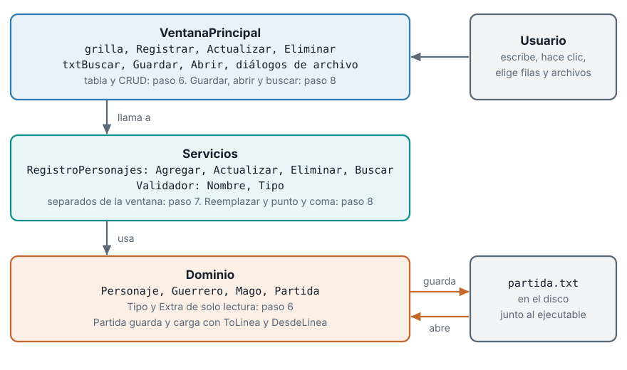
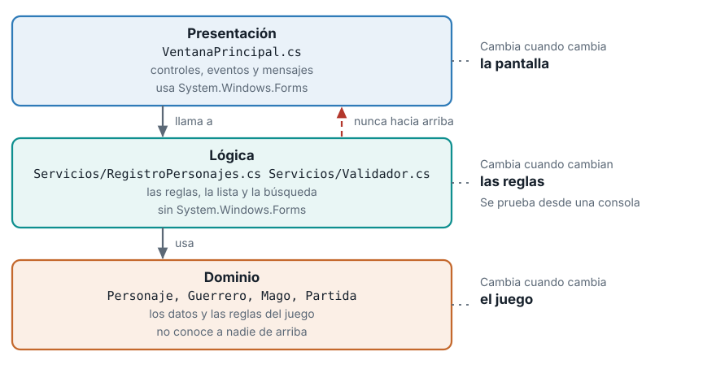
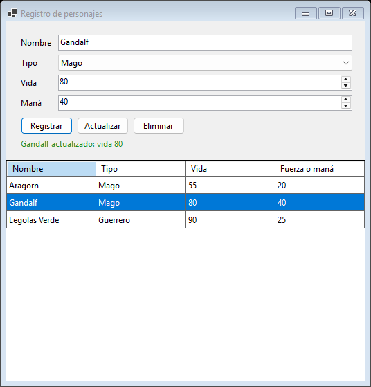
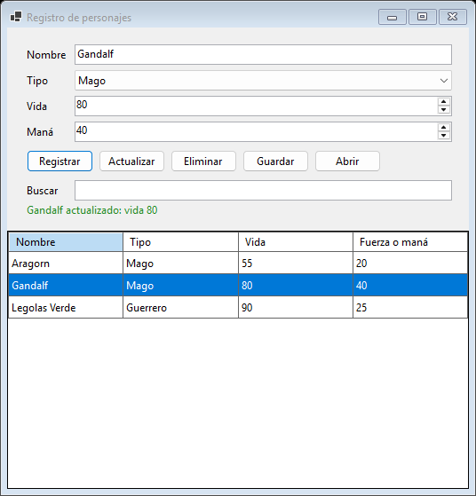

```{=html}
<style>
  /* En esta guía hay fragmentos de código largos dentro de listas y tablas: en teléfono se parten en vez de ensanchar la página */
  p code, li code, td code { white-space: normal; overflow-wrap: anywhere; }
</style>
```

::: {.ficha}
|            |                                                          |
|------------|----------------------------------------------------------|
| Asignatura | Herramientas de Programación I (ET0047)                  |
| Programa   | Tecnología en Desarrollo de Software                     |
| Unidad     | Unidad 3. Diseño y desarrollo de aplicaciones gráficas aplicando la POO |
| Saberes    | Elementos GUI con Windows Forms: propiedades y eventos de control. Interfaz gráfica desarrollada mediante código, con programación orientada a objetos y persistencia de información |
:::

Esta guía se probó con el SDK de .NET **10.0.302**.

Esta es la segunda parte de la guía de interfaz gráfica con Windows Forms. En la [parte 1](gui-winforms-parte-1.qmd) construiste, desde cero y solo con código, una ventana que pide los datos de un personaje del videojuego, los valida y los registra. Aquí conviertes esa ventana en una aplicación completa: muestra la lista de personajes, permite corregirlos y borrarlos, separa la lógica de la pantalla, guarda y abre archivos, y busca entre los personajes. La guía sirve para estudiar por tu cuenta, sin haber asistido a la clase y sin otro material. Cada bloque de código sale de un proyecto que se compiló y se probó, y cada mensaje de la ventana que ves citado es el texto exacto que produce el programa.

## El problema general: la ventana que olvida

Termina el paso 5 y abre la aplicación. Registras a Aragorn y la ventana responde `Aragorn registrado: vida 70`. Los campos se limpian. Registras a Gandalf. Ahora hazte una pregunta: ¿dónde está Aragorn?

En ningún lado. El objeto `Guerrero` que creaste vivía en una variable local dentro del manejador `AlRegistrar`. Cuando el método terminó, la variable desapareció y el objeto con ella. La ventana confirma el registro y no recuerda nada.

Una aplicación de gestión necesita tres cosas que la ventana del paso 5 no tiene:

1. **Recordar.** Los personajes tienen que seguir existiendo mientras la ventana esté abierta, y verse.
2. **Mantenerse ordenada.** Si cada regla nueva se suma al formulario, el archivo crece hasta que nadie se atreve a tocarlo.
3. **Sobrevivir al cierre.** Al cerrar la ventana la memoria se libera. Lo que no está en un archivo se pierde.

Cada una de esas tres necesidades es una de las tres partes de esta guía.

## El mapa de esta parte

| Paso | El problema | La idea que lo resuelve | Archivos que aparecen o cambian |
|---|---|---|---|
| 6 | Los personajes registrados no se ven, no se corrigen ni se borran | Una tabla (`DataGridView`) enlazada a una `BindingList<Personaje>` y un CRUD de personajes | `VentanaPrincipal.cs`, y `Personaje.cs`, `Guerrero.cs` y `Mago.cs` con las propiedades `Tipo` y `Extra` |
| 7 | El formulario mezcla controles con reglas de negocio y crece sin control | Separar la presentación de la lógica: un servicio y un validador que no conocen Windows Forms | `Servicios/RegistroPersonajes.cs`, `Servicios/Validador.cs`, `VentanaPrincipal.cs` más corto, y un programa de consola que prueba la lógica sin ventana |
| 8 | Al cerrar se pierde todo y encontrar un personaje entre muchos es lento | Persistencia con `Partida`, diálogos de abrir y guardar, y un cuadro de búsqueda | `VentanaPrincipal.cs`, `Servicios/RegistroPersonajes.cs` y `Servicios/Validador.cs` |

Cada paso es un proyecto que compila y se ejecuta. Un paso parte del anterior: el paso 6 evoluciona la aplicación del paso 5, el 7 evoluciona la del 6 y el 8 evoluciona la del 7. Los pasos 6, 7 y 8 usan el mismo caso, el registro de personajes del videojuego de la clase de POO (`Personaje`, `Guerrero`, `Mago` y `Partida`). Si necesitas repasar esas clases, están en la guía [Unidad 3. Programación orientada a objetos](poo-clases-herencia-archivos.qmd).

::: {.diagrama}
{fig-alt="Tres capas apiladas: VentanaPrincipal arriba, Servicios en el medio con RegistroPersonajes y Validador, y Dominio abajo con Personaje, Guerrero, Mago y Partida. El usuario actúa sobre la ventana y Partida lee y escribe el archivo partida.txt"}
:::

Este diagrama es el destino. Vuelve a él al terminar cada paso y ubica qué pieza acabas de agregar.

### Vocabulario nuevo

| Término | Qué significa |
|---|---|
| `DataGridView` | El control que muestra una lista de objetos como una tabla de filas y columnas |
| `BindingList<T>` | Una lista que avisa, con el evento `ListChanged`, cada vez que se agrega, cambia o quita un elemento |
| `DataSource` | La propiedad de la tabla que dice de dónde salen sus filas |
| CRUD | Las cuatro operaciones de una aplicación de gestión: crear, leer, actualizar y eliminar |
| Capa | Un grupo de clases con una responsabilidad: presentación (la ventana), lógica (reglas y lista) y dominio (los datos del juego) |
| Servicio | Una clase de la capa de lógica que ofrece operaciones sobre los datos, como `RegistroPersonajes` |
| Excepción | Una señal de error que detiene el programa si nadie la atrapa con `try` y `catch` |
| Cuadro de diálogo | Una ventana estándar de Windows que pide algo al usuario, como la ruta de un archivo |

## Requisitos

- **Windows 10 u 11.** Windows Forms solo corre en Windows.
- **El SDK de .NET 10.** En una terminal, `dotnet --version` debe imprimir un número que empiece por `10.`. La guía se probó con 10.0.302.
- **VS Code** con la extensión **C#** de Microsoft. No usas el diseñador visual: todo se escribe con código.
- **El proyecto de la parte 1 funcionando.** Esta guía retoma desde la aplicación del paso 5 de la [parte 1](gui-winforms-parte-1.qmd), la carpeta `RegistroPersonajes` con su validación y su `ErrorProvider`. Si no la tienes, termina primero la parte 1.

::: {.callout-warning title="Si usas macOS o Linux"}
Windows Forms no corre en esos sistemas. Necesitas una máquina virtual con Windows o acceso remoto a una sala de cómputo con Windows. Pídele a tu docente el acceso si no tienes otra opción.
:::

## Cómo trabajar esta guía

- **Sigue el orden.** Cada paso nace de un problema del anterior.
- **Escribe el código tú mismo.** Copiarlo y pegarlo compila, pero no se aprende. Escríbelo, equivócate y lee el error.
- **Cada paso tiene la misma forma:** el problema, la idea, el paso a paso, qué debes ver, un laboratorio de experimentos que rompen cosas a propósito, los errores frecuentes, un ejercicio para practicar y un resumen.
- **El código viene por tramos.** Los formularios de estos pasos tienen entre 227 y 314 líneas. No los repito completos en cada paso: te muestro el tramo que cambia y te explico qué cambió respecto al paso anterior. Los tramos no se alteran: cada bloque de esta guía es un fragmento real y contiguo del archivo del paso. Al final de cada paso hay una tabla que dice en qué rango de líneas del archivo completo va cada tramo, para que armes el archivo entero sin dudas.
- **Dos nombres parecidos.** En el código, `tabla` es el `TableLayoutPanel` que ordena los campos (lo conoces del paso 4) y `grilla` es el `DataGridView` que muestra la lista. En el texto llamo "la tabla" al `DataGridView` y "el panel de campos" al `TableLayoutPanel`.
- **Guarda una copia antes de cada paso.** Si algo se rompe, puedes volver. Con el Explorador de archivos, copia la carpeta `RegistroPersonajes` completa y pégala con otro nombre, por ejemplo `RegistroPersonajes-paso5`.
- **Ejecuta al terminar cada paso** con `dotnet run`, dentro de la carpeta del proyecto. Mientras la ventana esté abierta, la terminal queda ocupada: ciérrala antes de volver a ejecutar o a compilar.
- **Una presentación acompaña la clase presencial.** Esta guía cubre lo mismo con más detalle, y tiene todo lo necesario si no asististe.

## Paso 6. Una lista de personajes en una tabla

### 6.1 El problema

::: {.callout-warning title="El problema"}
Registras a Aragorn, a Gandalf y a Legolas. La ventana confirma cada registro con un mensaje verde, pero después no puedes ver quiénes son, no puedes corregir la vida de Aragorn que escribiste mal, no puedes borrar a Legolas y nada impide que registres otro "Aragorn". Los objetos se crean y se pierden.
:::

Recuerda el paso 2: para que la ventana contara clics usaste un **campo** de la clase, `clics`, que guardaba el número entre un evento y el siguiente. Los personajes necesitan lo mismo: un campo de `VentanaPrincipal` que los guarde mientras la ventana exista. Pero guardarlos no basta, hay que mostrarlos, y para eso se usa una tabla.

### 6.2 La idea

**La lista y la tabla.** Un campo de tipo `List<Personaje>` guardaría los objetos, pero una `List` no avisa a nadie cuando cambia: si agregas un personaje, la tabla no se entera. La solución es `BindingList<Personaje>`, una lista con **timbre**. Cada vez que alguien agrega, cambia o quita un elemento, toca el timbre (el evento `ListChanged`) y la tabla, que está escuchando, se redibuja sola. Con una `BindingList` no escribes código para refrescar la tabla.

El `DataGridView` es el control que dibuja filas y columnas. Se conecta a la lista con su propiedad `DataSource`. Cada fila es un objeto de la lista. Cada columna toma el valor de una propiedad del objeto, la que le indicas con `DataPropertyName`.

::: {.diagrama}
{fig-alt="Tres filas de cajas conectadas con flechas. La primera va de clic en Registrar a personajes.Add, a el aviso ListChanged de la BindingList y a una fila nueva en la tabla. La segunda va de clic en una fila a AlSeleccionarFila, a DataBoundItem y a los campos. La tercera va de actualizar o eliminar a el cambio en la lista, al aviso ListChanged y a la tabla redibujada"}
:::

**CRUD.** Casi toda aplicación de gestión hace cuatro cosas con sus datos, y cada una tiene un botón o un control:

| Operación | En inglés | En la ventana |
|---|---|---|
| Crear | Create | El botón `Registrar` agrega un personaje a la lista |
| Leer | Read | La tabla muestra todos los personajes |
| Actualizar | Update | El botón `Actualizar` reemplaza el personaje elegido por los datos de los campos |
| Eliminar | Delete | El botón `Eliminar` quita el personaje elegido |

**Dos dificultades que aparecen y se resuelven en este paso.**

1. **La tabla solo muestra propiedades públicas.** `Personaje` tiene `Nombre`, `Vida` y `EstaVivo`. Pero el tipo del personaje (Guerrero o Mago) y su dato propio (la fuerza o el maná) no son propiedades de la clase base: `Fuerza` existe solo en `Guerrero` y `Mana` solo en `Mago`. Una tabla que muestra una lista de `Personaje` no puede preguntar por `Fuerza`. La solución es agregar a la clase base dos propiedades abstractas de solo lectura, `Tipo` y `Extra`, y que cada subclase diga cuánto valen. Es el **polimorfismo** de la guía de POO: la tabla le pregunta `Extra` a cada objeto y cada objeto responde a su manera. `Guerrero` y `Mago` conviven en la misma tabla.
2. **Un personaje no se puede modificar.** `Nombre` no tiene `set` y `Vida` tiene `private set`: lo diseñaste así para proteger las reglas. Entonces `Actualizar` no cambia el objeto: crea uno nuevo con los datos de los campos y lo coloca en la misma posición de la lista.

**El nombre es la clave.** En esta aplicación no puede haber dos personajes con el mismo nombre, sin distinguir mayúsculas. La validación del paso 5 todavía no tenía esta regla. Aquí se agrega como una regla más de `Validar`.

### 6.3 Paso a paso

**Qué cambia respecto al paso 5:** `VentanaPrincipal.cs` pasa de 130 a 238 líneas, porque agrega la tabla, dos botones, la lista de personajes y las reglas de actualizar y eliminar. El dominio recibe `Tipo` y `Extra`. `Program.cs` y el `.csproj` no cambian.

#### 6.3.1 Prepara la carpeta

Abre una terminal y entra a la carpeta de tu proyecto del paso 5, la que contiene el archivo `RegistroPersonajes.csproj`:

```powershell
cd RegistroPersonajes
```

Si quieres conservar el paso 5 intacto, haz antes la copia que te sugerí. Todo lo que sigue se hace sobre los archivos de esa carpeta: no se crea un proyecto nuevo. El archivo `.csproj` y `Program.cs` no cambian. `Program.cs` tiene `[STAThread]`, que en el paso 8 necesitarán los diálogos de abrir y guardar, y ya lo tiene desde el paso 2.

#### 6.3.2 Agrega `Tipo` y `Extra` al dominio

En tu proyecto ya tienes `Personaje.cs`, `Guerrero.cs` y `Mago.cs`, las clases de la guía de POO. Cada una recibe unas pocas líneas nuevas y nada más.

En `Personaje.cs`, justo debajo de la propiedad `EstaVivo`, agrega las dos propiedades abstractas:

<!-- codigo: dominio6/Personaje.cs -->
```csharp
    // Nuevo en el paso 6: la tabla solo puede mostrar propiedades públicas de la clase base.
    // Cada subclase dice cuál es su tipo y cuál es su dato propio (fuerza o maná).
    public abstract string Tipo { get; }
    public abstract int Extra { get; }
```

`abstract` significa que `Personaje` declara que existen, pero no dice cuánto valen: cada subclase está obligada a decirlo. `{ get; }` las hace de solo lectura. Los dos comentarios explican por qué existen. El resto de `Personaje.cs` no cambia.

En `Guerrero.cs`, debajo de la propiedad `Fuerza`:

<!-- codigo: dominio6/Guerrero.cs -->
```csharp
    public override string Tipo => "Guerrero";
    public override int Extra => Fuerza;
```

En `Mago.cs`, debajo de la propiedad `Mana`:

<!-- codigo: dominio6/Mago.cs -->
```csharp
    public override string Tipo => "Mago";
    public override int Extra => Mana;
```

`override` implementa la propiedad abstracta de la clase base. `=>` crea una propiedad calculada: no guarda nada, responde cada vez que se le pregunta. Un guerrero responde que su tipo es `"Guerrero"` y que su extra es su fuerza. Un mago responde `"Mago"` y su maná. `Partida.cs` no cambia: el formato del archivo sigue siendo `Tipo;Nombre;Vida;Extra`, y ahora `Tipo` y `Extra` coinciden con las propiedades.

::: {.callout-note title="Si algo falla al compilar"}
Si compilas sin hacer estos cambios, el formulario nuevo pregunta por `Tipo` y `Extra` y el compilador no los encuentra. Si los pones en `Personaje` pero olvidas `Guerrero` o `Mago`, el compilador exige que las subclases los implementen. Los dos errores aparecen en la sección de errores frecuentes de este paso.
:::

#### 6.3.3 Los campos nuevos de la ventana

Abre `VentanaPrincipal.cs`. Lo primero que cambia es la parte de arriba: el `using` de la lista, los botones nuevos, la tabla y la lista de personajes. Este es el tramo completo, de la primera línea a la lista:

<!-- codigo: paso6/VentanaPrincipal.cs -->
```csharp
using System.ComponentModel;

// Paso 6: los personajes registrados se quedan en una lista que se ve en una tabla y se puede corregir.
class VentanaPrincipal : Form
{
    private readonly Label lblNombre = new() { Text = "Nombre", AutoSize = true };
    private readonly TextBox txtNombre = new();
    private readonly Label lblTipo = new() { Text = "Tipo", AutoSize = true };
    private readonly ComboBox cboTipo = new() { DropDownStyle = ComboBoxStyle.DropDownList };
    private readonly Label lblVida = new() { Text = "Vida", AutoSize = true };
    private readonly NumericUpDown numVida = new() { Minimum = 0, Maximum = 100, Value = 100 };
    private readonly Label lblExtra = new() { Text = "Extra", AutoSize = true };
    private readonly NumericUpDown numExtra = new() { Minimum = 0, Maximum = 100, Value = 10 };
    private readonly Button btnRegistrar = new() { Text = "Registrar", AutoSize = true };
    private readonly Button btnActualizar = new() { Text = "Actualizar", AutoSize = true };
    private readonly Button btnEliminar = new() { Text = "Eliminar", AutoSize = true };
    private readonly Label lblEstado = new() { AutoSize = true };
    private readonly ErrorProvider errores = new();
    private readonly DataGridView grilla = new();

    // Una BindingList avisa a la tabla cada vez que cambia, así que no hay que refrescarla a mano.
    private readonly BindingList<Personaje> personajes = new();
```

Qué es nuevo respecto al paso 5:

| Línea | Qué hace | Por qué |
|---|---|---|
| 1 | `using System.ComponentModel;` | `BindingList` vive en ese espacio de nombres, y el resto de los tipos de esta ventana ya vienen incluidos por los `using` implícitos del proyecto |
| 15 y 16 | `btnActualizar` y `btnEliminar` | Dos operaciones más del CRUD: ya tienes `Registrar` |
| 19 | `private readonly DataGridView grilla = new();` | La tabla que muestra la lista, creada como los demás controles |
| 21 y 22 | `BindingList<Personaje> personajes` | La lista que guarda los personajes mientras la ventana exista. Es un campo, como `clics` en el paso 2. El comentario resume la idea: la lista avisa a la tabla cuando cambia |

Las líneas 4 a 14, 17 y 18 ya las conocías: son los controles del paso 5. El `ErrorProvider` (línea 18) sigue siendo el que marca los campos con error.

#### 6.3.4 El constructor: eventos y distribución

El constructor crece, pero casi todo su contenido es del paso 4 y del paso 5. Te muestro entero el tramo y marco abajo lo nuevo:

<!-- codigo: paso6/VentanaPrincipal.cs -->
```csharp
    public VentanaPrincipal()
    {
        Text = "Registro de personajes";
        ClientSize = new Size(520, 520);
        MinimumSize = new Size(440, 460);
        StartPosition = FormStartPosition.CenterScreen;

        cboTipo.Items.AddRange(new object[] { "Guerrero", "Mago" });

        cboTipo.SelectedIndexChanged += AlCambiarTipo;
        btnRegistrar.Click += AlRegistrar;
        btnActualizar.Click += AlActualizar;
        btnEliminar.Click += AlEliminar;
        grilla.SelectionChanged += AlSeleccionarFila;
        AcceptButton = btnRegistrar;

        foreach (Control c in new Control[] { lblNombre, lblTipo, lblVida, lblExtra, lblEstado })
        {
            c.Anchor = AnchorStyles.Left;
        }
        foreach (Control c in new Control[] { txtNombre, cboTipo, numVida, numExtra })
        {
            c.Anchor = AnchorStyles.Left | AnchorStyles.Right;
        }

        var tabla = new TableLayoutPanel
        {
            Dock = DockStyle.Top,
            AutoSize = true,
            ColumnCount = 2,
            Padding = new Padding(16)
        };
        tabla.ColumnStyles.Add(new ColumnStyle(SizeType.AutoSize));
        tabla.ColumnStyles.Add(new ColumnStyle(SizeType.Percent, 100));

        tabla.Controls.Add(lblNombre, 0, 0);
        tabla.Controls.Add(txtNombre, 1, 0);
        tabla.Controls.Add(lblTipo, 0, 1);
        tabla.Controls.Add(cboTipo, 1, 1);
        tabla.Controls.Add(lblVida, 0, 2);
        tabla.Controls.Add(numVida, 1, 2);
        tabla.Controls.Add(lblExtra, 0, 3);
        tabla.Controls.Add(numExtra, 1, 3);

        var botones = new FlowLayoutPanel { AutoSize = true, Dock = DockStyle.Fill };
        botones.Controls.AddRange(new Control[] { btnRegistrar, btnActualizar, btnEliminar });
        tabla.Controls.Add(botones, 0, 4);
        tabla.SetColumnSpan(botones, 2);

        tabla.Controls.Add(lblEstado, 0, 5);
        tabla.SetColumnSpan(lblEstado, 2);

        ConfigurarGrilla();

        // La tabla se agrega primero: Dock = Fill ocupa lo que deja libre el panel de arriba.
        Controls.Add(grilla);
        Controls.Add(tabla);
    }
```

| Línea | Qué hace | Por qué |
|---|---|---|
| 27 y 28 | `ClientSize` de 520 por 520 y `MinimumSize` de 440 por 460 | La ventana necesita más alto: ahora lleva una tabla debajo de los campos |
| 34 a 36 | Un evento `Click` por botón | `Registrar`, `Actualizar` y `Eliminar` llaman cada uno a su manejador (conexión con `+=`, como en el paso 2) |
| 37 | `grilla.SelectionChanged += AlSeleccionarFila;` | Cada vez que cambia la fila elegida en la tabla, se ejecuta `AlSeleccionarFila` |
| 51 y 52 | `Dock = DockStyle.Top` y `AutoSize = true` en el panel de campos | Antes el panel ocupaba toda la ventana (`Fill`). Ahora solo ocupa lo que necesita, arriba. El resto de la ventana queda libre para la tabla |
| 69 | `botones.Controls.AddRange(...)` | Los tres botones juntos en el mismo `FlowLayoutPanel` |
| 76 | `ConfigurarGrilla();` | La configuración de la tabla vive en un método propio para que el constructor no se llene de líneas |
| 78 a 80 | `Controls.Add(grilla);` y después `Controls.Add(tabla);` | **El orden importa.** La tabla se agrega primero y el panel de campos después. Con `Dock`, WinForms reparte el espacio empezando por el último control agregado: el panel de arriba toma lo que necesita y la tabla (`Fill`) ocupa lo que queda libre. Si inviertes el orden, las primeras filas quedan tapadas por el panel |

#### 6.3.5 Configurar la tabla

`DataGridView` tiene decenas de propiedades. Estas son las que necesita esta ventana:

<!-- codigo: paso6/VentanaPrincipal.cs -->
```csharp
    private void ConfigurarGrilla()
    {
        grilla.Dock = DockStyle.Fill;
        grilla.ReadOnly = true; // la tabla solo muestra; los cambios se hacen con los campos y los botones
        grilla.AllowUserToAddRows = false;
        grilla.AllowUserToDeleteRows = false;
        grilla.SelectionMode = DataGridViewSelectionMode.FullRowSelect;
        grilla.MultiSelect = false;
        grilla.RowHeadersVisible = false;
        grilla.BackgroundColor = SystemColors.Window; // sin el gris de fondo debajo de las filas
        grilla.AutoSizeColumnsMode = DataGridViewAutoSizeColumnsMode.Fill;

        // Una columna por propiedad pública de Personaje. Tipo y Extra existen gracias al dominio6.
        grilla.AutoGenerateColumns = false;
        grilla.Columns.Add(new DataGridViewTextBoxColumn { HeaderText = "Nombre", DataPropertyName = "Nombre" });
        grilla.Columns.Add(new DataGridViewTextBoxColumn { HeaderText = "Tipo", DataPropertyName = "Tipo" });
        grilla.Columns.Add(new DataGridViewTextBoxColumn { HeaderText = "Vida", DataPropertyName = "Vida" });
        grilla.Columns.Add(new DataGridViewTextBoxColumn { HeaderText = "Fuerza o maná", DataPropertyName = "Extra" });
        grilla.DataSource = personajes;
    }
```

| Línea | Qué hace | Por qué |
|---|---|---|
| 85 | `Dock = DockStyle.Fill` | La tabla ocupa todo el espacio libre |
| 86 | `ReadOnly = true` | La tabla solo muestra. Los cambios se hacen con los campos y los botones, que son los que aplican las reglas |
| 87 y 88 | `AllowUserToAddRows` y `AllowUserToDeleteRows` en `false` | Dejan claro que las filas se agregan y se borran solo con los botones. Sin ellas, la tabla podría ofrecer una fila vacía al final y dejar borrar filas con la tecla Supr, saltándose tu validación |
| 89 y 90 | `SelectionMode = FullRowSelect` y `MultiSelect = false` | Un clic elige toda la fila, y una sola a la vez. Así `Seleccionado()` sabe de qué personaje se trata |
| 91 | `RowHeadersVisible = false` | Quita la columna gris de la izquierda, que aquí no sirve para nada |
| 92 | `BackgroundColor = SystemColors.Window` | Pinta de blanco el fondo que queda debajo de las filas |
| 93 | `AutoSizeColumnsMode = Fill` | Las columnas se reparten el ancho de la tabla |
| 96 | `AutoGenerateColumns = false` | **Tú decides las columnas.** Si lo dejas en `true`, la tabla crea una columna por cada propiedad pública, incluida `EstaVivo`, que no quieres |
| 97 a 100 | Una `DataGridViewTextBoxColumn` por columna | `HeaderText` es el título que ve el usuario y `DataPropertyName` es el nombre de la propiedad de `Personaje` de la que sale el valor. La cuarta columna toma `Extra` y la titula `Fuerza o maná` |
| 101 | `grilla.DataSource = personajes;` | La conexión: la tabla muestra la lista y escucha su `ListChanged`. Va después de definir las columnas |

El método `AlCambiarTipo`, que cambia la etiqueta `Extra` por `Fuerza` o `Maná`, es el del paso 5 y no cambia (líneas 104 a 112 del archivo).

#### 6.3.6 Elegir una fila: de la tabla a los campos

Cuando el usuario hace clic en una fila, sus datos pasan a los campos para poder corregirlos. Es el camino contrario al del paso 3, donde leías los campos para crear un objeto:

<!-- codigo: paso6/VentanaPrincipal.cs -->
```csharp
    // Al elegir una fila, sus datos pasan a los campos para poder corregirlos.
    private void AlSeleccionarFila(object? sender, EventArgs e)
    {
        if (Seleccionado() is not Personaje p) return;

        errores.Clear();
        txtNombre.Text = p.Nombre;
        cboTipo.SelectedItem = p.Tipo;
        numVida.Value = p.Vida;
        // Asignar un valor fuera de rango a un NumericUpDown lanza una excepción.
        numExtra.Value = Math.Clamp(p.Extra, (int)numExtra.Minimum, (int)numExtra.Maximum);
    }

    private Personaje? Seleccionado() =>
        grilla.SelectedRows.Count > 0 ? grilla.SelectedRows[0].DataBoundItem as Personaje : null;
```

| Línea | Qué hace | Por qué |
|---|---|---|
| 115 | Manejador del evento `SelectionChanged` | Se ejecuta cada vez que cambia la fila elegida |
| 117 | `if (Seleccionado() is not Personaje p) return;` | Pregunta cuál es el personaje elegido. Si no hay ninguno, termina. Si hay, lo deja en la variable `p` ya lista para usar |
| 119 | `errores.Clear();` | Si había un error marcado de antes, ya no corresponde |
| 120 a 122 | Copian `Nombre`, `Tipo` y `Vida` del personaje a los campos | El camino inverso: del objeto al control. Asignar `SelectedItem` con el texto del tipo elige esa opción en el `ComboBox` |
| 124 | `Math.Clamp(p.Extra, ...)` | **Un `NumericUpDown` lanza una excepción si le asignas un valor fuera de su rango.** El dominio acepta una fuerza de 500, pero `numExtra` llega solo a 100. `Math.Clamp` recorta el valor al rango del control. Hoy no puedes crear desde la ventana un personaje con extra mayor que 100, pero en el paso 8 llegarán personajes desde un archivo |
| 127 y 128 | `Seleccionado()` | Devuelve el personaje de la fila elegida o `null`. `SelectedRows[0]` es la fila y `DataBoundItem` es el objeto que hay detrás de esa fila: el mismo `Personaje` que está en la lista. `as Personaje` lo devuelve como `Personaje`, o `null` si no es uno |

#### 6.3.7 Validar con una clave única

`Validar` del paso 5 revisaba el largo del nombre y el tipo. Ahora recibe un parámetro más y suma una regla:

<!-- codigo: paso6/VentanaPrincipal.cs -->
```csharp
    // "editando" es la fila que se está corrigiendo: su propio nombre no cuenta como repetido.
    private bool Validar(Personaje? editando)
    {
        errores.Clear();

        string nombre = txtNombre.Text.Trim();
        if (nombre.Length == 0 || nombre.Length > 20)
        {
            errores.SetError(txtNombre, "Escriba un nombre de 1 a 20 caracteres");
            txtNombre.Focus();
            return false;
        }

        // El nombre es la clave: no puede haber dos personajes con el mismo.
        if (personajes.Any(p => p != editando && p.Nombre.Equals(nombre, StringComparison.OrdinalIgnoreCase)))
        {
            errores.SetError(txtNombre, "Ya existe un personaje con ese nombre");
            txtNombre.Focus();
            return false;
        }

        if (cboTipo.SelectedItem == null)
        {
            errores.SetError(cboTipo, "Elija un tipo de personaje");
            cboTipo.Focus();
            return false;
        }

        return true;
    }
```

| Línea | Qué hace | Por qué |
|---|---|---|
| 131 | `Validar(Personaje? editando)` | `editando` es el personaje que se está corrigiendo, o `null` si se está registrando uno nuevo. El `?` indica que puede ser nulo |
| 144 | `personajes.Any(p => p != editando && p.Nombre.Equals(nombre, StringComparison.OrdinalIgnoreCase))` | Pregunta si hay algún personaje que no sea el que estás editando y que tenga el mismo nombre, sin distinguir mayúsculas. `Any` recibe una función que devuelve `true` o `false` para cada elemento. Sin la parte `p != editando`, no podrías actualizar la vida de Aragorn sin cambiarle el nombre, porque chocaría consigo mismo |
| 146 | `"Ya existe un personaje con ese nombre"` | El mensaje exacto que verás junto al campo |

La estructura es la del paso 5: cada regla marca el campo con `errores.SetError`, le lleva el foco y devuelve `false` en cuanto algo falla.

#### 6.3.8 Tres métodos de apoyo

En el paso 5, `AlRegistrar` creaba el personaje, mostraba el mensaje y limpiaba los campos, todo en el mismo método. Ahora hay tres manejadores que necesitan hacer lo mismo, así que cada tarea tiene su método:

<!-- codigo: paso6/VentanaPrincipal.cs -->
```csharp
    private Personaje CrearDesdeCampos()
    {
        string nombre = txtNombre.Text.Trim();
        int vida = (int)numVida.Value;
        int extra = (int)numExtra.Value;

        return cboTipo.SelectedItem is "Mago"
            ? new Mago(nombre, vida, extra)
            : new Guerrero(nombre, vida, extra);
    }

    private void Informar(string texto, bool correcto)
    {
        lblEstado.ForeColor = correcto ? Color.ForestGreen : Color.Firebrick;
        lblEstado.Text = texto;
    }

    private void Limpiar()
    {
        errores.Clear();
        txtNombre.Clear();
        cboTipo.SelectedIndex = -1;
        numVida.Value = 100;
        numExtra.Value = 10;
        grilla.CurrentCell = null; // sin fila actual ni seleccionada
        grilla.ClearSelection();
        txtNombre.Focus();
    }
```

| Método | Qué hace | Por qué es un método aparte |
|---|---|---|
| `CrearDesdeCampos` | Lee los campos y devuelve un `Guerrero` o un `Mago` (líneas 163 a 169) | Lo usan `Registrar` y `Actualizar`: es el mismo camino del paso 3, del control al objeto |
| `Informar` | Pone el texto en `lblEstado`, en verde si salió bien y en rojo si no (líneas 174 y 175) | Los tres manejadores muestran mensajes y no deben repetir esas dos líneas |
| `Limpiar` | Deja la ventana lista para el siguiente personaje (líneas 180 a 187) | Además de vaciar los campos, `CurrentCell = null` y `ClearSelection()` dejan la tabla sin fila elegida. **Es necesario:** la tabla deja elegida la primera fila apenas tiene datos, aunque nadie la haya elegido, y el primer clic en `Eliminar` borraría un personaje que no elegiste |

#### 6.3.9 El CRUD: registrar, actualizar y eliminar

Con todo lo anterior, los tres manejadores quedan cortos:

<!-- codigo: paso6/VentanaPrincipal.cs -->
```csharp
    private void AlRegistrar(object? sender, EventArgs e)
    {
        if (!Validar(null))
        {
            Informar("No se registró: corrija el campo marcado", false);
            return;
        }

        Personaje nuevo = CrearDesdeCampos();
        personajes.Add(nuevo); // la tabla muestra la fila nueva sin que hagamos nada más
        Informar($"{nuevo.Nombre} registrado: vida {nuevo.Vida}", true);
        Limpiar();
    }

    private void AlActualizar(object? sender, EventArgs e)
    {
        Personaje? actual = Seleccionado();
        if (actual == null)
        {
            Informar("Seleccione una fila para actualizar", false);
            return;
        }
        if (!Validar(actual))
        {
            Informar("No se actualizó: corrija el campo marcado", false);
            return;
        }

        // Personaje no se puede modificar (Nombre y Tipo no tienen set): se cambia por uno nuevo en la misma posición.
        Personaje nuevo = CrearDesdeCampos();
        personajes[personajes.IndexOf(actual)] = nuevo;
        Informar($"{nuevo.Nombre} actualizado: vida {nuevo.Vida}", true);
        Limpiar();
    }

    private void AlEliminar(object? sender, EventArgs e)
    {
        Personaje? actual = Seleccionado();
        if (actual == null)
        {
            Informar("Seleccione una fila para eliminar", false);
            return;
        }

        personajes.Remove(actual);
        Informar($"{actual.Nombre} eliminado", true);
        Limpiar();
    }
```

| Línea | Qué hace | Por qué |
|---|---|---|
| 192 a 196 | Si `Validar(null)` falla, muestra el mensaje en rojo y sale | `null` significa "no estoy editando a nadie": el nombre no puede coincidir con ninguno de la lista |
| 199 | `personajes.Add(nuevo);` | **Esta es toda la actualización de la tabla.** La lista avisa con `ListChanged` y la tabla dibuja la fila. No hay código para refrescarla |
| 206 a 211 | Si no hay fila elegida, `Actualizar` lo dice y sale | No se puede actualizar a nadie que no se eligió |
| 212 | `Validar(actual)` | Ahora sí se pasa el personaje que se está editando: su propio nombre no cuenta como repetido |
| 218 a 220 | Crea un personaje nuevo y lo coloca en la misma posición | Como `Personaje` no se puede modificar (`Nombre` y `Tipo` no tienen `set`), `Actualizar` lo reemplaza: `personajes[personajes.IndexOf(actual)] = nuevo;`. Asignar a una posición de la lista también dispara `ListChanged` |
| 234 | `personajes.Remove(actual);` | Quita el objeto de la lista y la tabla lo borra solo |

Este es el último tramo. Guarda, compila y ejecuta desde la terminal, dentro de la carpeta del proyecto:

```powershell
dotnet run
```

#### 6.3.10 Cómo se arma el archivo completo

El código completo de este paso está en el archivo de referencia `paso6/VentanaPrincipal.cs` del material de la clase, líneas 1 a 238. Estos son los tramos en orden, con una línea en blanco entre un método y el siguiente:

| Líneas del archivo | Qué contiene | Dónde está en esta guía |
|---|---|---|
| 1 a 22 | `using`, comentario, clase, controles, `grilla` y `personajes` | 6.3.3 |
| 24 a 81 | El constructor | 6.3.4 |
| 83 a 102 | `ConfigurarGrilla` | 6.3.5 |
| 104 a 112 | `AlCambiarTipo` | Igual que en el paso 5 |
| 114 a 128 | `AlSeleccionarFila` y `Seleccionado` | 6.3.6 |
| 130 a 159 | `Validar(Personaje? editando)` | 6.3.7 |
| 161 a 188 | `CrearDesdeCampos`, `Informar` y `Limpiar` | 6.3.8 |
| 190 a 237 | `AlRegistrar`, `AlActualizar` y `AlEliminar` | 6.3.9 |
| 238 | La llave que cierra la clase | |

### 6.4 Qué debes ver

Ejecuta la aplicación y recorre estas ocho situaciones en orden. A la izquierda, lo que haces; a la derecha, el texto exacto que debe aparecer.

<!-- estados: paso6/estados.txt -->
| Situación | Texto que se ve |
|---|---|
| Guerrero Aragorn, vida 70 | `"Aragorn registrado: vida 70"` |
| Nombre repetido | `"No se registró: corrija el campo marcado"` |
| Mensaje del ErrorProvider con nombre repetido | `"Ya existe un personaje con ese nombre"` |
| Actualizar la vida de Aragorn | `"Aragorn actualizado: vida 55"` |
| Actualizar con un nombre ocupado | `"No se actualizó: corrija el campo marcado"` |
| Actualizar sin fila elegida | `"Seleccione una fila para actualizar"` |
| Eliminar a Gandalf | `"Gandalf eliminado"` |
| Eliminar sin fila elegida | `"Seleccione una fila para eliminar"` |

Algunas aclaraciones para recorrerlo. Para las situaciones 4 a 7 necesitas dos personajes registrados, por ejemplo Aragorn y Gandalf. En la situación 3 el texto no sale en la etiqueta verde o roja de abajo, sino en el `ErrorProvider`: es el mensaje que aparece al pasar el ratón por el icono rojo junto al campo. En la situación 5, intenta ponerle a Aragorn el nombre de Gandalf.

{fig-alt="Ventana Registro de personajes con los campos de captura arriba, tres botones, un mensaje verde y una tabla de tres filas con la fila de Gandalf elegida en azul y sus datos copiados en los campos"}

La captura viene de una sesión de pruebas, así que sus filas pueden no coincidir con las tuyas (por ejemplo, ahí Aragorn aparece con tipo Mago). Lo que debes comprobar es la estructura. La fila elegida pasa a los campos. Las columnas son Nombre, Tipo, Vida y Fuerza o maná. El campo de la fuerza o el maná se llama `Maná` cuando el tipo elegido es Mago. Y un nombre repetido se rechaza.

### 6.5 Rompe esto y observa

Estos tres experimentos rompen algo a propósito. Después de cada uno, devuelve el código a como estaba.

1. **Deja que la tabla decida las columnas.** Borra la línea `grilla.AutoGenerateColumns = false;` (línea 96) y ejecuta. Esperado: la tabla muestra cinco columnas, no cuatro. Aparece una columna `EstaVivo` que tú no pediste, porque la tabla genera una columna por cada propiedad pública de `Personaje` que no tenga ya una columna asignada. Con `AutoGenerateColumns` en `false` solo salen las que tú declaraste.

2. **Cambia la forma de elegir.** Cambia `DataGridViewSelectionMode.FullRowSelect` (línea 89) por `DataGridViewSelectionMode.CellSelect`. Registra un personaje, haz clic en una celda y mira los campos. Esperado: los campos no se llenan, y al pulsar `Eliminar` el mensaje dice `Seleccione una fila para eliminar`. Con `CellSelect` el clic elige una celda y no una fila, entonces `SelectedRows` queda vacío y `Seleccionado()` devuelve `null`.

3. **Invierte el orden de los controles.** Intercambia las líneas 79 y 80: primero `Controls.Add(tabla);` y después `Controls.Add(grilla);`. Esperado: el panel de campos se dibuja encima de la tabla y tapa el encabezado y las primeras filas, porque la tabla con `Fill` se reparte el espacio antes que el panel. Al revés, como estaba, el panel toma lo que necesita y la tabla se queda con lo que sobra.

### 6.6 Errores frecuentes

| Qué ves | Causa | Cómo se resuelve |
|---|---|---|
| No agregar `Tipo` y `Extra` al dominio | `error CS1061: "Personaje" no contiene una definición para "Tipo"` y el mismo mensaje para `Extra` | Agrega las dos propiedades abstractas a `Personaje.cs` (6.3.2) |
| Agregarlas a `Personaje` pero no a `Guerrero` o `Mago` | `error CS0534: 'Guerrero' no implementa el miembro abstracto heredado 'Personaje.Tipo.get'` | Agrega `Tipo` y `Extra` con `override` en las dos subclases |
| Usar `List<Personaje>` en vez de `BindingList<Personaje>` | La ventana dice `Aragorn registrado: vida 70` pero la tabla no muestra la fila, porque una `List` no avisa cuando cambia | Cambia el tipo del campo y agrega `using System.ComponentModel;` |
| Escribir mal un `DataPropertyName` | La columna sale vacía, sin ningún error | Copia el nombre exacto de la propiedad pública, como `Tipo` o `Extra` |
| Asignar `numExtra.Value = p.Extra` sin `Math.Clamp` | `ArgumentOutOfRangeException` al elegir un personaje cuyo extra pasa de 100 | Recorta con `Math.Clamp` al rango del control |
| No deseleccionar la tabla en `Limpiar` | `Eliminar` borra una fila que no elegiste | Deja `CurrentCell = null` y `ClearSelection()` en `Limpiar` |

### 6.7 Para practicar

Agrega a la tabla una quinta columna, `Vivo`, que muestre si el personaje está vivo. No cambies el dominio: la propiedad `EstaVivo` ya existe y es pública.

::: {.callout-note title="Pista" collapse="true"}
Una columna de verdadero o falso se muestra mejor con una casilla: usa `DataGridViewCheckBoxColumn` en vez de `DataGridViewTextBoxColumn`, con `HeaderText = "Vivo"` y `DataPropertyName = "EstaVivo"`. Agrégala en `ConfigurarGrilla`, antes de la línea que asigna el `DataSource`. Registra un personaje con vida 0 y comprueba que la casilla sale vacía.
:::

### 6.8 Lo que aprendiste

- Los objetos que deben vivir entre eventos van en un campo de la clase, como `clics` en el paso 2.
- Una `BindingList` avisa cuando cambia y una `DataGridView` enlazada a ella se redibuja sola: `Add`, `Remove` y asignar una posición bastan.
- La tabla solo muestra propiedades públicas, así que `Tipo` y `Extra` pasaron al dominio, y el polimorfismo hace que `Guerrero` y `Mago` convivan en la misma tabla.
- `Actualizar` reemplaza el objeto por uno nuevo en su posición, porque `Personaje` no se puede modificar. `Seleccionado()` toma el objeto de la fila y `Math.Clamp` protege al `NumericUpDown`.
- El nombre es la clave: `Validar(editando)` rechaza los repetidos sin que un personaje choque consigo mismo.

**El puente al paso 7.** Mira lo que ocurrió con `VentanaPrincipal.cs`: pasó de 130 a 238 líneas. Las reglas del nombre, la lista y el reemplazo están mezcladas con botones, colores y foco. Para saber si "aragorn" se rechaza tienes que abrir la ventana y escribir. En el paso 7 sacamos esas reglas del formulario.

## Paso 7. Separar la lógica de la presentación

### 7.1 El problema

::: {.callout-warning title="El problema"}
Quieres comprobar que el nombre "aragorn" se rechaza cuando ya existe "Aragorn". Para hacerlo tienes que ejecutar la ventana, escribir el nombre, elegir un tipo y hacer clic. Y si mañana otra pantalla necesita la misma regla, tienes que copiarla y pegarla. La regla vive mezclada con controles, colores y foco, y no se puede probar sin ventana.
:::

Abre `VentanaPrincipal.cs` del paso 6 y fíjate en lo que mezcla un solo archivo: leer controles, aplicar las reglas del negocio (largo del nombre, nombres repetidos), mantener la lista y mostrar mensajes. Cada paso que agregues, como guardar y buscar en el paso 8, va a sumar más líneas al mismo archivo.

### 7.2 La idea

**Separación de responsabilidades.** Piensa en un restaurante. El mesero toma el pedido y lo trae a la mesa. La cocina prepara los platos. El mesero no cocina, y la cocina no sabe cuántas mesas tiene el salón. Si cambias el salón, no cambias la cocina.

En tu aplicación pasa lo mismo, en tres capas:

- **Presentación:** el formulario. Conoce controles, eventos y mensajes. Traduce lo que escribe el usuario a llamadas, y los resultados a lo que se ve.
- **Lógica:** las reglas y la lista. Aquí viven `RegistroPersonajes` (la lista y sus operaciones) y `Validador` (las reglas de entrada). No conocen ventanas.
- **Dominio:** `Personaje`, `Guerrero`, `Mago` y `Partida`, las clases del juego.

Cada capa llama a la de abajo y ninguna conoce a la de arriba.

::: {.diagrama}
{fig-alt="Tres cajas apiladas: Presentación, Lógica y Dominio. Flechas hacia abajo dicen llama a y usa. Una flecha roja discontinua hacia arriba dice nunca hacia arriba. A la derecha se indica que cada capa cambia por una razón distinta y que la lógica se prueba desde una consola"}
:::

**La prueba de fuego.** ¿Cómo sabes si separaste bien? La lógica debe compilar en un proyecto de consola, donde no existe Windows Forms. Si compila ahí, no depende de la ventana. Eso mismo vas a hacer al final del paso.

**Cómo se comunican.** `Validador` no muestra nada: recibe el texto y devuelve el mensaje de error, o `null` si todo está bien. Es la ventana la que decide dónde mostrar ese mensaje (en el `ErrorProvider`, en este caso). Así la misma regla podría servir mañana en una consola o en una página web.

### 7.3 Paso a paso

**Qué cambia respecto al paso 6:** aparece la carpeta `Servicios` con dos archivos nuevos, y `VentanaPrincipal.cs` pasa de 238 a 227 líneas porque pierde las reglas. La ventana se comporta igual. Además creas un proyecto de consola aparte para probar la lógica sin ventana.

#### 7.3.1 Crea `Servicios/RegistroPersonajes.cs`

Crea una carpeta `Servicios` dentro de tu proyecto, con el comando `mkdir Servicios` en la terminal o con el botón de nueva carpeta del explorador de VS Code. La carpeta no cambia nada del código: es solo orden. Dentro, crea `RegistroPersonajes.cs` con este contenido completo. Es la lógica que antes estaba dentro del formulario, ahora en su propia clase:

<!-- codigo: paso7/Servicios/RegistroPersonajes.cs completo -->
```csharp
using System.ComponentModel;

// La lógica de negocio: guarda y consulta personajes. No conoce ventanas ni controles.
class RegistroPersonajes
{
    // Una BindingList avisa a quien la muestre (una tabla, por ejemplo) cada vez que cambia.
    public BindingList<Personaje> Personajes { get; } = new();

    // "ignorar" es el personaje que se está corrigiendo: su propio nombre no cuenta como repetido.
    public bool Existe(string nombre, Personaje? ignorar = null)
    {
        return Personajes.Any(p => p != ignorar && p.Nombre.Equals(nombre, StringComparison.OrdinalIgnoreCase));
    }

    public void Agregar(Personaje personaje)
    {
        Personajes.Add(personaje);
    }

    // Personaje no se puede modificar: el actual se cambia por uno nuevo en la misma posición.
    public void Actualizar(Personaje actual, Personaje nuevo)
    {
        Personajes[Personajes.IndexOf(actual)] = nuevo;
    }

    public bool Eliminar(Personaje personaje)
    {
        return Personajes.Remove(personaje);
    }

    // Busca por nombre o por tipo, sin distinguir mayúsculas. Un texto vacío devuelve todos.
    public IEnumerable<Personaje> Buscar(string texto)
    {
        return Personajes.Where(p =>
            p.Nombre.Contains(texto, StringComparison.OrdinalIgnoreCase) ||
            p.Tipo.Contains(texto, StringComparison.OrdinalIgnoreCase));
    }
}
```

| Línea | Qué hace | Por qué |
|---|---|---|
| 1 | `using System.ComponentModel;` | Para `BindingList`, que se muda del formulario al servicio |
| 4 | `class RegistroPersonajes` | Una clase normal de POO: guarda datos (la lista) y tiene métodos |
| 7 | `public BindingList<Personaje> Personajes { get; } = new();` | La lista, ahora como propiedad de solo lectura. El formulario la usa para enlazar la tabla y los demás la consultan. Sigue siendo una `BindingList`, así que la tabla sigue enterándose de los cambios |
| 10 a 13 | `Existe(string nombre, Personaje? ignorar = null)` | Dice si ya hay un personaje con ese nombre, sin distinguir mayúsculas. `ignorar` es el que se está corrigiendo. Un parámetro con valor por defecto (`= null`) es opcional: `Existe("aragorn")` también se puede llamar |
| 15 a 18 | `Agregar` | Lo que antes hacía `personajes.Add(nuevo)` en el formulario |
| 21 a 24 | `Actualizar(actual, nuevo)` | Reemplaza en la misma posición, como en el paso 6 |
| 26 a 29 | `Eliminar` | Devuelve `true` si el personaje estaba y lo quitó |
| 32 a 37 | `Buscar(string texto)` | Filtra por nombre o por tipo sin distinguir mayúsculas. Un texto vacío devuelve todos, porque cualquier texto contiene la cadena vacía. No se usa en la ventana todavía: es la preparación del paso 8 |

Nada de este archivo menciona un control ni una ventana. Lo único "visual" que había en el formulario, la lista que avisa a la tabla, sigue siendo `BindingList`, que no es de Windows Forms: es un tipo general de .NET.

#### 7.3.2 Crea `Servicios/Validador.cs`

Las reglas de entrada, en una clase que no guarda estado:

<!-- codigo: paso7/Servicios/Validador.cs completo -->
```csharp
// Las reglas de entrada, sin ventanas. Cada método devuelve el mensaje de error, o null si todo está bien.
static class Validador
{
    public const int LargoMaximo = 20;

    // Recibe el texto tal como lo escribió el usuario. "editando" es el personaje que se está corrigiendo.
    public static string? Nombre(string texto, RegistroPersonajes registro, Personaje? editando = null)
    {
        string nombre = texto.Trim();
        if (nombre.Length == 0 || nombre.Length > LargoMaximo)
        {
            return $"Escriba un nombre de 1 a {LargoMaximo} caracteres";
        }
        if (registro.Existe(nombre, editando))
        {
            return "Ya existe un personaje con ese nombre";
        }
        return null;
    }

    public static string? Tipo(string? tipo)
    {
        return tipo is "Guerrero" or "Mago" ? null : "Elija un tipo de personaje";
    }
}
```

| Línea | Qué hace | Por qué |
|---|---|---|
| 2 | `static class Validador` | Una clase estática no se instancia: sus métodos se llaman con el nombre de la clase, como `Math.Clamp`. Sirve cuando no hay datos propios que guardar |
| 4 | `public const int LargoMaximo = 20;` | El 20 aparecía escrito a mano en el formulario. Ahora vive en un solo lugar |
| 7 | `public static string? Nombre(string texto, RegistroPersonajes registro, Personaje? editando = null)` | Recibe el texto, el registro (para saber quién existe) y a quién se está editando. Devuelve el mensaje de error o `null`; el `?` de `string?` avisa que puede ser nulo |
| 9 | `string nombre = texto.Trim();` | Quita los espacios de los extremos antes de comprobar nada |
| 10 a 13 | El largo | Igual que en el paso 5, pero el mensaje se arma con `$"... {LargoMaximo} ..."` |
| 14 a 17 | `registro.Existe(nombre, editando)` | La regla del nombre repetido, ahora aquí |
| 21 a 24 | `Tipo(string? tipo)` | `tipo is "Guerrero" or "Mago"` pregunta si el texto es una de las dos opciones. Si lo es, devuelve `null` (sin error); si no, el mensaje `Elija un tipo de personaje` |

#### 7.3.3 Adelgaza el formulario

Ahora `VentanaPrincipal.cs` deja de tener las reglas. Cambia en cuatro lugares y todo lo demás queda como en el paso 6.

**Primero, la cabecera y la lista.** Borra la línea `using System.ComponentModel;` (el formulario ya no menciona `BindingList`) y cambia el comentario de arriba:

<!-- codigo: paso7/VentanaPrincipal.cs -->
```csharp
// Paso 7: el formulario solo traduce entre los controles y el servicio. Las reglas viven en Servicios/.
class VentanaPrincipal : Form
```

Y en los campos, borra el comentario y el campo `personajes` (dos líneas). En su lugar va el servicio:

<!-- codigo: paso7/VentanaPrincipal.cs -->
```csharp
    private readonly RegistroPersonajes registro = new(); // la lista y sus operaciones
```

**Segundo, la tabla se enlaza a la lista del servicio.** En `ConfigurarGrilla`, la última línea ya no apunta a un campo del formulario:

<!-- codigo: paso7/VentanaPrincipal.cs -->
```csharp
        grilla.DataSource = registro.Personajes;
```

**Tercero, `Validar` pregunta al `Validador`.** Antes tenía las reglas adentro. Ahora solo las pide y, si hay un error, lo muestra junto al campo:

<!-- codigo: paso7/VentanaPrincipal.cs -->
```csharp
    // Pregunta al Validador y, si hay un error, lo muestra junto al campo.
    private bool Validar(Personaje? editando)
    {
        errores.Clear();

        string? error = Validador.Nombre(txtNombre.Text, registro, editando);
        if (error != null)
        {
            errores.SetError(txtNombre, error);
            txtNombre.Focus();
            return false;
        }

        error = Validador.Tipo(cboTipo.SelectedItem as string);
        if (error != null)
        {
            errores.SetError(cboTipo, error);
            cboTipo.Focus();
            return false;
        }

        return true;
    }
```

| Línea | Qué hace | Por qué |
|---|---|---|
| 132 | `string? error = Validador.Nombre(txtNombre.Text, registro, editando);` | La regla del nombre viaja a otra clase. El formulario pasa lo que escribió el usuario y recibe un mensaje o `null` |
| 133 a 138 | Si hay error, lo marca, le lleva el foco y devuelve `false` | Esto sí es trabajo de la ventana: mostrar el error y mover el foco |
| 140 | `Validador.Tipo(cboTipo.SelectedItem as string)` | `SelectedItem` es un `object?`: `as string` lo convierte a texto, o a `null` si no hay nada elegido |

**Cuarto, los tres manejadores solo traducen.** Leen los controles, llaman al servicio y muestran el resultado:

<!-- codigo: paso7/VentanaPrincipal.cs -->
```csharp
    private void AlRegistrar(object? sender, EventArgs e)
    {
        if (!Validar(null))
        {
            Informar("No se registró: corrija el campo marcado", false);
            return;
        }

        Personaje nuevo = CrearDesdeCampos();
        registro.Agregar(nuevo); // la tabla muestra la fila nueva sin que hagamos nada más
        Informar($"{nuevo.Nombre} registrado: vida {nuevo.Vida}", true);
        Limpiar();
    }

    private void AlActualizar(object? sender, EventArgs e)
    {
        Personaje? actual = Seleccionado();
        if (actual == null)
        {
            Informar("Seleccione una fila para actualizar", false);
            return;
        }
        if (!Validar(actual))
        {
            Informar("No se actualizó: corrija el campo marcado", false);
            return;
        }

        Personaje nuevo = CrearDesdeCampos();
        registro.Actualizar(actual, nuevo);
        Informar($"{nuevo.Nombre} actualizado: vida {nuevo.Vida}", true);
        Limpiar();
    }

    private void AlEliminar(object? sender, EventArgs e)
    {
        Personaje? actual = Seleccionado();
        if (actual == null)
        {
            Informar("Seleccione una fila para eliminar", false);
            return;
        }

        registro.Eliminar(actual);
        Informar($"{actual.Nombre} eliminado", true);
        Limpiar();
    }
```

Compara con el paso 6: `personajes.Add(nuevo)` pasó a `registro.Agregar(nuevo)`, el reemplazo manual pasó a `registro.Actualizar(actual, nuevo)` y `personajes.Remove(actual)` pasó a `registro.Eliminar(actual)`. Los mensajes y el flujo no cambiaron. El formulario ya no sabe cómo se actualiza la lista: solo pide que se haga.

#### 7.3.4 Pruébalo sin ventana

Aquí está el beneficio. Vas a probar `RegistroPersonajes` y `Validador` desde un programa de consola, sin abrir ninguna ventana. Primero crea un proyecto de consola **vecino** del tuyo, no dentro de él. En la terminal, sal de la carpeta de tu proyecto con `cd ..`, escribe `dotnet new console -n PruebaServicio` y entra con `cd PruebaServicio`.

Copia a esa carpeta, con el Explorador de archivos, estos cinco archivos de tu proyecto: `Personaje.cs`, `Guerrero.cs` y `Mago.cs` del dominio, y `RegistroPersonajes.cs` y `Validador.cs` de la carpeta `Servicios`. No copies `VentanaPrincipal.cs` ni `Program.cs`: el `Program.cs` de `PruebaServicio` es otro.

Reemplaza el `Program.cs` de `PruebaServicio` con este:

<!-- codigo: paso7/consola/Program.cs completo -->
```csharp
// Prueba del servicio sin ninguna ventana: si funciona aquí, la lógica no depende de Windows Forms.
var registro = new RegistroPersonajes();

void Mostrar(string que, object? resultado) => Console.WriteLine($"{que}: {resultado}");

Mostrar("Nombre vacio", Validador.Nombre("", registro));
Mostrar("Nombre de 21 letras", Validador.Nombre(new string('A', 21), registro));
Mostrar("Tipo sin elegir", Validador.Tipo(null));
Mostrar("Aragorn es valido", Validador.Nombre("Aragorn", registro) ?? "sin error");

registro.Agregar(new Guerrero("Aragorn", 70, 30));
registro.Agregar(new Mago("Gandalf", 80, 40));
Mostrar("Personajes", registro.Personajes.Count);
Mostrar("Existe aragorn", registro.Existe("aragorn"));
Mostrar("Aragorn repetido", Validador.Nombre("aragorn", registro));

Personaje aragorn = registro.Personajes[0];
Mostrar("Aragorn corrigiendose a si mismo", Validador.Nombre("Aragorn", registro, aragorn) ?? "sin error");

registro.Actualizar(aragorn, new Guerrero("Aragorn", 55, 30));
Mostrar("Vida de Aragorn tras actualizar", registro.Personajes[0].Vida);

Mostrar("Buscar 'mag'", string.Join(", ", registro.Buscar("mag").Select(p => p.Nombre)));
Mostrar("Buscar 'ara'", string.Join(", ", registro.Buscar("ara").Select(p => p.Nombre)));
Mostrar("Buscar 'zzz'", registro.Buscar("zzz").Count());

Mostrar("Eliminar a Gandalf", registro.Eliminar(registro.Personajes[1]));
Mostrar("Personajes", registro.Personajes.Count);
```

Este programa crea un registro, le pregunta cosas al `Validador` y le pide operaciones al `RegistroPersonajes`. `Mostrar` (línea 4) es una función local que imprime una etiqueta, dos puntos y el resultado. Ejecútalo con `dotnet run`, dentro de la carpeta `PruebaServicio`:

```powershell
dotnet run
```

Esto es lo que debes ver:

<!-- codigo: paso7/consola/salida.txt completo -->
```text
Nombre vacio: Escriba un nombre de 1 a 20 caracteres
Nombre de 21 letras: Escriba un nombre de 1 a 20 caracteres
Tipo sin elegir: Elija un tipo de personaje
Aragorn es valido: sin error
Personajes: 2
Existe aragorn: True
Aragorn repetido: Ya existe un personaje con ese nombre
Aragorn corrigiendose a si mismo: sin error
Vida de Aragorn tras actualizar: 55
Buscar 'mag': Gandalf
Buscar 'ara': Aragorn
Buscar 'zzz': 0
Eliminar a Gandalf: True
Personajes: 1
```

Cada línea de la salida responde a una instrucción:

| Instrucción de `Program.cs` | Salida | Qué demuestra |
|---|---|---|
| `Validador.Nombre("", registro)` | `Nombre vacio: Escriba un nombre de 1 a 20 caracteres` | Un nombre vacío no pasa |
| `Validador.Nombre(new string('A', 21), registro)` | `Nombre de 21 letras: Escriba un nombre de 1 a 20 caracteres` | Uno de 21 caracteres tampoco |
| `Validador.Tipo(null)` | `Tipo sin elegir: Elija un tipo de personaje` | Sin tipo elegido no se acepta |
| `Validador.Nombre("Aragorn", registro) ?? "sin error"` | `Aragorn es valido: sin error` | Con el registro vacío, el nombre es válido. `??` entrega el texto de la derecha cuando el resultado es `null` |
| Dos llamadas a `registro.Agregar(...)` y `registro.Personajes.Count` | `Personajes: 2` | El servicio guarda los personajes sin ninguna ventana |
| `registro.Existe("aragorn")` | `Existe aragorn: True` | La comparación no distingue mayúsculas |
| `Validador.Nombre("aragorn", registro)` | `Aragorn repetido: Ya existe un personaje con ese nombre` | La regla del nombre repetido funciona sin formulario |
| `Validador.Nombre("Aragorn", registro, aragorn)` | `Aragorn corrigiendose a si mismo: sin error` | Pasar el personaje que se edita evita que choque consigo mismo |
| `registro.Actualizar(aragorn, new Guerrero("Aragorn", 55, 30))` | `Vida de Aragorn tras actualizar: 55` | El reemplazo en la misma posición funciona |
| `registro.Buscar("mag")`, `("ara")` y `("zzz")` | `Buscar 'mag': Gandalf`, `Buscar 'ara': Aragorn` y `Buscar 'zzz': 0` | `Buscar` filtra por nombre o por tipo, y sin coincidencias devuelve una lista vacía |
| `registro.Eliminar(registro.Personajes[1])` | `Eliminar a Gandalf: True` y `Personajes: 1` | `Eliminar` devuelve `true` y la lista queda con uno |

Fíjate en lo que acabas de lograr: probaste las reglas del negocio sin ventana, sin clics y sin escribir en ningún campo. Y la prueba de fuego pasó: `RegistroPersonajes.cs` y `Validador.cs` compilan en un proyecto que no tiene Windows Forms.

#### 7.3.5 Ejecuta la ventana

Vuelve a la carpeta de tu proyecto con la ventana (`cd ..\RegistroPersonajes`) y ejecútala:

```powershell
dotnet run
```

Debe comportarse exactamente igual que en el paso 6. Separar no cambió lo que el usuario ve, solo dónde viven las reglas.

#### 7.3.6 Cómo se arma el archivo completo

El código completo de este paso está en los archivos de referencia `paso7/VentanaPrincipal.cs` (227 líneas), `paso7/Servicios/RegistroPersonajes.cs` (38 líneas, completo en 7.3.1) y `paso7/Servicios/Validador.cs` (25 líneas, completo en 7.3.2). `VentanaPrincipal.cs` se obtiene del paso 6 con los cuatro cambios anteriores. Los tramos que no cambian son los del paso 6:

| Líneas del archivo del paso 7 | Qué contiene | Origen |
|---|---|---|
| 1 a 3 | Comentario, clase y llave de apertura | 7.3.3, primer cambio: ya no hay `using` |
| 4 a 17 | Controles | Igual que en el paso 6 (líneas 6 a 19) |
| 19 | El campo `registro` | 7.3.3, primer cambio |
| 21 a 97 | El constructor y `ConfigurarGrilla` hasta la última columna | Igual que en el paso 6 (líneas 24 a 100), salvo el comentario de la línea 92, que ya no menciona el dominio |
| 98 y 99 | `grilla.DataSource = registro.Personajes;` y la llave del método | 7.3.3, segundo cambio |
| 101 a 125 | `AlCambiarTipo`, `AlSeleccionarFila` y `Seleccionado` | Igual que en el paso 6 (líneas 104 a 128) |
| 127 a 149 | `Validar` | 7.3.3, tercer cambio |
| 151 a 178 | `CrearDesdeCampos`, `Informar` y `Limpiar` | Igual que en el paso 6 (líneas 161 a 188) |
| 180 a 226 | `AlRegistrar`, `AlActualizar` y `AlEliminar` | 7.3.3, cuarto cambio |
| 227 | La llave que cierra la clase | |

### 7.4 Qué debes ver

La ventana es idéntica a la del paso 6, así que la captura es la misma: tres personajes en la tabla, el de Gandalf elegido y sus datos en los campos.

{fig-alt="Ventana Registro de personajes con los mismos campos, botones y tabla de tres filas que en el paso 6, con la fila de Gandalf elegida"}

Los mensajes también son los mismos: las ocho situaciones de la tabla del paso 6 dan exactamente los mismos textos. Lo que cambió es lo que viste en la consola: la salida de la sección 7.3.4.

### 7.5 Rompe esto y observa

1. **Mete la ventana en el servicio.** En `Validador.cs`, agrega `MessageBox.Show("hola");` como primera línea de `Nombre`, antes de `string nombre = texto.Trim();`. Haz el cambio en la copia de `Validador.cs` que está en `PruebaServicio` y ejecuta `dotnet run` ahí. Esperado: el proyecto de consola no compila y el error dice `error CS0103: El nombre 'MessageBox' no existe en el contexto actual`, señalando la línea 9, columna 9 de `Validador.cs`. En la consola no existe Windows Forms. En tu proyecto con ventana, en cambio, ese mismo `Validador.cs` compilaría: por eso la prueba de fuego usa un proyecto de consola. Quita la línea.

2. **Cambia una regla en un solo lugar.** En el `Validador.cs` de tu proyecto con ventana, cambia `LargoMaximo = 20` por `LargoMaximo = 10` y copia ese archivo a `PruebaServicio`, reemplazando el que está allá. Ejecuta `PruebaServicio` y luego la ventana. Esperado: la consola ahora dice `Nombre vacio: Escriba un nombre de 1 a 10 caracteres`, y la ventana muestra el mismo texto con 10 al escribir un nombre largo. Antes el 20 estaba escrito en dos lugares del formulario. Ahora la regla vive en uno solo. Devuelve el 20.

3. **Los espacios.** En `Program.cs` de `PruebaServicio`, agrega al final la línea `Mostrar("Con espacios", Validador.Nombre("  Aragorn  ", registro));` y ejecútalo. Esperado: `Con espacios: Ya existe un personaje con ese nombre`. Aragorn sigue en el registro y `Validador` quita los espacios de los extremos con `Trim()` antes de comparar, así que `"  Aragorn  "` es el mismo nombre que `"Aragorn"`.

### 7.6 Errores frecuentes

| Qué ves | Causa | Cómo se resuelve |
|---|---|---|
| Escribir `new Validador()` | `error CS0712: No se puede crear ninguna instancia de la clase estática 'Validador'` | Una clase estática se usa por su nombre: `Validador.Nombre(...)` |
| Copiar solo los archivos de `Servicios` a `PruebaServicio`, sin el dominio | Errores `CS0246` porque no se encuentran `Personaje`, `Guerrero` o `Mago` | Copia también los tres archivos del dominio |
| Poner `MessageBox` o `Color` en un archivo de `Servicios` | La consola no compila, y la capa de lógica ya depende de la ventana | Devuelve un mensaje (`string`) y deja que el formulario lo muestre |
| Olvidar pasar `editando` a `Validador.Nombre` | Al actualizar solo la vida de Aragorn aparece `Ya existe un personaje con ese nombre` | Pasa el personaje elegido: `Validador.Nombre(txtNombre.Text, registro, editando)` |
| Crear dos `RegistroPersonajes` | El validador consulta una lista y la tabla muestra otra | Debe haber una sola instancia: el campo `registro` del formulario |
| Dejar `grilla.DataSource = personajes;` | Error de compilación: `personajes` ya no existe | Cámbialo por `registro.Personajes` |

### 7.7 Para practicar

Agrega a `RegistroPersonajes` un método `Contar(string tipo)` que devuelva cuántos personajes hay de ese tipo, y pruébalo desde `PruebaServicio` sin abrir ninguna ventana. Registra dos guerreros y un mago y comprueba que `Contar("Guerrero")` da 2.

::: {.callout-note title="Pista" collapse="true"}
El método devuelve un `int`. En una sola línea, `Personajes.Count(p => p.Tipo == tipo)` cuenta los elementos que cumplen la condición. Para probarlo, agrega a `Program.cs` de `PruebaServicio` una línea con `Mostrar` que imprima el resultado.
:::

### 7.8 Lo que aprendiste

- Un formulario que mezcla controles con reglas crece sin control y no se puede probar sin abrir la ventana.
- La presentación, la lógica y el dominio son tres capas: cada una llama a la de abajo y ninguna conoce a la de arriba.
- `RegistroPersonajes` guarda la lista y sus operaciones, y `Validador` devuelve el mensaje de error o `null`. Ninguno menciona Windows Forms.
- La prueba de fuego es compilar la lógica en un proyecto de consola. Si compila, es independiente de la ventana.
- El formulario quedó como traductor: lee los controles, llama al servicio y muestra el resultado.

**El puente al paso 8.** La ventana es ordenada, pero cuando la cierras todo desaparece. Y con 50 personajes en la tabla, encontrar uno obliga a recorrerla. En el paso 8 guardamos en un archivo, abrimos desde un archivo y agregamos un cuadro de búsqueda.

## Paso 8. Guardar, abrir y buscar: la aplicación completa

### 8.1 El problema

::: {.callout-warning title="El problema"}
Registras tres personajes, cierras la ventana y la abres otra vez: la tabla está vacía. La lista vivía en la memoria del programa y la memoria se libera al cerrar. Y cuando tengas cincuenta personajes, encontrar a Gandalf te obliga a recorrer la tabla fila por fila.
:::

La guía de POO ya resolvió el primer problema con la clase `Partida`: guarda una lista de personajes en un archivo de texto con `ToLinea` y la recupera con `DesdeLinea`. Cada línea tiene el formato `Tipo;Nombre;Vida;Extra`. Falta conectar esa clase con la ventana y dejar que el usuario elija dónde guardar. El segundo problema se resuelve con un cuadro de búsqueda que filtra la tabla mientras escribes.

### 8.2 La idea

**Tres movimientos de datos.** Los personajes viven en tres lugares: el archivo `partida.txt` en el disco, la lista `registro.Personajes` en memoria y la tabla en pantalla. Las flechas del diagrama son las operaciones que tienes que programar.

::: {.diagrama}
{fig-alt="Tres columnas: en disco el archivo partida.txt, en memoria la lista registro.Personajes y en pantalla la grilla. Flechas CargarDesde y GuardarEn entre el archivo y la lista, y Mostrar entre la lista y la grilla. El aviso ListChanged y el evento TextChanged de txtBuscar llaman a Mostrar"}
:::

**Los diálogos solo piden la ruta.** `SaveFileDialog` y `OpenFileDialog` son las ventanas estándar de Windows para guardar y abrir. El programa no escribe la ruta: la elige el usuario. Pero el diálogo es difícil de probar (hay que hacer clic), así que el trabajo real va en métodos que reciben la ruta como parámetro: `GuardarEn(ruta)` y `CargarDesde(ruta)`. El manejador del botón solo abre el diálogo y le pasa la ruta elegida a uno de esos métodos.

**Guardar al cerrar y cargar al arrancar.** La aplicación guarda sola en `partida.txt`, junto al ejecutable, cuando se cierra la ventana (evento `FormClosing`), y lo carga al arrancar si existe. El usuario no tiene que acordarse de guardar.

**Disco puede fallar.** Una carpeta que no existe, un archivo bloqueado por otro programa o falta de permisos lanzan una **excepción**: una señal de error que, si nadie la atrapa, termina el programa con un mensaje técnico. Con `try` pruebas el código riesgoso y con `catch` decides qué hacer si falla. Aquí se atrapa solo lo que se espera (`IOException` y `UnauthorizedAccessException`) y se avisa al usuario con un mensaje en `lblEstado`.

**La tabla filtrada es una copia.** En el paso 6 la tabla estaba enlazada directamente a la `BindingList`. Con la búsqueda, la tabla muestra solo parte de la lista, así que ahora cada vez que algo cambia el formulario arma una lista nueva con `registro.Buscar(...)` y la entrega a la tabla. Ya no te llega el aviso automático: escuchas tú mismo el `ListChanged` y vuelves a llenar la tabla. Los objetos son los mismos de la lista (la copia es de la lista, no de los personajes), así que eliminar o actualizar desde una fila filtrada funciona igual.

### 8.3 Paso a paso

**Qué cambia respecto al paso 7:** `VentanaPrincipal.cs` pasa de 227 a 314 líneas y los dos archivos de `Servicios` reciben una regla nueva cada uno. Aparece `Partida.cs`, si no la tenías. La ventana gana dos botones y un cuadro de búsqueda. `Program.cs` y el `.csproj` no cambian.

#### 8.3.1 `Partida.cs`: la clase que guarda y carga

La parte 1 te dijo que no escribieras `Partida.cs` todavía. Ahora la necesitas. Es la clase de la guía de POO: guarda una lista de personajes en un archivo de texto y la recupera. Si ya la tienes en tu proyecto, déjala como está, no cambia. Si no, crea `Partida.cs` junto a `Program.cs` con este contenido completo:

<!-- codigo: dominio6/Partida.cs completo -->
```csharp
static class Partida
{
    public static void Guardar(List<Personaje> personajes, string ruta)
    {
        using var escritor = new StreamWriter(ruta);
        foreach (Personaje p in personajes)
        {
            escritor.WriteLine(p.ToLinea());
        }
    }

    public static List<Personaje> Cargar(string ruta)
    {
        var personajes = new List<Personaje>();
        if (!File.Exists(ruta)) return personajes;

        using var lector = new StreamReader(ruta);
        string? linea;
        while ((linea = lector.ReadLine()) != null)
        {
            Personaje? p = Personaje.DesdeLinea(linea);
            if (p != null) personajes.Add(p);
        }
        return personajes;
    }
}
```

| Línea | Qué hace | Por qué |
|---|---|---|
| 1 | `static class Partida` | No guarda datos propios: sus dos métodos se llaman con el nombre de la clase |
| 3 a 10 | `Guardar(List<Personaje> personajes, string ruta)` | Abre el archivo, recorre la lista y escribe `p.ToLinea()` en una línea por personaje. `using var` cierra el archivo al terminar el método |
| 12 a 25 | `Cargar(string ruta)` | Si el archivo no existe devuelve una lista vacía. Si existe, lee línea por línea y convierte cada una con `Personaje.DesdeLinea` |
| 21 y 22 | `Personaje? p = Personaje.DesdeLinea(linea);` y `if (p != null) personajes.Add(p);` | `DesdeLinea` devuelve `null` si la línea está dañada (no tiene cuatro campos, un número no es número o el tipo no existe). Esas líneas se ignoran: un archivo dañado no tumba el programa |

`Personaje` ya trae `ToLinea` y `DesdeLinea` desde la guía de POO. Con las propiedades nuevas del paso 6, `Tipo` y `Extra` coinciden con el primero y el último campo de cada línea.

#### 8.3.2 `Validador`: el punto y coma

El archivo separa los campos con `;`. Si alguien registra un personaje llamado `Aragorn;70`, la línea guardada sería `Guerrero;Aragorn;70;70;30` y no se podría leer de vuelta. La regla nueva evita ese problema desde la entrada. Puede sonarte: es la práctica del paso 5 de la parte 1. Si la resolviste dentro de `Validar()` del formulario, bórrala de ahí, porque ahora las reglas viven en `Validador`. En `Servicios/Validador.cs`, entre la regla del largo y la del nombre repetido:

<!-- codigo: paso8/Servicios/Validador.cs -->
```csharp
        // Nuevo en el paso 8: el archivo separa los campos con punto y coma, y un nombre con ";" no se podría leer de vuelta.
        if (nombre.Contains(';'))
        {
            return "El nombre no puede llevar punto y coma";
        }
```

`nombre.Contains(';')` pregunta si el texto tiene un punto y coma. Es una regla que el archivo impone, y por eso vive en `Validador`, donde están todas las demás. El resto del archivo es el del paso 7.

#### 8.3.3 `RegistroPersonajes.Reemplazar`

Cuando se abre un archivo, la lista debe cambiar toda por la que llegó. Pero el archivo puede traer nombres repetidos, y la regla de que el nombre es la clave debe seguir valiendo. En `Servicios/RegistroPersonajes.cs`, entre `Eliminar` y `Buscar`:

<!-- codigo: paso8/Servicios/RegistroPersonajes.cs -->
```csharp
    // Cambia toda la lista por la que llegó de un archivo. Si trae un nombre inválido o repetido, se descarta.
    public void Reemplazar(IEnumerable<Personaje> nuevos)
    {
        Personajes.Clear();
        foreach (Personaje p in nuevos)
        {
            if (Validador.Nombre(p.Nombre, this) == null)
            {
                Personajes.Add(p);
            }
        }
    }
```

| Línea | Qué hace | Por qué |
|---|---|---|
| 34 | `Personajes.Clear();` | Vacía la lista actual. Esto también avisa a quien escucha |
| 35 | `foreach (Personaje p in nuevos)` | Recorre los personajes que llegaron del archivo |
| 37 | `if (Validador.Nombre(p.Nombre, this) == null)` | Pasa cada nombre por el `Validador` contra la lista que se va llenando. `this` es el registro mismo. Un nombre inválido, con punto y coma o repetido, devuelve un mensaje y el personaje se descarta |
| 39 | `Personajes.Add(p);` | Los que pasan entran a la lista |

El resto de `RegistroPersonajes.cs` no cambia, y sigue sin mencionar ninguna ventana.

#### 8.3.4 Controles y campos nuevos

En `VentanaPrincipal.cs` agrega los controles de guardar, abrir y buscar, el campo que marca la ruta del archivo automático y una bandera. Este es el tramo, que empieza justo después de `btnEliminar`. Las líneas 19 a 23 (`lblEstado`, `errores`, `grilla` y `registro`) ya las tenías del paso 7:

<!-- codigo: paso8/VentanaPrincipal.cs -->
```csharp
    private readonly Button btnGuardar = new() { Text = "Guardar", AutoSize = true };
    private readonly Button btnAbrir = new() { Text = "Abrir", AutoSize = true };
    private readonly Label lblBuscar = new() { Text = "Buscar", AutoSize = true };
    private readonly TextBox txtBuscar = new();
    private readonly Label lblEstado = new() { AutoSize = true };
    private readonly ErrorProvider errores = new();
    private readonly DataGridView grilla = new();

    private readonly RegistroPersonajes registro = new(); // la lista y sus operaciones

    // Junto al ejecutable: se carga al arrancar y se guarda al cerrar.
    private static readonly string RutaPartida = Path.Combine(AppContext.BaseDirectory, "partida.txt");
    private bool mostrando; // true mientras se vuelve a llenar la tabla
```

| Línea | Qué hace | Por qué |
|---|---|---|
| 15 y 16 | `btnGuardar` y `btnAbrir` | Los botones que abren los diálogos |
| 17 y 18 | `lblBuscar` y `txtBuscar` | El cuadro de búsqueda con su etiqueta |
| 26 | `RutaPartida = Path.Combine(AppContext.BaseDirectory, "partida.txt")` | La ruta del archivo automático. `AppContext.BaseDirectory` es la carpeta del ejecutable; `Path.Combine` le pega el nombre del archivo con el separador correcto. `static readonly` porque es la misma para toda la aplicación y no cambia |
| 27 | `private bool mostrando;` | Una bandera que vale `true` mientras la tabla se vuelve a llenar. En 8.3.7 verás para qué sirve |

#### 8.3.5 Los eventos nuevos

El constructor conecta cinco eventos nuevos: dos clics, el cambio del texto de búsqueda, el cierre de la ventana y el aviso de la lista. Este es el tramo del constructor que va desde la carga del tipo hasta el último evento:

<!-- codigo: paso8/VentanaPrincipal.cs -->
```csharp
        cboTipo.Items.AddRange(new object[] { "Guerrero", "Mago" });

        cboTipo.SelectedIndexChanged += AlCambiarTipo;
        btnRegistrar.Click += AlRegistrar;
        btnActualizar.Click += AlActualizar;
        btnEliminar.Click += AlEliminar;
        btnGuardar.Click += AlGuardar;
        btnAbrir.Click += AlAbrir;
        grilla.SelectionChanged += AlSeleccionarFila;
        txtBuscar.TextChanged += AlBuscar;
        FormClosing += AlCerrar;
        registro.Personajes.ListChanged += (_, _) => Mostrar(); // la lista cambió: se vuelve a filtrar y mostrar
        AcceptButton = btnRegistrar;

        // Enter en el cuadro de búsqueda no debe registrar nada.
        txtBuscar.Enter += (_, _) => AcceptButton = null;
        txtBuscar.Leave += (_, _) => AcceptButton = btnRegistrar;
```

| Línea | Qué hace | Por qué |
|---|---|---|
| 42 y 43 | `btnGuardar.Click += AlGuardar;` y `btnAbrir.Click += AlAbrir;` | Los dos botones nuevos |
| 45 | `txtBuscar.TextChanged += AlBuscar;` | `TextChanged` se dispara con cada tecla: la tabla se filtra mientras escribes |
| 46 | `FormClosing += AlCerrar;` | `FormClosing` se dispara cuando la ventana está por cerrarse. Es el momento de guardar |
| 47 | `registro.Personajes.ListChanged += (_, _) => Mostrar();` | El aviso de la lista, escuchado por tu código. Es una función anónima (lambda) con dos parámetros que no usas, escritos `_`. Cada vez que la lista cambia, se llama a `Mostrar()` |
| 50 a 52 | `txtBuscar.Enter` y `txtBuscar.Leave` | Mientras el cursor está en el cuadro de búsqueda, `AcceptButton` se desactiva (`null`), y al salir se restablece. Sin esto, pulsar Enter en la búsqueda haría clic en `Registrar` |

#### 8.3.6 Distribución: la búsqueda y los botones

Los dos bucles de `Anchor` incluyen los controles nuevos, `lblBuscar` en el primero y `txtBuscar` en el segundo:

<!-- codigo: paso8/VentanaPrincipal.cs -->
```csharp
        foreach (Control c in new Control[] { lblNombre, lblTipo, lblVida, lblExtra, lblBuscar, lblEstado })
        {
            c.Anchor = AnchorStyles.Left;
        }
        foreach (Control c in new Control[] { txtNombre, cboTipo, numVida, numExtra, txtBuscar })
        {
            c.Anchor = AnchorStyles.Left | AnchorStyles.Right;
        }
```

Y el final del constructor coloca cinco botones, la fila de búsqueda y el mensaje, llena la tabla vacía y carga el archivo automático si existe:

<!-- codigo: paso8/VentanaPrincipal.cs -->
```csharp
        var botones = new FlowLayoutPanel { AutoSize = true, Dock = DockStyle.Fill };
        botones.Controls.AddRange(new Control[] { btnRegistrar, btnActualizar, btnEliminar, btnGuardar, btnAbrir });
        tabla.Controls.Add(botones, 0, 4);
        tabla.SetColumnSpan(botones, 2);

        tabla.Controls.Add(lblBuscar, 0, 5);
        tabla.Controls.Add(txtBuscar, 1, 5);

        tabla.Controls.Add(lblEstado, 0, 6);
        tabla.SetColumnSpan(lblEstado, 2);

        ConfigurarGrilla();
        Mostrar();
        if (File.Exists(RutaPartida)) CargarDesde(RutaPartida);

        // La tabla se agrega primero: Dock = Fill ocupa lo que deja libre el panel de arriba.
        Controls.Add(grilla);
        Controls.Add(tabla);
```

| Línea | Qué hace | Por qué |
|---|---|---|
| 83 | `AddRange` con cinco botones | `Guardar` y `Abrir` se suman a los tres del CRUD |
| 87 y 88 | `lblBuscar` y `txtBuscar` en la fila 5 | El cuadro de búsqueda, debajo de los botones. El mensaje baja a la fila 6 |
| 93 | `ConfigurarGrilla();` | Define las columnas |
| 94 | `Mostrar();` | Llena la tabla por primera vez (vacía), ya con las columnas definidas |
| 95 | `if (File.Exists(RutaPartida)) CargarDesde(RutaPartida);` | Al arrancar, si ya hay una partida guardada, la carga. `File.Exists` evita intentar abrir un archivo que no existe |

#### 8.3.7 `Mostrar`: filtrar y llenar la tabla

`ConfigurarGrilla` ya no asigna el `DataSource`: el tramo termina en las columnas. El nuevo método `Mostrar` hace lo que antes hacía esa línea, pero con la lista filtrada:

<!-- codigo: paso8/VentanaPrincipal.cs -->
```csharp
        // Una columna por propiedad pública de Personaje.
        grilla.AutoGenerateColumns = false;
        grilla.Columns.Add(new DataGridViewTextBoxColumn { HeaderText = "Nombre", DataPropertyName = "Nombre" });
        grilla.Columns.Add(new DataGridViewTextBoxColumn { HeaderText = "Tipo", DataPropertyName = "Tipo" });
        grilla.Columns.Add(new DataGridViewTextBoxColumn { HeaderText = "Vida", DataPropertyName = "Vida" });
        grilla.Columns.Add(new DataGridViewTextBoxColumn { HeaderText = "Fuerza o maná", DataPropertyName = "Extra" });
    }

    // La tabla muestra solo lo que coincide con la búsqueda, así que se vuelve a llenar cada vez que cambia la lista o el texto.
    private void Mostrar()
    {
        mostrando = true; // llenar la tabla selecciona su primera fila, y eso no debe pasar a los campos
        grilla.DataSource = registro.Buscar(txtBuscar.Text).ToList();
        grilla.CurrentCell = null; // sin fila elegida: así Eliminar no borra una fila que nadie eligió
        grilla.ClearSelection();
        mostrando = false;
    }
```

| Línea | Qué hace | Por qué |
|---|---|---|
| 126 | `grilla.DataSource = registro.Buscar(txtBuscar.Text).ToList();` | Pide al servicio los personajes que coinciden con el texto buscado, los pasa a una `List` con `ToList()` y se la da a la tabla. Con el cuadro vacío, `Buscar` devuelve todos |
| 125 y 129 | `mostrando = true;` y `mostrando = false;` | Encierran el llenado. **Llenar la tabla elige su primera fila**, y eso dispararía `SelectionChanged` y copiaría esa fila sobre los campos mientras el usuario escribe en la búsqueda |
| 127 y 128 | `CurrentCell = null;` y `ClearSelection();` | La tabla queda sin fila elegida, para que `Eliminar` no borre una fila que nadie eligió |

La bandera se usa en `AlSeleccionarFila`. Es el único cambio de ese método (línea 145): si la tabla se está llenando, no pasa nada.

<!-- codigo: paso8/VentanaPrincipal.cs -->
```csharp
    // Al elegir una fila, sus datos pasan a los campos para poder corregirlos.
    private void AlSeleccionarFila(object? sender, EventArgs e)
    {
        if (mostrando || Seleccionado() is not Personaje p) return;

        errores.Clear();
        txtNombre.Text = p.Nombre;
        cboTipo.SelectedItem = p.Tipo;
        numVida.Value = p.Vida;
        // Asignar un valor fuera de rango a un NumericUpDown lanza una excepción.
        numExtra.Value = Math.Clamp(p.Extra, (int)numExtra.Minimum, (int)numExtra.Maximum);
    }
```

`mostrando || Seleccionado() is not Personaje p` se lee: "si se está mostrando, o si no hay personaje elegido, salir". El `||` corta el resto: cuando `mostrando` es `true`, ni siquiera se pregunta por `Seleccionado()`.

#### 8.3.8 La búsqueda

El manejador de la búsqueda es el más corto de todo el formulario, porque la lógica de filtrar ya está en `RegistroPersonajes.Buscar`, del paso 7:

<!-- codigo: paso8/VentanaPrincipal.cs -->
```csharp
    private void AlBuscar(object? sender, EventArgs e)
    {
        Mostrar();
    }
```

#### 8.3.9 Los diálogos: guardar y abrir

Los manejadores de los botones solo piden la ruta. Si el usuario acepta, pasan la ruta a los métodos que hacen el trabajo:

<!-- codigo: paso8/VentanaPrincipal.cs -->
```csharp
    // Los diálogos solo piden la ruta. El trabajo real está en GuardarEn y CargarDesde, que se pueden probar sin ventanas.
    private void AlGuardar(object? sender, EventArgs e)
    {
        using var dialogo = new SaveFileDialog { Filter = "Personajes (*.txt)|*.txt", FileName = "partida.txt" };
        if (dialogo.ShowDialog() == DialogResult.OK)
        {
            GuardarEn(dialogo.FileName);
        }
    }

    private void AlAbrir(object? sender, EventArgs e)
    {
        using var dialogo = new OpenFileDialog { Filter = "Personajes (*.txt)|*.txt" };
        if (dialogo.ShowDialog() == DialogResult.OK)
        {
            CargarDesde(dialogo.FileName);
        }
    }
```

| Línea | Qué hace | Por qué |
|---|---|---|
| 267 | `new SaveFileDialog { Filter = "...", FileName = "partida.txt" }` | El diálogo de guardar. `Filter` define lo que muestra la lista de tipos: el texto visible, una barra vertical y el patrón de archivos. `FileName` es el nombre sugerido |
| 267 y 276 | `using var dialogo` | Los diálogos ocupan recursos de Windows y se liberan al terminar el método, como los lectores de archivos de la guía de POO |
| 268 | `if (dialogo.ShowDialog() == DialogResult.OK)` | `ShowDialog()` muestra el diálogo y espera a que el usuario lo cierre. Devuelve `OK` si aceptó y `Cancel` si canceló. Solo con `OK` se guarda |
| 270 y 279 | `GuardarEn(dialogo.FileName)` y `CargarDesde(dialogo.FileName)` | `FileName` es la ruta completa que eligió el usuario |

#### 8.3.10 `GuardarEn` y `CargarDesde`

Aquí está el trabajo real. Ninguno de los dos abre un diálogo: reciben la ruta como parámetro.

<!-- codigo: paso8/VentanaPrincipal.cs -->
```csharp
    private void GuardarEn(string ruta)
    {
        try
        {
            Partida.Guardar(registro.Personajes.ToList(), ruta);
            Informar($"Guardados {registro.Personajes.Count} personajes en {Path.GetFileName(ruta)}", true);
        }
        catch (Exception ex) when (ex is IOException or UnauthorizedAccessException)
        {
            Informar("No se pudo guardar: " + ex.Message, false);
        }
    }

    private void CargarDesde(string ruta)
    {
        try
        {
            // Partida.Cargar ya ignora las líneas dañadas; Reemplazar descarta además los nombres repetidos.
            registro.Reemplazar(Partida.Cargar(ruta));
            Informar($"Cargados {registro.Personajes.Count} personajes de {Path.GetFileName(ruta)}", true);
        }
        catch (Exception ex) when (ex is IOException or UnauthorizedAccessException)
        {
            Informar("No se pudo abrir: " + ex.Message, false);
        }
    }
```

| Línea | Qué hace | Por qué |
|---|---|---|
| 285 y 290 | `try { ... } catch (Exception ex) when (ex is IOException or UnauthorizedAccessException)` | Prueba el código que toca el disco. Si lanza una `IOException` (carpeta que no existe, archivo bloqueado) o una `UnauthorizedAccessException` (sin permisos), el `catch` lo atrapa. El `when` filtra: cualquier otro error no se oculta |
| 287 | `Partida.Guardar(registro.Personajes.ToList(), ruta);` | Reutiliza la clase de la guía de POO. `Partida.Guardar` pide una `List<Personaje>`, y `ToList()` convierte la `BindingList` en una |
| 288 | `Informar($"Guardados {registro.Personajes.Count} personajes en {Path.GetFileName(ruta)}", true);` | `Path.GetFileName` deja solo el nombre del archivo, sin las carpetas |
| 292 | `Informar("No se pudo guardar: " + ex.Message, false);` | El mensaje rojo, con la explicación de Windows. Su texto depende del idioma de tu sistema |
| 301 | `registro.Reemplazar(Partida.Cargar(ruta));` | `Partida.Cargar` ya ignora las líneas dañadas (las que no tienen cuatro campos o tienen números que no son números, o un tipo desconocido). `Reemplazar` descarta además los nombres repetidos |
| 302 | `Informar($"Cargados {registro.Personajes.Count} personajes de ...", true);` | Cuenta los que quedaron después de las dos limpiezas, no los que traía el archivo |
| 306 | `Informar("No se pudo abrir: " + ex.Message, false);` | El mismo patrón para abrir |

#### 8.3.11 Guardar al cerrar

El último manejador es cortísimo:

<!-- codigo: paso8/VentanaPrincipal.cs -->
```csharp
    private void AlCerrar(object? sender, FormClosingEventArgs e)
    {
        GuardarEn(RutaPartida);
    }
```

Cuando el usuario cierra la ventana, se guarda la partida en `RutaPartida`, la que está junto al ejecutable. Al arrancar de nuevo, el constructor (línea 95) la carga. Es el ciclo completo: abrir, trabajar, cerrar y encontrar todo donde lo dejaste.

Guarda, compila y ejecuta desde la carpeta del proyecto:

```powershell
dotnet run
```

#### 8.3.12 Cómo se arma el archivo completo

El código completo de este paso está en los archivos de referencia `paso8/VentanaPrincipal.cs` (314 líneas), `paso8/Servicios/RegistroPersonajes.cs` (51 líneas) y `paso8/Servicios/Validador.cs` (30 líneas). El primero se obtiene del paso 7 con los cambios de 8.3.4 a 8.3.11. `RegistroPersonajes.cs` es el del paso 7 con `Reemplazar` entre `Eliminar` y `Buscar` (8.3.3), y `Validador.cs` es el del paso 7 con la regla del punto y coma (8.3.2). Los tramos de `VentanaPrincipal.cs` que no cambian son los del paso 7: `AlCambiarTipo`, `Seleccionado`, `Validar`, `CrearDesdeCampos`, `Informar`, `Limpiar`, `AlRegistrar`, `AlActualizar` y `AlEliminar`.

| Líneas del archivo del paso 8 | Qué contiene | Dónde está en esta guía |
|---|---|---|
| 1 a 14 | Comentario, clase y los controles hasta `btnEliminar` | Igual que en el paso 7, salvo el comentario de la línea 1 |
| 15 a 27 | Controles y campos nuevos | 8.3.4 |
| 29 a 35 | Inicio del constructor | Igual que en el paso 7 |
| 36 a 52 | `Items`, eventos y `AcceptButton` | 8.3.5 |
| 54 a 61 | Los bucles de `Anchor` | 8.3.6 |
| 63 a 80 | El panel de campos | Igual que en el paso 7 |
| 82 a 99 | Final del constructor | 8.3.6 |
| 102 a 120 | `ConfigurarGrilla` | Como en el paso 7, sin la línea del `DataSource` (8.3.7) |
| 122 a 130 | `Mostrar` | 8.3.7 |
| 132 a 140 | `AlCambiarTipo` | Igual que en el paso 7 |
| 142 a 153 | `AlSeleccionarFila` | 8.3.7 |
| 155 a 257 | `Seleccionado` hasta `AlEliminar` | Igual que en el paso 7 |
| 259 a 313 | `AlBuscar`, diálogos, `GuardarEn`, `CargarDesde` y `AlCerrar` | 8.3.8 a 8.3.11 |
| 314 | La llave que cierra la clase | |

### 8.4 Qué debes ver

Recorre este flujo con la ventana abierta:

1. Registra tres personajes: Aragorn (Guerrero, vida 70, fuerza 30), Gandalf (Mago, vida 80, maná 40) y Legolas (Guerrero, vida 90, fuerza 25).
2. Pulsa `Guardar` y guarda el archivo como `partida-ejemplo.txt` en el Escritorio. El mensaje debe ser el de la fila `Guardar tres personajes` de la tabla de abajo.
3. Elimina a Gandalf y cierra la ventana. Se guarda `partida.txt` con dos personajes.
4. Vuelve a ejecutar con `dotnet run`. Al arrancar, el mensaje debe ser el de la fila `Arrancar con partida.txt`.
5. Pulsa `Abrir` y elige `partida-ejemplo.txt`. Vuelven los tres personajes y el mensaje es el de la fila `Abrir el archivo guardado`.
6. Escribe `guerrero` en el cuadro de búsqueda: la tabla muestra solo a Aragorn y a Legolas.

Estos son todos los mensajes de la aplicación completa. Las ocho primeras filas son las del CRUD de los pasos 6 y 7, y las seis últimas son nuevas. Las filas del archivo dañado y de la carpeta que no existe salen de los experimentos y de los errores. En la de la carpeta, el texto completo es `No se pudo guardar: ` seguido de la explicación de Windows, que depende del idioma de tu sistema. El mensaje del punto y coma sale en el `ErrorProvider`, junto al campo Nombre.

<!-- estados: paso8/estados.txt -->
| Situación | Texto que se ve |
|---|---|
| Guerrero Aragorn, vida 70 | `"Aragorn registrado: vida 70"` |
| Nombre repetido | `"No se registró: corrija el campo marcado"` |
| Mensaje del ErrorProvider con nombre repetido | `"Ya existe un personaje con ese nombre"` |
| Actualizar la vida de Aragorn | `"Aragorn actualizado: vida 55"` |
| Actualizar con un nombre ocupado | `"No se actualizó: corrija el campo marcado"` |
| Actualizar sin fila elegida | `"Seleccione una fila para actualizar"` |
| Eliminar a Gandalf | `"Gandalf eliminado"` |
| Eliminar sin fila elegida | `"Seleccione una fila para eliminar"` |
| Guardar tres personajes | `"Guardados 3 personajes en partida-ejemplo.txt"` |
| Abrir el archivo guardado | `"Cargados 3 personajes de partida-ejemplo.txt"` |
| Abrir un archivo con lineas danadas | `"Cargados 2 personajes de partida-danada.txt"` |
| Guardar en una carpeta que no existe | `"No se pudo guardar"` |
| Nombre con punto y coma | `"El nombre no puede llevar punto y coma"` |
| Arrancar con partida.txt | `"Cargados 2 personajes de partida.txt"` |

Y este es el archivo que escribe `Guardar` con los tres personajes: una línea por personaje, con el formato `Tipo;Nombre;Vida;Extra`.

<!-- codigo: paso8/salida-partida.txt completo -->
```text
Guerrero;Aragorn;70;30
Mago;Gandalf;80;40
Guerrero;Legolas;90;25
```

Para ver el archivo automático, busca `partida.txt` en la carpeta del ejecutable. Si ejecutas con `dotnet run`, está en `bin\Debug\net10.0-windows\` dentro de la carpeta del proyecto. Ábrelo con el Bloc de notas o con VS Code.

{fig-alt="Ventana Registro de personajes con cinco botones, un cuadro Buscar con el texto guerrero, un mensaje verde y una tabla filtrada con dos filas, Aragorn elegido y Legolas"}

Esta captura se tomó después de abrir un archivo con tres personajes y escribir `guerrero` en la búsqueda: Gandalf, que es Mago, no aparece. Y esta es la misma aplicación sin filtro, con la tabla completa del CRUD:

{fig-alt="Ventana Registro de personajes con cinco botones, el cuadro Buscar vacío y una tabla de tres filas con la fila de Gandalf elegida"}

### 8.5 Rompe esto y observa

1. **Un archivo dañado.** Con el Bloc de notas, crea `partida-danada.txt` con estas cinco líneas, una por renglón. Después, en la aplicación, pulsa `Abrir` y elígelo.

| Línea | Qué tiene de particular |
|---|---|
| `Guerrero;Aragorn;70;30` | Está bien |
| `esto no es una linea valida` | No tiene cuatro campos |
| `Mago;Gandalf;80;40` | Está bien |
| `Elfo;Legolas;90;25` | Tiene un tipo que no existe |
| `Mago;Saruman;abc;40` | La vida no es un número |

Esperado: la aplicación no se cae y el mensaje es `Cargados 2 personajes de partida-danada.txt`. Las tres líneas dañadas se ignoran. Es `Partida.Cargar` con `Personaje.DesdeLinea`: cualquier línea que no cumpla el formato devuelve `null` y no se agrega. Prueba también un archivo con `Guerrero;Aragorn;70;30` y `Mago;aragorn;80;40`: solo entra el primero, porque `Reemplazar` descarta el nombre repetido sin distinguir mayúsculas.

2. **Quita la bandera.** En `AlSeleccionarFila`, borra `mostrando || ` de la condición de la línea 145 y ejecuta. Registra a Aragorn y a Gandalf. Escribe "borrador" en el campo Nombre y después escribe `mag` en el cuadro de búsqueda. Esperado: el campo Nombre cambia solo a `Gandalf`, porque llenar la tabla eligió una fila y copió sus datos sobre lo que estabas escribiendo. Con la bandera, tu "borrador" se queda donde está. Devuelve la condición.

3. **Una fuerza fuera de rango.** Crea un archivo `fuerza-alta.txt` con una sola línea: `Guerrero;Gimli;60;500`. Ábrelo y haz clic en la fila de Gimli. Esperado: el campo de la fuerza muestra 100. El dominio acepta 500, pero `numExtra` solo llega a 100, y `Math.Clamp` recorta el valor. Ahora, en `AlSeleccionarFila`, cambia `Math.Clamp(p.Extra, (int)numExtra.Minimum, (int)numExtra.Maximum)` por `p.Extra` y repite: al elegir la fila, Windows Forms muestra el cuadro de una excepción no controlada, una `ArgumentOutOfRangeException`, y su mensaje dice que `Value` debería estar entre `Minimum` y `Maximum`. Devuelve el `Math.Clamp`.

### 8.6 Errores frecuentes

| Qué ves | Causa | Cómo se resuelve |
|---|---|---|
| Buscar `partida.txt` en la carpeta del proyecto | No está ahí: se guarda junto al ejecutable | Búscalo en `bin\Debug\net10.0-windows\` |
| Detener el programa con Ctrl+C en la terminal o con el botón de parar del depurador | La ventana no se cierra de forma normal, `FormClosing` no se dispara y no se guarda | Cierra la ventana con la X |
| Faltar `[STAThread]` en `Program.cs` | Los diálogos de abrir y guardar no funcionan | Deja `[STAThread]` encima de `Main`, como en el paso 2 |
| Abrir un archivo con personajes sin guardar | `Abrir` reemplaza la lista y lo que no guardaste desaparece | Pulsa `Guardar` antes de abrir otro archivo |
| El cuadro de búsqueda parece "romper" la tabla | La búsqueda filtra por nombre y también por tipo: `mag` encuentra a los Mago | Borra el texto de búsqueda para ver todos |
| Pulsar Enter en el cuadro de búsqueda registra un personaje | Se olvidaron las líneas de `txtBuscar.Enter` y `txtBuscar.Leave`, y `AcceptButton` sigue activo | Agrégalas (8.3.5) |
| Registrar un nombre con punto y coma | `El nombre no puede llevar punto y coma` | Es la regla de 8.3.2: el archivo usa `;` como separador |
| No ver ningún cuadro de diálogo al pulsar `Guardar` | Falta el `if (dialogo.ShowDialog() == DialogResult.OK)` o el `Click` no está conectado | Revisa que `btnGuardar.Click += AlGuardar;` esté en el constructor |

### 8.7 Para practicar

Haz que la barra de título muestre el nombre del archivo que abriste, por ejemplo `Registro de personajes - partida-ejemplo.txt`. Al arrancar, mientras no se haya abierto otro, debe seguir diciendo `Registro de personajes`.

::: {.callout-note title="Pista" collapse="true"}
La propiedad `Text` del formulario es el título de la ventana. El lugar para cambiarlo es `CargarDesde`, después de `Reemplazar`, con `Path.GetFileName(ruta)` para el nombre. Piensa qué pasa si la carga falla: la línea del título debe ir dentro del `try`, junto con las demás.
:::

### 8.8 Lo que aprendiste

- `SaveFileDialog` y `OpenFileDialog` solo piden la ruta. El trabajo real va en `GuardarEn(ruta)` y `CargarDesde(ruta)`, que se pueden probar sin diálogos.
- `Partida` convierte la lista en líneas de texto, y `Reemplazar` carga lo que llegó descartando los nombres inválidos o repetidos. Las líneas dañadas se ignoran.
- `try` y `catch` con `when` atrapan solo los errores esperados del disco (`IOException`, `UnauthorizedAccessException`) y los convierten en un mensaje.
- `FormClosing` guarda al cerrar y el constructor carga al arrancar: la aplicación recuerda donde la dejaste.
- La búsqueda filtra con `TextChanged`, y `Mostrar` llena la tabla con una copia filtrada. La bandera `mostrando` evita que ese llenado se confunda con un clic del usuario.

## Cierre de la parte 2

### El sistema completo

Ya tienes la aplicación terminada. Estas son sus piezas y lo que hace cada una:

| Pieza | Qué hace | De qué paso viene |
|---|---|---|
| `Program.cs` | Arranca la aplicación y abre la ventana. Lleva `[STAThread]` | Pasos 1 y 2 |
| `VentanaPrincipal.cs` | Controles, eventos, mensajes y diálogos. Traduce entre la pantalla y los servicios | Pasos 2 a 8 |
| `Servicios/RegistroPersonajes.cs` | La lista, y las operaciones de agregar, actualizar, eliminar, reemplazar y buscar | Paso 7, con `Reemplazar` en el 8 |
| `Servicios/Validador.cs` | Las reglas del nombre y del tipo | Paso 7, con el punto y coma en el 8 |
| `Personaje.cs`, `Guerrero.cs`, `Mago.cs` | El dominio, con `Tipo` y `Extra` de solo lectura | Guía de POO, con `Tipo` y `Extra` en el 6 |
| `Partida.cs` | Convierte la lista en líneas de texto y las lee de vuelta | Guía de POO |
| `partida.txt` | La partida guardada, junto al ejecutable | Paso 8 |

Este es el flujo completo de un registro, de principio a fin. El usuario escribe y hace clic en `Registrar`. El formulario llama a `Validador` y, si no hay errores, crea el objeto y se lo da a `RegistroPersonajes`. La lista avisa con `ListChanged`. El formulario escucha el aviso y llama a `Mostrar`, que filtra y llena la tabla. Al cerrar la ventana, `AlCerrar` llama a `GuardarEn`, que pide a `Partida` que escriba el archivo. Al volver a arrancar, `CargarDesde` lee el archivo, `Reemplazar` limpia lo dañado y la tabla muestra a todos de nuevo.

::: {.diagrama}
{fig-alt="Tres capas apiladas con la ventana arriba, los servicios en el medio y el dominio abajo, el usuario a la derecha de la ventana y el archivo partida.txt a la derecha del dominio, con flechas de guardar y abrir"}
:::

### El mapa de lo aprendido

Con la parte 1, recorriste ocho pasos. Cada uno resolvió un problema del anterior:

| Paso | El problema que apareció | El concepto que lo resolvió |
|---|---|---|
| 1 | La consola decide cuándo el usuario actúa. ¿Qué es una ventana y por qué el programa no termina? | `Form`, `Application.Run` y el bucle de mensajes |
| 2 | ¿Cómo reacciona el programa a lo que hace el usuario? | Evento y manejador, una clase que hereda de `Form` y estado entre eventos |
| 3 | ¿Cómo pido y muestro datos? | `Label`, `TextBox`, `ComboBox`, `NumericUpDown` y el paso del control al objeto |
| 4 | ¿Por qué se descuadra al cambiar el tamaño? | `Dock`, `Anchor`, `TableLayoutPanel` y `FlowLayoutPanel` |
| 5 | ¿Qué pasa si el usuario escribe cualquier cosa? | Validación, `ErrorProvider`, mensajes claros, foco y Enter |
| 6 | ¿Cómo muestro y gestiono una lista de objetos? | `DataGridView` sobre `BindingList` y el CRUD de personajes |
| 7 | ¿Dónde pongo la lógica para que el formulario no crezca sin control? | Separar presentación y lógica: servicio y validador sin Windows Forms |
| 8 | ¿Cómo no pierdo los datos al cerrar y cómo encuentro uno? | Persistencia con `Partida`, diálogos de abrir y guardar, y búsqueda |

La idea que une los ocho pasos: en consola el programa decide cuándo el usuario puede actuar. En una ventana, el usuario decide cuándo el programa debe reaccionar. De ahí salen los eventos, las validaciones y la separación de capas.

### La conexión con la actividad de la unidad

La actividad 9 de la unidad pide un sistema de gestión con interfaz gráfica desarrollada mediante código, con programación orientada a objetos y con persistencia de información. La aplicación de esta guía tiene los tres ingredientes: la interfaz está hecha solo con código, el dominio y los servicios son clases con responsabilidades claras, y la información sobrevive al cierre en un archivo.

Para tu propio sistema, la estructura es la misma y cambia el caso. Piensa en cada pieza de esta guía y en qué reemplazaría: tu dominio en lugar de `Personaje`, `Guerrero` y `Mago`, un servicio con las operaciones de tu dominio en lugar de `RegistroPersonajes`, un validador con las reglas de tus datos, una tabla con las columnas que necesites y un formato de archivo para guardar tus objetos.

### Para mejorar la aplicación

La aplicación funciona, y como toda versión, tiene límites. Cada uno es un buen ejercicio para después:

- **`Abrir` reemplaza la lista sin preguntar.** Lo que no habías guardado se pierde. Se puede avisar antes con un `MessageBox` de confirmación.
- **Al cerrar siempre se guarda en `partida.txt`,** aunque hayas abierto otro archivo. Se puede recordar la ruta del último archivo abierto y guardar ahí.
- **`Cargados 1 personajes`.** El mensaje no distingue el singular del plural.
- **La ventana llama directo a `Partida`.** En una aplicación más grande, el guardado también pasaría por la capa de lógica.
- **El archivo de texto no tiene versión ni protección.** Si cambia el formato, los archivos viejos dejan de servir. Más adelante verás formatos y bases de datos más robustos.

### Lista de verificación

::: {.checklist}
- [ ] Explicas por qué una `BindingList` actualiza la tabla sola y una `List` no.
- [ ] Configuras un `DataGridView` en código: columnas, selección de fila completa y solo lectura.
- [ ] Explicas por qué `Tipo` y `Extra` están en la clase base y cómo el polimorfismo los hace funcionar.
- [ ] Implementas registrar, actualizar y eliminar con una clave única.
- [ ] Separas la presentación de la lógica y compruebas la separación compilando la lógica en un proyecto de consola.
- [ ] Pruebas el servicio y el validador sin abrir una ventana.
- [ ] Abres y guardas con `SaveFileDialog` y `OpenFileDialog`, con el trabajo real en métodos que reciben la ruta.
- [ ] Atrapas los errores de disco esperados con `try` y `catch`.
- [ ] Filtras la tabla con el evento `TextChanged`.
- [ ] Guardas al cerrar la ventana y cargas al arrancar.
:::

## Recursos

- La tabla: [Microsoft Learn, clase DataGridView](https://learn.microsoft.com/es-es/dotnet/api/system.windows.forms.datagridview)
- La lista que avisa: [Microsoft Learn, clase BindingList](https://learn.microsoft.com/es-es/dotnet/api/system.componentmodel.bindinglist-1)
- Diálogos: [Microsoft Learn, clase SaveFileDialog](https://learn.microsoft.com/es-es/dotnet/api/system.windows.forms.savefiledialog) y [clase OpenFileDialog](https://learn.microsoft.com/es-es/dotnet/api/system.windows.forms.openfiledialog)
- El cierre de la ventana: [Microsoft Learn, evento Form.FormClosing](https://learn.microsoft.com/es-es/dotnet/api/system.windows.forms.form.formclosing)

::: {.pie-doc}
Herramientas de Programación I (ET0047). Institución Universitaria Pascual Bravo. Facultad de Ingeniería. Semestre 2026-02.

**Transparencia.** La redacción de esta guía contó con el apoyo de inteligencia artificial, usando el modelo Claude Sonnet 5 de Anthropic. Todo el contenido fue revisado y validado. El código y los textos de pantalla provienen de proyectos compilados y ejecutados contra el SDK de .NET 10.0.302.
:::
