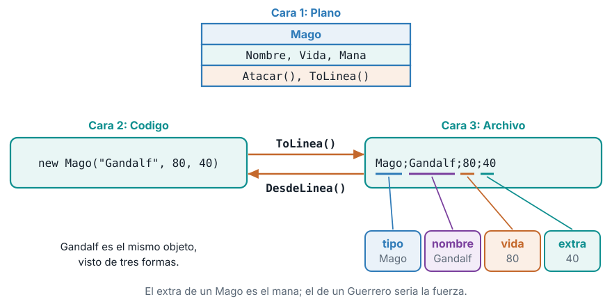
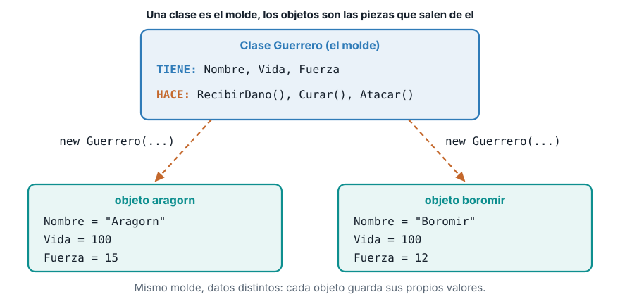
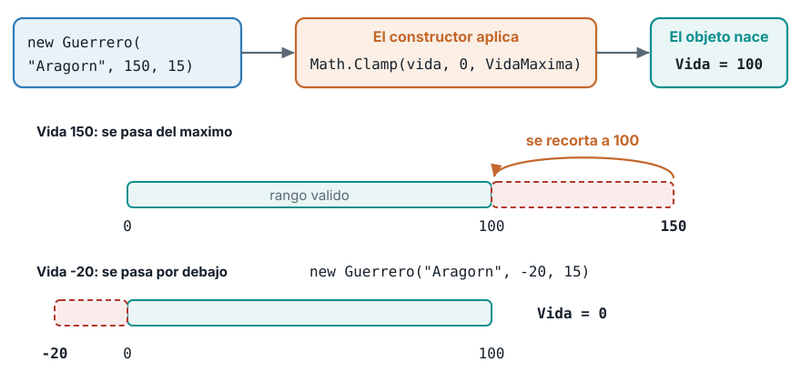
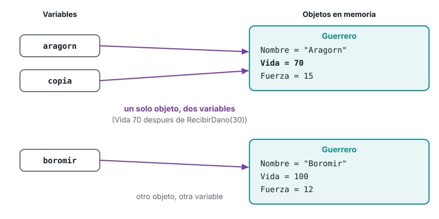
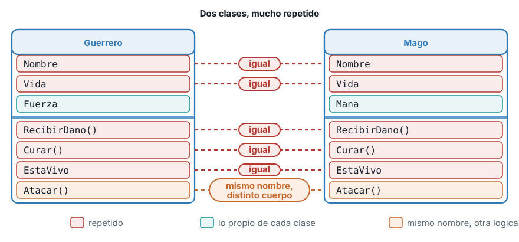
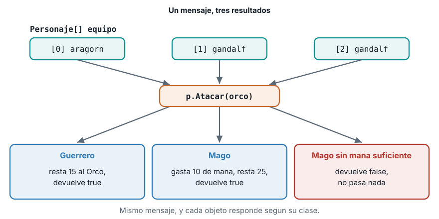
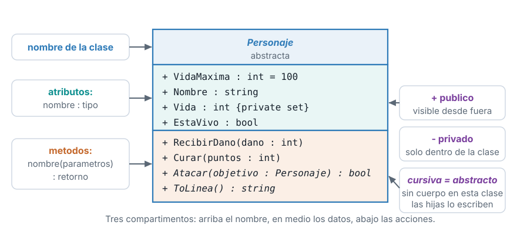
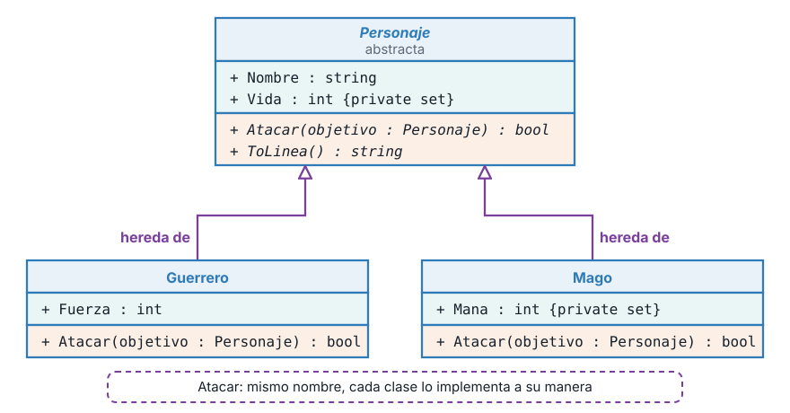
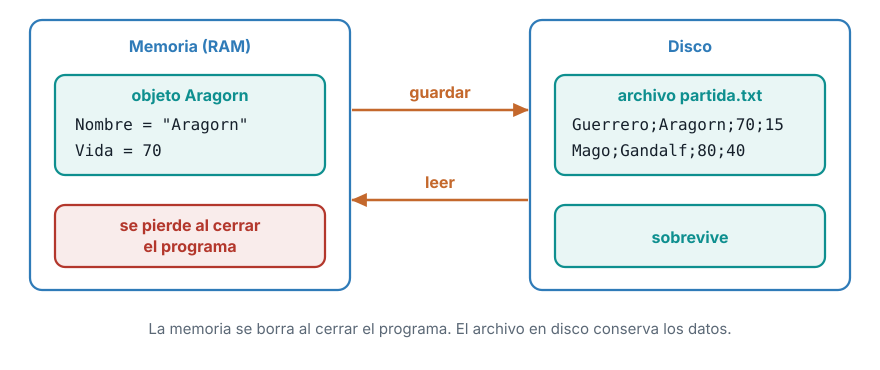
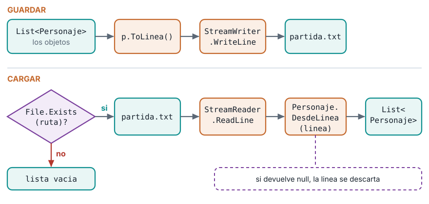

```{=html}
<style>
  /* En esta guía hay fragmentos de código largos dentro de listas y tablas: en teléfono se parten en vez de ensanchar la página */
  p code, li code, td code { white-space: normal; overflow-wrap: anywhere; }
</style>
```

::: {.ficha}
|            |                                                          |
|------------|----------------------------------------------------------|
| Asignatura | Herramientas de Programación I (ET0047)                  |
| Programa   | Tecnología en Desarrollo de Software                     |
| Unidad     | Unidad 3. Diseño y desarrollo de aplicaciones gráficas aplicando la POO |
| Saberes    | Paradigma de la POO: clases y objetos, atributos, métodos y constructores. Instanciación de objetos y acceso a atributos y métodos. Modelado de clases con UML. Manejo de archivos de texto para persistencia |
:::

Esta guía se probó con el SDK de .NET **10.0.302**.

Esta guía recorre, paso a paso, la sesión presencial de programación orientada a objetos (POO). Construyes un videojuego de consola con tres clases, lo dibujas con UML y haces que la partida sobreviva al cierre del programa guardándola en un archivo de texto. Cada bloque de código sale de un programa que se compiló y se ejecutó, y cada salida que ves es la salida real. Puedes copiar todo y seguirla en tu computador.

## La presentación de la sesión

Esta es la presentación que se usa en clase. Avanza con la flecha derecha o con un clic y retrocede con la flecha izquierda. Haz clic dentro del cuadro antes de usar el teclado.

```{=html}
<div id="pres-caja" class="presentacion-incrustada" style="position: relative; width: 100%; aspect-ratio: 16 / 9; overflow: hidden; margin: 1.2rem 0; border: 1px solid #c9d1d9; border-radius: 12px; background: #fbf8f1;">
  <iframe id="pres-marco" src="presentacion-poo-videojuego.html" title="Presentación de la sesión: programación orientada a objetos con un videojuego" loading="lazy" allow="fullscreen" style="position: absolute; top: 0; left: 0; width: 1280px; height: 720px; border: 0; transform-origin: 0 0;"></iframe>
</div>
<script>
(function () {
  var caja = document.getElementById('pres-caja');
  var marco = document.getElementById('pres-marco');
  if (!caja || !marco) return;
  function ajustar() { marco.style.transform = 'scale(' + (caja.clientWidth / 1280) + ')'; }
  if (window.ResizeObserver) new ResizeObserver(ajustar).observe(caja);
  window.addEventListener('resize', ajustar);
  ajustar();
})();
</script>
```

[Abrir la presentación en pantalla completa](presentacion-poo-videojuego.html){.btn .btn-primary role="button" target="_blank"}

## Qué vas a construir

Un videojuego pequeño con **tres clases**. `Personaje` es una clase abstracta que guarda lo que todos los personajes comparten. `Guerrero` y `Mago` heredan de ella y agregan lo suyo. Al final, la partida se guarda en un archivo `partida.txt` y se recupera la próxima vez que ejecutas el programa.

| Clase | Qué guarda | Qué hace |
|---|---|---|
| `Personaje` (abstracta) | `Nombre`, `Vida`, constante `VidaMaxima = 100`, `EstaVivo` | `RecibirDano`, `Curar`, `Atacar` (sin cuerpo), `ToLinea`, `DesdeLinea` |
| `Guerrero` | `Fuerza` | `Atacar`: quita tanta vida como su fuerza |
| `Mago` | `Mana`, constantes `CostoMana = 10` y `DanoMagico = 25` | `Atacar`: gasta 10 de maná y quita 25 de vida |

El juego cumple cinco reglas de negocio. Las vas a ver aparecer una a una a lo largo de la guía:

1. La vida nunca baja de 0 ni pasa de 100, y el constructor corrige los valores inválidos.
2. `RecibirDano` resta vida con piso en 0, y `Curar` suma con techo en 100.
3. Un personaje muerto no ataca ni se cura.
4. El Guerrero ataca siempre y hace un daño igual a su fuerza.
5. El Mago ataca solo si tiene 10 de maná o más. Si no, `Atacar` devuelve `false` y no pasa nada.

Un mismo personaje tiene **tres caras** y la guía las mantiene juntas desde el principio: el plano (un diagrama UML), el código (la clase en C#) y la línea que se guarda en el archivo. Cuando termines, puedes pasar de una cara a otra sin dudar.

::: {.diagrama}
{fig-alt="Las tres caras del mismo objeto Gandalf: plano UML de la clase Mago, codigo C# que crea el objeto y linea de texto del archivo partida.txt, con ToLinea y DesdeLinea como puente entre el codigo y el archivo"}
:::

**Lo que esta guía no cubre.** Interfaces, excepciones con `try` y `catch`, JSON, bases de datos e interfaz gráfica. Aparecen en las semanas siguientes.

## Antes de empezar: el proyecto

Abre una terminal y crea un proyecto de consola nuevo:

```powershell
dotnet new console -n Videojuego
cd Videojuego
```

El proyecto trae un archivo `Program.cs`. Cada clase que escribas va en **su propio archivo**, en la misma carpeta que `Program.cs`, y el nombre del archivo es el nombre de la clase. Al terminar tendrás cinco archivos:

- `Program.cs`: el programa principal, con las instrucciones que se ejecutan.
- `Personaje.cs`: la clase base abstracta.
- `Guerrero.cs`: la clase derivada del guerrero.
- `Mago.cs`: la clase derivada del mago.
- `Partida.cs`: la clase que guarda y carga la partida.

Para ejecutar, escribe en la terminal, dentro de la carpeta `Videojuego`:

```powershell
dotnet run
```

La guía avanza por etapas. En cada etapa te indico qué archivo crear o reemplazar. **Reemplazar** significa borrar el contenido anterior del archivo y pegar el nuevo. Las etapas cambian a `Guerrero.cs` y `Program.cs` varias veces, porque el diseño mejora conforme aprendes.

## 1. Clases y objetos

### 1.1 Qué tiene y qué hace un personaje

Piensa en Aragorn, un guerrero de tu videojuego. Puedes describirlo con dos listas. Lo que **tiene**: un nombre, una cantidad de vida y una fuerza. Lo que **hace**: ataca, recibe daño, se cura.

La POO organiza el programa alrededor de esa idea. En vez de dejar los datos en variables sueltas y las reglas en funciones sueltas, **se agrupan en una sola pieza**: datos y comportamiento viajan juntos.

- La **clase** es el molde. Dice qué datos y qué acciones tendrá todo guerrero. Es un plano: no es ningún guerrero concreto.
- El **objeto** es una pieza concreta fabricada con ese molde. `aragorn` y `boromir` son dos objetos de la misma clase `Guerrero`, cada uno con sus propios valores.
- Los **atributos** son los datos que guarda cada objeto (`Nombre`, `Vida`, `Fuerza`).
- Los **métodos** son las acciones que sabe hacer (`RecibirDano`, `Curar`, `Atacar`).

::: {.diagrama}
{fig-alt="La clase Guerrero como molde con sus atributos y metodos, y dos objetos creados a partir de ella, aragorn y boromir, con valores distintos"}
:::

### 1.2 Tu primera clase

Crea el archivo `Guerrero.cs` con este contenido:

```csharp
class Guerrero
{
    public string Nombre = "";
    public int Vida;
    public int Fuerza;

    public void RecibirDano(int dano)
    {
        Vida -= dano;
    }
}
```

Línea por línea:

- `class Guerrero` declara la clase. Todo lo que está entre las llaves `{ }` pertenece al molde.
- `public string Nombre = "";`, `public int Vida;` y `public int Fuerza;` son los **atributos**. `public` significa que cualquier parte del programa puede leerlos y cambiarlos. El `= ""` le da un valor inicial vacío al texto.
- `public void RecibirDano(int dano)` es un **método**. `void` significa que no devuelve nada. Recibe un número, `dano`, y le resta esa cantidad a `Vida`.

Ahora reemplaza `Program.cs` para crear un guerrero y probarlo:

```csharp
var aragorn = new Guerrero();
aragorn.Nombre = "Aragorn";
aragorn.Vida = 100;
aragorn.Fuerza = 15;

aragorn.RecibirDano(120);
Console.WriteLine($"{aragorn.Nombre}: vida {aragorn.Vida}");
```

`new Guerrero()` crea un objeto a partir de la clase. Después se asignan sus datos uno por uno con el operador punto (`aragorn.Nombre = "Aragorn";`). Al final, Aragorn recibe 120 de daño y se imprime su vida. Ejecuta con `dotnet run`:

```text
Aragorn: vida -20
```

**Una vida de -20 es un error.** La clase funciona, pero nada impide que la vida quede negativa. Cualquiera puede escribir `aragorn.Vida = -5;` y el programa lo acepta. Falta una forma de proteger los datos y de crear el objeto ya con valores válidos. Eso lo resuelven el constructor y la protección de los atributos.

### 1.3 El constructor y los atributos protegidos

Un **constructor** es un método especial que se ejecuta una sola vez, cuando se crea el objeto con `new`. Tiene el mismo nombre que la clase y no declara tipo de retorno. Sirve para darle al objeto valores iniciales válidos desde el primer instante.

Reemplaza `Guerrero.cs` con la versión completa. Primero verás las piezas por separado y después el archivo entero.

**La constante.** Un valor que no cambia nunca:

```csharp
class Guerrero
{
    public const int VidaMaxima = 100;
```

`const int VidaMaxima = 100;` declara una constante. Si algún día el máximo cambia, lo cambias en un solo lugar.

**Las propiedades.** Los atributos pasan de campos públicos a **propiedades** con permisos distintos:

```csharp
    public string Nombre { get; }
    public int Vida { get; private set; }
    public int Fuerza { get; }
    public bool EstaVivo => Vida > 0;
```

- `{ get; }` significa que cualquiera puede **leer** el valor, pero solo el constructor puede asignarlo. `Nombre` y `Fuerza` no deberían cambiar después de crear el personaje.
- `{ get; private set; }` significa que cualquiera puede **leer** `Vida`, pero solo los métodos de la propia clase pueden **cambiarla**. Es el **encapsulamiento**: los datos quedan protegidos y solo se modifican por las reglas que tú escribes.
- `EstaVivo => Vida > 0;` es una propiedad calculada: no guarda nada, responde `true` o `false` cada vez que se consulta.

**El constructor.** Recibe los datos iniciales y los valida:

```csharp
    public Guerrero(string nombre, int vida, int fuerza)
    {
        Nombre = nombre;
        Vida = Math.Clamp(vida, 0, VidaMaxima);
        Fuerza = fuerza;
    }
```

`Math.Clamp(vida, 0, VidaMaxima)` recorta el valor para que quede entre 0 y 100. Si te piden una vida de 150, el objeto nace con 100. Si te piden -20, nace con 0. **Esta es la regla 1**: la vida siempre es válida desde el principio.

::: {.diagrama}
{fig-alt="Flujo del constructor: el valor de vida recibido pasa por Math.Clamp entre 0 y VidaMaxima y el objeto nace con un valor valido"}
:::

Con el constructor, crear un guerrero ya no necesita asignar campo por campo: `new Guerrero("Aragorn", 100, 15)` entrega un objeto listo.

**Protección en acción.** Como `Vida` tiene `private set`, ya no se puede escribir desde fuera. Si en `Program.cs` intentas:

```csharp
var aragorn = new Guerrero("Aragorn", 100, 15);
aragorn.Vida = 500;
Console.WriteLine(aragorn.Vida);
```

el compilador se niega a construir el programa. En un SDK en español el mensaje es:

```text
Program.cs(2,1): error CS0272: La propiedad o el indizador 'Guerrero.Vida' no se pueden usar en este contexto porque el descriptor de acceso set es inaccesible
```

El error aparece **al compilar**, antes de ejecutar. Eso es mejor que un error escondido que se descubre jugando.

### 1.4 Los métodos con reglas

Los métodos son donde viven las reglas de negocio. Mira los tres que cuidan la vida:

```csharp
    public void RecibirDano(int dano)
    {
        Vida = Math.Max(0, Vida - dano);
    }

    public void Curar(int puntos)
    {
        if (!EstaVivo) return;
        Vida = Math.Min(VidaMaxima, Vida + puntos);
    }
```

- **`RecibirDano`** resta la vida con `Math.Max(0, Vida - dano)`. `Math.Max` devuelve el mayor de los dos números, así que la vida nunca baja de 0. Con vida 100 y 30 de daño queda en 70. Con 120 de daño queda en 0, no en -20. **Regla 2, primera parte.**
- **`Curar`** primero revisa `if (!EstaVivo) return;`. El `!` significa "no": si el personaje no está vivo, el método termina sin hacer nada. **Regla 3**: un personaje muerto no se cura. Después suma con `Math.Min(VidaMaxima, Vida + puntos)`, que devuelve el menor de los dos, así que la vida no pasa de 100. **Regla 2, segunda parte.**

Un método que termina con `return;` sin valor sale de inmediato. Es una **cláusula de guarda**: se descartan primero los casos que no aplican, y el resto del método queda sin anidar.

### 1.5 El método `Atacar` (práctica 1)

Falta la acción principal. Antes de mirar la solución, piénsala con las reglas 3 y 4: un guerrero ataca a otro guerrero y le quita tanta vida como su fuerza, pero solo si está vivo. El método debe **devolver** `true` si el ataque ocurrió y `false` si no.

::: {.callout-note title="Práctica 1: escribe Atacar" collapse="true"}
Pistas. La firma empieza con `public bool Atacar(Guerrero objetivo)`. Usa una cláusula de guarda con `EstaVivo`. Para quitar vida, llama al método que ya existe en el objetivo.

**Solución:**

```csharp
    public bool Atacar(Guerrero objetivo)
    {
        if (!EstaVivo) return false;
        objetivo.RecibirDano(Fuerza);
        return true;
    }
```

`objetivo.RecibirDano(Fuerza)` hace que el **otro** guerrero se aplique el daño con sus propias reglas. Por eso la vida del objetivo nunca queda negativa: la regla vive en `RecibirDano` y no se repite aquí.
:::

El archivo `Guerrero.cs` completo de esta etapa queda así:

```csharp
class Guerrero
{
    public const int VidaMaxima = 100;

    public string Nombre { get; }
    public int Vida { get; private set; }
    public int Fuerza { get; }
    public bool EstaVivo => Vida > 0;

    public Guerrero(string nombre, int vida, int fuerza)
    {
        Nombre = nombre;
        Vida = Math.Clamp(vida, 0, VidaMaxima);
        Fuerza = fuerza;
    }

    public void RecibirDano(int dano)
    {
        Vida = Math.Max(0, Vida - dano);
    }

    public void Curar(int puntos)
    {
        if (!EstaVivo) return;
        Vida = Math.Min(VidaMaxima, Vida + puntos);
    }

    public bool Atacar(Guerrero objetivo)
    {
        if (!EstaVivo) return false;
        objetivo.RecibirDano(Fuerza);
        return true;
    }
}
```

## 2. Instanciar objetos y usar sus miembros

### 2.1 Qué hace `new` y qué es una referencia

**Instanciar** es crear un objeto concreto a partir de una clase. En C# se hace con `new`. Reemplaza `Program.cs`:

```csharp
var aragorn = new Guerrero("Aragorn", 100, 15);
var boromir = new Guerrero("Boromir", 100, 12);
var copia = aragorn;

aragorn.RecibirDano(30);

Console.WriteLine($"{aragorn.Nombre}: vida {aragorn.Vida}");
Console.WriteLine($"{boromir.Nombre}: vida {boromir.Vida}");
Console.WriteLine($"{copia.Nombre}: vida {copia.Vida}");
```

Cuando C# ejecuta `new Guerrero("Aragorn", 100, 15)`, pasan tres cosas en orden: reserva espacio en memoria para el objeto, ejecuta el constructor con los datos que le diste y entrega la **referencia**, que es la dirección donde vive el objeto. La variable `aragorn` no contiene al guerrero. Contiene la referencia que apunta a él.

Eso explica la tercera línea del programa. `var copia = aragorn;` **no crea otro guerrero**: copia la referencia. Ahora `aragorn` y `copia` son dos nombres para el mismo objeto. Cuando `aragorn` recibe 30 de daño, `copia` también lo ve. Ejecuta y compara con tu predicción:

```text
Aragorn: vida 70
Boromir: vida 100
Aragorn: vida 70
```

`Boromir` conserva su vida de 100 porque es otro objeto, y `copia` imprime `Aragorn: vida 70` porque apunta al mismo.

::: {.diagrama}
{fig-alt="Diagrama de memoria con tres variables y dos objetos: aragorn y copia apuntan al mismo objeto con vida 70 y boromir apunta a otro objeto con vida 100"}
:::

::: {.callout-warning title="Un error muy común"}
Creer que `var copia = aragorn;` hace una copia independiente. Para tener dos guerreros distintos, cada uno se crea con su propio `new`.
:::

### 2.2 Acceder a atributos y métodos con el operador punto

Una vez que tienes un objeto, el **operador punto** (`.`) te deja usar lo que tiene por dentro:

- `aragorn.Nombre` **lee** un atributo.
- `aragorn.Atacar(boromir)` **llama** un método.

Un método se llama con paréntesis y entre ellos van los datos que necesita. Los atributos se leen sin paréntesis. Reemplaza `Program.cs`:

```csharp
var aragorn = new Guerrero("Aragorn", 100, 15);
var boromir = new Guerrero("Boromir", 100, 12);

bool acierto = aragorn.Atacar(boromir);
Console.WriteLine($"{aragorn.Nombre} ataca a {boromir.Nombre}: {acierto}");
Console.WriteLine($"{boromir.Nombre}: vida {boromir.Vida}");
```

Línea por línea: `aragorn.Atacar(boromir)` hace que Aragorn ataque a Boromir. El método devuelve `true` y esa respuesta se guarda en la variable `acierto`. Después se imprimen dos líneas leyendo atributos con el punto. Salida:

```text
Aragorn ataca a Boromir: True
Boromir: vida 85
```

Aragorn tiene fuerza 15, así que a Boromir le quedan 100 - 15 = 85. El ataque cambió el **estado** de `boromir` y no el de `aragorn`.

## 3. Herencia y polimorfismo

### 3.1 El problema: llega el Mago

Quieres sumar al Mago. Necesita casi lo mismo que el Guerrero: nombre, vida, `RecibirDano`, `Curar`, `EstaVivo`. Solo cambian dos cosas: en lugar de `Fuerza` tiene `Mana`, y su `Atacar` funciona distinto.

Si copias y pegas la clase `Guerrero`, quedan dos clases con cinco miembros idénticos. Cada cambio de una regla obliga a corregir las dos. Con un tercer personaje, serían tres copias.

Hay un segundo problema. `Guerrero.Atacar` recibe un `Guerrero` como objetivo. Un mago no podría atacar a un guerrero y un guerrero no podría atacar a un mago, porque cada clase solo conoce a la suya.

::: {.diagrama}
{fig-alt="Dos cajas de clase, Guerrero y Mago, con los miembros repetidos marcados como iguales, los atributos propios Fuerza y Mana destacados y Atacar con el mismo nombre pero distinto cuerpo"}
:::

La solución es la **herencia**: se escribe lo común una sola vez en una **clase base**, y las **clases derivadas** lo reciben automáticamente y agregan lo suyo.

### 3.2 La clase base abstracta

Crea el archivo `Personaje.cs`:

```csharp
abstract class Personaje
{
    public const int VidaMaxima = 100;

    public string Nombre { get; }
    public int Vida { get; private set; }
    public bool EstaVivo => Vida > 0;

    protected Personaje(string nombre, int vida)
    {
        Nombre = nombre;
        Vida = Math.Clamp(vida, 0, VidaMaxima);
    }

    public void RecibirDano(int dano)
    {
        Vida = Math.Max(0, Vida - dano);
    }

    public void Curar(int puntos)
    {
        if (!EstaVivo) return;
        Vida = Math.Min(VidaMaxima, Vida + puntos);
    }

    public abstract bool Atacar(Personaje objetivo);
}
```

Lo que cambió respecto a `Guerrero`:

- `abstract class Personaje` marca la clase como **abstracta**: no se puede instanciar con `new Personaje(...)`. Es un molde general, pensado solo para que otras clases hereden de él.
- El constructor es `protected`: solo la propia clase y sus derivadas pueden usarlo.
- `Nombre`, `Vida`, `EstaVivo`, `RecibirDano` y `Curar` pasaron aquí **sin cambios**. Es lo que antes estaba repetido.
- La última línea es lo más importante: `public abstract bool Atacar(Personaje objetivo);`. Un método **abstracto** no tiene cuerpo. Dice "todos los personajes atacan y devuelven `bool`", pero deja a cada clase derivada la tarea de decir cómo. El objetivo es un `Personaje`, así que cualquier personaje puede atacar a cualquier otro.

### 3.3 Las clases derivadas

Reemplaza `Guerrero.cs`. Los dos puntos y el nombre de la base (`: Personaje`) expresan "hereda de":

```csharp
class Guerrero : Personaje
{
    public int Fuerza { get; }

    public Guerrero(string nombre, int vida, int fuerza) : base(nombre, vida)
    {
        Fuerza = fuerza;
    }

    public override bool Atacar(Personaje objetivo)
    {
        if (!EstaVivo) return false;
        objetivo.RecibirDano(Fuerza);
        return true;
    }
}
```

- `class Guerrero : Personaje` hace que `Guerrero` reciba todo lo público de `Personaje`. No repites `Nombre` ni `Vida`.
- `: base(nombre, vida)` en el constructor llama al constructor de la base para armar la parte común. El guerrero solo guarda lo suyo: la fuerza.
- `public override bool Atacar(...)` **sobrescribe** el método abstracto con su propio cuerpo. La palabra `override` es obligatoria. El método hace lo mismo que antes: ataca solo si está vivo y quita tanta vida como su fuerza (**regla 4**).

Crea el archivo `Mago.cs`:

```csharp
class Mago : Personaje
{
    public const int CostoMana = 10;
    public const int DanoMagico = 25;

    public int Mana { get; private set; }

    public Mago(string nombre, int vida, int mana) : base(nombre, vida)
    {
        Mana = Math.Max(0, mana);
    }

    public override bool Atacar(Personaje objetivo)
    {
        if (!EstaVivo || Mana < CostoMana) return false;
        Mana -= CostoMana;
        objetivo.RecibirDano(DanoMagico);
        return true;
    }
}
```

El mago hereda lo común igual que el guerrero y agrega lo suyo: su maná y dos constantes. Su `Atacar` es distinto: revisa `Mana < CostoMana`, y si no hay maná suficiente, devuelve `false` y no hace nada. Si hay, gasta 10 de maná y quita 25 de vida (**regla 5**).

Fíjate en que `Atacar` aparece con **el mismo nombre y la misma firma** en las tres clases. Lo que cambia es el cuerpo.

### 3.4 Polimorfismo: un mensaje, muchos resultados

Reemplaza `Program.cs`:

```csharp
var orco = new Guerrero("Orco", 100, 8);
var aragorn = new Guerrero("Aragorn", 100, 15);
var gandalf = new Mago("Gandalf", 80, 15);

Personaje[] equipo = { aragorn, gandalf, gandalf };
foreach (Personaje p in equipo)
{
    Console.WriteLine($"{p.Nombre} ataca: {p.Atacar(orco)}");
}

Console.WriteLine($"{orco.Nombre}: vida {orco.Vida}");
```

La clave está en el arreglo `Personaje[] equipo`. Guarda un guerrero y dos veces el mago, pero su tipo es `Personaje`, y las dos clases derivadas **son** personajes. Dentro del `foreach`, la variable `p` es un `Personaje`, y la llamada `p.Atacar(orco)` ejecuta la versión de **la clase real del objeto**. Eso se llama **polimorfismo**: una misma llamada hace cosas distintas según quién la recibe. Ejecuta:

```text
Aragorn ataca: True
Gandalf ataca: True
Gandalf ataca: False
Orco: vida 60
```

Sigue las líneas una por una. Aragorn ataca y quita 15, así que el orco queda en 85. Gandalf tiene 15 de maná, ataca y gasta 10 (queda con 5), y le quita 25, así que el orco queda en 60. En la tercera vuelta Gandalf intenta atacar otra vez con solo 5 de maná: `Atacar` devuelve `False` y no cambia nada. El orco termina en 60.

::: {.diagrama}
{fig-alt="Un mismo mensaje Atacar enviado a un arreglo de Personaje produce tres resultados distintos segun la clase del objeto y el estado de su mana"}
:::

El código que llama no necesita saber si el personaje es guerrero o mago. Mañana puedes crear un `Arquero` y el `foreach` seguirá funcionando sin tocarlo.

## 4. Modelado de clases con UML

### 4.1 Por qué dibujar antes de programar

**UML** (Unified Modeling Language) es un lenguaje gráfico estándar para dibujar el diseño de un programa. Un **diagrama de clases** muestra qué clases hay, qué guarda cada una, qué sabe hacer y cómo se relacionan. Dibujarlo antes de programar te deja discutir el diseño sin escribir código, y dibujarlo después te sirve de documentación.

### 4.2 La caja de una clase

Una clase se dibuja como una caja con tres compartimentos, de arriba abajo: el **nombre**, los **atributos** y los **métodos**. Esta es la caja de `Personaje`:

::: {.diagrama}
{fig-alt="Caja UML de la clase abstracta Personaje con sus atributos y metodos y las llamadas que explican la notacion"}
:::

La notación que usarás todo el semestre:

| Se escribe | Significa | Ejemplo en `Personaje` |
|---|---|---|
| `+` | público: cualquiera lo puede usar | `+ Nombre : string` |
| `-` | privado: solo la propia clase | `- campo : tipo` |
| `nombre : tipo` | un atributo con su tipo | `+ Vida : int {private set}` |
| `nombre(parámetros) : retorno` | un método con lo que recibe y devuelve | `+ Curar(puntos : int)` |
| `= valor` | valor inicial o constante | `+ VidaMaxima : int = 100` |
| Nombre en cursiva | clase abstracta | *Personaje* |
| Método en cursiva | método abstracto | *Atacar(objetivo : Personaje) : bool* |

En C#, `Vida` se puede **leer** desde fuera pero solo se **cambia** desde dentro. Se dibuja como `+ Vida : int {private set}`: público para leer, con la nota de que el `set` es privado.

### 4.3 Relaciones: la herencia

Las clases rara vez viven solas. La relación que ya conoces es la **herencia** (también llamada generalización). Se dibuja con una línea continua que termina en un **triángulo hueco** apuntando a la clase base, y se lee "es un": un `Guerrero` **es un** `Personaje`.

::: {.diagrama}
{fig-alt="Diagrama de clases con Personaje como clase base abstracta y Guerrero y Mago como clases derivadas, unidas con flechas de herencia"}
:::

Observa tres detalles del dibujo. Las clases derivadas no repiten `Nombre`, `Vida` ni `RecibirDano`: ya vienen de la base. `Atacar` sí aparece en las dos derivadas, porque cada una lo **sobrescribe** con su propio cuerpo. Y la flecha siempre apunta de la clase específica hacia la general.

Con solo tres clases no aparece otra relación habitual, la **asociación**, que se dibuja con una línea simple entre dos clases y significa "una clase usa a otra". Más adelante, cuando un `Equipo` use `Personaje`, la verás.

### 4.4 Del código al plano y del plano al código (práctica 2)

Un buen modelador mueve la información en las dos direcciones. Esta tabla te sirve de guía:

| En el código | En la caja UML |
|---|---|
| `class Mago : Personaje` | Una caja `Mago` con una flecha de herencia hacia `Personaje` |
| `public const int CostoMana = 10;` | `+ CostoMana : int = 10` en atributos |
| `public int Mana { get; private set; }` | `+ Mana : int {private set}` en atributos |
| `public override bool Atacar(Personaje objetivo)` | `+ Atacar(objetivo : Personaje) : bool` en métodos |

::: {.callout-note title="Práctica 2: del código al plano" collapse="true"}
Dibuja en tu cuaderno la caja UML de la clase `Mago` a partir de este archivo, sin mirar el diagrama de arriba:

```csharp
class Mago : Personaje
{
    public const int CostoMana = 10;
    public const int DanoMagico = 25;

    public int Mana { get; private set; }

    public Mago(string nombre, int vida, int mana) : base(nombre, vida)
    {
        Mana = Math.Max(0, mana);
    }

    public override bool Atacar(Personaje objetivo)
    {
        if (!EstaVivo || Mana < CostoMana) return false;
        Mana -= CostoMana;
        objetivo.RecibirDano(DanoMagico);
        return true;
    }
}
```

**Solución.** Nombre: `Mago`, con una flecha de herencia hacia `Personaje`. Atributos: `+ CostoMana : int = 10`, `+ DanoMagico : int = 25` y `+ Mana : int {private set}`. Métodos: `+ Atacar(objetivo : Personaje) : bool`. No dibujes `Nombre`, `Vida` ni `RecibirDano`: pertenecen a `Personaje`.
:::

## 5. Persistencia en archivos de texto

### 5.1 El problema: la memoria se olvida

Ejecuta el programa, deja a Aragorn herido, ciérralo y vuelve a abrirlo: Aragorn tiene otra vez 100 de vida. Todo lo que está en variables y objetos vive en la **memoria (RAM)**, y la memoria se borra cuando el programa termina.

La **persistencia** es guardar los datos fuera de la memoria, en el disco, para que sobrevivan. La forma más simple es un **archivo de texto**: un archivo que puedes abrir con el Bloc de notas y leer con tus ojos.

::: {.diagrama}
{fig-alt="Comparacion entre la memoria RAM, que se pierde al cerrar el programa, y el disco, donde el archivo partida.txt sobrevive; flechas de guardar y leer entre ambos"}
:::

### 5.2 Decidir el formato del archivo

Un archivo de texto no sabe nada de objetos: solo guarda líneas. Tienes que **decidir cómo convertir un objeto en una línea** y cómo convertir una línea de nuevo en un objeto. El formato que usaremos tiene cuatro campos separados por punto y coma:

```text
Tipo;Nombre;Vida;Extra
```

`Extra` es la fuerza si es un guerrero y el maná si es un mago. Un ejemplo con dos personajes:

```text
Guerrero;Aragorn;70;15
Mago;Gandalf;80;40
```

El primer campo, el **tipo**, es indispensable: sin él, al leer no sabrías si crear un `Guerrero` o un `Mago`.

### 5.3 De objeto a línea: `ToLinea`

Cada clase sabe cómo convertirse en texto. En la base se declara el método abstracto y en cada derivada se escribe:

```csharp
    public abstract string ToLinea();
```

```csharp
    public override string ToLinea() => $"Guerrero;{Nombre};{Vida};{Fuerza}";
```

```csharp
    public override string ToLinea() => $"Mago;{Nombre};{Vida};{Mana}";
```

El `=>` es una forma corta de escribir un método que devuelve un valor: significa "devuelve esto". El texto entre comillas con `$` y llaves `{ }` es una **cadena interpolada**: C# reemplaza cada `{Nombre}` por su valor. Agrega esa línea al final de las clases `Guerrero` y `Mago` (antes de la llave de cierre de la clase) y la declaración abstracta en `Personaje`.

### 5.4 De línea a objeto: `DesdeLinea`

La operación inversa es más delicada, porque la línea puede estar mal escrita. Va como método **estático** de `Personaje` (un método que se llama con el nombre de la clase, sin necesidad de un objeto):

```csharp
    public static Personaje? DesdeLinea(string linea)
    {
        string[] partes = linea.Split(';');
        if (partes.Length != 4) return null;
        if (!int.TryParse(partes[2], out int vida)) return null;
        if (!int.TryParse(partes[3], out int extra)) return null;

        return partes[0] switch
        {
            "Guerrero" => new Guerrero(partes[1], vida, extra),
            "Mago" => new Mago(partes[1], vida, extra),
            _ => null
        };
    }
```

Paso a paso:

1. `linea.Split(';')` parte el texto en pedazos por cada punto y coma y entrega un arreglo de cuatro `string`.
2. Si no hay exactamente cuatro pedazos, la línea es inválida: `return null;`. **`null` significa "no hay objeto"**. Por eso el retorno se declara `Personaje?`, con el signo de interrogación.
3. `int.TryParse(partes[2], out int vida)` intenta convertir el texto en número. Devuelve `true` si pudo y deja el número en `vida`; devuelve `false` si el texto no es un número. Si falla, también `return null;`.
4. El `switch` mira el primer pedazo, el tipo, y crea la clase correcta con `new`. Si el tipo no se conoce, `_ => null`.

### 5.5 Guardar la partida: escribir un archivo

Crea el archivo `Partida.cs`. Primero, el método que guarda:

```csharp
    public static void Guardar(List<Personaje> personajes, string ruta)
    {
        using var escritor = new StreamWriter(ruta);
        foreach (Personaje p in personajes)
        {
            escritor.WriteLine(p.ToLinea());
        }
    }
```

- `new StreamWriter(ruta)` abre el archivo para **escribir** (lo crea si no existe y lo reemplaza si existe). Un **flujo** (*stream*) es el canal por el que viaja el texto entre el programa y el archivo.
- `using var` garantiza que el archivo se **cierre solo** al terminar el método, aunque algo salga mal. Si no cierras un archivo, puede quedar bloqueado o sin guardar el final.
- El `foreach` recorre la lista y escribe cada personaje con `WriteLine(p.ToLinea())`: una línea por personaje.

### 5.6 Cargar la partida: leer un archivo

Ahora, el método que lee:

```csharp
    public static List<Personaje> Cargar(string ruta)
    {
        var personajes = new List<Personaje>();
        if (!File.Exists(ruta)) return personajes;

        using var lector = new StreamReader(ruta);
        string? linea;
        while ((linea = lector.ReadLine()) != null)
        {
            Personaje? p = Personaje.DesdeLinea(linea);
            if (p != null) personajes.Add(p);
        }
        return personajes;
    }
```

- `if (!File.Exists(ruta)) return personajes;` revisa antes si el archivo existe. La primera vez que juegas no hay partida guardada, y eso no es un error: se devuelve una lista vacía.
- `new StreamReader(ruta)` abre el archivo para **leer**, también con `using var`.
- `while ((linea = lector.ReadLine()) != null)` lee una línea, la guarda en `linea` y repite mientras queden líneas. `ReadLine()` devuelve `null` cuando se acabaron.
- Cada línea pasa por `Personaje.DesdeLinea`. Si devuelve `null` (línea dañada), se **descarta** y la carga continúa con las demás.

::: {.diagrama}
{fig-alt="Dos flujos: guardar convierte cada personaje en una linea con ToLinea y la escribe con StreamWriter; cargar comprueba que el archivo exista, lee con StreamReader y reconstruye con DesdeLinea descartando lineas invalidas"}
:::

El archivo `Partida.cs` completo:

```csharp
static class Partida
{
    public static void Guardar(List<Personaje> personajes, string ruta)
    {
        using var escritor = new StreamWriter(ruta);
        foreach (Personaje p in personajes)
        {
            escritor.WriteLine(p.ToLinea());
        }
    }

    public static List<Personaje> Cargar(string ruta)
    {
        var personajes = new List<Personaje>();
        if (!File.Exists(ruta)) return personajes;

        using var lector = new StreamReader(ruta);
        string? linea;
        while ((linea = lector.ReadLine()) != null)
        {
            Personaje? p = Personaje.DesdeLinea(linea);
            if (p != null) personajes.Add(p);
        }
        return personajes;
    }
}
```

### 5.7 El programa completo: dos ejecuciones, una partida

Reemplaza `Program.cs`. El programa carga la partida, si existe; si no, crea una nueva. Después hiere a Aragorn, guarda y muestra la vida:

```csharp
const string Ruta = "partida.txt";

List<Personaje> equipo = Partida.Cargar(Ruta);
if (equipo.Count == 0)
{
    equipo.Add(new Guerrero("Aragorn", 100, 15));
    equipo.Add(new Mago("Gandalf", 80, 40));
    Console.WriteLine("Partida nueva");
}
else
{
    Console.WriteLine("Partida cargada");
}

equipo[0].RecibirDano(30);
Partida.Guardar(equipo, Ruta);

foreach (Personaje p in equipo)
{
    Console.WriteLine($"{p.Nombre}: vida {p.Vida}");
}
```

Ejecuta `dotnet run` **por primera vez**. No hay archivo, así que la partida es nueva:

```text
Partida nueva
Aragorn: vida 70
Gandalf: vida 80
```

Mira la carpeta del proyecto: apareció `partida.txt`. Ábrelo con el Bloc de notas: tiene `Guerrero;Aragorn;70;15` y `Mago;Gandalf;80;40`. Ahora ejecuta `dotnet run` **por segunda vez**:

```text
Partida cargada
Aragorn: vida 40
Gandalf: vida 80
```

El programa dice `Partida cargada`. Aragorn empezó con 70 (leído del archivo), recibió otros 30 y quedó en 40. **El juego recuerda.** Para empezar de cero, borra `partida.txt`.

::: {.diagrama}
{fig-alt="Linea de tiempo con dos ejecuciones: la primera crea la partida y guarda vida 70; la segunda carga el archivo, aplica otro dano y guarda vida 40"}
:::

### 5.8 Cuando el archivo falla

Un archivo es un dato que viene de fuera del programa, y los datos de fuera pueden estar mal. La guía ya maneja dos casos:

- **El archivo no existe.** `File.Exists` lo detecta y `Cargar` devuelve una lista vacía.
- **Una línea está dañada.** `DesdeLinea` devuelve `null` y esa línea se ignora.

Compruébalo. Crea un archivo `danada.txt` en la carpeta del proyecto con estas dos líneas. En la segunda, el `ochenta` no es un número:

```text
Guerrero;Aragorn;70;15
Mago;Gandalf;ochenta;40
```

Reemplaza `Program.cs` para cargar ese archivo:

```csharp
List<Personaje> cargados = Partida.Cargar("danada.txt");
Console.WriteLine($"Personajes cargados: {cargados.Count}");
foreach (Personaje p in cargados)
{
    Console.WriteLine($"{p.Nombre}: vida {p.Vida}");
}
```

Ejecuta:

```text
Personajes cargados: 1
Aragorn: vida 70
```

Cargó **solo un personaje**: Aragorn. La línea de Gandalf se descartó porque `int.TryParse` no pudo convertir `ochenta`, y el programa siguió sin caerse.

### 5.9 Las tres caras del mismo objeto

Vuelve al diagrama del principio. Gandalf existe como plano (la caja UML de `Mago`), como código (`new Mago("Gandalf", 80, 40)`) y como línea (`Mago;Gandalf;80;40`). `ToLinea` lleva del código a la línea y `DesdeLinea` regresa. Si el formato del archivo que escribe `ToLinea` no coincide con el que lee `DesdeLinea`, la carga descarta todo. Los dos métodos deben cambiar juntos.

## 6. Reto: agrega un Arquero

La herencia y el archivo ya hacen lo difícil. Para comprobar que entendiste el diseño, agrega una clase nueva **sin tocar el `foreach` del polimorfismo**.

::: {.callout-note title="Reto: la clase Arquero" collapse="true"}
Reglas. El `Arquero` hereda de `Personaje` y tiene `Flechas`. Su `Atacar` quita 12 de vida y gasta una flecha. Si no quedan flechas o está muerto, devuelve `false`. Debe guardarse y cargarse con el formato `Arquero;Nombre;Vida;Flechas`.

Pistas. Copia la estructura de `Mago`. Necesitas una línea nueva en el `switch` de `DesdeLinea`.

**Solución.** Crea `Arquero.cs`:

```csharp
class Arquero : Personaje
{
    public const int DanoFlecha = 12;

    public int Flechas { get; private set; }

    public Arquero(string nombre, int vida, int flechas) : base(nombre, vida)
    {
        Flechas = Math.Max(0, flechas);
    }

    public override bool Atacar(Personaje objetivo)
    {
        if (!EstaVivo || Flechas == 0) return false;
        Flechas--;
        objetivo.RecibirDano(DanoFlecha);
        return true;
    }

    public override string ToLinea() => $"Arquero;{Nombre};{Vida};{Flechas}";
}
```

Agrega una línea al `switch` de `Personaje.DesdeLinea`:

```csharp
        return partes[0] switch
        {
            "Guerrero" => new Guerrero(partes[1], vida, extra),
            "Mago" => new Mago(partes[1], vida, extra),
            "Arquero" => new Arquero(partes[1], vida, extra),
            _ => null
        };
```

Y prueba con este `Program.cs`:

```csharp
var legolas = new Arquero("Legolas", 90, 1);
var orco = new Guerrero("Orco", 100, 8);

Console.WriteLine(legolas.Atacar(orco));
Console.WriteLine(legolas.Atacar(orco));
Console.WriteLine($"Orco: vida {orco.Vida}");

var equipo = new List<Personaje> { legolas, orco };
Partida.Guardar(equipo, "partida.txt");
foreach (Personaje p in Partida.Cargar("partida.txt"))
{
    Console.WriteLine(p.ToLinea());
}
```

Salida:

```text
True
False
Orco: vida 88
Arquero;Legolas;90;0
Guerrero;Orco;88;8
```

Legolas tiene una sola flecha: el primer ataque funciona (`True`), el segundo no (`False`). El orco queda en 88 (100 menos 12), y el archivo guarda a Legolas con 0 flechas.
:::

## Código completo del proyecto

Esta es la versión final de los cinco archivos, la que produce las dos ejecuciones de la sección 5.7. Copia cada archivo en su pestaña a la carpeta del proyecto.

::: {.panel-tabset}
### Personaje.cs

```csharp
abstract class Personaje
{
    public const int VidaMaxima = 100;

    public string Nombre { get; }
    public int Vida { get; private set; }
    public bool EstaVivo => Vida > 0;

    protected Personaje(string nombre, int vida)
    {
        Nombre = nombre;
        Vida = Math.Clamp(vida, 0, VidaMaxima);
    }

    public void RecibirDano(int dano)
    {
        Vida = Math.Max(0, Vida - dano);
    }

    public void Curar(int puntos)
    {
        if (!EstaVivo) return;
        Vida = Math.Min(VidaMaxima, Vida + puntos);
    }

    public abstract bool Atacar(Personaje objetivo);

    public abstract string ToLinea();

    public static Personaje? DesdeLinea(string linea)
    {
        string[] partes = linea.Split(';');
        if (partes.Length != 4) return null;
        if (!int.TryParse(partes[2], out int vida)) return null;
        if (!int.TryParse(partes[3], out int extra)) return null;

        return partes[0] switch
        {
            "Guerrero" => new Guerrero(partes[1], vida, extra),
            "Mago" => new Mago(partes[1], vida, extra),
            _ => null
        };
    }
}
```

### Guerrero.cs

```csharp
class Guerrero : Personaje
{
    public int Fuerza { get; }

    public Guerrero(string nombre, int vida, int fuerza) : base(nombre, vida)
    {
        Fuerza = fuerza;
    }

    public override bool Atacar(Personaje objetivo)
    {
        if (!EstaVivo) return false;
        objetivo.RecibirDano(Fuerza);
        return true;
    }

    public override string ToLinea() => $"Guerrero;{Nombre};{Vida};{Fuerza}";
}
```

### Mago.cs

```csharp
class Mago : Personaje
{
    public const int CostoMana = 10;
    public const int DanoMagico = 25;

    public int Mana { get; private set; }

    public Mago(string nombre, int vida, int mana) : base(nombre, vida)
    {
        Mana = Math.Max(0, mana);
    }

    public override bool Atacar(Personaje objetivo)
    {
        if (!EstaVivo || Mana < CostoMana) return false;
        Mana -= CostoMana;
        objetivo.RecibirDano(DanoMagico);
        return true;
    }

    public override string ToLinea() => $"Mago;{Nombre};{Vida};{Mana}";
}
```

### Partida.cs

```csharp
static class Partida
{
    public static void Guardar(List<Personaje> personajes, string ruta)
    {
        using var escritor = new StreamWriter(ruta);
        foreach (Personaje p in personajes)
        {
            escritor.WriteLine(p.ToLinea());
        }
    }

    public static List<Personaje> Cargar(string ruta)
    {
        var personajes = new List<Personaje>();
        if (!File.Exists(ruta)) return personajes;

        using var lector = new StreamReader(ruta);
        string? linea;
        while ((linea = lector.ReadLine()) != null)
        {
            Personaje? p = Personaje.DesdeLinea(linea);
            if (p != null) personajes.Add(p);
        }
        return personajes;
    }
}
```

### Program.cs

```csharp
const string Ruta = "partida.txt";

List<Personaje> equipo = Partida.Cargar(Ruta);
if (equipo.Count == 0)
{
    equipo.Add(new Guerrero("Aragorn", 100, 15));
    equipo.Add(new Mago("Gandalf", 80, 40));
    Console.WriteLine("Partida nueva");
}
else
{
    Console.WriteLine("Partida cargada");
}

equipo[0].RecibirDano(30);
Partida.Guardar(equipo, Ruta);

foreach (Personaje p in equipo)
{
    Console.WriteLine($"{p.Nombre}: vida {p.Vida}");
}
```
:::

## Errores frecuentes

| Error | Qué pasa | Cómo se corrige |
|---|---|---|
| Confundir clase con objeto | Intentar usar `Guerrero.Vida` sin crear un guerrero | Primero `new Guerrero(...)`, después se usa el objeto |
| Olvidar `new` | El compilador marca que la variable no tiene valor | `var aragorn = new Guerrero(...)` |
| Creer que `copia = aragorn` crea otro objeto | Los dos nombres cambian juntos | Crear cada objeto con su propio `new` |
| Escribir `Atacar` sin `override` en la derivada | Error de compilación | Agregar `override` |
| Intentar `new Personaje(...)` | Error: la clase es abstracta | Crear un `Guerrero` o un `Mago` |
| No cerrar el archivo | El archivo queda bloqueado o sin el final | Usar `using var` |
| Formato distinto entre `ToLinea` y `DesdeLinea` | La carga descarta las líneas | Cambiar los dos métodos juntos |
| Olvidar el tipo en la línea del archivo | No se sabe qué clase crear | Todo registro empieza por `Tipo;` |

## Lista de verificación

::: {.checklist}
- [ ] Explicas la diferencia entre clase y objeto con un ejemplo del videojuego.
- [ ] Declaras una clase con atributos, métodos y un constructor que valida.
- [ ] Instancias objetos con `new` y usas el operador punto para leer atributos y llamar métodos.
- [ ] Explicas por qué `var copia = aragorn;` no crea otro objeto.
- [ ] Escribes una clase base abstracta y dos clases derivadas con `override`.
- [ ] Dibujas la caja UML de una clase y una relación de herencia.
- [ ] Guardas objetos en un archivo de texto con `StreamWriter` y los recuperas con `StreamReader`.
- [ ] Manejas un archivo inexistente y una línea dañada sin que el programa falle.
:::

## Recursos

- Clases y objetos en C#: [Microsoft Learn, objetos](https://learn.microsoft.com/es-es/dotnet/csharp/fundamentals/object-oriented/objects)
- Herencia: [Microsoft Learn, tutorial de herencia](https://learn.microsoft.com/es-es/dotnet/csharp/fundamentals/tutorials/inheritance)
- Clases y métodos abstractos: [Microsoft Learn, palabra clave abstract](https://learn.microsoft.com/es-es/dotnet/csharp/language-reference/keywords/abstract)
- Lectura y escritura de archivos de texto: [Microsoft Learn, escribir texto en un archivo](https://learn.microsoft.com/es-es/dotnet/standard/io/how-to-write-text-to-a-file)

::: {.pie-doc}
Herramientas de Programación I (ET0047). Institución Universitaria Pascual Bravo.
Facultad de Ingeniería. Semestre 2026-02.

**Transparencia.** La redacción de esta guía contó con el apoyo de inteligencia artificial, usando el modelo Claude Sonnet 5 de Anthropic. Todo el contenido fue revisado y validado. Las salidas de terminal son reales, obtenidas ejecutando el código exacto de esta guía contra el SDK de .NET 10.0.302.
:::
